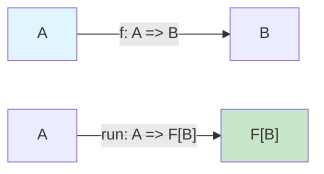
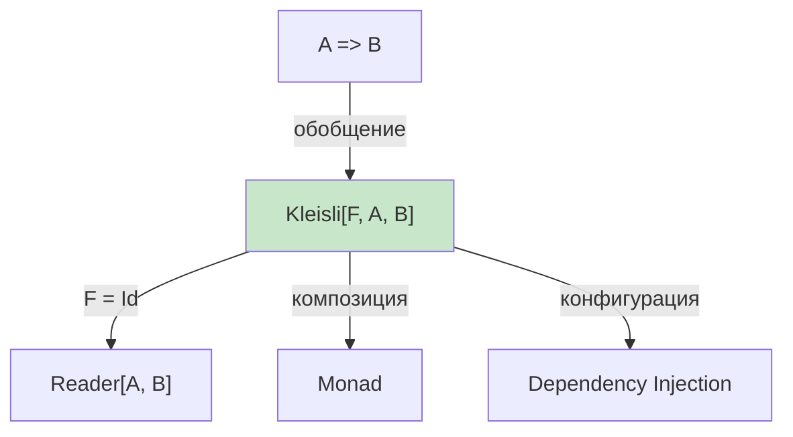



# Kleisli: Композиция функций с монадическим контекстом

## Проблема композиции

Одним из самых полезных свойств функций является их **композиция**. 
Имея функцию `A => B` и функцию `B => C`, мы можем объединить их в новую функцию `A => C`. 
Именно через это свойство композиции мы можем писать множество маленьких функций и объединять их в более крупные, решающие наши задачи.

```dotty
val twice: Int => Int        = x => x * 2
val countCats: Int => String = x => if x == 1 then "1 cat" else s"$x cats"

val twiceAsManyCats: Int => String = twice andThen countCats
// Или: countCats compose twice

twiceAsManyCats(1) // "2 cats"
```

Однако что, если наши функции возвращают **монадические значения**? Например:

```dotty
val parse: String => Option[Int] =
  s => if s.matches("-?[0-9]+") then Some(s.toInt) else None

val reciprocal: Int => Option[Double] =
  i => if i != 0 then Some(1.0 / i) else None
```

Мы не можем использовать обычную композицию, потому что тип выхода `parse` — `Option[Int]`, а тип входа `reciprocal` — `Int`.

## Концепция Kleisli

`Kleisli[F[_], A, B]` — это просто обёртка вокруг функции `A => F[B]`. 
В зависимости от свойств `F[_]`, с `Kleisli` можно делать разные вещи. 
Например, если у `F[_]` есть экземпляр `FlatMap` (можно вызывать `flatMap` на значениях `F[A]`), 
мы можем компоновать два `Kleisli` так же, как и обычные функции.

### Определение

```dotty
import cats.FlatMap
import cats.syntax.all.*

final case class Kleisli[F[_], A, B](run: A => F[B]):
  // Композиция: Z => F[B] через Z => F[A] и A => F[B]
  def compose[Z](k: Kleisli[F, Z, A])(using
      F: FlatMap[F]
  ): Kleisli[F, Z, B] =
    Kleisli[F, Z, B](z => k.run(z).flatMap(run))

  // andThen — композиция в обратном направлении
  def andThen[Z](k: Kleisli[F, B, Z])(using
      F: FlatMap[F]
  ): Kleisli[F, A, Z] =
    Kleisli(a => run(a).flatMap(k.run))
```

### Возвращаясь к примеру

```dotty
import cats.syntax.all.*

val parse: Kleisli[Option, String, Int] =
  Kleisli((s: String) => if s.matches("-?[0-9]+") then Some(s.toInt) else None)

val reciprocal: Kleisli[Option, Int, Double] =
  Kleisli((i: Int) => if i != 0 then Some(1.0 / i) else None)

val parseAndReciprocal: Kleisli[Option, String, Double] =
  reciprocal.compose(parse)
// или parse.andThen(reciprocal)

parseAndReciprocal.run("10")  // Some(0.1)
parseAndReciprocal.run("0")   // None (деление на ноль)
parseAndReciprocal.run("abc") // None (не число)
```

## Сравнение: Обычная функция vs Kleisli

| Характеристика | `A => B`            | `Kleisli[F, A, B]`             |
|----------------|---------------------|--------------------------------|
| Представляет   | Функцию без эффекта | Функцию с эффектом `F`         |
| Композиция     | `andThen`/`compose` | Требует `FlatMap[F]`           |
| Применение     | `f(a)`              | `k.run(a)`                     |
| Пример         | `Int => String`     | `Kleisli[Option, Int, String]` |



## Методы Kleisli

### map — преобразование результата

Требует только `Functor[F]`:

```dotty
import cats.Functor

final case class Kleisli[F[_], A, B](run: A => F[B]):
  def map[C](f: B => C)(using F: Functor[F]): Kleisli[F, A, C] =
    Kleisli(a => F.map(run(a))(f))

val parse: Kleisli[Option, String, Int]            = ???
val parseToString: Kleisli[Option, String, String] =
  parse.map(_.toString) // преобразует Option[Int] в Option[String]
```

### flatMap — последовательная композиция

Требует `FlatMap[F]`:

```dotty
import cats.FlatMap

final case class Kleisli[F[_], A, B](run: A => F[B]):
  def flatMap[C](f: B => Kleisli[F, A, C])(using
      F: FlatMap[F]
  ): Kleisli[F, A, C] =
    Kleisli(a => F.flatMap(run(a))(b => f(b).run(a)))
```

### Таблица методов

| Метод      | Требование к `F[_]` | Описание                        |
|------------|---------------------|---------------------------------|
| `map`      | `Functor`           | Преобразование результата       |
| `flatMap`  | `FlatMap`           | Последовательная композиция     |
| `compose`  | `FlatMap`           | Композиция в обратном порядке   |
| `andThen`  | `FlatMap`           | Композиция в прямом порядке     |
| `lift`     | `Applicative`       | Поднятие в другой контекст      |
| `traverse` | `Applicative`       | Прохождение по структуре данных |
| `lower`    | `Monad`             | Извлечение функции              |

## Инстансы типов

`Kleisli` имеет множество инстансов классов типов в зависимости от инстансов `F[_]`:

| Класс типов   | Требование к `F[_]`                |
|---------------|------------------------------------|
| `Functor`     | `Functor`                          |
| `Apply`       | `Apply`                            |
| `Applicative` | `Applicative`                      |
| `FlatMap`     | `FlatMap`                          |
| `Monad`       | `Monad`                            |
| `Arrow`       | `Monad`                            |
| `Strong`      | `Functor`                          |
| `SemigroupK`  | `FlatMap` (для `Kleisli[F, A, A]`) |
| `MonoidK`     | `Monad` (для `Kleisli[F, A, A]`)   |

### Пример: Monad для Kleisli

```dotty
import cats.Monad
import cats.data.Kleisli
import cats.syntax.all.*

given kleisliMonad[F[_]: Monad as F, Z]: Monad[[A] =>> Kleisli[F, Z, A]] =
  new Monad[[A] =>> Kleisli[F, Z, A]]:
    def pure[A](a: A): Kleisli[F, Z, A] =
      Kleisli(_ => F.pure(a))

    def flatMap[A, B](fa: Kleisli[F, Z, A])(f: A => Kleisli[F, Z, B])
        : Kleisli[F, Z, B] =
      Kleisli(z => F.flatMap(fa.run(z))(a => f(a).run(z)))

    def tailRecM[A, B](a: A)(f: A => Kleisli[F, Z, Either[A, B]])
        : Kleisli[F, Z, B] =
      Kleisli(z => F.tailRecM(a)(f(_).run(z)))
```

### Инстанс Monoid для Kleisli

Если `F[B]` имеет `Monoid`, то `Kleisli[F, A, B]` также имеет `Monoid`:

```dotty
import cats.Monoid

given kleisliMonoid[F[_], A, B](using
    M: Monoid[F[B]]
): Monoid[Kleisli[F, A, B]] =
  new Monoid[Kleisli[F, A, B]]:
    def empty: Kleisli[F, A, B] =
      Kleisli(_ => M.empty)

    def combine(x: Kleisli[F, A, B], y: Kleisli[F, A, B]): Kleisli[F, A, B] =
      Kleisli(a => M.combine(x.run(a), y.run(a)))
```

## Практические применения

Представьте, что у нас есть несколько модулей, каждый со своей конфигурацией:

```dotty
import cats.Monad
import cats.data.Kleisli
import cats.effect.IOApp
import cats.syntax.all.*

case class DbConfig(url: String, user: String, pass: String)
trait Db
object Db:
  val fromDbConfig: Kleisli[Option, DbConfig, Db] = ???

case class ServiceConfig(addr: String, port: Int)
trait Service
object Service:
  val fromServiceConfig: Kleisli[Option, ServiceConfig, Service] = ???
  
case class AppConfig(dbConfig: DbConfig, serviceConfig: ServiceConfig)

class App(db: Db, service: Service)  
```

Используя метод `local`, мы можем "расширить" входной тип:

```dotty
final case class Kleisli[F[_], A, B](run: A => F[B]):
  def local[AA](f: AA => A): Kleisli[F, AA, B] = Kleisli(f.andThen(run))

def appFromAppConfig: Kleisli[Option, AppConfig, App] =
  for
    db <- Db.fromDbConfig.local[AppConfig](_.dbConfig)
    sv <- Service.fromServiceConfig.local[AppConfig](_.serviceConfig)
  yield new App(db, sv)
```

## Связь с другими абстракциями



## Итоговое резюме

`Kleisli` — это мощная абстракция для работы с функциями, возвращающими монадические значения. Ключевые аспекты:

1. **Композиция монадических функций** — позволяет компоновать функции с эффектами
2. **Обёртка над `A => F[B]`** — добавляет монадический интерфейс
3. **Гибкость** — поддерживает различные классы типов в зависимости от `F[_]`
4. **Reader монада** — является основой для Dependency Injection
5. **Трансформер монад** — комбинирует эффекты функций с другими эффектами

---

**Ссылки:**

- [Ссылка на репозиторий с упражнениями][sample]
- [Cats](https://typelevel.org/cats/datatypes/kleisli.html)

[sample]: https://gitverse.ru/scalabook/typeclasses
