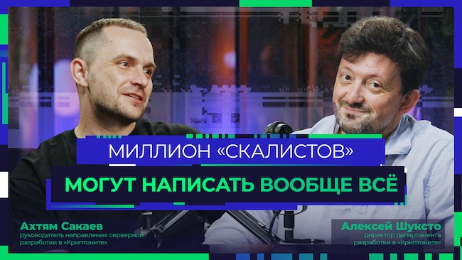

# Подкасты

Для тех, кто предпочитает аудиоформат, собран список подкастов, посвящённых программированию.
Эти подкасты позволяют узнавать новое: интервью с ведущими специалистами отрасли,
обсуждения актуальных тем и обзоры новых инструментов и технологий.

## Подкаст "Криптонит говорит"

[Подкаст «Криптонит говорит» про Scala. Почему так мало «скалистов» и заменит ли этот язык Java?](https://t.me/kryptonite_channel/1328)

## Остальные подкасты

Список подкастов организован в **алфавитном порядке**.

| Название                                                                                                       |      🌐 Язык      | 📅 Период               | 🔊 Выпуски | 🔍 Подробнее                                                                                                                                                                                                                                                                                                                                                                                                                                                                                                                                                                                                 |
|----------------------------------------------------------------------------------------------------------------|:-----------------:|-------------------------|-----------:|--------------------------------------------------------------------------------------------------------------------------------------------------------------------------------------------------------------------------------------------------------------------------------------------------------------------------------------------------------------------------------------------------------------------------------------------------------------------------------------------------------------------------------------------------------------------------------------------------------------|
| [**Философия программирования**](https://podcasts.apple.com/ru/podcast/философия-программирования/id787957888) |      🇷🇺 RU      | 2013-12-22 → 2014-02-11 |          8 | @:note(🔍 Подробнее) Подкаст **«Философия программирования»** — это глубокая и вдумчивая беседа о том, как код, технологии и мышление разработчика пересекаются с философскими концепциями. Ведущие и гости обсуждают не только технические аспекты, но и этические, социальные и даже метафизические вопросы, стоящие за программированием. Эпизоды заставляют задуматься о природе цифрового мира, роли разработчика в нём и том, как технологии меняют человечество. Отличный выбор для тех, кто хочет выйти за рамки синтаксиса и алгоритмов. @:@                                                        |
| [**Corecursive**](https://corecursive.com)                                                                     |      🇬🇧 EN      | 2018-01-01 → 🟢 н.в.    |       110+ | @:note(🔍 Подробнее) Подкаст **«Corecursive»** — это увлекательное погружение в мир разработки через истории и опыт выдающихся программистов, инженеров и исследователей. Ведущий Adam Gordon Bell обсуждает с гостями не только технические детали их работы, но и вдохновляющие моменты, трудности и неожиданные открытия на их профессиональном пути. Эпизоды охватывают широкий спектр тем — от функционального программирования и open-source до карьерного роста и философии инженерии. Идеальный подкаст для тех, кто хочет заглянуть за кулисы IT и узнать, как создаются интересные технологии. @:@ |
| [**CTOcast**](https://podcasts.apple.com/us/podcast/ctocast/id945496997)                                       | 🇬🇧 EN + 🇷🇺 RU | 2013-11-01 → 2022-05-27 |         33 | @:note(🔍 Подробнее) **CTOcast** — это полезный подкаст для технических лидеров и CTO, где обсуждаются ключевые аспекты управления IT-командами, архитектурой и продуктами. Гости (опытные CTO и инженеры) делятся практическими кейсами, разбирают сложности масштабирования и дают ценные советы по развитию технологических компаний. Отличный выбор для тех, кто хочет прокачать навыки в tech-лидерстве. @:@                                                                                                                                                                                            |
| [**DevZen**](https://devzen.ru)                                                                                |      🇷🇺 RU      | 2014-07-26 → 🟢 н.в.    |       520+ | @:note(🔍 Подробнее) Подкаст **«DevZen»** — это насыщенные и неформальные беседы о программировании, IT-индустрии и профессиональном развитии, где ведущие и гости с юмором и без пафоса разбирают актуальные технологии, тренды и личный опыт в разработке. Обсуждения варьируются от глубоких технических тем до карьерных советов и философских размышлений о роли разработчика в современном мире. Живой язык, ирония и практические инсайты делают этот подкаст отличным выбором для тех, кто хочет совместить полезные знания с лёгкостью и самоиронией. @:@                                           |
| [**Flatmappers**](https://flatmappers.com)                                                                     |      🇷🇺 RU      | 2023-05-07 → 🟢 н.в.    |        43+ | @:note(🔍 Подробнее) Подкаст на темы интересные ведущим о разных аспектах разработки сложных программных продуктов (back-end/web/tooling...), о функциональном программировании и соответствующих языках (Scala, Rust, Haskell, Ocaml...), OpenSource, а так же обсуждение технических новостей. @:@                                                                                                                                                                                                                                                                                                         |
| **Scala Love**                                                                                                 |      🇬🇧 EN      | 2019-01-27 → 2020-10-09 |         24 | @:note(🔍 Подробнее) **Scala Love** — это подкаст для разработчиков, увлечённых экосистемой Scala и функциональным программированием. Ведущие и гости обсуждают новости языка, лучшие практики, опыт использования Scala в продакшене, а также инструменты и фреймворки, такие как Akka, Cats и ZIO. Эпизоды содержат интервью с экспертами, разборы кейсов и полезные советы, что делает подкаст ценным ресурсом как для новичков, так и для опытных Scala-разработчиков. Доступен на основных платформах, включая Apple Podcasts. @:@                                                                      |
| [**Scalalaz**](https://russiancast.club/scalalaz/)                                                             |      🇷🇺 RU      | 2016-08-07 → 2022-10-15 |        110 | @:note(🔍 Подробнее) **Scalalaz** — это русскоязычный подкаст о Scala и функциональном программировании. В нём обсуждаются тонкости языка, продвинутые концепции FP (например, монады, тайпклассы), а также разбираются доклады с конференций и опыт применения Scala в реальных проектах. Подкаст будет особенно полезен разработчикам, которые хотят глубже погрузиться в функциональную парадигму, но из-за неформального формата и шуток слушается легко. Доступен на платформе **Russiancast.club** и других подкаст-стримингах. @:@                                                                    |
