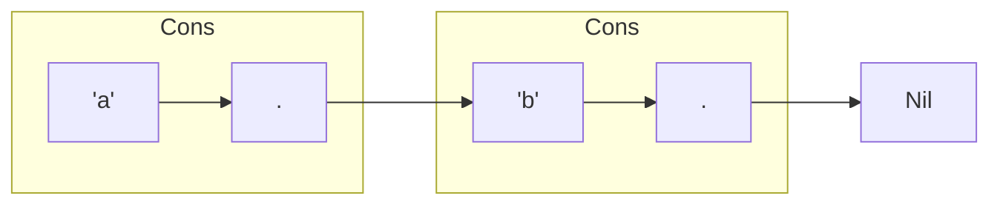
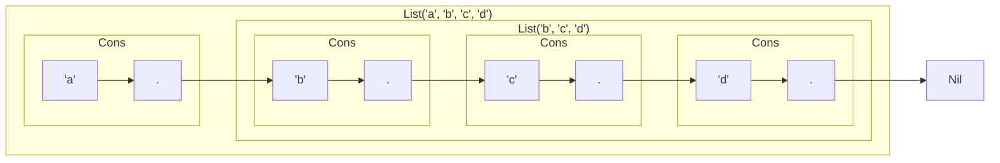

# Функциональная структура данных

Функциональная структура данных — это тип данных, который:

1. **Неизменяем (immutable)**: После создания структура данных не может быть изменена. 
   Любые операции, которые кажутся изменением, на самом деле создают новую копию структуры с необходимыми модификациями.
2. **Рекурсивна**: Многие функциональные структуры данных (например, списки, деревья) реализованы с использованием рекурсии.
3. **Эффективна в операциях с неизменяемостью**: Благодаря внутренней оптимизации 
   (например, использованию структурной или ссылочной общей части — **structural sharing**), 
   функциональные структуры данных минимизируют затраты памяти и вычислительных ресурсов при создании новых версий.

Примеры функциональных структур данных:

- **Список (List)**: В функциональном программировании список обычно реализуется как связный список. 
  Каждый элемент списка содержит значение и ссылку на следующий элемент.
- **Дерево (Tree)**: Деревья в функциональном программировании часто реализуются как неизменяемые структуры, 
  где каждый узел содержит значение и ссылки на дочерние узлы.
- **Ассоциативный массив (Map) / Словарь (Dictionary)**: Функциональные карты или словари 
  обычно реализуются как неизменяемые структуры, такие как деревья поиска или хеш-таблицы с общей частью.
- **Множество (Set)**: Функциональные множества также неизменяемы и часто реализуются с использованием деревьев или хеш-таблиц.

Преимущества функциональных структур данных:

1. **Безопасность**: Неизменяемость предотвращает побочные эффекты, что делает код более предсказуемым.
2. **Параллелизм**: Неизменяемые структуры данных легко использовать в многопоточных или распределенных системах, 
   так как нет риска конфликтов при модификации данных.
3. **История изменений**: Поскольку каждая операция создает новую версию структуры, 
   можно легко отслеживать изменения или откатываться к предыдущим состояниям.
4. **Эффективность**: Благодаря структурному совместному использованию, затраты на создание новых версий минимизируются.

## Односвязный список

Односвязанный список (или просто связанный список) — это линейная структура данных, состоящая из узлов, 
каждый из которых содержит данные и ссылку на следующий узел. 
Первый узел называется головой списка, последний узел указывает на специально значение, обозначающее конец списка. 
Доступ к элементам осуществляется последовательно, начиная с головы списка.

Односвязный список можно определить так:

```dotty
enum List[+A]:
  case Nil
  case Cons(head: A, tail: List[A])

object List:
  def apply[A](as: A*): List[A] =
    if as.isEmpty then Nil
    else Cons(as.head, apply(as.tail*))
```

Перечисление `List` содержит два конструктора данных, которые представляют две возможные формы `List`. 
`List` может быть пустым, обозначаемым конструктором данных `Nil`, 
или непустым, обозначаемым конструктором данных `Cons` (сокращение от _construction_). 
Непустой список состоит из начального элемента `head`, 
за которым следует `List` (возможно, пустой) оставшихся элементов (`tail`)

Пример списка `Cons("a", Cons("b", Nil))`:



Создать список можно следующим образом:

```dotty
val ex1: List[Double] = Nil
// ex1: List[Double] = Nil
val ex2: List[Int] = Cons(1, Nil)
// ex2: List[Int] = Cons(head = 1, tail = Nil)
val ex3: List[String] = Cons("a", Cons("b", Nil))
// ex3: List[String] = Cons(head = "a", tail = Cons(head = "b", tail = Nil))
val ex4: List[String] = List.apply("a", "b")
// ex4: List[String] = Cons(head = "a", tail = Cons(head = "b", tail = Nil))
```

#### Операции над односвязным списком

Над этой функциональной структурой данных можно определить, например, следующие операции суммы и произведения,
которые используют сопоставление с образцом:

```dotty
def sum(ints: List[Int]): Int = ints match
  case Nil => 0
  case Cons(x, xs) => x + sum(xs)

def product(ds: List[Double]): Double = ds match
  case Nil => 1.0
  case Cons(0.0, _) => 0.0
  case Cons(x, xs) => x * product(xs)
```

Рекурсивные определения довольно часто встречаются при написании функций, 
работающими с рекурсивными типами данных, такими как `List` 
(который ссылается сам на себя в конструкторе данных `Cons`).

## Совместное использование данных в функциональных структурах данных

Когда данные неизменяемы, как писать функции, которые, например, добавляют или удаляют элементы из списка? 

Когда добавляется элемент `e` в начало существующего списка, скажем `xs`, 
возвращается новый список, в данном случае `Cons(e, xs)`. 
Поскольку списки неизменяемы, на самом деле не нужно копировать `xs`; можно просто использовать его повторно. 
Это называется совместное использование данных (_data sharing_). 
Совместное использование неизменяемых данных часто позволяет более эффективно реализовывать функции; 
всегда можно вернуть неизменяемые структуры данных, не беспокоясь о том, что последующий код что-то поправит. 
Нет необходимости делать копии, чтобы избежать модификации или повреждения.

Точно так же, чтобы удалить элемент из начала списка `val mylist = Cons(x, xs)`, можно просто вернуть его "хвост" - `xs`. 
Никакого реального удаления не происходит. Первоначальный список `mylist` все еще доступен в целости и сохранности. 
Говорится, что функциональные структуры данных являются _постоянными_, 
что означает, что операции над ними никогда не меняют существующие ссылки.



## Деревья

Ещё одним примером функциональной структуры данных является двоичное дерево:

```dotty
enum Tree[+A]:
  case Leaf(value: A)
  case Branch(left: Tree[A], right: Tree[A])
```


---

**Ссылки:**

- [Functional Programming in Scala, Second Edition, Chapter 3](https://www.manning.com/books/functional-programming-in-scala-second-edition?query=Functional%20Programming%20in%20Scala,%20Second%20Edition)
- [Introduction to Functional Programming - Bird, Wadler, Chapter 3](https://www.amazon.com/Introduction-functional-programming-Prentice-international/dp/0134841891)
- [Learning Scalaz](http://eed3si9n.com/learning-scalaz/Validation.html#NonEmptyList)
- [Scalaz API](https://javadoc.io/doc/org.scalaz/scalaz-core_3/7.3.6/scalaz/NonEmptyList.html)
