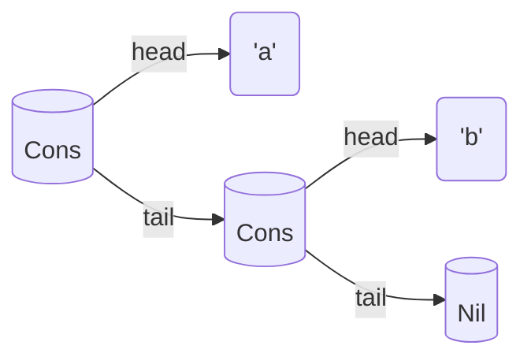
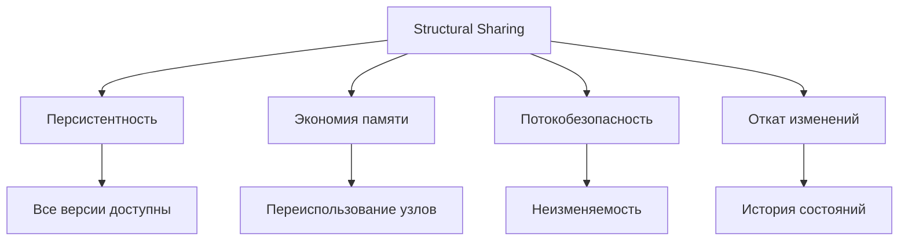
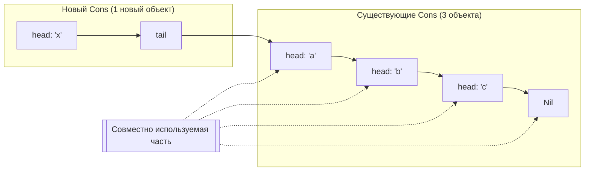
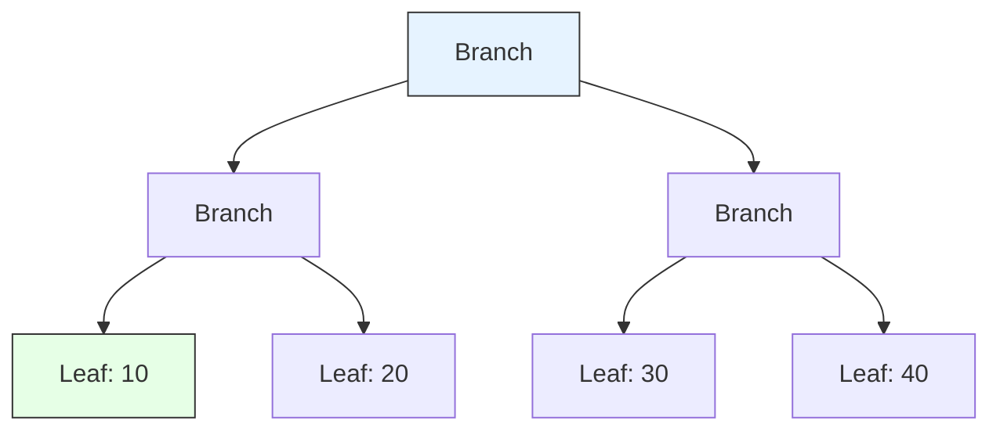

# Функциональные структуры данных

Функциональные структуры данных представляют собой фундаментальную концепцию в функциональном программировании, 
обладающую следующими ключевыми характеристиками:

1. **Неизменяемость (_immutability_)**:
    - Основополагающее свойство: после создания экземпляр структуры данных не может быть модифицирован
    - Все операции, имитирующие изменения, фактически создают новые версии структуры
    - Гарантирует безопасность данных и отсутствие побочных эффектов

2. **Рекурсивная природа**:
    - Большинство функциональных структур построено на принципах рекурсии
    - Рекурсивные определения позволяют создавать сложные структуры из простых компонентов
    - Примеры: списки определяются через голову и хвост (рекурсивно), деревья - через поддеревья

3. **Оптимизация операций**:
    - Используется структурное совместное использование (_structural sharing_) для минимизации накладных расходов
    - Новые версии структур повторно используют неизменяемые части оригинальных структур
    - Обеспечивает эффективность по памяти и производительность

## Основные типы функциональных структур данных

### Связные списки (List)

- Классическая функциональная структура
- Реализация: рекурсивная композиция узлов (голова + хвост)
- Операции: O(1) для добавления в начало, O(n) для доступа по индексу
- Идеально подходит для последовательной обработки и рекурсивных алгоритмов

### Деревья (Tree)

- Иерархические структуры с рекурсивной природой
- Варианты: бинарные деревья, деревья поиска, красно-черные деревья
- Каждый узел содержит значение и ссылки на дочерние узлы
- Оптимальны для поиска и упорядоченного хранения данных

### Ассоциативные массивы (Map/Dictionary)

- Неизменяемые хранилища пар "ключ-значение"
- Реализации: через сбалансированные деревья или хеш-деревья
- Гарантируют предсказуемую производительность операций

### Множества (Set)

- Функциональные аналоги математических множеств
- Часто реализуются на основе деревьев или хеш-структур
- Поддерживают теоретико-множественные операции

## Преимущества функционального подхода

**1. Безопасность и надежность**

- **Иммутабельность:** Данные не изменяются, создаются новые версии. Исключаются случайные повреждения.
- **Чистые функции:** Результат зависит только от входных данных. Нет скрытых зависимостей.
- **Простота тестирования:** Функции можно проверять изолированно, без сложных сред выполнения.

**2. Параллелизм**

- **Потокобезопасность:** Неизменяемые данные можно безопасно использовать в многопоточных средах без блокировок.
- **Упрощенная распределенная обработка:** Данные легко передавать между узлами (например, для MapReduce).

**3. Управление состоянием**

- **История изменений:** Автоматическое сохранение всех версий данных (удобно для undo/redo, аудита).
- **Простое воспроизведение:** Легко отлаживать, так как любое состояние можно воссоздать.

**4. Эффективность**

- **Совместное использование:** Новые структуры данных могут повторно использовать неизменяемые части старых.
- **Оптимизации:** Ленивые вычисления, мемоизация и агрессивная оптимизация компилятором возможны благодаря чистоте функций.

**5. Композиционность**

- **Модульность:** Программы собираются из небольших, независимых функций, как конструктор.
- **Повторное использование:** Общие паттерны (map, filter, reduce) работают с разными типами данных.

## Односвязный список

Односвязный список - базовая, но важная функциональная структура данных, обладающая следующими свойствами:

- Линейная организация элементов
- Каждый узел содержит:
    - Полезные данные
    - Ссылку на следующий узел (или признак конца)
- Рекурсивное определение: список есть либо пустой элемент (`Nil`), либо голова плюс хвост (`Cons`)

### Формальное определение

```dotty
enum LinkedList[+A]:
  case Nil
  case Cons(head: A, tail: LinkedList[A])

object LinkedList:
  def apply[A](as: A*): LinkedList[A] =
    if as.isEmpty then Nil
    else Cons(as.head, apply(as.tail *))
```

Разбор определения:

- `LinkedList` - параметризованный тип с ковариантным параметром `A`
- `Nil` представляет пустой список
- `Cons` (от "constructor") создает новый элемент списка
- Метод `apply` в сопутствующем объекте обеспечивает удобное создание списков

### Визуализация списка

Пример списка `Cons("a", Cons("b", Nil))`:



### Практическое использование

Примеры создания списков:

```dotty
val empty: LinkedList[Double] = Nil  // Пустой список
val single: LinkedList[Int] = Cons(1, Nil)  // Список из одного элемента
val multi: LinkedList[String] = Cons("a", Cons("b", Nil))  // Многоэлементный список
val convenient: LinkedList[String] = LinkedList("a", "b")  // Альтернативный синтаксис
```

### Базовые операции

Примеры рекурсивных операций:

```dotty
def sum(ints: LinkedList[Int]): Int = ints match
  case Nil => 0
  case Cons(x, xs) => x + sum(xs)

def product(ds: LinkedList[Double]): Double = ds match
  case Nil => 1.0
  case Cons(0.0, _) => 0.0  // Оптимизация для нуля
  case Cons(x, xs) => x * product(xs) 
```

Особенности:

- Использование сопоставление с шаблоном для декомпозиции списка
- Рекурсивная обработка хвоста списка
- Базовый случай (`Nil`) завершает рекурсию

### Упражнение 2.1.1: Ручное создание списков

> [Репозиторий с упражнениями и инструкцией по выполнению][sample]

```dotty
// Создайте вручную следующие списки:
val empty: LinkedList[Int] = ??? // Пустой список
val single: LinkedList[String] = ??? // Список с одним элементом "Hello"
val threeNumbers: LinkedList[Int] = ??? // Список 1, 2, 3
```

@:note(🔍 Показать решение)

```dotty
val empty: LinkedList[Int] = Nil
val single: LinkedList[String] = Cons("Hello", Nil)
val threeNumbers: LinkedList[Int] = Cons(1, Cons(2, Cons(3, Nil)))  
```

@:@

### Упражнение 2.1.2: Основы сопоставления с шаблоном

Реализуйте функцию `describe`, которая анализирует структуру списка и возвращает его текстовое описание:

```dotty
def describe[A](list: LinkedList[A]): String =
  list match
    case Nil => ???
    case Cons(_, _) => ???
```

Возвращаемые значения:

- `"empty"` для пустого списка (`Nil`)
- `"singleton"` для списка с одним элементом
- `"at least two"` для списка с двумя и более элементами

**Цель упражнения**

Отработать навыки:

- Сопоставление с шаблоном на алгебраических типах данных
- Анализ рекурсивной структуры связанных списков
- Работу с базовыми случаями для списков

**Примеры использования**

```dotty
describe(Nil)                      // "empty"
describe(Cons(1, Nil))             // "singleton"
describe(Cons(1, Cons(2, Nil)))    // "at least two"
describe(Cons("a", Cons("b", Cons("c", Nil))))  // "at least two"
```

@:note(🔍 Показать решение)

Функция `describe` анализирует структуру связного списка и возвращает строковую характеристику его размера: 
`"empty"` для пустого списка (`Nil`), `"singleton"` для списка из одного элемента (`Cons(_, Nil)`) 
и `"at least two"` для списков с двумя и более элементами (любой другой случай). 
Решение использует сопоставление с шаблоном для проверки трех возможных вариантов структуры списка, 
обеспечивая простоту, читаемость и полное покрытие всех возможных случаев.

```dotty
def describe[A](list: LinkedList[A]): String =
  list match
    case Nil => "empty"
    case Cons(_, Nil) => "singleton"
    case _ => "at least two"
```

@:@

### Упражнение 2.1.3: Реализация функции length для списка

Реализуйте функцию `length`, которая вычисляет длину связанного списка:

```dotty
def length[A](list: LinkedList[A]): Int = ???
```

**Цель упражнения**

Научиться:

- Работать с рекурсивными структурами данных
- Применять сопоставление с шаблоном для обработки списков
- Писать чистые функциональные реализации базовых операций

**Примеры использования**

```dotty
length(Nil) == 0
length(Cons(1, Nil)) == 1
length(Cons("a", Cons("b", Cons("c", Nil)))) == 3
```

@:note(🔍 Показать решение)

Эта реализация вычисляет длину связного списка через **хвостовую рекурсию**, 
что позволяет избежать переполнения стека для больших списков. 
Внутренняя функция `loop` последовательно проходит по каждому элементу списка (игнорируя значения через `_`), 
увеличивая аккумулятор `acc` на `1` при каждом шаге, пока не достигнет конца списка (`Nil`), 
после чего возвращает накопленное значение. 

```dotty
def length[A](list: LinkedList[A]): Int =
  @annotation.tailrec
  def loop(remaining: LinkedList[A], acc: Int): Int = 
    remaining match
      case Nil => acc
      case Cons(_, tail) => loop(tail, acc + 1)

  loop(list, 0)
```

@:@

### Упражнение 2.1.4: Объединение списков

Реализуйте функцию `append`, которая объединяет два связных списка:

```dotty
def append[A](xs: LinkedList[A], ys: LinkedList[A]): LinkedList[A] = ???
```

**Цель упражнения**

Научиться:

- Работать с рекурсивными операциями над связными списками
- Реализовывать базовые операции функциональных структур данных
- Применять принцип структурного совместного использования (structural sharing)

**Примеры использования**

```dotty
append(Nil, Nil) == Nil
append(Cons(1, Nil), Cons(2, Nil)) == Cons(1, Cons(2, Nil))
append(Cons("a", Cons("b", Nil)), Cons("c", Nil)) == Cons("a", Cons("b", Cons("c", Nil)))
```

**Подсказки**

- Используйте сопоставление с шаблоном по первому списку
- Для рекурсивного случая создавайте новые Cons-узлы
- Второй список присоединяется только в базовом случае

@:note(🔍 Показать решение)

Функция `append` рекурсивно объединяет два связных списка, создавая новый список, 
где элементы первого списка (`xs`) предшествуют элементам второго (`ys`). 
При разборе через сопоставление с шаблоном, если `xs` пуст (`Nil`), функция возвращает `ys`, 
в противном случае она последовательно создает новые узлы `Cons`, сохраняя голову (`h`) текущего списка 
и рекурсивно обрабатывая хвост (`t`), пока не достигнет конца первого списка. 
Это классический пример функционального подхода с сохранением иммутабельности — 
исходные списки не изменяются, а создается новая структура, разделяющая узлы второго списка для эффективности. 
Сложность O(n), где `n` — длина первого списка.

```dotty
def append[A](xs: LinkedList[A], ys: LinkedList[A]): LinkedList[A] = 
  xs match
    case Nil => ys
    case Cons(h, t) => Cons(h, append(t, ys))
```

@:@

### Упражнение 2.1.5: Разворот списка

Реализуйте функцию `reverse`, которая возвращает новый список с элементами в обратном порядке:

```dotty
def reverse[A](list: LinkedList[A]): LinkedList[A] = ???
```

**Цель упражнения**

Научиться:

- Работать с рекурсивными преобразованиями списков
- Применять хвостовую рекурсию для эффективного разворота
- Использовать аккумуляторы для накопления результата

**Примеры использования**

```dotty
reverse(Nil) == Nil
reverse(Cons(1, Nil)) == Cons(1, Nil)
reverse(Cons(1, Cons(2, Cons(3, Nil)))) == Cons(3, Cons(2, Cons(1, Nil)))
```

**Подсказки**

1. Используйте вспомогательную функцию с аккумулятором
2. Сопоставление с шаблоном по входному списку
3. На каждом шаге забирайте голову и добавляйте в аккумулятор

@:note(🔍 Показать решение)

Функция `reverse` разворачивает связный список, используя **хвостовую рекурсию** для оптимальной производительности. 
Внутренняя функция `loop` последовательно разбирает исходный список (`remaining`), 
перемещая каждый элемент в аккумулятор (`acc`), который накапливает результат в обратном порядке. 
Когда исходный список становится пустым (`Nil`), аккумулятор содержит готовый перевёрнутый список. 
Аннотация `@tailrec` гарантирует оптимизацию в цикл, что обеспечивает **O(n) сложность** и предотвращает переполнение стека. 
Решение сохраняет **иммутабельность** — исходный список не изменяется, а создаётся новая структура.

```dotty
def reverse[A](list: LinkedList[A]): LinkedList[A] =
  @annotation.tailrec
  def loop(remaining: LinkedList[A], acc: LinkedList[A]): LinkedList[A] =
    remaining match
      case Nil => acc
      case Cons(head, tail) => loop(tail, Cons(head, acc))
  
  loop(list, Nil)
```

@:@

### Упражнение 2.1.6: Поиск элемента в списке

Реализуйте функцию `contains`, которая проверяет наличие элемента в связном списке:

```dotty
def contains[A](list: LinkedList[A], elem: A): Boolean = ???
```

**Цель упражнения**

Научиться:

- Искать элементы в функциональных структурах данных
- Применять рекурсивные подходы с условиями
- Работать с обобщенными типами (generics)

**Примеры использования**

```dotty
contains(Nil, 1) == false
contains(Cons(1, Nil), 1) == true
contains(Cons("a", Cons("b", Nil)), "c") == false
```

@:note(🔍 Показать решение)

Функция `contains` проверяет наличие элемента в связном списке, используя **рекурсивное сопоставление с шаблоном**: 
для пустого списка (`Nil`) возвращает `false`, а для непустого (`Cons`) 
сравнивает голову списка с искомым элементом и, при несовпадении, рекурсивно проверяет хвост. 
Оператор `||` обеспечивает **ленивое вычисление** — функция завершает работу при первом же найденном совпадении. 
Решение демонстрирует канонический функциональный подход с **линейной сложностью O(n)** и сохранением иммутабельности, 
но требует оптимизации через хвостовую рекурсию для очень длинных списков.

```dotty
@annotation.tailrec
def contains[A](list: LinkedList[A], elem: A): Boolean = 
  list match
    case Nil => false
    case Cons(head, tail) => 
      head == elem || contains(tail, elem)
```

@:@

## Принцип структурного совместного использования данных (Structural Sharing)

Фундаментальное свойство функциональных структур данных - **иммутабельность** 
и **эффективное переиспользование памяти**, достигаемое за счет следующих механизмов:

### 1. Добавление элементов (Cons-операция)

**Как работает:**

- При добавлении нового элемента в начало списка (операция `Cons`) создается **только один новый узел**
- Новый узел содержит:
    - Добавляемый элемент (в поле `head`)
    - **Ссылку на исходный список** (в поле `tail`)

```dotty
val original = Cons(2, Cons(3, Nil))  // [2, 3]
val extended = Cons(1, original)      // [1, 2, 3] 
```

**Преимущества:**

- Время выполнения: **O(1)** (не зависит от размера списка)
- Память: **+1 узел** (а не полная копия списка)
- **Исходный список остается полностью доступным**


### 2. Удаление элементов (Tail-операция)

**Как работает:**

- При "удалении" головы списка (операция `tail`) просто возвращается ссылка на существующий хвост
- **Никаких модификаций** исходной структуры

```dotty
val list = Cons(1, Cons(2, Cons(3, Nil)))  // [1, 2, 3]
val shortened = list.tail                  // [2, 3] 
```

**Особенности:**

- Фактическое "удаление" - это **просто смена ссылки**
- Все предыдущие версии списка остаются **полностью работоспособными**
- Время выполнения: **O(1)**

### Ключевые преимущества подхода

**Персистентность данных:**

- Все версии структур данных **сохраняются** после модификаций
- Возможность отката к предыдущим состояниям

Пример использования:

```dotty
val v1 = Cons(1, Cons(2, Nil))  // Версия 1
val v2 = Cons(0, v1)            // Версия 2
// v1 и v2 полностью независимы и неизменяемы
```

**Эффективность памяти:**

- Средний случай: **O(k)** памяти для k операций (вместо O(k*n))
- 
Пример экономии:

```dotty
// Создаем 1000 вариантов списка
val base = (1 to 1000000).foldRight(Nil)(Cons(_, _))
val variants = (1 to 1000).map(i => Cons(i, base)) 
// Память: O(n + k) вместо O(k*n)
```

**Потокобезопасность:**

- Нет необходимости в блокировках
- Возможность **бесконфликтного** чтения из нескольких потоков

Пример:

```dotty
val sharedList = Cons("data", baseList)
// Можно безопасно передавать sharedList между потоками
```

### Ограничения и нюансы

1. **Производительность**:
    - Доступ по индексу: **O(n)** (требуется полный обход)
    - Вставка в конец: **O(n)** (требуется полное копирование)

2. **Паттерны использования**:
    - Оптимален для **LIFO**-операций (последний вошел - первый вышел)
    - Не подходит для частых **случайных модификаций**



### Визуализация совместного использования



## Функциональные двоичные деревья

Двоичные деревья представляют собой рекурсивную функциональную структуру данных, 
где каждый узел может быть либо терминальным (листом), либо содержать ссылки на два поддерева. 
В отличие от императивных реализаций, функциональные деревья являются неизменяемыми - 
любая модификация создает новое дерево, сохраняя оригинальное.

### Базовая структура

```dotty
enum Tree[+A]:
  // Терминальный узел с значением
  case Leaf(value: A) 
  
  // Нетерминальный узел с левым и правым поддеревом
  case Branch(left: Tree[A], right: Tree[A])
```

Ключевые особенности:

- **Рекурсивность**: определение типа ссылается само на себя
- **Обобщенность**: параметр типа `A` позволяет хранить значения любого типа
- **Алгебраичность**: два независимых варианта узлов (суммарный тип)

### Визуализация структуры

Пример дерева:



### Оптимизации и особенности

1. **Персистентность**:
    - Все версии дерева остаются доступными после модификаций
    - Пример:
      ```dotty
      val v1 = Branch(Leaf(1), Leaf(2))
      val v2 = Branch(v1, Leaf(3)) // v1 остается доступным
      ```

2. **Ленивые вычисления**:
    - Возможность реализации отложенных вычислений в ветвях:
      ```dotty
      case class LazyBranch(left: () => Tree[A], right: () => Tree[A])
      ```

### Сравнение производительности

|  Операция | Функциональное | Императивное |
|-----------|----------------|--------------|
| Поиск     | O(log n)       | O(log n)     |
| Вставка   | O(log n)\*     | O(1)         |      
| Удаление  | O(log n)\*     | O(1)         |     
| Память    | O(n)           | O(n)         |   

\* - с учетом персистентности и структурного разделения

Функциональные деревья особенно полезны в:

- Системах с требованием к неизменяемости (blockchain, undo/redo)
- Распределенных вычислениях
- Многопоточных средах

### Упражнение 2.2.1: Ручное создание деревьев

```dotty
// Создайте вручную следующие деревья:
val empty: Tree[Int] = ???        // Пустое дерево
val single: Tree[String] = ???    // Дерево с одним листом "Hello"
val sampleTree: Tree[Int] = ???   // Дерево Branch(Branch(Leaf(1), Leaf(2)), Leaf(3))
```

@:note(🔍 Показать решение)

```dotty
val empty: Tree[Int] = Leaf(0)    
val single: Tree[String] = Leaf("Hello")
val sampleTree: Tree[Int] = 
  Branch(
    Branch(Leaf(1), Leaf(2)),
    Leaf(3)
  )
```

@:@

### Упражнение 2.2.2: Реализация функции size для дерева

Реализуйте функцию `size`, которая вычисляет количество узлов в дереве:

```dotty
def size[A](tree: Tree[A]): Int = ???
```

**Примеры использования**

```dotty
size(Leaf(1)) == 1
size(Branch(Leaf(1), Branch(Leaf(2), Leaf(3)))) == 5
```

@:note(🔍 Показать решение)

Функция `size` рекурсивно вычисляет общее количество узлов в дереве: для листа (`Leaf`) возвращает `1` (учет самого листа), 
а для ветки (`Branch`) суммирует `1` (текущий узел), размер левого поддерева (`size(l)`) и правого поддерева (`size(r)`). 
Решение демонстрирует классический функциональный подход с сопоставлением с шаблоном, 
обходя все узлы дерева с линейной сложностью **O(n)**, где n — количество узлов, 
и сохраняя иммутабельность — исходное дерево не изменяется в процессе вычислений.

```dotty
def size[A](tree: Tree[A]): Int = tree match
  case Leaf(_) => 1
  case Branch(l, r) => 1 + size(l) + size(r)
```

@:@

### Упражнение 2.2.3: Преобразование дерева

Реализуйте функцию `map` (преобразование содержимого контейнера) для деревьев:

```dotty
def map[A, B](tree: Tree[A])(f: A => B): Tree[B] = ???
```

**Примеры использования**

```dotty
map(Leaf(1))(_ * 2) == Leaf(2)
map(Branch(Leaf(1), Leaf(2)))(_.toString) == Branch(Leaf("1"), Leaf("2"))
```

@:note(🔍 Показать решение)

Функция `map` рекурсивно преобразует дерево, применяя функцию `f` к каждому значению в листьях (`Leaf`), 
сохраняя при этом исходную структуру ветвлений (`Branch`). 
Решение использует сопоставление с шаблоном: для листов вызывает функцию преобразования `f(v)`, 
а для ветвей рекурсивно обрабатывает оба поддерева. 
Этот подход гарантирует **иммутабельность** — создается совершенно новое дерево с преобразованными значениями, 
но с идентичной структурой ветвления, сложность операции — **O(n)**, где n — количество узлов. 
Типичное применение — преобразование всех значений дерева (например, чисел в строки) без изменения его формы.

```dotty
def map[A, B](tree: Tree[A])(f: A => B): Tree[B] = tree match
  case Leaf(v) => Leaf(f(v))
  case Branch(l, r) => Branch(map(l)(f), map(r)(f))
```

@:@

### Упражнение 2.2.4: Удаление элемента из дерева

Реализуйте функцию `remove`, которая удаляет терминальные узлы с заданным значением из дерева:

> Упражнение требует знания `Option` из раздела ["Обработка ошибок"](handling-errors.md)

```dotty
def remove[A](tree: Branch[A], value: A): Option[Tree[A]] = ???
```

**Требования:**

1. Удалять только терминальные узлы (`Leaf`), соответствующие значению
2. Сохранять оригинальную структуру дерева для неизменяемых частей
3. `None` возвращается в случае, если удалены все элементы дерева

**Примеры:**

```dotty
val tree1 = Branch(Leaf(1), Branch(Leaf(2), Leaf(3)))
remove(tree1, 2) == Branch(Leaf(1), Leaf(3))

val tree2 = Branch(Leaf("a"), Leaf("b"))
remove(tree2, "c") == tree2

val tree3 = Branch(
  Branch(Leaf(1), Leaf(1)),
  Branch(Leaf(1), Leaf(2))
)
remove(tree3, 1) == Leaf(2)
```

@:note(🔍 Показать решение)

Функция `remove` рекурсивно обрабатывает дерево, удаляя терминальные узлы (`Leaf`) с заданным значением: 
если значение в листе совпадает с искомым, узел удаляется (возвращается `None`), иначе лист сохраняется; 
для ветвей (`Branch`) функция проверяет результаты обработки обоих поддеревьев 
и либо объединяет их в новую ветвь (если оба поддерева остались), 
либо возвращает оставшееся поддерево (если одно было удалено), либо `None` (если оба поддерева удалены). 

```dotty
def remove[A](tree: Tree[A], value: A): Option[Tree[A]] =
  tree match
    case Leaf(v) if v == value => None
    case Leaf(v) => Some(Leaf(v))
    case Branch(left, right) =>
      (remove(left, value), remove(right, value)) match
        case (None, None) => None
        case (Some(l), None) => Some(l)
        case (None, Some(r)) => Some(r)
        case (Some(l), Some(r)) => Some(Branch(l, r))
```

@:@

---

**Ссылки:**

- [Ссылка на репозиторий с упражнениями][sample]
- [Functional Programming in Scala, Second Edition, Chapter 3](https://www.manning.com/books/functional-programming-in-scala-second-edition?query=Functional%20Programming%20in%20Scala,%20Second%20Edition)
- [Introduction to Functional Programming - Bird, Wadler, Chapter 3](https://archive.org/details/introductiontofu0000bird/mode/2up)
- [Learning Scalaz](http://eed3si9n.com/learning-scalaz/Validation.html#NonEmptyList)
- [Scalaz API](https://javadoc.io/doc/org.scalaz/scalaz-core_3/7.3.6/scalaz/NonEmptyList.html)

[sample]: https://gitverse.ru/scalabook/fp
