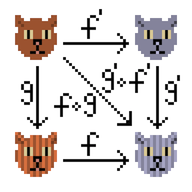
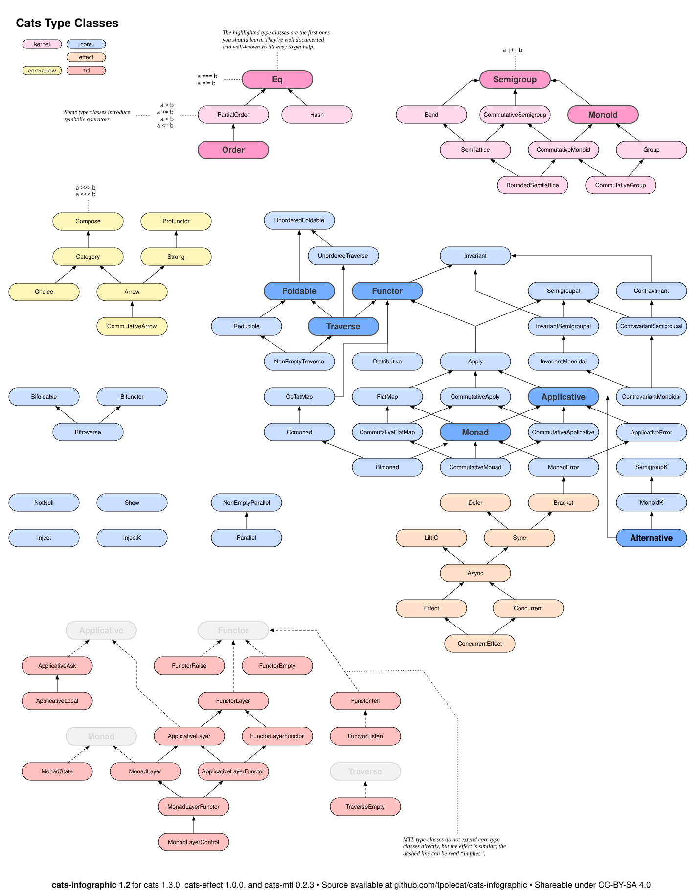



# Cats



## Обзор

**Cats** — это библиотека, предоставляющая абстракции для функционального программирования на языке [Scala](https://scala-lang.org).

Scala поддерживает как объектно-ориентированную, так и функциональную парадигмы, 
и это нашло свое отражение в гибридном подходе стандартной библиотеки. 
Cats стремится предоставить базовые, бинарно-совместимые, модульные, доступные и 
эффективные абстракции для функционального программирования.

Более широкая цель Cats — создать фундамент для [экосистемы чистых, типобезопасных библиотек](https://typelevel.org/cats/typelevelEcosystem.html), 
предназначенных для поддержки функционального программирования в приложениях на Scala.

**Ключевые особенности Cats:**

- **Бинарная совместимость:** разные версии библиотеки можно использовать в одном проекте без конфликтов.
- **Модульность:** вы подключаете только те модули, которые реально нужны.
- **Доступность:** для работы с Cats не требуется глубоких знаний теории категорий.
- **Эффективность:** абстракции Cats, как правило, не создают значительных накладных расходов во время выполнения.

### Почему «кошки» (Cats)?

Название является игривым сокращением от английского слова _category_ («категория»), 
что отсылает к математической **[теории категорий](https://ru.wikipedia.org/wiki/%D0%A2%D0%B5%D0%BE%D1%80%D0%B8%D1%8F_%D0%BA%D0%B0%D1%82%D0%B5%D0%B3%D0%BE%D1%80%D0%B8%D0%B9)**.

Однако, чтобы использовать Cats, вам **не нужно знать ничего** о теории категорий. 
Название — лишь отражение математических корней библиотеки, 
а её API спроектирован для решения практических задач повседневной разработки.

### Начало работы

Cats доступен для использования не только на стандартной **JVM** (Java Virtual Machine), 
но и для компиляции в JavaScript через **[Scala.js](http://www.scala-js.org/)** 
и в нативный код через **[Scala Native](https://www.scala-native.org/)**. 
Это позволяет применять Cats в бэкенд-сервисах, фронтенд-приложениях (например, на React) 
и даже в высокопроизводительных системах на нативном коде.

#### Подключение зависимости

Чтобы начать использовать Cats, добавьте следующую строку в ваш файл `build.sbt`:

```dotty
libraryDependencies += "org.typelevel" %% "cats-core" % "@VERSION@"
```

> Примечание: вместо `@VERSION@` необходимо подставить [актуальную версию библиотеки](https://mvnrepository.com/artifact/org.typelevel/cats-core).

#### Модули Cats

Строка выше подключает **cats-core** — основной модуль. 
Однако вы можете подключать и другие модули выборочно, чтобы уменьшить итоговый размер приложения. 
Вот основные модули (укажите имя нужного модуля вместо `"cats-core"`):

- **`cats-kernel`** — минимальный набор базовых классов типов (например, `Eq`, `Semigroup`, `Monoid`). 
  Обязателен для всех остальных модулей.
- **`cats-core`** — ядро библиотеки, включающее большинство основных классов типов и функциональность. 
  Обязателен для полноценной работы.
- **`cats-laws`** — содержит законы (формальные правила), которым должны подчиняться экземпляры классов типов. 
  Используется для тестирования.
- **`cats-free`** — предоставляет «свободные» структуры, такие как [Free монада](../typeclass/monad/free-monads.md), 
  и сопутствующие классы типов. 
  Используется для построения встроенных предметно-ориентированных языков (DSL).
- **`cats-testkit`** — библиотека-помощник для написания тестов, проверяющих экземпляры классов типов на соблюдение законов.
- **`algebra`** — классы типов, представляющие алгебраические структуры (например, группы, кольца). Это основа для `cats-kernel`.
- **`alleycats-core`** — экспериментальные экземпляры и классы Cats, которые могут не соблюдать все формальные законы. 
  Используйте с осторожностью, когда законы приносятся в жертву практичности.

## Классы типов

[**Классы типов**](../typeclass/index.md) — это мощный инструмент функционального программирования, 
который обеспечивает **ad-hoc полиморфизм** (более известный как **перегрузка**).

В то время как многие объектно-ориентированные языки используют наследование для достижения полиморфизма, 
функциональное программирование тяготеет к комбинации:

1. **Параметрического полиморфизма** (как дженерики в Java): одна функция работает с любым типом, не зная о нём ничего.
2. **Ad-hoc полиморфизма** (классы типов): одна и та же функция может по-разному работать с разными типами, 
   но это поведение определяется заранее и не зависит от иерархии наследования.

**Простыми словами:** класс типов определяет _интерфейс_ (набор операций), 
а для конкретных типов предоставляются _экземпляры_ — реализации этого интерфейса. 
Это позволяет «добавлять» новое поведение к существующим типам без изменения их исходного кода.

### Классы типов в Cats (инфографика)

Ниже представлена инфографика, которая визуализирует иерархию основных классов типов Cats 
от самых общих (`Functor`) к самым специализированным (`Monad`, `Comonad` и др.).



> Автор: [@tpolecat](https://github.com/tpolecat/cats-infographic). 
> На графике показано, как классы типов наследуют друг друга (стрелки означают «расширяет» или «зависит от»).

**Краткое пояснение иерархии (сверху вниз):**

- [Functor](../typeclass/monad/functor.md) — умеет применять функцию к значению внутри контейнера (метод `map`).
- [Apply](../typeclass/monad/apply.md) — расширяет `Functor` методом `ap`, позволяя применять функцию, тоже находящуюся в контейнере.
- [Applicative](../typeclass/monad/applicative.md) — добавляет возможность поднять обычное значение в контейнер (`pure`).
- [FlatMap](../typeclass/monad/bind.md) — обеспечивает связывание вычислений с помощью `flatMap` (основа for-comprehensions).
- [Monad](../typeclass/monad/monad.md) — объединяет `Applicative` и `FlatMap`. Это самый известный класс типов для последовательных вычислений.
- [MonadError](../typeclass/monad/monad-error.md) — добавляет обработку ошибок в монаду.
- [CoflatMap / Comonad](../typeclass/monad/co-monads.md) — «перевёрнутые» версии `FlatMap` и `Monad` (фокусируются на извлечении значения из контекста, а не на вложении).

### Таблица неполных экземпляров классов типов в Cats

**Важное примечание:** Cats предоставляет _стандартные_ экземпляры (реализации) для многих типов. 
Однако не каждый тип может поддерживать _все_ операции (например, нельзя сделать `flatMap` для `Validated`, 
так как его семантика предназначена для накопления ошибок, а не для последовательности действий).

Следующая таблица (изначально предоставленная [@hobwekiva](https://typelevel.org/cats/typeclasses.html)) 
показывает, какие классы типов и для каких встроенных типов реализованы.

**Расшифровка обозначений:**

- **✔** — полная поддержка. Для данного типа существует законный экземпляр этого класса типов.
- **✗** — поддержка отсутствует. Невозможно реализовать или она не имеет смысла.
- **Условия** — например, `K:Monoid` означает, что экземпляр существует _только если_ для типа `K` также определён экземпляр `Monoid`.

| Тип данных (контейнер)                    | Functor |         Apply          |      Applicative       |        Monad        | MonoidK |    ApplicativeError    | MonadError | CoflatMap | Comonad | Bimonad |
|:------------------------------------------|:-------:|:----------------------:|:----------------------:|:-------------------:|:-------:|:----------------------:|:----------:|:---------:|:-------:|:-------:|
| **`Id[A]`** (тождество)                   |    ✔    |           ✔            |           ✔            |          ✔          |    ✗    |           ✗            |     ✗      |     ✔     |    ✔    |    ✔    |
| **`Eval[A]`** (ленивое вычисление)        |    ✔    |           ✔            |           ✔            |          ✔          |    ✗    |           ✗            |     ✗      |     ✔     |    ✔    |    ✔    |
| **`Option[A]`** (возможно отсутствие)     |    ✔    |           ✔            |           ✔            |          ✔          |    ✔    |           ✔            |     ✔      |     ✔     |    ✗    |    ✗    |
| **`Const[K, A]`** (константа)             |    ✔    |  ✔ (если `K:Monoid`)   |  ✔ (если `K:Monoid`)   |          ✗          |    ✗    |           ✗            |     ✗      |     ✗     |    ✗    |    ✗    |
| **`Either[E, A]`** (ошибка или значение)  |    ✔    |           ✔            |           ✔            |          ✔          |    ✔    |           ✔            |     ✔      |     ✗     |    ✗    |    ✗    |
| **`List[A]`** (список)                    |    ✔    |           ✔            |           ✔            |          ✔          |    ✔    |           ✗            |     ✗      |     ✔     |    ✗    |    ✗    |
| **`NonEmptyList[A]`** (непустой список)   |    ✔    |           ✔            |           ✔            |          ✔          |    ✗    |           ✗            |     ✗      |     ✔     |    ✔    |    ✔    |
| **`Stream[A]`** (ленивый список)          |    ✔    |           ✔            |           ✔            |          ✔          |    ✔    |           ✗            |     ✗      |     ✔     |    ✗    |    ✗    |
| **`Map[K, A]`** (словарь)                 |    ✔    |           ✔            |           ✗            |          ✗          |    ✔    |           ✗            |     ✗      |     ✗     |    ✗    |    ✗    |
| **`Validated[E, A]`** (накопление ошибок) |    ✔    | ✔ (если `E:Semigroup`) | ✔ (если `E:Semigroup`) |          ✗          |    ✗    | ✔ (если `E:Semigroup`) |     ✗      |     ✗     |    ✗    |    ✗    |
| **`Reader[E, A]`** (чтение окружения)     |    ✔    |           ✔            |           ✔            |          ✔          |    ✗    |           ✗            |     ✗      |     ✗     |    ✗    |    ✗    |
| **`Writer[E, A]`** (логирование)          |    ✔    |  ✔ (если `E:Monoid`)   |  ✔ (если `E:Monoid`)   | ✔ (если `E:Monoid`) |    ✗    |           ✗            |     ✗      |     ✔     |    ✗    |    ✗    |

#### Практический смысл таблицы

Взглянув на таблицу, вы можете быстро понять возможности типа:

- **`Validated`** нельзя использовать в for-comprehension (нет `Monad`), 
  зато он отлично подходит для _валидации форм_ с накоплением всех ошибок (`Applicative`).
- **`NonEmptyList`** — это полноценная монада и даже комонада (можно извлечь первый элемент, например), 
  но для него нет `MonoidK` (нельзя представить пустой элемент).
- **`Map`** не является монадой (нет `flatMap`), но может быть `MonoidK` 
  (объединение карт с «нейтральным» элементом — пустой картой).
- **`Id`** поддерживает почти всё, включая `Comonad` и `Bimonad`, потому что является «обёрткой» над обычным значением.

Эта таблица — шпаргалка, которая помогает выбрать правильную абстракцию для вашей задачи.

## Экосистема Cats

Помимо основных модулей, есть несколько важных проектов, которые выпускаются отдельно:

- **[cats-effect](https://github.com/typelevel/cats-effect)** — стандартный тип `IO`
  для описания асинхронных и эффектных вычислений, а также классы типов `Sync`, `Async` и `Effect`.
  Фундамент для функционального параллельного программирования.
- **[cats-mtl](https://github.com/typelevel/cats-mtl)** — предоставляет [трансформеры классов типов](../typeclass/monad/monad-transformer.md)
  для удобной работы с эффектами в стеке монад.
- **[mouse](https://github.com/typelevel/mouse)** — небольшое дополнение Cats,
  добавляющее удобный синтаксис (методы расширения) для стандартных типов,
  чтобы код стал ещё лаконичнее (например, `2.some` вместо `Some(2)`).
- **[kittens](https://github.com/typelevel/kittens)** — автоматический вывод (деривация) экземпляров классов типов
  для case-классов и алгебраических типов данных (ADT), а также утилиты для работы с обобщённым программированием.
- **[cats-tagless](https://github.com/typelevel/cats-tagless)** — утилиты для работы с final tagless encoded алгебрами:
  автоматическое создание интерпретаторов, трансформация функций и т.д.
- **[cats-collections](https://github.com/typelevel/cats-collections)** — структуры данных,
  облегчающие чистое функциональное программирование (например, `Diet`, `AVLTree`, `Map` с изменяемой памятью для фокусировки).
- **[cats-testkit-scalatest](https://github.com/typelevel/cats-testkit-scalatest)** — интеграция Cats testkit
  с популярным фреймворком для тестирования Scalatest.
- [**cats-parse**](https://github.com/typelevel/cats-parse) — Библиотека для парсинга в экосистеме Cats.
- [**cats-retry**](https://cb372.github.io/cats-retry/) — Компонуемая логика повторных попыток для Cats и Cats Effect.

---

**Ссылки:**

- [Cats home page][home]

[home]: https://typelevel.org/cats/
