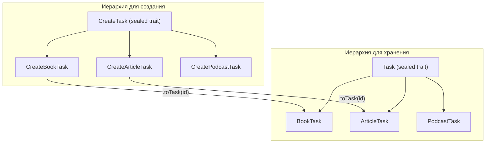



# Архитектура уровня работы с данными

## Определение предметной области

Наше приложение управляет задачами, которые составляют индивидуальный план развития (ИПР). 
Эти задачи требуют постоянного хранения своего состояния и атрибутов. 
Прежде чем принимать решение о выборе конкретной технологии хранения (например, PostgreSQL, MongoDB, in-memory), 
необходимо четко определить, какое поведение мы ожидаем от системы хранения данных.

Приложение оперирует четырьмя основными сущностями (доменными типами), которые должны быть персистентными:

1. **Пользовательские типы задач (User Types)** — это кастомные категории или шаблоны задач, 
   которые создают сами пользователи для классификации своей учебной деятельности (например, "Ведение блога", "Разработка игры").
2. **Разделы (Sections)** — логические группы или категории, предназначенные для структурирования и организации задач 
   (например, "Scala", "Машинное обучение", "Алгоритмы").
3. **Цели (Goals)** — целевые состояния или метрики, которых пользователь планирует достичь 
   в результате выполнения набора задач (например, "Изучить основы Scala 3", "Подготовиться к собеседованию").
4. **Задачи (Tasks)** — конкретные, выполняемые элементы плана, которые относятся к определенному типу, 
   находятся в разделе и работают на достижение цели. Это ядро предметной области.

Для каждой из этих сущностей требуется стандартный набор операций жизненного цикла, известный как CRUD (Create, Read, Update, Delete):

- **`create`** — создание новой записи в базе данных. Возвращает уникальный идентификатор созданной сущности.
- **`get`** — извлечение записи по ее уникальному идентификатору. Возвращает `Option`, так как запись может отсутствовать.
    - **`getAll`** — извлечение всех записей данного типа. Возвращает коллекцию (список, вектор), которая может быть пустой.
- **`update`** — модификация существующей записи. Ожидается, что идентификатор сущности в обновляемом объекте 
  соответствует идентификатору в хранилище.
    - **`updateAll`** — модификация коллекции записей данного типа.
- **`delete`** — безвозвратное удаление записи по ее уникальному идентификатору.

### Принцип единой ответственности на уровне доступа к данным

Сервис, ответственный за взаимодействие с базой данных, должен строго следовать принципу единой ответственности. 
Его единственная задача — выполнять низкоуровневые операции сохранения, извлечения и удаления данных. 
Он **не должен** содержать бизнес-логику, такую как проверка корректности связей между сущностями, 
применение сложных правил или координация транзакций, затрагивающих несколько агрегатов.

#### Пример для иллюстрации разделения ответственности:

Рассмотрим сценарий: попытка создать задачу (`Task`) и привязать ее к разделу (`Section`), который не существует в базе данных.

Является ли обработка этой ситуации проблемой сервиса базы данных? **Нет**.

**Аргументация:**

1. Сервис БД (`TaskService`) отвечает только за сохранение переданного ему объекта `CreateTask` в хранилище. 
   Его контракт — записать данные.
2. Проверка того, существует ли переданный `sectionId` в таблице разделов, относится к **бизнес-логике**. 
   Это правило приложения: "задача не может быть создана для несуществующего раздела". 
   Такая проверка должна выполняться на более высоком уровне, в Domain Service, 
   который может координировать вызовы к `SectionService` и `TaskService`.

### Защита целостности данных и инкапсуляция

Чтобы предотвратить случайное нарушение целостности данных 
(например, прямое удаление раздела, на который все еще ссылаются задачи) 
и обеспечить прохождение всех операций через слой бизнес-логики, мы применяем строгую инкапсуляцию:

- Сервисы БД объявляются как **`private[services]`** в Scala. 
  Это ограничивает их видимость только в пределах текущего пакета и его подпакетов.
- Внешний код (например, контроллеры HTTP API) **не может напрямую обращаться** к этим сервисам.
- Все запросы к данным должны проходить через слой сервисов приложения (или "интерпретаторов"), 
  которые содержат бизнес-логику и координируют вызовы к репозиториям.

### Выбор архитектурного паттерна: Tagless Final

Для реализации описанных выше принципов (разделение ответственности, тестируемость, полиморфизм над эффектами) 
мы используем архитектурный паттерн **[Tagless Final][tagless]**. Этот подход позволяет:

1.  Абстрагироваться от конкретной монады эффектов `F[_]` (например, `IO`, `Future`, `Task`) на уровне алгебры (интерфейса).
2.  Легко подменять реализации (например, мок на реальную БД) без изменения кода бизнес-логики.
3.  Четко отделить объявление операций (алгебру) от их исполнения (интерпретатор).

## Проектирование алгебр (интерфейсов)

Алгебра — это абстрактный API, описывающий, _что_ можно сделать, но не _как_ это реализовано. 
Начнем с создания алгебры для работы с пользовательскими типами задач.

```dotty
// pdp/src/main/scala/ru/scalabook/pdp/services/UserTypeService.scala
package ru.scalabook.pdp.services

import cats.Monad
import ru.scalabook.pdp.model.*
import ru.scalabook.pdp.model.UserType.{UserTypeId, UserTypeName}

/** Интерфейс сервиса для управления пользовательскими типами задач. */
private[services] trait UserTypeService[F[_]: Monad]:

  /** Создаёт новый пользовательский тип задачи. */
  def create(name: UserTypeName): F[UserTypeId]

  /** Получает пользовательский тип задачи по его идентификатору. */
  def get(id: UserTypeId): F[Option[UserType]]

  /** Получает список всех пользовательских типов задач. */
  def getAll: F[List[UserType]]

  /** Обновляет существующий пользовательский тип задачи. */
  def update(userType: UserType): F[Unit]

  /** Обновляет список пользовательских типов задач. */
  def updateAll(userTypes: NonEmptyList[UserType]): F[Unit]

  /** Удаляет пользовательский тип задачи по его идентификатору. */
  def delete(id: UserTypeId): F[Unit]
```

### Семантика возвращаемых типов в контексте эффектов

- **`F[_]`** — параметр типа, представляющий [абстрактный эффект](../fp/external-effects.md) 
  (например, асинхронное вычисление, операцию с побочным эффектом). 
  Это позволяет алгебре быть независимой от конкретной runtime-библиотеки (Cats Effect, ZIO, Monix).
- **`F[_]: Monad`** — тип `F` является [монадой](../typeclass/monad/monad.md). В данном случае это означает, 
  что мы можем использовать `F` в [for-comprehension](../fp/for-comprehension.md).
- **`F[UserTypeId]`** — операция, которая в процессе выполнения (`F`) произведет побочный эффект (запись в БД) и вернет результат — `UserTypeId`.
- **`F[Option[UserType]]`** — операция чтения, которая может завершиться успешно, найдя сущность (`Some[UserType]`), 
  или вернуть `None`, если сущность с таким ID не существует.
- **`F[List[UserType]]`** — операция чтения, всегда возвращающая коллекцию. 
  Коллекция может быть пустой, если в БД еще нет записей.
- **`F[Unit]`** — операция, которая выполняется ради своего побочного эффекта (обновление, удаление) 
  и не возвращает значимого значения. `Unit` служит сигналом успешного завершения.

### Размещение бизнес-логики: за пределами алгебры

Сложные операции, которые требуют координации нескольких вызовов к БД или проверки бизнес-правил, 
**не должны** быть частью алгебры сервиса БД. 
Например, операция "перенести все задачи из раздела A в раздел B" или "удалить цель и все связанные с ней задачи".

Согласно паттерну [Tagless Final][tagless], такая логика описывается в виде **программы** (program) — функции, 
которая принимает экземпляры необходимых алгебр (через параметры типа или контекст) 
и, используя их, описывает последовательность действий. 
Таким образом, `UserTypeService` остается простым и стабильным репозиторием, 
а вся сложная логика поднимается на уровень программы, которую мы рассмотрим в разделе ["Жизненный цикл задач"](lifecycle.md).

### Остальные алгебры

Алгебры `SectionService` и `GoalService` проектируются по аналогичной с `UserTypeService` схеме, 
отличаясь лишь типами моделей (`Section`, `SectionId`, `Goal`, `GoalId`). 
Их реализации можно найти в [исходном коде проекта](https://gitverse.ru/scalabook/pdp/content/master/pdp/src/main/scala/ru/scalabook/pdp/services).

Для сущности `Task` возникает нюанс. 
Операция `create` не может принимать готовую `Task`, так как у новой задачи еще нет присвоенного идентификатора (`id`). 
Поэтому мы определяем отдельную иерархию типов `CreateTask`, которая повторяет структуру `Task`, но без поля `id`.

```dotty
// pdp/src/main/scala/ru/scalabook/pdp/services/TaskService.scala
package ru.scalabook.pdp.services

import ru.scalabook.pdp.model.*
import java.util.UUID

private[services] trait TaskService[F[_]]:

  // Принимает объект для создания, возвращает сгенерированный UUID.
  def create(task: CreateTask): F[UUID]

  // Для получения нужен и id, и taskType, чтобы однозначно идентифицировать запись.
  def get(id: UUID, taskType: TaskType): F[Option[Task]]

  def getAll: F[Vector[Task]]

  // Принимает полноценную Task с id.
  def update(task: Task): F[Unit] 

  def delete(id: UUID, taskType: TaskType): F[Unit]

```

Тип `CreateTask` и его варианты (для книг, статей и т.д.) являются точными копиями соответствующих `*Task` типов, но без поля `id`. 
[Ссылка на полное определение.](https://gitverse.ru/scalabook/pdp/content/master/pdp/src/main/scala/ru/scalabook/pdp/model/CreateTask.scala)

```dotty
sealed trait CreateTask:
  val name: TaskName
  val taskType: TaskType
  val status: Status
  val sectionId: SectionId
  val goalId: GoalId
  val ordinal: TaskOrdinal
  val startDate: Option[LocalDate]
  val endDate: Option[LocalDate]
  val information: String
  val plan: List[TaskStep]

final case class CreateBookTask(
    name: TaskName,
    status: Status,
    sectionId: SectionId,
    goalId: GoalId,
    ordinal: TaskOrdinal,
    startDate: Option[LocalDate],
    endDate: Option[LocalDate],
    information: String,
    plan: List[TaskStep],
    authors: Authors,
    pages: Pages
) extends CreateTask:
  // Тип задачи фиксирован для каждого case class.
  val taskType: TaskType = TaskType.Book

// ... аналогично для CreateArticleTask, CreateCourseTask и других
```

#### Обоснование двух параллельных иерархий

Возникает резонный вопрос: _Почему бы не использовать одну иерархию типов для задач, сделав поле `id` опциональным, 
вместо создания двух почти идентичных иерархий (`CreateTask` и `Task`)?_



Основная причина — **требования библиотеки для автоматической генерации SQL-запросов**, которую мы разберем в следующем разделе. 
Эта библиотека полагается на макросы, которые для корректной работы требуют, 
чтобы модели данных были реализованы как `case class`, наследующие от `Product`.

В Scala `case class` не может наследоваться от другого `case class`. 
Следовательно, мы не можем создать общий `case class Task` с опциональным `id`, 
от которого будут наследоваться `case class BookTask` и другие. 
Наличие двух отдельных, но структурно похожих иерархий (`case class CreateBookTask` и `case class BookTask`) 
является практическим решением, позволяющим сохранить преимущества `case class` 
(неизменяемость, автоматические методы, паттерн-матчинг) 
как для операций создания, так и для чтения.

## Реализация интерпретаторов: заглушки

Для каждой алгебры может существовать несколько **интерпретаторов** — конкретных реализаций 
на определенном типе эффектов `F[_]` (например, `IO`) и для определенного хранилища.

- **Mock-реализация** — хранит данные в памяти (например, в `Ref[IO, Map]`). 
  Используется для модульного и интеграционного тестирования бизнес-логики без развертывания реальной БД. Быстрая и изолированная.
- **PostgreSQL-реализация** — использует JDBC или асинхронный драйвер (например, PostgresSQL) 
  для выполнения SQL-запросов к промышленной реляционной БД. Это продакшен-реализация.

Начнем разработку с моканной реализации, так как она позволяет быстро протестировать 
и отладить всю цепочку вызовов от контроллеров до сервисов, не заботясь о миграциях базы данных и подключении.

```dotty
// pdp/src/main/scala/ru/scalabook/pdp/services/mock/MockUserTypeService.scala
package ru.scalabook.pdp.services.mock

import cats.effect.*
import ru.scalabook.pdp.model.*
import ru.scalabook.pdp.model.UserType.{UserTypeId, UserTypeName}
import ru.scalabook.pdp.services.UserTypeService

/**
 * Мок-реализация UserTypeService, использующая иммутабельную Map в памяти
 * для хранения состояния, защищенного с помощью Ref из Cats Effect.
 *
 * @param userTypes Ref, содержащий текущее состояние хранилища (Map из ID в UserType).
 * @param nextId Ref-счетчик для генерации новых уникальных ID.
 */
private[services] class MockUserTypeService(
    userTypes: Ref[IO, Map[UserTypeId, UserType]],
    nextId: Ref[IO, UserTypeId]
) extends UserTypeService[IO]: // Интерпретируем алгебру в конкретном эффекте IO

  /**
   * Создает новый тип задачи.
   * Атомарно: 1) берет следующий ID, 2) инкрементирует счетчик, 3) сохраняет запись.
   */
  def create(name: UserTypeName): IO[UserTypeId] =
    for
      // Получаем текущий ID и увеличиваем счетчик для следующего вызова.
      // applyUnsafe здесь безопасен, так как мы знаем, 
      // что id.value + 1 - положительное число.
      id <- nextId.getAndUpdate(id => UserTypeId.applyUnsafe(id.value + 1))
      // Создаем объект UserType и сохраняем его в Map.
      // Используем метод update для сохранения.
      _  <- update(UserType(id, name)) 
    yield id // Возвращаем ID, под которым был сохранен тип.

  /** Извлекает тип по ID. Возвращает None, если ключ не найден. */
  def get(id: UserTypeId): IO[Option[UserType]] =
    userTypes.get.map(_.get(id)) // Читаем Map и выполняем lookup.

  /** Извлекает все типы, преобразуя значения Map в List. */
  def getAll: IO[List[UserType]] =
    userTypes.get.map(_.values.toList)

  /** Обновляет (или добавляет) запись в Map. */
  def update(userType: UserType): IO[Unit] =
    userTypes.update(currentMap => currentMap + (userType.id -> userType))

  /** Обновляет все переданные записи в Map. */
  def updateAll(items: NonEmptyList[UserType]): IO[Unit] =
    userTypes.update(_ ++ items.toList.map(t => t.id -> t))
    
  /** Удаляет запись по ID. Если ID не существует, операция не имеет эффекта. */
  def delete(id: UserTypeId): IO[Unit] =
    userTypes.update(_ - id)

end MockUserTypeService

/** Компаньон-объект, предоставляющий безопасный конструктор Resource для создания сервиса. */
object MockUserTypeService:
  /**
   * Фабричный метод, возвращающий Resource[IO, UserTypeService[IO]].
   * Гарантирует, что состояние (Ref) будет корректно инициализировано.
   * Resource управляет жизненным циклом, хотя для Ref это не критично.
   */
  def make: Resource[IO, UserTypeService[IO]] =
    Resource.eval { // Создаем ресурс из чистого эффекта (eval).
      for
        // Инициализируем хранилище пустой Map.
        types <- Ref[IO].of(Map.empty[UserTypeId, UserType])
        // Инициализируем счетчик ID значением 0 (первый ID будет 0).
        id    <- Ref[IO].of(UserTypeId(0))
      yield new MockUserTypeService(types, id) // Возвращаем новый экземпляр сервиса.
    }    
```

---

**Ссылки:**

- [Персональный план развития][plugin]
- [Репозиторий с исходниками][repo]

[repo]: https://gitverse.ru/scalabook/pdp
[plugin]: https://artemkorsakov.github.io/personal-development-plan/ru/
[tagless]: ../fp/patterns/tagless-final.md
