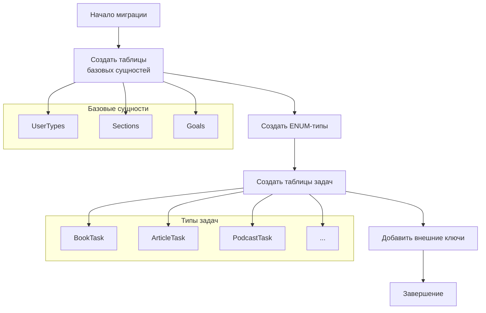



# Практическая реализация CRUD-операций

## Создание и поддержка структуры базы данных

При работе с реляционными базами данных недостаточно просто выполнять операции чтения и записи данных (DML). 
Необходимо также управлять самой структурой хранилища: 
создавать и модифицировать таблицы, определять типы данных, 
устанавливать связи между сущностями и настраивать ограничения целостности. 
Для решения этой задачи мы создаем специализированный **сервис миграций**.

#### Ключевые функции сервиса миграций:

- **Создание таблиц (CREATE TABLE)**: Инициализация структурированных контейнеров для хранения различных типов данных, 
  с определением типов колонок, первичных ключей и других атрибутов.
- **Создание пользовательских типов данных (CREATE TYPE)**: Определение домен-специфичных типов, таких как ENUM в PostgreSQL, 
  которые обеспечивают семантическую точность и ограничение допустимых значений на уровне БД.
- **Установка связей между таблицами (FOREIGN KEY)**: Формальное определение отношений "один-ко-многим" 
  или "многие-ко-многим" между сущностями, что является основой реляционной модели.
- **Настройка ограничений целостности (CONSTRAINTS)**: Реализация бизнес-правил непосредственно 
  в схеме данных через CHECK-ограничения, UNIQUE-ограничения и NOT NULL, что предотвращает попадание некорректных данных в систему.
- **Обеспечение идемпотентности**: Использование конструкций `CREATE TABLE IF NOT EXISTS` гарантирует, 
  что скрипты миграции можно безопасно запускать многократно без ошибок.

### Проектирование и реализация сервиса миграций PostgreSQL

Создаем класс `PostgreSQLMigrationService`, который инкапсулирует всю логику инициализации схемы БД. 
Класс объявляется как `private[services]`, что ограничивает его использование только в пределах пакета `services`, 
и делает его доступным только для внутреннего использования, предотвращая случайный вызов извне.

```dotty
// pdp/src/main/scala/ru/scalabook/pdp/services/postgresql/PostgreSQLMigrationService.scala
package ru.scalabook.pdp.services.postgresql

import cats.*
import cats.effect.*
import doobie.*
import doobie.implicits.*
import doobie.util.transactor.Transactor.Aux
import ru.scalabook.pdp.model.*
import ru.scalabook.sql.SqlMacros.*
import ru.scalabook.sql.TableSchema

/** Сервис для управления структурой базы данных PostgreSQL. Отвечает за
  * создание таблиц, типов, установку связей и ограничений.
  *
  * @param xa
  *   {{{Transactor[F]}}} - абстракция Doobie для выполнения запросов в
  *   контексте F.
  */
private[services] class PostgreSQLMigrationService[F[_]: MonadCancelThrow](
  xa: Aux[[x] =>> F[x], Unit]
):
  import PostgreSQLMigrationService.*

  /** Основной метод инициализации базы данных. Выполняет последовательность
    * DDL-запросов для создания всей необходимой структуры. Все операции
    * выполняются в единой транзакции для атомарности.
    *
    * @return
    *   {{{F[Unit]}}} - эффект, представляющий операцию инициализации.
    */
  def initialize(): F[Unit] =
    val program =
      for
        // 1. Создание таблиц для базовых сущностей
        _ <- generateCreateTableFor[UserType].update.run
        _ <- generateCreateTableFor[Section].update.run
        _ <- generateCreateTableFor[Goal].update.run

        // 2. Создание пользовательского типа ENUM для статуса задачи
        _ <- generateCreateEnumType[Status].update.run

        // 3. Создание таблиц для различных типов задач
        _ <- generateCreateTableFor[BookTask].update.run
        _ <- addSectionFKToTable[BookTask]().update.run
        _ <- addGoalFKToTable[BookTask]().update.run

        _ <- generateCreateTableFor[ArticleTask].update.run
        _ <- addSectionFKToTable[ArticleTask]().update.run
        _ <- addGoalFKToTable[ArticleTask]().update.run

        _ <- generateCreateTableFor[PodcastTask].update.run
        _ <- addSectionFKToTable[PodcastTask]().update.run
        _ <- addGoalFKToTable[PodcastTask]().update.run

        _ <- generateCreateTableFor[VideoTask].update.run
        _ <- addSectionFKToTable[VideoTask]().update.run
        _ <- addGoalFKToTable[VideoTask]().update.run

        _ <- generateCreateTableFor[CourseTask].update.run
        _ <- addSectionFKToTable[CourseTask]().update.run
        _ <- addGoalFKToTable[CourseTask]().update.run

        _ <- generateCreateTableFor[UserTask].update.run
        _ <- addSectionFKToTable[UserTask]().update.run
        _ <- addGoalFKToTable[UserTask]().update.run

        // 4. Установка дополнительных внешних ключей
        _ <- userTypeFK.update.run
      yield ()
    // Преобразование программы ConnectionIO в F с использованием Transactor
    program.transact(xa)
  end initialize

end PostgreSQLMigrationService

/** Сопутствующий объект, содержащий вспомогательные запросы и константы.
  */
private[services] object PostgreSQLMigrationService:
  /** Запрос для установки внешнего ключа между таблицей user_tasks и
    * user_types. UserTask содержит ссылку на пользовательский тип задачи.
    */
  private val userTypeFK =
    sql"""ALTER TABLE user_tasks
            ADD CONSTRAINT fk_user_types
            FOREIGN KEY (user_type_id) REFERENCES user_types(id);"""

  /** Генерирует запрос для добавления внешнего ключа на таблицу разделов
    * (sections). Использует контекстный параметр TableSchema[T] для получения
    * имени таблицы.
    *
    * @tparam T
    *   Тип задачи, для которой добавляется внешний ключ.
    * @return
    *   Fragment с SQL-запросом ALTER TABLE.
    */
  private def addSectionFKToTable[T: TableSchema as schema](): Fragment =
    Fragment.const(
      s"""ALTER TABLE "${schema.tableName}"
            ADD CONSTRAINT fk_section
            FOREIGN KEY (section_id) REFERENCES sections(id);"""
    )

  /** Генерирует запрос для добавления внешнего ключа на таблицу целей (goals).
    */
  private def addGoalFKToTable[T: TableSchema as schema](): Fragment =
    Fragment.const(
      s"""ALTER TABLE "${schema.tableName}"
            ADD CONSTRAINT fk_goal
            FOREIGN KEY (goal_id) REFERENCES goals(id);"""
    )
end PostgreSQLMigrationService
```

### Архитектурные решения и их обоснование

#### 1. **Выбор плоской структуры таблиц**

Мы сознательно отказались от следующих альтернативных подходов:

- **EAV (Entity-Attribute-Value)**: Одна таблица для всех типов задач с колонками `entity_id`, `attribute`, `value`. 
  Приводит к сложным запросам и проблемам с производительностью.
- **Единая таблица с JSON-полями**: Хранение специфичных атрибутов (авторы, длительность) в JSONB. 
  Упрощает схему, но усложняет запросы и валидацию.

**Наше решение**: Отдельная таблица для каждого конкретного типа задачи (`books`, `articles`, `podcasts` и т.д.).

**Преимущества:**

- **Производительность**: Простые SELECT/INSERT/UPDATE запросы, эффективное использование индексов.
- **Типобезопасность**: Каждая таблица имеет строго типизированную схему, соответствующую доменному типу.
- **Ясность и простота**: Структура БД непосредственно отражает доменную модель, что упрощает понимание и отладку.
- **Возможности оптимизации**: Возможность создать специализированные индексы для каждого типа задач.

#### 2. **Использование внешних ключей для обеспечения ссылочной целостности**

Внешние ключи (`FOREIGN KEY`) — не просто техническая деталь, а важный инструмент проектирования:

- **Гарантии целостности**: PostgreSQL предотвращает:
    - Создание задачи с несуществующим `section_id` или `goal_id`.
    - Удаление раздела, на который ссылаются задачи (по умолчанию), если не используется `ON DELETE CASCADE`.
- **Семантическая ясность**: Явно декларирует отношения между сущностями в схеме БД.
- **Возможность каскадных операций**: При необходимости можно настроить `ON DELETE CASCADE` 
  для автоматического удаления зависимых задач.

#### 3. **Критическая важность порядка выполнения операций**

Последовательность выполнения DDL-запросов строго регламентирована:



**Логика порядка:**

1. **Сначала базовые таблицы**: `user_types`, `sections`, `goals` создаются первыми, так как на них ссылаются другие таблицы.
2. **Затем пользовательские типы**: ENUM `StatusEnum` должен существовать до создания таблиц задач, которые его используют.
3. **Таблицы задач**: Создаются после того, как все типы и базовые таблицы готовы.
4. **Внешние ключи в конце**: Устанавливаются после создания всех таблиц, на которые они ссылаются.

Нарушение этого порядка приведет к ошибкам выполнения SQL.

## Реализация конкретных сервисов работы с PostgreSQL

### Конкретизация абстрактных алгебр: от интерфейса к реализации

Принцип **"Program to an interface, not an implementation"** является фундаментальным 
в объектно-ориентированном и функциональном программировании. В нашем контексте это означает:

- **Абстрактный уровень**: Трейт `UserTypeService[F[_]]` определяет **что** нужно сделать (контракт).
- **Конкретный уровень**: Класс `PostgreSQLUserTypeService` определяет **как** это сделать для PostgreSQL (реализация).

Такое разделение обеспечивает несколько ключевых преимуществ:

- **Свобода замены реализации**: Возможность перейти с PostgreSQL на другую СУБД (MySQL, SQLite) 
  или даже на in-memory хранилище для тестов, модифицируя только слой реализации.
- **Упрощение тестирования**: Бизнес-логика может тестироваться с mock-реализациями, не требуя развернутой БД.
- **Соблюдение принципа инверсии зависимостей**: Высокоуровневые модули (бизнес-логика) зависят от абстракций, 
  а не от деталей низкоуровневых модулей (работы с БД).

### Структура и реализация PostgreSQLUserTypeService

Класс `PostgreSQLUserTypeService` является конкретной реализацией алгебры `UserTypeService[F]`, использующей PostgreSQL в качестве бэкенда.

```dotty
// pdp/src/main/scala/ru/scalabook/pdp/services/postgresql/PostgreSQLUserTypeService.scala
package ru.scalabook.pdp.services.postgresql

// `doobie` необходимо импортировать через `_root_` из-за конфликта имен
// с `io.github.iltotore.iron.doobie`
import _root_.doobie.*
import _root_.doobie.implicits.*
import _root_.doobie.util.transactor.Transactor.*
import cats.data.NonEmptyVector
import cats.effect.*
import cats.syntax.all.*
import io.github.iltotore.iron.*
// Импорт неявных преобразований для Iron-типов
import io.github.iltotore.iron.doobie.given 
import ru.scalabook.pdp.model
import ru.scalabook.pdp.model.*
import ru.scalabook.pdp.model.Section.SectionName.given
import ru.scalabook.pdp.model.User.UserId
import ru.scalabook.pdp.model.UserType.{UserTypeId, UserTypeName}
import ru.scalabook.pdp.services.UserTypeService
import ru.scalabook.sql.SqlMacros.*

/** Конкретная реализация UserTypeService для PostgreSQL. Наследует абстрактный
  * интерфейс UserTypeService[F] и предоставляет реализацию всех его методов с
  * использованием Doobie и сгенерированного SQL.
  *
  * @param xa
  *   Transactor[[x] =>> F[x], Unit] - Doobie Transactor для выполнения
  *   запросов.
  */
private[services] class PostgreSQLUserTypeService[F[_]: MonadCancelThrow](
    xa: Aux[[x] =>> F[x], Unit]
) extends UserTypeService[F]:

  /** Создает новый пользовательский тип задачи. Использует макрос
    * generateInsertReturningId для генерации параметризованного INSERT-запроса.
    *
    * @param newItem
    *   Новый тип задачи.
    * @return
    *   {{{F[UserTypeId]}}} - эффект, который при выполнении вернет ID созданной
    *   записи.
    */
  def create(newItem: CreateUserType): F[UserTypeId] =
    generateInsertReturningId[UserType, CreateUserType, UserTypeId](newItem)
      .query[UserTypeId] // Указываем, что запрос возвращает UserTypeId
      .unique            // Ожидаем ровно одну запись (возвращаемый ID)
      .transact(xa)      // Выполняем в контексте транзакции

  /** Получает пользовательский тип задачи по его ID.
    *
    * @param id
    *   Идентификатор типа задачи.
    * @return
    *   {{{F[Option[UserType]]}}} - эффект, возвращающий опциональный результат.
    */
  def get(id: UserTypeId): F[Option[UserType]] =
    generateSelectById[UserType, UserTypeId](id)
      .query[UserType]  // Указываем тип результата - UserType
      .option           // Может вернуть 0 или 1 запись
      .transact(xa)

  /** Получает все пользовательские типы задач.
    *
    * @return
    *   {{{F[Vector[UserType]]}}} - эффект, возвращающий список всех типов.
    */
  def getByUser(userId: UserId): F[Vector[UserType]] =
    generateSelectByField[UserType, UserId](userId, "user_id")
      .query[UserType] // Селект всех полей
      .to[Vector]        // Преобразуем поток результатов в Vector
      .transact(xa)    

  /** Обновляет существующий пользовательский тип задачи.
    *
    * @param userType
    *   Объект UserType с обновленными данными (должен содержать существующий
    *   ID).
    * @return
    *   {{{F[Unit]}}} - эффект, подтверждающий выполнение операции.
    */
  def update(userType: UserType): F[Unit] =
    generateUpdateById[UserType, UserTypeId](userType)
      .update        // Указываем, что это update-запрос
      .run           // Выполняем, игнорируя количество измененных строк
      .transact(xa)
      .void          // Преобразуем F[Int] в F[Unit]

  /** Пакетно обновляет несколько пользовательских типов задач. 
    * Этот метод используется, например, при массовом изменении порядка (reordering)
    * типов, когда необходимо обновить ordinal для списка элементов.
    * 
    * Реализация последовательно выполняет UPDATE-запросы для каждого элемента списка
    * в рамках единой транзакции. Для оптимизации можно было бы использовать 
    * batch-запрос, но текущая реализация обеспечивает простоту и надежность.
    *
    * @param userTypes
    *   NonEmptyVector[UserType] - гарантированно непустой список типов для обновления.
    * @return
    *   {{{F[Unit]}}} - эффект, подтверждающий выполнение всех операций обновления.
    */
  def updateAll(userTypes: NonEmptyVector[UserType]): F[Unit] =
    def toConn: UserType => ConnectionIO[Int] =
      generateUpdateById[UserType, UserTypeId](_).update.run
    
    // Сворачиваем хвост списка, начиная с первого элемента.
    // Используем оператор *> (sequencing) для последовательного выполнения запросов
    // с игнорированием промежуточных результатов (важен только побочный эффект).
    userTypes.tail.foldLeft(toConn(userTypes.head)) { case (acc, userType) =>
      acc *> toConn(userType)
    }
      .transact(xa)  // Выполняем всю последовательность в одной транзакции
      .void          
    
  /** Удаляет пользовательский тип задачи по ID.
    *
    * @param id
    *   Идентификатор типа задачи для удаления.
    * @return
    *   F[Unit] - эффект, подтверждающий выполнение операции.
    */
  def delete(id: UserTypeId): F[Unit] =
    generateDeleteById[UserType, UserTypeId](id)
      .update
      .run
      .transact(xa)
      .void

end PostgreSQLUserTypeService
```

### Принцип минимального и точного соответствия контракту

Важнейший аспект реализации — строгое соблюдение контракта, определенного в интерфейсе `UserTypeService`.

#### Что означает "реализовывать только необходимые методы"?

1. **Точное соответствие сигнатурам**: Класс реализует ровно те методы, которые объявлены в трейте, 
   с точно такими же типами параметров и возвращаемых значений.
2. **Отсутствие дополнительных публичных методов**: Класс не добавляет новых публичных методов, 
   которые не были бы частью контракта.
3. **Инкапсуляция деталей реализации**: Все вспомогательные функции, специфичные для PostgreSQL, 
   должны быть приватными методами или функциями в сопутствующем объекте.

**Пример нарушения принципа (антипаттерн):**

```dotty
// ❌ НЕПРАВИЛЬНО: Класс добавляет методы, не объявленные в интерфейсе
class PostgreSQLTaskService extends TaskService[IO]:
  // Методы из интерфейса - правильно
  def create(task: CreateTask): IO[TaskId] = ...
  def get(id: TaskId, taskType: TaskType): IO[Option[Task]] = ...

  // Лишний публичный метод - НЕПРАВИЛЬНО!
  def internalDatabaseOptimization(): IO[Unit] = ...

  // Метод, меняющий сигнатуру - НЕПРАВИЛЬНО!
  def getAll(limit: Int): IO[Vector[Task]] = ... // В интерфейсе нет параметра limit!
```

**Пример правильной реализации:**

```dotty
// ✅ ПРАВИЛЬНО: Точное соответствие интерфейсу
class PostgreSQLTaskService extends TaskService[IO]:
  // Только методы из интерфейса
  def create(task: CreateTask): IO[TaskId] = ...
  def get(id: TaskId, taskType: TaskType): IO[Option[Task]] = ...
  def getByUser(userId: UserId): IO[Vector[Task]] = ...  // Без параметров, как в интерфейсе
  def update(task: Task): IO[Unit] = ...
  def delete(id: TaskId, taskType: TaskType): IO[Unit] = ...

  // Приватные вспомогательные методы - допустимо
  private def buildWhereClause(filters: Map[String, String]): String = ...
```

### Механизм преобразования типов: роль неявных параметров (given instances)

Ключевой элемент, обеспечивающий работу кода — это система неявных параметров (given instances) в Scala 3.

#### Что происходит при вызове `.query[UserType]`?

```dotty
generateSelectById[UserType, UserTypeId](id)
  .query[UserType]  // "Магическое" преобразование!
  .option
  .transact(xa)
```

1. **Doobie ищет неявный `Get[UserType]`**: Метод `query[T]` требует наличия в неявной области видимости 
   экземпляра типа `Get[T]` — класса типов Doobie, который знает, как преобразовать строку результата SQL в объект типа `T`.

2. **Импорт `iron.doobie.given` решает проблему**:

   ```dotty
   import io.github.iltotore.iron.doobie.given
   ```

   Этот импорт предоставляет автоматические экземпляры `Get` и `Put` для уточненных типов, 
   таких как `UserTypeName`, `UserTypeId` и составных case class, содержащих такие поля.

3. **Автоматическая деривация**: Для case class'ов, таких как `UserType`, 
   Doobie может автоматически сгенерировать `Get[UserType]`, 
   если для всех его полей существуют соответствующие экземпляры `Get`.

### Правила корректного использования неявных параметров

Неявные параметры — мощный инструмент, но их неправильное использование может сделать код запутанным и сложным для понимания.

#### ❌ Типичные ошибки и антипаттерны:

```dotty
// 1. Использование неявных параметров для передачи бизнес-данных
def processOrder()(using order: Order): IO[Unit] =  
  // ❌ АНТИПАТТЕРН!
  // Где взять order? Кто его должен установить? Код становится неявным.

// 2. Изменение поведения через неявные параметры
def calculatePrice(using discountCalculator: DiscountCalculator): Money =  
  // ❌ Опасно!
  // Теперь результат зависит от скрытого контекста.

// 3. Чрезмерное использование для "удобства"
def getUser(using id: UserId, using db: Database, using logger: Logger): IO[User] =  
  // ❌ Слишком много!
  // Код становится запутанным, сложно понять зависимости.
```

#### ✅ Правильные сценарии использования:

```dotty
// 1. Конфигурация и настройки (неизменяемые)
def initializeService(using config: AppConfig): IO[Service] =  // ✅ Правильно

// 2. Сессии и аутентификация (в пределах запроса)
def getCurrentUser(using session: UserSession): IO[User] =  // ✅ Правильно

// 3. Кодеки и сериализаторы (инфраструктура)
def decodeResponse[T](response: String)(using decoder: Decoder[T]): IO[T] =  // ✅ Правильно

// 4. Логирование и телеметрия
def businessOperation(input: Input)(using logger: Logger): IO[Output] =  // ✅ Правильно
```

### Интеграция с другими сервисами: Sections и Goals

Реализация сервисов для `Section` и `Goal` следует точно такой же схеме, что и для `UserType`. 
Различия минимальны и касаются только:

1. **Типов доменных моделей**: Вместо `UserType` используются `Section` и `Goal`.
2. **Типов идентификаторов**: `SectionId` и `GoalId` вместо `UserTypeId`.
3. **Типов параметров создания**: `CreateSection` и `CreateGoal` вместо `CreateUserType`.

Структура кода остается идентичной, демонстрируя преимущества нашего подхода:

- **Повторное использование шаблона**: Однажды разработанный паттерн применяется ко всем сущностям.
- **Согласованность**: Все сервисы выглядят и работают одинаково, что упрощает понимание системы.
- **Масштабируемость**: Добавление новой сущности требует минимальных усилий — в основном, это копирование шаблона с заменой типов.

Ссылка на полные реализации: 
[PostgreSQLSectionService](https://gitverse.ru/scalabook/pdp/content/master/pdp/src/main/scala/ru/scalabook/pdp/services/postgresql/PostgreSQLSectionService.scala) 
и [PostgreSQLGoalService](https://gitverse.ru/scalabook/pdp/content/master/pdp/src/main/scala/ru/scalabook/pdp/services/postgresql/PostgreSQLGoalService.scala).

## Реализация CRUD-операций для системы задач (Tasks)

В системе управления задачами мы сталкиваемся с фундаментальной проектной задачей: 
необходимо хранить множество различных типов задач, каждый из которых обладает уникальными атрибутами и структурой данных. 
Это классическая проблема представления полиморфных данных в реляционной базе данных.

### Проблематика разнородных структур данных

Наша доменная модель включает шесть различных типов задач, каждый со своей специфической структурой:

- **BookTask** (Книги): Содержит атрибуты, специфичные для книг — авторы (`authors`), количество страниц (`pages`).
- **ArticleTask** (Статьи): Включает URL-ссылку на статью (`link`), предполагаемое время чтения (`duration`).
- **PodcastTask** (Подкасты): Характеризуется длительностью эпизодов (`episode_duration`), количеством эпизодов (`episodes`).
- **VideoTask** (Видео): Содержит информацию о платформе (`platform` — YouTube, Vimeo), длительность видео (`duration`), ссылку на видео.
- **CourseTask** (Курсы): Включает данные о платформе курса (`platform` — Coursera, Udemy), ссылку на курс.
- **UserTask** (Пользовательские задачи): Представляет общие задачи с продолжительностью (`duration`).

Каждый тип задачи имеет как **общие атрибуты** (наследуемые от базового типа `Task` — имя, статус, сроки), 
так и **специфические атрибуты**, уникальные для данного типа.

### Выбранная стратегия: Table per Concrete Class (TPCC)

Для решения проблемы полиморфного хранения мы применяем стратегию ["Table per Concrete Class" (TPCC)](https://docs.oracle.com/cd/E19798-01/821-1841/bnbqu/index.html), 
также известную как "Concrete Table Inheritance". 
В этой стратегии каждая конкретная реализация задачи хранится в своей собственной таблице.

```sql
-- Пример структуры БД при TPCC подходе
CREATE TABLE books (id UUID, name VARCHAR, user_id UUID, status StatusEnum, ..., authors VARCHAR, pages INT);
CREATE TABLE articles (id UUID, name VARCHAR, user_id UUID, status StatusEnum, ..., link TEXT, duration BIGINT);
CREATE TABLE podcasts (id UUID, name VARCHAR, user_id UUID, status StatusEnum, ..., episodes INT, episode_duration BIGINT);
-- ... и так для каждого типа задач
```

#### Преимущества подхода TPCC:

1. **Оптимальная производительность**:

    - Отсутствуют колонки с `NULL` значениями для нерелевантных атрибутов 
      (в таблице `books` нет колонки `link`, в таблице `articles` нет колонки `pages`).
    - Уменьшается размер строк, что повышает эффективность кэширования и скорость чтения.
    - Упрощенные индексы — можно индексировать только релевантные для типа колонки.

2. **Максимальная типобезопасность на уровне БД**:

    - Каждая таблица имеет строгую схему, соответствующую конкретному типу задачи.
    - Ограничения `NOT NULL` применяются только к действительно обязательным полям.
    - Внешние ключи и проверочные ограничения могут быть специфичными для каждого типа.

3. **Прозрачность и понятность структуры**:

    - Схема базы данных напрямую отражает доменную модель.
    - Разработчикам и администраторам БД интуитивно понятно, где и какие данные хранятся.
    - Упрощается написание аналитических запросов и отчетов.

4. **Эффективное использование специфичных для типа индексов**:

    - Для `books` можно создать индекс по `authors`.
    - Для `videos` можно создать индекс по `platform`.
    - Для `courses` можно создать составной индекс по `platform` и `progress`.

#### Альтернативные подходы и их недостатки:

- **Единая таблица со всеми полями (Single Table Inheritance)**:

  ```sql
  CREATE TABLE tasks (
      id UUID, name VARCHAR, user_id UUID, task_type VARCHAR,
      authors VARCHAR, pages INT, link TEXT, duration BIGINT,
      platform VARCHAR, episodes INT, episode_duration BIGINT
      -- большинство полей будут NULL в большинстве записей
  );
  ```

  **Проблемы**: Раздутая таблица, много `NULL` значений, сложные индексы.

- **Общая таблица + расширения (Class Table Inheritance)**:

  ```sql
  CREATE TABLE tasks (id UUID, name VARCHAR, task_type VARCHAR);
  CREATE TABLE book_details (task_id UUID, authors VARCHAR, pages INT);
  CREATE TABLE article_details (task_id UUID, link TEXT, duration BIGINT);
  ```

  **Проблемы**: Необходимость join-ов для получения полных данных, сложность поддержки целостности.

- **Хранение специфичных данных в JSONB**:
  ```sql
  CREATE TABLE tasks (id UUID, name VARCHAR, task_type VARCHAR, specific_data JSONB);
  ```
  **Проблемы**: Потеря типобезопасности, сложность валидации, ограниченные возможности индексации.

## Реализация специальных преобразований типов для работы с Doobie

### Проблема соответствия типов Scala и SQL

Doobie, как библиотека для типобезопасной работы с БД, 
требует явного определения преобразований между типами Scala и соответствующими SQL-типами. 
Для большинства стандартных типов (`Int`, `String`, `LocalDate`) эти преобразования предоставляются автоматически. 
Однако для пользовательских типов и сложных структур необходимо определить преобразования вручную.

Типы, требующие специального внимания в нашем проекте:

1. **Перечисления (enum)**: `Status` — пользовательский enum, не имеющий прямого аналога в SQL.
2. **Коллекции**: `Vector[TaskStep]` — список пользовательских типов, которые должны храниться как массив в PostgreSQL.
3. **Опциональные значения**: `Option[LocalDate]` — дата, которая может отсутствовать, требует особой обработки NULL.
4. **Специализированные типы измерений**: `FiniteDuration` — представление длительности, которое эффективнее хранить как число.

### Детали реализации преобразований

#### 1. Преобразование для перечисления `Status`

```dotty
// Доменный тип - перечисление статусов задачи
enum Status:
  case InProgress, Planned, KnowledgeBase, Completed

object Status:
  /** Ручное определение преобразования между типом Status и строковым
    * представлением в БД. Doobie требует наличия экземпляра Meta[Status] для
    * работы с этим типом в запросах.
    *
    * Методология: Используем преобразование через String как промежуточный тип.
    */
  given Meta[Status] = Meta[String].timap(Status.valueOf)(_.toString)
```

**Механизм работы преобразования:**

- `Meta[String]` — базовый преобразователь Doobie для строкового типа.
- `.timap(f)(g)` — метод, создающий двунаправленное преобразование:
    - `f: String => Status` — функция чтения из БД (строка → enum)
    - `g: Status => String` — функция записи в БД (enum → строка)

**Оценка безопасности подхода:**

Данное решение безопасно при следующих условиях:

- **Контролируемая запись**: Только наш код пишет данные в таблицы статусов.
- **Валидация на входе**: Все значения статусов проходят валидацию перед записью.
- **Стабильность enum**: Имена case-объектов произвольно не меняются.

**Риски при эволюции системы:**

Изменение перечисления требует скоординированных действий:

```dotty
// Пример опасного изменения:
enum Status:
  case InProgress, Planned, KnowledgeBase
  // Добавление нового статуса - безопасно
  case Completed

  // Переименование - ОПАСНО!
  // case InProgress -> case InWork // Требует миграции данных!
```

#### 2. Преобразование для уточненного типа `TaskStep`

```dotty
type TaskStep = TaskStep.T

object TaskStep
    extends RefinedType[String, MinLength[2] & MaxLength[200] & Trimmed]:

  /** Преобразование для списка шагов задач. PostgreSQL хранит массивы строк
    * как Array[String], а мы используем List[TaskStep].
    */
  given Meta[List[TaskStep]] =
    Meta[Array[String]].timap(
      // Преобразование из БД в Scala: Array[String] -> List[TaskStep]
      _.map(TaskStep.applyUnsafe).toList
    )(
      // Преобразование из Scala в БД: List[TaskStep] -> Array[String]
      _.map(_.toString).toArray
    )
```

**Особенности реализации:**

- **Использование `applyUnsafe`**: Поскольку данные приходят из нашей же БД, мы можем предположить,
  что они уже прошли валидацию при вставке. Валидация выполняется при создании объектов `TaskStep` на уровне приложения.
- **Преобразование коллекций**: Doobie требует отдельного экземпляра `Meta` для `List[TaskStep]`, а не только для `TaskStep`.
- **Эффективность работы с массивами**: PostgreSQL эффективно работает с массивами, 
  что позволяет хранить списки шагов без создания дополнительных таблиц связей.

#### 3. Преобразования для `Option[LocalDate]` и `FiniteDuration`

```dotty
// Файл: pdp/src/main/scala/ru/scalabook/pdp/model/src.scala
package ru.scalabook.pdp.model

// ... остальная часть модели

/** Преобразование для опциональной даты. Option[LocalDate] соответствует
  * nullable колонке DATE в PostgreSQL.
  */
given Meta[Option[LocalDate]] =
  Meta[LocalDate].imap[Option[LocalDate]](
    // Из БД (не NULL) -> Some(date)
    // Из БД (NULL) -> None
    date => Option(date) 
  )(
    // В БД: Some(date) -> date, None -> NULL
    _.orNull             
  )

/** Преобразование для длительности. Храним как BIGINT (миллисекунды) для
  * эффективности и точности.
  */
given Meta[FiniteDuration] =
  Meta[Long].timap(
    // Из БД: Long -> FiniteDuration
    millis => FiniteDuration(millis, MILLISECONDS)  
  )(
    // В БД: FiniteDuration -> Long
    _.toMillis                  
  )    
```

**Обоснование выбранных представлений:**

- **`Option[LocalDate]`**: Использование `null` в БД для представления отсутствующего значения — это идиоматичный подход в SQL, 
  который эффективно поддерживается индексами и запросами.
- **`FiniteDuration` как `Long`**: Хранение длительности в миллисекундах как целого числа:
    - Исключает проблемы с точностью чисел с плавающей точкой.
    - Позволяет эффективно выполнять арифметические операции в SQL.
    - Упрощает индексирование и сортировку по длительности.

## Принципы организации неявных экземпляров

Когда компилятор Scala 3 ищет неявный экземпляр (given instance), он следует определенному порядку поиска. 
Размещение экземпляров в правильных местах критически важно для предсказуемости работы системы и предотвращения конфликтов.

##### Уровень 1: **Сопутствующий объект типа данных (Наивысший приоритет)**

```dotty
enum Status:
  case InProgress, Planned, KnowledgeBase, Completed

// Идеальное размещение - в сопутствующем объекте самого типа
object Status:
  given Meta[Status] = Meta[String].timap(Status.valueOf)(_.toString)
```

**Преимущества:**

- **Автоматическое обнаружение**: Компилятор всегда найдет экземпляр при работе с типом `Status`.
- **Единственность источника**: Гарантирует, что существует только один экземпляр для данного типа.
- **Семантическая группировка**: Все связанное с типом находится в одном месте.
- **Простота поиска**: Разработчики интуитивно ищут преобразования в сопутствующем объекте типа.

##### Уровень 2: **Сопутствующий объект класса типов**

```dotty
// Альтернатива - если не можем изменить исходный тип
object Meta:  // Сопутствующий объект класса типов Meta
  given Meta[Status] = Meta[String].timap(Status.valueOf)(_.toString)
```

**Применение:**

- Для типов из внешних библиотек, которые мы не можем изменить.
- Для группировки экземпляров по функциональному признаку.
- Когда один тип требует нескольких экземпляров для разных контекстов (редкий случай).

##### Уровень 3: **Специализированный объект с явным импортом**

```dotty
// Создаем явный контейнер для экземпляров
object DatabaseTypeConversions:
  given Meta[Status] = Meta[String].timap(Status.valueOf)(_.toString)
  given Meta[List[TaskStep]] = ...

// Явно импортируем там, где нужно
import DatabaseTypeConversions.given
```

**Использование:**

- Для организации экземпляров по доменным областям.
- Когда нужен явный контроль над тем, какие экземпляры доступны.
- Для модульного тестирования с разными наборами экземпляров.

#### Опасность сиротствующих экземпляров (Orphan Instances)

[Сиротствующий экземпляр](https://pjrt.medium.com/orphan-instances-in-scala-322caa78e382) — это given instance, который объявлен вне сопутствующего объекта типа данных 
и вне сопутствующего объекта класса типов. Такие экземпляры создают серьезные проблемы в поддержке кода.

##### ❌ Пример опасного размещения:

```dotty
// Файл: src/main/scala/utils/SomeUtility.scala
package utils

// Сиротствующий экземпляр
given Meta[Status] =
  Meta[String].timap(Status.valueOf)(_.toString)

// Проблемы:
// 1. Не связано ни с Status, ни с Meta
// 2. Может быть объявлено в нескольких местах
// 3. Трудно найти при отладке
```

##### Проблемы, создаваемые сиротствующими экземплярами:

1. **Сложность обнаружения и понимания**:

   ```dotty
   // Код работает "магически"
   val status: Status = sql"SELECT status FROM tasks".query[Status].unique
   // Откуда берется преобразование? Где искать?
   ```

2. **Конфликты и неоднозначности**:

   ```dotty
   // Файл A.scala
   given Meta[Status] = Meta[String].timap(Status.valueOf)(_.toString)

   // Файл B.scala
   given Meta[Status] = Meta[Int].timap(i => Status.values(i))(_.ordinal)

   // Результат: ошибка компиляции "ambiguous implicit values"
   ```

3. **Непредсказуемое поведение**:

   ```dotty
   // В зависимости от порядка импортов может использоваться разный экземпляр
   import A.given  // Используется строковое представление
   import B.given  // Конфликт! Какой экземпляр выберет компилятор?
   ```

4. **Сложности при рефакторинге и поддержке**:
    - При перемещении типов между модулями экземпляры могут "потеряться".
    - Сборка больших проектов может зависеть от тонкостей порядка компиляции.
    - Автоматический рефакторинг инструментов может не учитывать сиротствующие экземпляры.

## Реализация сервиса работы с задачами

### Операция создания задачи (Create)

Реализация метода `create` демонстрирует обработку полиморфизма через сопоставление с образцом (pattern matching):

```dotty
/** Создает новую задачу в базе данных. Определяет конкретный тип задачи и
  * вызывает соответствующий сгенерированный SQL.
  *
  * @param task
  *   Данные для создания задачи (абстрактный CreateTask).
  * @return
  *   IO[TaskId] - эффект, возвращающий идентификатор созданной задачи.
  */
def create(task: CreateTask): IO[TaskId] =
  task match
    case book: CreateBookTask =>
      // Для книг: используем макрос для BookTask
      generateInsertReturningId[BookTask, CreateBookTask, TaskId](book)
        .query[TaskId]
        .unique
        .transact(xa)

    case article: CreateArticleTask =>
      // Для статей: используем макрос для ArticleTask
      generateInsertReturningId[ArticleTask, CreateArticleTask, TaskId](article)
        .query[TaskId]
        .unique
        .transact(xa)

    case podcast: CreatePodcastTask =>
      // Для подкастов: аналогично
      generateInsertReturningId[PodcastTask, CreatePodcastTask, TaskId](podcast)
        .query[TaskId]
        .unique
        .transact(xa)

    case video: CreateVideoTask =>
      generateInsertReturningId[VideoTask, CreateVideoTask, TaskId](video)
        .query[TaskId]
        .unique
        .transact(xa)

    case course: CreateCourseTask =>
      generateInsertReturningId[CourseTask, CreateCourseTask, TaskId](course)
        .query[TaskId]
        .unique
        .transact(xa)

    case userTask: CreateUserTask =>
      // Пользовательские задачи хранятся отдельно
      generateInsertReturningId[UserTask, CreateUserTask, TaskId](userTask)
        .query[TaskId]
        .unique
        .transact(xa)
```

**Ключевые аспекты реализации:**

1. **Определение типа во время выполнения**: Хотя на вход приходит абстрактный `CreateTask`, 
   сопоставление с шаблоном позволяет определить конкретный тип и вызвать соответствующий метод.
2. **Использование сгенерированного SQL**: Для каждого типа вызывается специализированный макрос, 
   который генерирует корректный INSERT-запрос с учетом специфичных полей.
3. **Возврат сгенерированного идентификатора**: Все варианты возвращают `TaskId`, 
   который генерируется базой данных (через `DEFAULT gen_random_uuid()`).

### Операция получения одной задачи по идентификатору (Read One)

```dotty
/** Получает конкретную задачу по ее идентификатору и типу. Тип задачи
  * необходим для определения, в какой таблице искать.
  *
  * @param id
  *   Уникальный идентификатор задачи (TaskId).
  * @param taskType
  *   Тип задачи, определяющий таблицу для поиска.
  * @return
  *   IO[Option[Task]] - эффект, возвращающий Optional задачу.
  */
def get(id: TaskId, taskType: TaskType): IO[Option[Task]] =
  taskType match
    case Book =>
      // Поиск в таблице books
      generateSelectById[BookTask, TaskId](id)
        .query[BookTask].option.transact(xa)

    case Article =>
      // Поиск в таблице articles
      generateSelectById[ArticleTask, TaskId](id)
        .query[ArticleTask].option.transact(xa)

    case Podcast =>
      generateSelectById[PodcastTask, TaskId](id)
        .query[PodcastTask].option.transact(xa)

    case Video =>
      generateSelectById[VideoTask, TaskId](id)
        .query[VideoTask].option.transact(xa)

    case Course =>
      generateSelectById[CourseTask, TaskId](id)
        .query[CourseTask].option.transact(xa)

    case Other =>
      // Все остальные типы считаем пользовательскими задачами
      generateSelectById[UserTask, TaskId](id)
        .query[UserTask].option.transact(xa)
```

### Операция получения всех задач (Read All)

```dotty
/** Получает все задачи всех типов из базы данных. Выполняет параллельные
  * запросы к каждой таблице и объединяет результаты.
  *
  * @return
  *   IO[Vector[Task]] - эффект, возвращающий вектор всех задач.
  */
def getByUser(userId: UserId): IO[Vector[Task]] =
  // Параллельное выполнение запросов ко всем таблицам
  (
    generateSelectByField[BookTask, UserId](
      userId,
      "user_id"
    ).query[BookTask].to[Vector].transact(xa),
    generateSelectByField[ArticleTask, UserId](
      userId,
      "user_id"
    ).query[ArticleTask].to[Vector].transact(xa),
    generateSelectByField[PodcastTask, UserId](
      userId,
      "user_id"
    ).query[PodcastTask].to[Vector].transact(xa),
    generateSelectByField[VideoTask, UserId](
      userId,
      "user_id"
    ).query[VideoTask].to[Vector].transact(xa),
    generateSelectByField[CourseTask, UserId](
      userId,
      "user_id"
    ).query[CourseTask].to[Vector].transact(xa),
    generateSelectByField[UserTask, UserId](
      userId,
      "user_id"
    ).query[UserTask].to[Vector].transact(xa)
  ).mapN { // mapN объединяет результаты всех параллельных вычислений
    case (books, articles, podcasts, videos, courses, userTasks) =>
      // Объединение всех результатов в один полиморфный список
      books ++ articles ++ podcasts ++ videos ++ courses ++ userTasks
  }  
```

### Операция обновления задачи (Update)

```dotty
/** Обновляет существующую задачу в базе данных. Определяет конкретный тип
  * задачи и вызывает соответствующий сгенерированный SQL запрос UPDATE.
  *
  * @param task
  *   Объект задачи с обновленными данными. Должен содержать существующий ID.
  * @return
  *   IO[Unit] - эффект, подтверждающий успешное выполнение операции
  *   обновления.
  */
def update(task: Task): IO[Unit] =
  task match
    case book: BookTask =>
      // Обновление книги: генерация UPDATE запроса для таблицы books
      generateUpdateById[BookTask, TaskId](book)
        .update.run.transact(xa).void

    case article: ArticleTask =>
      // Обновление статьи: генерация UPDATE запроса для таблицы articles
      generateUpdateById[ArticleTask, TaskId](article)
        .update.run.transact(xa).void

    case podcast: PodcastTask =>
      // Обновление подкаста: генерация UPDATE запроса для таблицы podcasts
      generateUpdateById[PodcastTask, TaskId](podcast)
        .update.run.transact(xa).void

    case video: VideoTask =>
      // Обновление видео: генерация UPDATE запроса для таблицы videos
      generateUpdateById[VideoTask, TaskId](video)
        .update.run.transact(xa).void

    case course: CourseTask =>
      // Обновление курса: генерация UPDATE запроса для таблицы courses
      generateUpdateById[CourseTask, TaskId](course)
        .update.run.transact(xa).void

    case userTask: UserTask =>
      // Обновление пользовательской задачи: генерация UPDATE запроса для таблицы user_tasks
      generateUpdateById[UserTask, TaskId](userTask)
        .update.run.transact(xa).void
```

### Операция удаления задачи (Delete)

```dotty
/** Удаляет задачу по идентификатору и типу.
  *
  * @param id
  *   Идентификатор задачи для удаления.
  * @param taskType
  *   Тип задачи, определяющий таблицу.
  * @return
  *   IO[Unit] - эффект, подтверждающий выполнение.
  */
def delete(id: TaskId, taskType: TaskType): IO[Unit] =
  taskType match
    case Book =>
      generateDeleteById[BookTask, TaskId](id)
        .update.run.transact(xa).void

    case Article =>
      generateDeleteById[ArticleTask, TaskId](id)
        .update.run.transact(xa).void

    case Podcast =>
      generateDeleteById[PodcastTask, TaskId](id)
        .update.run.transact(xa).void

    case Video =>
      generateDeleteById[VideoTask, TaskId](id)
        .update.run.transact(xa).void

    case Course =>
      generateDeleteById[CourseTask, TaskId](id)
        .update.run.transact(xa).void

    case Other =>
      generateDeleteById[UserTask, TaskId](id)
        .update.run.transact(xa).void
```

## Заключение

Реализация CRUD-операций для системы задач демонстрирует несколько важных архитектурных принципов:

1. **Стратегический выбор модели хранения**: TPCC обеспечивает оптимальный баланс между производительностью и типобезопасностью.
2. **Тщательная работа с типами**: Правильные преобразования между Scala-типами и SQL — основа надежности системы.
3. **Организация кода**: Правильное размещение given instances предотвращает множество проблем в будущем.
4. **Эффективность операций**: Параллельное выполнение запросов и точное указание типов повышают производительность.

Эта реализация обеспечивает прочный фундамент для системы управления задачами, 
который может масштабироваться и эволюционировать вместе с требованиями проекта.

---

**Ссылки:**

- [Персональный план развития][plugin]
- [Репозиторий с исходниками][repo]
- [Ещё один ORM для SQL на Scala][sql-gen]

[repo]: https://gitverse.ru/scalabook/pdp
[plugin]: https://artemkorsakov.github.io/personal-development-plan/ru/
[sql-gen]: https://gitverse.ru/scalabook/sql-gen
