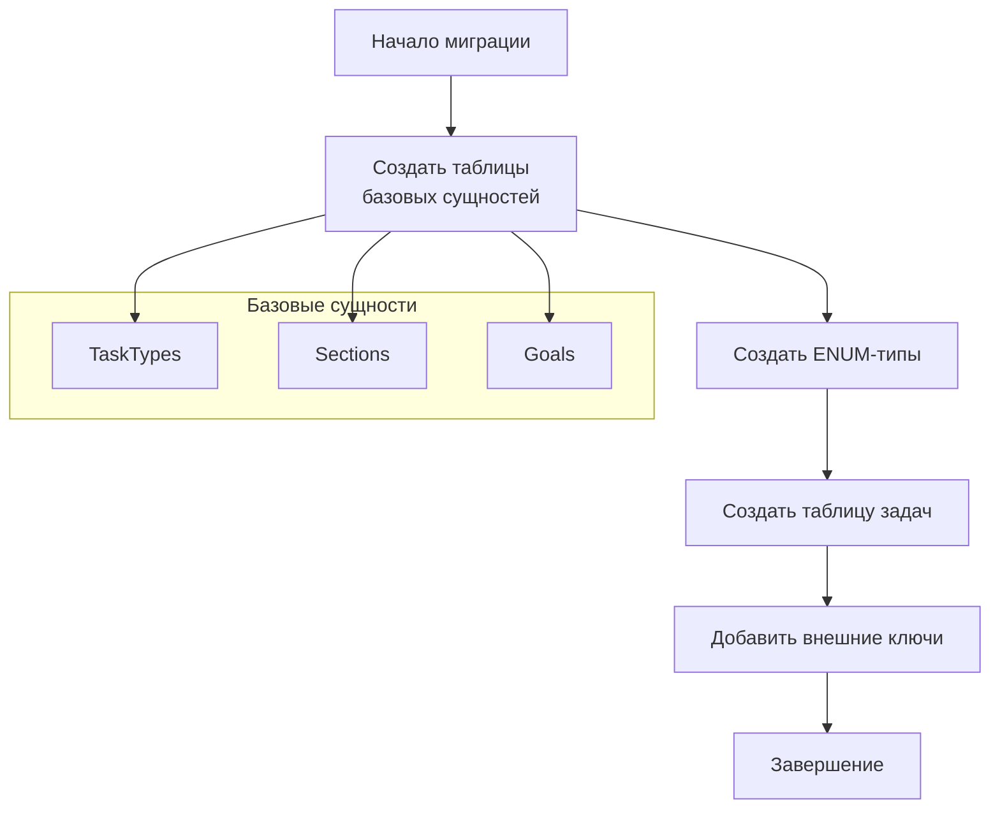



# Практическая реализация CRUD-операций

## Работа с PostgreSQL через библиотеку Doobie

После проектирования алгебр и создания мок-реализаций наступает этап разработки продакшен-реализаций,
которые будут взаимодействовать с реальной системой хранения данных. 
Мы будем использовать **PostgreSQL** — зрелую,
надежную и полнофункциональную реляционную систему управления базами данных (СУБД).

> 💡 **Примечание о переносимости**: Описанные ниже архитектурные принципы и подходы к работе с данными
> являются универсальными и применимы к большинству реляционных баз данных (MySQL, Oracle, SQL Server и др.).
> Технические отличия будут заключаться в основном в синтаксисе SQL-диалектов,
> особенностях драйверов и настройках подключения к конкретной СУБД.

### Выбор библиотеки для доступа к данным: Doobie

Для реализации взаимодействия с PostgreSQL будем использовать библиотеку [Doobie](https://typelevel.org/doobie/index.html).

Doobie — это чисто функциональная JDBC-слой библиотека для работы с реляционными базами данных.
Ее ключевые преимущества:

- **Строго функциональный подход**: Полная интеграция с экосистемой Cats Effect, использование `IO`
  и других абстрактных эффектов для описания всех операций с побочными эффектами (ввод-вывод, работа с сетью).
  Это обеспечивает предсказуемость, тестируемость и композируемость кода.
- **Типобезопасность на уровне компиляции**: Многие распространенные ошибки
  (несоответствие типов между Scala и SQL, опечатки в именах колонок, неверное количество параметров)
  выявляются на этапе компиляции, а не во время выполнения, что значительно повышает надежность приложения.
- **Высокая композируемость**: Запросы в Doobie построены на базе примитивов,
  которые можно комбинировать с помощью монадических операций (`map`, `flatMap`) и аппликативных функторов.
  Это позволяет строить сложные, динамические SQL-запросы из простых, повторно используемых компонентов.
- **Прозрачность и контролируемость**: Библиотека предоставляет удобные инструменты для логирования запросов и их выполнения.

Для начала работы с Doobie необходимо добавить соответствующие зависимости в конфигурацию сборки проекта (файл `project/Dependencies.scala`).

Структура зависимостей для модуля, работающего с базой данных:

```dotty
// Файл: project/Dependencies.scala
object Dependencies {
  object doobie {
    // Рекомендуется использовать актуальную стабильную версию.
    private val version = "1.0.0-RC13"
    val core            = "org.typelevel" %% "doobie-core"     % version
    val free            = "org.typelevel" %% "doobie-free"     % version
    val hikari          = "org.typelevel" %% "doobie-hikari"   % version
    val postgres        = "org.typelevel" %% "doobie-postgres" % version
  }

  object iron {
    ...
    val doobie          = "io.github.iltotore" %% "iron-doobie"     % version
  }

  object log4cats {
    private val version = "2.8.0"
    val core            = "org.typelevel" %% "log4cats-core"   % version
    val slf4j           = "org.typelevel" %% "log4cats-slf4j"  % version
    val logback         = "ch.qos.logback" % "logback-classic" % "1.6.3"
  }

  // ... другие блоки зависимостей ...

  // Корневой список библиотек для основного модуля приложения (pdp)
  val pdpLibs: Seq[ModuleID] =
    Seq(
      ...
      doobie.core,
      doobie.free,
      doobie.hikari,
      doobie.postgres,
      iron.cats,
      iron.circe,
      iron.core,
      iron.doobie,
      iron.pureconfig,
      log4cats.core,
      log4cats.logback,
      log4cats.slf4j,
    )
}
```

### Следующие шаги после настройки зависимостей

После успешного подключения необходимых библиотек мы можем приступить к реализации следующих ключевых задач:

1. **Создание интерпретаторов алгебр для PostgreSQL**: Реализация трейтов `TaskTypeService[F[_]]`, `TaskService[F[_]]`
   и других с использованием Doobie's `ConnectionIO` или `Transactor[F]`.
2. **Настройка подключения к базе данных**: Конфигурация пула соединений (`HikariCP` или аналоги),
   создание `Transactor` — объекта, который преобразует программы Doobie (`ConnectionIO`) в целевой эффект `F[_]` (например, `IO`).
3. **Реализация CRUD-операций**: Написание или генерация SQL-запросов
   для операций `insert`, `select`, `update`, `delete` для каждой из наших сущностей,
   используя компиляторы запросов Doobie (`Update`, `Query`).

## Создание и поддержка структуры базы данных

При работе с реляционными базами данных недостаточно просто выполнять операции чтения и записи данных (DML). 
Необходимо также управлять самой структурой хранилища: 
создавать и модифицировать таблицы, определять типы данных, 
устанавливать связи между сущностями и настраивать ограничения целостности. 
Для решения этой задачи мы создаем специализированный **сервис миграций**.

#### Ключевые функции сервиса миграций:

- **Создание таблиц (CREATE TABLE)**: Инициализация структурированных контейнеров для хранения различных типов данных, 
  с определением типов колонок, первичных ключей и других атрибутов.
- **Создание пользовательских типов данных (CREATE TYPE)**: Определение домен-специфичных типов, таких как ENUM в PostgreSQL, 
  которые обеспечивают семантическую точность и ограничение допустимых значений на уровне БД.
- **Установка связей между таблицами (FOREIGN KEY)**: Формальное определение отношений "один-ко-многим" 
  или "многие-ко-многим" между сущностями, что является основой реляционной модели.
- **Настройка ограничений целостности (CONSTRAINTS)**: Реализация бизнес-правил непосредственно 
  в схеме данных через CHECK-ограничения, UNIQUE-ограничения и NOT NULL, что предотвращает попадание некорректных данных в систему.
- **Обеспечение идемпотентности**: Использование конструкций `CREATE TABLE IF NOT EXISTS` гарантирует, 
  что скрипты миграции можно безопасно запускать многократно без ошибок.

### Проектирование и реализация сервиса миграций PostgreSQL

Создаем класс `PostgreSQLMigrationService`, который инкапсулирует всю логику инициализации схемы БД. 
Класс объявляется как `private[pdp]`, что ограничивает его использование только в пределах пакета `pdp`, 
и делает его доступным только для внутреннего использования, предотвращая случайный вызов извне.

```dotty
// pdp/src/main/scala/ru/scalabook/pdp/services/postgresql/PostgreSQLMigrationService.scala
/** Сервис для управления структурой базы данных PostgreSQL. Отвечает за
  * создание таблиц, типов, установку связей и ограничений.
  *
  * @param xa
  *   {{{Transactor[F]}}} - абстракция Doobie для выполнения запросов в
  *   контексте F.
  */
private[pdp] class PostgreSQLMigrationService[F[_]: {MonadCancelThrow, Logger}](
    xa: Transactor[F]
):
  import PostgreSQLMigrationService.*

  def migrate(): F[Boolean] =
    checkExistFK
      .query[Boolean]
      .option
      .transact(xa)
      .flatMap:
        case Some(v) if v =>
          Logger[F].info("No migration required").as(true)
        case _ =>
          Logger[F].info("Database initialization") *>
            initialize()

  /** Основной метод инициализации базы данных. Выполняет последовательность
    * DDL-запросов для создания всей необходимой структуры. Все операции
    * выполняются в единой транзакции для атомарности.
    *
    * @return
    *   {{{F[Boolean]}}} - эффект, представляющий операцию инициализации.
    */
  def initialize(): F[Boolean] =
    val program =
      for
        _ <- createUsersTable.update.run
        _ <- createTaskTypesTable.update.run
        _ <- addUsersFKToTable("task_types").update.run
        _ <- createSectionsTable.update.run
        _ <- addUsersFKToTable("sections").update.run
        _ <- createGoalsTable.update.run
        _ <- addUsersFKToTable("goals").update.run
        _ <- createStatusEnum.update.run
        _ <- createTasksTable.update.run
        _ <- addSectionFKToTable("tasks").update.run
        _ <- addGoalFKToTable("tasks").update.run
        _ <- addUsersFKToTable("tasks").update.run
        _ <- taskTypeFK.update.run
        _ <- createCompletedTasksTable.update.run
        _ <- addSectionFKToTable("completed_tasks").update.run
        _ <- addGoalFKToTable("completed_tasks").update.run
        _ <- addUsersFKToTable("completed_tasks").update.run
      yield true
    program.transact(xa)
  end initialize

end PostgreSQLMigrationService

private[pdp] object PostgreSQLMigrationService:
  /** Запрос для проверки, была ли уже миграция */
  private val checkExistFK: Fragment =
    sql"""SELECT EXISTS (
           SELECT 1
           FROM information_schema.tables
           WHERE table_schema = 'public'
           AND table_name = 'users'
       );"""

  private val createUsersTable: Fragment =
    sql"""CREATE TABLE IF NOT EXISTS users (
         id UUID DEFAULT gen_random_uuid() PRIMARY KEY, 
         name VARCHAR(255) NOT NULL, 
         password VARCHAR(255) NOT NULL
         );"""

  private val createTaskTypesTable: Fragment =
    sql"""CREATE TABLE IF NOT EXISTS task_types (
         id SERIAL PRIMARY KEY, 
         name VARCHAR(255) NOT NULL, 
         user_id UUID NOT NULL, 
         displayed BOOLEAN NOT NULL DEFAULT TRUE, 
         ordinal INT NOT NULL DEFAULT 1000
         );"""

  private val createSectionsTable: Fragment =
    sql"""CREATE TABLE IF NOT EXISTS sections (
         id SERIAL PRIMARY KEY, 
         name VARCHAR(255) NOT NULL, 
         user_id UUID NOT NULL, 
         displayed BOOLEAN NOT NULL DEFAULT TRUE, 
         ordinal INT NOT NULL DEFAULT 1000
         );"""

  private val createGoalsTable: Fragment =
    sql"""CREATE TABLE IF NOT EXISTS goals (
         id SERIAL PRIMARY KEY, 
         name VARCHAR(255) NOT NULL, 
         user_id UUID NOT NULL, 
         displayed BOOLEAN NOT NULL DEFAULT TRUE, 
         ordinal INT NOT NULL DEFAULT 1000
         );"""

  private val createStatusEnum: Fragment =
    sql"""CREATE TYPE StatusEnum AS ENUM
         ('InProgress', 'Planned', 'KnowledgeBase', 'Completed');"""

  private val createTasksTable: Fragment =
    sql"""CREATE TABLE IF NOT EXISTS tasks (
         id UUID DEFAULT gen_random_uuid() PRIMARY KEY, 
         name VARCHAR(255) NOT NULL, 
         user_id UUID NOT NULL, 
         task_type_id INT NOT NULL, 
         status StatusEnum NOT NULL, 
         section_id INT NOT NULL, 
         goal_id INT NOT NULL, 
         ordinal INT NOT NULL, 
         start_date DATE, 
         end_date DATE, 
         information TEXT, 
         plan VARCHAR[], 
         duration BIGINT NOT NULL, 
         time_spent BIGINT);"""

  private val createCompletedTasksTable: Fragment =
    sql"""CREATE TABLE IF NOT EXISTS completed_tasks (
         id SERIAL PRIMARY KEY, 
         task_id UUID NOT NULL, 
         task_type_id INT NOT NULL, 
         name VARCHAR(255) NOT NULL, 
         user_id UUID NOT NULL, 
         section_id INT NOT NULL, 
         goal_id INT NOT NULL, 
         duration BIGINT NOT NULL, 
         rating INT NOT NULL, 
         review TEXT, 
         start_date DATE, 
         end_date DATE);"""

  private val taskTypeFK =
    sql"""ALTER TABLE tasks
            ADD CONSTRAINT fk_task_types
            FOREIGN KEY (task_type_id) REFERENCES task_types(id);"""

  private def addSectionFKToTable(tableName: String): Fragment =
    Fragment.const(
      s"""ALTER TABLE "$tableName"
            ADD CONSTRAINT fk_section
            FOREIGN KEY (section_id) REFERENCES sections(id);"""
    )

  private def addGoalFKToTable(tableName: String): Fragment =
    Fragment.const(
      s"""ALTER TABLE "$tableName"
            ADD CONSTRAINT fk_goal
            FOREIGN KEY (goal_id) REFERENCES goals(id);"""
    )

  private def addUsersFKToTable(tableName: String): Fragment =
    Fragment.const(
      s"""ALTER TABLE "$tableName"
            ADD CONSTRAINT fk_users
            FOREIGN KEY (user_id) REFERENCES users(id);"""
    )
end PostgreSQLMigrationService
```

### Важность порядка выполнения операций

Последовательность выполнения DDL-запросов строго регламентирована:



**Логика порядка:**

1. **Сначала базовые таблицы**: `task_types`, `sections`, `goals` создаются первыми, так как на них ссылаются другие таблицы.
2. **Затем пользовательские типы**: ENUM `StatusEnum` должен существовать до создания таблиц задач, которые его используют.
3. **Таблицы задач**: Создаются после того, как все типы и базовые таблицы готовы.
4. **Внешние ключи в конце**: Устанавливаются после создания всех таблиц, на которые они ссылаются.

## Реализация конкретных сервисов работы с PostgreSQL

### Конкретизация абстрактных алгебр: от интерфейса к реализации

Принцип **"Program to an interface, not an implementation"** является фундаментальным 
в объектно-ориентированном и функциональном программировании. В нашем контексте это означает:

- **Абстрактный уровень**: Трейт `TaskTypeService[F[_]]` определяет **что** нужно сделать (контракт).
- **Конкретный уровень**: Класс `PostgreSQLTaskTypeService` определяет **как** это сделать для PostgreSQL (реализация).

Такое разделение обеспечивает несколько ключевых преимуществ:

- **Свобода замены реализации**: Возможность перейти с PostgreSQL на другую СУБД (MySQL, SQLite) 
  или даже на in-memory хранилище для тестов, модифицируя только слой реализации.
- **Упрощение тестирования**: Бизнес-логика может тестироваться с mock-реализациями, не требуя развернутой БД.
- **Соблюдение принципа инверсии зависимостей**: Высокоуровневые модули (бизнес-логика) зависят от абстракций, 
  а не от деталей низкоуровневых модулей (работы с БД).

### Структура и реализация PostgreSQLTaskTypeService

Класс `PostgreSQLTaskTypeService` является конкретной реализацией алгебры `TaskTypeService[F]`, использующей PostgreSQL в качестве бэкенда.

```dotty
// pdp/src/main/scala/ru/scalabook/pdp/services/postgresql/PostgreSQLTaskTypeService.scala
private[pdp] class PostgreSQLTaskTypeService[F[_]: MonadCancelThrow](
    xa: Transactor[F]
) extends TaskTypeService[F]:

  /** Создает новый тип задачи.
    *
    * @param newItem
    *   Новый тип задачи.
    * @return
    *   {{{F[TaskTypeId]}}} - эффект, который при выполнении вернет ID созданной
    *   записи.
    */
  def create(newItem: CreateTaskType): F[TaskTypeId] =
    sql"""INSERT INTO task_types (name, user_id, displayed, ordinal) 
          VALUES (${newItem.name}, ${newItem.userId}, ${newItem.displayed}, ${newItem.ordinal}) 
          RETURNING id"""
      .query[TaskTypeId] // Указываем, что запрос возвращает TaskTypeId
      .unique            // Ожидаем ровно одну запись (возвращаемый ID)
      .transact(xa)      // Выполняем в контексте транзакции

  /** Получает тип задачи по его ID.
    *
    * @param id
    *   Идентификатор типа задачи.
    * @return
    *   {{{F[Option[TaskType]]}}} - эффект, возвращающий Optional результат.
    */
  def get(id: TaskTypeId): F[Option[TaskType]] =
    sql"""SELECT id, name, user_id, displayed, ordinal FROM task_types WHERE id = $id"""
      .query[TaskType] // Указываем тип результата 
      .option          // Может вернуть 0 или 1 запись
      .transact(xa)
      
  /** Получает все типы задач.
    *
    * @return
    *   {{{F[Vector[TaskType]]}}} - эффект, возвращающий список всех типов.
    */
  def getByUser(userId: UserId): F[Vector[TaskType]] =
    sql"""SELECT id, name, user_id, displayed, ordinal FROM task_types WHERE user_id = $userId"""
      .query[TaskType] // Селект всех полей
      .to[Vector]      // Преобразуем поток результатов в Vector
      .transact(xa)  

  /** Обновляет существующий тип задачи.
    *
    * @param taskType
    *   Объект TaskType с обновленными данными (должен содержать существующий
    *   ID).
    * @return
    *   {{{F[Boolean]}}} - эффект, подтверждающий выполнение операции.
    */
  def update(taskType: TaskType): F[Boolean] =
    getUpdateFragment(taskType)
      .update        // Указываем, что это update-запрос
      .run           // Выполняем
      .transact(xa)
      .map(_ > 0)    // Преобразуем F[Int] в F[Boolean]
      
  def updateAll(taskTypes: NonEmptyVector[TaskType]): F[Boolean] =
    // Сворачиваем хвост списка, начиная с первого элемента.
    // Используем оператор *> (sequencing) для последовательного выполнения запросов
    // с игнорированием промежуточных результатов (важен только побочный эффект).
    taskTypes.tail.foldLeft(getUpdateFragment(taskTypes.head).update.run) {
      case (acc, taskType) =>
        acc *> getUpdateFragment(taskType).update.run
    }
      .transact(xa) // Выполняем всю последовательность в одной транзакции
      .map(_ > 0)

  /** Удаляет тип задачи по ID.
    *
    * @param id
    *   Идентификатор типа задачи для удаления.
    * @return
    *   {{{F[Boolean]}}} - эффект, подтверждающий выполнение операции.
    */
  def delete(id: TaskTypeId): F[Boolean] =
    sql"""DELETE FROM task_types WHERE id = $id"""
      .update.run.transact(xa).map(_ > 0)

  private def getUpdateFragment(taskType: TaskType): Fragment =
    sql"""UPDATE task_types 
         SET name = ${taskType.name}, user_id = ${taskType.userId}, displayed = ${taskType.displayed}, ordinal = ${taskType.ordinal} 
         WHERE id = ${taskType.id}"""
end PostgreSQLTaskTypeService
```

При этом для `UserId`, т.к. это непрозрачный тип, необходимо явно определить [`Meta[UserId]`](https://typelevel.org/doobie/docs/12-Custom-Mappings.html):

```dotty
import org.typelevel.doobie.*
import org.typelevel.doobie.postgres.*
import org.typelevel.doobie.postgres.implicits.*

object UserId:
  given Meta[UserId] =
    Meta[UUID].imap[UserId](UserId(_))(identity)
```

### Принцип минимального и точного соответствия контракту

Важнейший аспект реализации — строгое соблюдение контракта, определенного в интерфейсе `TaskTypeService`.

#### Что означает "реализовывать только необходимые методы"?

1. **Точное соответствие сигнатурам**: Класс реализует ровно те методы, которые объявлены в трейте, 
   с точно такими же типами параметров и возвращаемых значений.
2. **Отсутствие дополнительных публичных методов**: Класс не добавляет новых публичных методов, 
   которые не были бы частью контракта.
3. **Инкапсуляция деталей реализации**: Все вспомогательные функции, специфичные для PostgreSQL, 
   должны быть приватными методами или функциями в сопутствующем объекте.

**Пример нарушения принципа (антипаттерн):**

```dotty
// ❌ НЕПРАВИЛЬНО: Класс добавляет методы, не объявленные в интерфейсе
class PostgreSQLTaskService extends TaskService[IO]:
  // Методы из интерфейса - правильно
  def create(task: CreateTask): IO[TaskId] = ...
  def get(id: TaskId, taskType: TaskType): IO[Option[Task]] = ...

  // Лишний публичный метод - НЕПРАВИЛЬНО!
  def internalDatabaseOptimization(): IO[Unit] = ...

  // Метод, меняющий сигнатуру - НЕПРАВИЛЬНО!
  def getByUser(limit: Int): IO[Vector[Task]] = ... // В интерфейсе нет параметра limit!
```

**Пример правильной реализации:**

```dotty
// ✅ ПРАВИЛЬНО: Точное соответствие интерфейсу
class PostgreSQLTaskService extends TaskService[IO]:
  // Только методы из интерфейса
  def create(task: CreateTask): IO[TaskId] = ...
  def get(id: TaskId, taskType: TaskType): IO[Option[Task]] = ...
  def getByUser(userId: UserId): IO[Vector[Task]] = ... 
  def update(task: Task): IO[Boolean] = ...
  def delete(id: TaskId, taskType: TaskType): IO[Boolean] = ...

  // Приватные вспомогательные методы - допустимо
  private def buildWhereClause(filters: Map[String, String]): String = ...
```

### Механизм преобразования типов: роль неявных параметров (given instances)

Ключевой элемент, обеспечивающий работу кода — это система неявных параметров (given instances) в Scala 3.

#### Что происходит при вызове `.query[UserType]`?

```dotty
sql"""SELECT id, name, user_id, displayed, ordinal FROM task_types WHERE id = $id"""
  .query[UserType]  // "Магическое" преобразование!
  .option
  .transact(xa)
```

1. **Doobie ищет неявный `Get[TaskType]`**: Метод `query[T]` требует наличия в неявной области видимости 
   экземпляра типа `Get[T]` — класса типов Doobie, который знает, как преобразовать строку результата SQL в объект типа `T`.

2. **Импорт `iron.doobie.given` решает проблему**:

   ```dotty
   import io.github.iltotore.iron.doobie.given
   ```

   Этот импорт предоставляет автоматические экземпляры `Get` и `Put` для уточненных типов, 
   таких как `TypeTypeName`, `TypeTypeId` и составных case class, содержащих такие поля.

3. **Автоматическая деривация**: Для case class'ов, таких как `TypeType`, 
   Doobie может автоматически сгенерировать `Get[TypeType]`, 
   если для всех его полей существуют соответствующие экземпляры `Get`.

### Правила корректного использования неявных параметров

Неявные параметры — мощный инструмент, но их неправильное использование может сделать код запутанным и сложным для понимания.

#### ❌ Типичные ошибки и антипаттерны:

```dotty
// 1. Использование неявных параметров для передачи бизнес-данных
def processOrder()(using order: Order): IO[Unit] =  
  // ❌ АНТИПАТТЕРН!
  // Где взять order? Кто его должен установить?

// 2. Изменение поведения через неявные параметры
def calculatePrice(using discountCalculator: DiscountCalculator): Money =  
  // ❌ Опасно!
  // Теперь результат зависит от скрытого контекста.

// 3. Чрезмерное использование для "удобства"
def getUser(using id: UserId, db: Database, logger: Logger): IO[User] =  
  // ❌ Слишком много!
  // Код становится запутанным, сложно понять зависимости.
```

#### ✅ Правильные сценарии использования:

```dotty
// 1. Конфигурация и настройки (неизменяемые)
def initializeService(using config: AppConfig): IO[Service] =  // ✅ Правильно

// 2. Сессии и аутентификация (в пределах запроса)
def getCurrentUser(using session: UserSession): IO[User] =  // ✅ Правильно

// 3. Кодеки и сериализаторы (инфраструктура)
def decodeResponse[T](response: String)(using decoder: Decoder[T]): IO[T] =  // ✅ Правильно

// 4. Логирование и телеметрия
def businessOperation(input: Input)(using logger: Logger): IO[Output] =  // ✅ Правильно
```

### Интеграция с другими сервисами: Sections и Goals

Реализация сервисов для `Section` и `Goal` следует точно такой же схеме, что и для `TypeType`. 
Различия минимальны и касаются только:

1. **Типов доменных моделей**: Вместо `TypeType` используются `Section` и `Goal`.
2. **Типов идентификаторов**: `SectionId` и `GoalId` вместо `TypeTypeId`.
3. **Типов параметров создания**: `CreateSection` и `CreateGoal` вместо `CreateTypeType`.

Ссылка на полные реализации: 
[PostgreSQLSectionService](https://gitverse.ru/scalabook/pdp/content/master/pdp/src/main/scala/ru/scalabook/pdp/services/postgresql/PostgreSQLSectionService.scala) 
и [PostgreSQLGoalService](https://gitverse.ru/scalabook/pdp/content/master/pdp/src/main/scala/ru/scalabook/pdp/services/postgresql/PostgreSQLGoalService.scala).

## Реализация специальных преобразований типов для работы с Doobie

Doobie, как библиотека для типобезопасной работы с БД, 
требует явного определения преобразований между типами Scala и соответствующими SQL-типами. 
Для большинства стандартных типов (`Int`, `String`, `LocalDate`) эти преобразования предоставляются автоматически. 
Однако для пользовательских типов и сложных структур необходимо определить преобразования вручную.

Типы, требующие специального внимания в нашем проекте:

1. **Перечисления (enum)**: `Status` — пользовательский enum, не имеющий прямого аналога в SQL.
2. **План выполнения**: `Plan(steps: List[PlanStep])` — список шагов, которые должны храниться как массив в PostgreSQL.
3. **Опциональные значения**: `Option[LocalDate]` — дата, которая может отсутствовать, требует особой обработки NULL.
4. **Специализированные типы измерений**: `FiniteDuration` — представление длительности, которое эффективнее хранить как число.

### Детали реализации преобразований

#### 1. Преобразование для перечисления `Status`

```dotty
// Доменный тип - перечисление статусов задачи
enum Status:
  case InProgress, Planned, KnowledgeBase, Completed

object Status:
  /** Ручное определение преобразования между типом Status и строковым
    * представлением в БД. Doobie требует наличия экземпляра Meta[Status] для
    * работы с этим типом в запросах.
    */
  given Meta[Status] = Meta[String].timap(Status.valueOf)(_.toString)
```

**Механизм работы преобразования:**

- `Meta[String]` — базовый преобразователь Doobie для строкового типа.
- `.timap(f)(g)` — метод, создающий двунаправленное преобразование:
    - `f: String => Status` — функция чтения из БД (строка → enum)
    - `g: Status => String` — функция записи в БД (enum → строка)

Данное решение безопасно при следующих условиях:

- **Контролируемая запись**: Только наш код пишет данные в таблицы статусов.
- **Валидация на входе**: Все значения статусов проходят валидацию перед записью.
- **Стабильность enum**: Имена case-объектов произвольно не меняются.

**Риски при эволюции системы:**

Изменение перечисления требует скоординированных действий:

```dotty
enum Status:
  case InProgress, Planned, KnowledgeBase
  // Добавление нового статуса - безопасно
  case Completed

  // Переименование - ОПАСНО!
  // case InProgress -> case InWork 
  // Требует миграции данных, т.к. в БД остается InProgress!
```

Аналогично определяется преобразование для запечатанного типа:

```dotty
object Task:
  opaque type TaskId = UUID

  object TaskId:
    def apply(uuid: UUID): TaskId = uuid

  given Meta[TaskId] =
    Meta[UUID].imap[TaskId](TaskId(_))(identity)
```

#### 2. Преобразование для `Plan`

```dotty
object Plan:
  given Meta[Plan] =
    unliftedStringArrayType.imap(array =>
      Plan(array.flatMap(step => decode[PlanStep](step).toOption).toList)
    )(plan =>
      plan.steps.map(step => step.asJson.noSpaces).toArray
    )
    
final case class PlanStep(
    number: StepNumber,
    step: StepName,
    completed: Boolean
) derives Decoder, Encoder    
```

`Plan` хранит список шагов `PlanStep`, но в базе данных нет отдельной таблицы для них — 
вместо этого используется колонка типа `VARCHAR[]` (массив строк). 
Каждый шаг сериализуется в JSON-строку через `PlanStep.asJson.noSpaces`, а сам план сохраняется как массив таких строк. 
Это позволяет хранить сложную вложенную структуру в одной колонке без дополнительных таблиц и JOIN-ов, 
а формат JSON делает данные читаемыми и расширяемыми.

При чтении из базы Doobie применяет `unliftedStringArrayType.imap`: 
массив строк из БД десериализуется обратно в `List[PlanStep]` через `decode[PlanStep]`. 
Оператор `imap` (invariant map) описывает двустороннее преобразование — из `Array[String]` в `Plan` и обратно, 
что позволяет `Meta[Plan]` автоматически использоваться в запросах `sql"..."` без ручного парсинга. 
Важно отметить, что при десериализации ошибки парсинга `decode[PlanStep]` молча игнорируются через `.toOption` — 
некорректные шаги просто пропускаются, что делает чтение устойчивым к повреждённым данным.

#### 3. Преобразования для `Option[LocalDate]` и `FiniteDuration`

```dotty
// Файл: pdp/src/main/scala/ru/scalabook/pdp/models/src.scala
/** Преобразование для опциональной даты. Option[LocalDate] соответствует
  * nullable колонке DATE в PostgreSQL.
  */
given Meta[Option[LocalDate]] =
  Meta[LocalDate].imap[Option[LocalDate]](
    // Из БД (не NULL) -> Some(date)
    // Из БД (NULL) -> None
    date => Option(date) 
  )(
    // В БД: Some(date) -> date, None -> NULL
    _.orNull             
  )

/** Преобразование для длительности. Храним как Long (минуты). */
given Meta[FiniteDuration] =
  Meta[Long].timap(
    // Из БД: Long -> FiniteDuration
    FiniteDuration(_, MINUTES)
  )(
    // В БД: FiniteDuration -> Long
    _.toMinutes
  )
```

**Обоснование выбранных представлений:**

- **`Option[LocalDate]`**: Использование `null` в БД для представления отсутствующего значения — это идиоматичный подход в SQL, 
  который эффективно поддерживается индексами и запросами.
- **`FiniteDuration` как `Long`**: Хранение длительности в минутах как целого числа.
    - Большая точность (секунды, миллисекунды) для продолжительности задач не требуется.

## Принципы организации неявных экземпляров

Когда компилятор Scala 3 ищет неявный экземпляр (given instance), он следует определенному порядку поиска. 
Размещение экземпляров в правильных местах критически важно для предсказуемости работы системы и предотвращения конфликтов.

##### Уровень 1: **Сопутствующий объект типа данных (Наивысший приоритет)**

```dotty
enum Status:
  case InProgress, Planned, KnowledgeBase, Completed

// Идеальное размещение - в сопутствующем объекте самого типа
object Status:
  given Meta[Status] = Meta[String].timap(Status.valueOf)(_.toString)
```

**Преимущества:**

- **Автоматическое обнаружение**: Компилятор всегда найдет экземпляр при работе с типом `Status`.
- **Единственность источника**: Гарантирует, что существует только один экземпляр для данного типа.
- **Семантическая группировка**: Все связанное с типом находится в одном месте.
- **Простота поиска**: Разработчики интуитивно ищут преобразования в сопутствующем объекте типа.

##### Уровень 2: **Сопутствующий объект класса типов**

```dotty
// Альтернатива - если не можем изменить исходный тип
object Meta:  // Сопутствующий объект класса типов Meta
  given Meta[Status] = Meta[String].timap(Status.valueOf)(_.toString)
```

**Применение:**

- Для типов из внешних библиотек, которые мы не можем изменить.
- Для группировки экземпляров по функциональному признаку.
- Когда один тип требует нескольких экземпляров для разных контекстов (редкий случай).

##### Уровень 3: **Специализированный объект с явным импортом**

```dotty
// Создаем явный контейнер для экземпляров
object DatabaseTypeConversions:
  given Meta[Status] = Meta[String].timap(Status.valueOf)(_.toString)
  given Meta[List[TaskStep]] = ...

// Явно импортируем там, где нужно
import DatabaseTypeConversions.given
```

**Использование:**

- Для организации экземпляров по доменным областям.
- Когда нужен явный контроль над тем, какие экземпляры доступны.
- Для модульного тестирования с разными наборами экземпляров.

#### Опасность сиротствующих экземпляров (Orphan Instances)

[Сиротствующий экземпляр](https://pjrt.medium.com/orphan-instances-in-scala-322caa78e382) — это given instance, 
который объявлен вне сопутствующего объекта типа данных и вне сопутствующего объекта класса типов. 
Такие экземпляры создают серьезные проблемы в поддержке кода.

##### ❌ Пример опасного размещения:

```dotty
// Файл: src/main/scala/utils/SomeUtility.scala
package utils

// Сиротствующий экземпляр
given Meta[Status] =
  Meta[String].timap(Status.valueOf)(_.toString)

// Проблемы:
// 1. Не связано ни с Status, ни с Meta
// 2. Может быть объявлено в нескольких местах
// 3. Трудно найти при отладке
```

##### Проблемы, создаваемые сиротствующими экземплярами:

1. **Сложность обнаружения и понимания**:

   ```dotty
   // Код работает "магически"
   val status: Status = sql"SELECT status FROM tasks".query[Status].unique
   // Откуда берется преобразование? Где искать?
   ```

2. **Конфликты и неоднозначности**:

   ```dotty
   // Файл A.scala
   given Meta[Status] = Meta[String].timap(Status.valueOf)(_.toString)

   // Файл B.scala
   given Meta[Status] = Meta[Int].timap(i => Status.values(i))(_.ordinal)

   // Результат: ошибка компиляции "ambiguous implicit values"
   ```

3. **Непредсказуемое поведение**:

   ```dotty
   // В зависимости от порядка импортов может использоваться разный экземпляр
   import A.given  // Используется строковое представление
   import B.given  // Конфликт! Какой экземпляр выберет компилятор?
   ```

4. **Сложности при рефакторинге и поддержке**:
    - При перемещении типов между модулями экземпляры могут "потеряться".
    - Сборка больших проектов может зависеть от тонкостей порядка компиляции.
    - Автоматический рефакторинг инструментов может не учитывать сиротствующие экземпляры.

## Реализация сервиса работы с задачами

Класс `PostgreSQLTaskService` — это реализация трейта `TaskService[F]`, 
которая работает с таблицей `tasks` в PostgreSQL через библиотеку **Doobie**. 

### Разбор каждого метода

#### `create(task: CreateTask): F[TaskId]`

```dotty
def create(task: CreateTask): F[TaskId] =
  sql"""INSERT INTO tasks (name, user_id, task_type_id, status, section_id, goal_id, ordinal, start_date, end_date, information, plan, duration, time_spent)
       VALUES (${task.name}, ${task.userId}, ${task.taskTypeId}, ${task.status}::StatusEnum, ${task.sectionId}, ${task.goalId}, ${task.ordinal}, ${task.startDate}, ${task.endDate}, ${task.information}, ${task.plan}, ${task.duration}, ${task.timeSpent})
       RETURNING id"""
    .query[TaskId]
    .unique
    .transact(xa)
```

**Что происходит:**

- Выполняется `INSERT` со всеми полями задачи. Значения передаются через `${...}` — Doobie сам экранирует их 
  и подставляет как параметры prepared statement, что защищает от SQL-инъекций.
- **`${task.status}::StatusEnum`** — явное приведение к PostgreSQL-типу `StatusEnum`. 
  Это необходимо, потому что статус в Scala — это `enum`/`sealed trait`, а в базе — пользовательский тип. 
  Без каста PostgreSQL может не понять, как преобразовать строку в enum.
- **`RETURNING id`** — PostgreSQL возвращает сгенерированный `UUID` новой записи прямо из запроса. 
  Это позволяет избежать второго запроса для получения ID.
- **`.query[TaskId].unique`** — Doobie ожидает ровно одну строку в ответ (`.unique`), иначе бросит ошибку. 
  Читает единственное значение как `TaskId`.
- **`.transact(xa)`** — выполняет запрос в транзакции на указанном `Transactor`.

**Возвращает:** `F[TaskId]` — идентификатор созданной задачи.

#### `get(id: TaskId): F[Option[Task]]`

```dotty
def get(id: TaskId): F[Option[Task]] =
  sql"""SELECT id, name, user_id, task_type_id, status, section_id, goal_id, ordinal, start_date, end_date, information, plan, duration, time_spent FROM tasks WHERE id = $id"""
    .query[Task]
    .option
    .transact(xa)
```

**Что происходит:**

- `SELECT` по первичному ключу. Все поля перечислены явно — это хорошая практика, чтобы не зависеть от порядка колонок в таблице.
- **`.query[Task].option`** — Doobie пытается прочитать результат как `Task`. Если строк нет, возвращается `None`; если есть — `Some(task)`.
- Метод **не бросает исключение** при отсутствии задачи — это важно для корректной обработки в HTTP-слое (например, чтобы вернуть 404).

**Возвращает:** `F[Option[Task]]` — `None`, если задача не найдена.

#### `getByUser(userId: UserId): F[Vector[Task]]`

```dotty
def getByUser(userId: UserId): F[Vector[Task]] =
  sql"""SELECT id, name, user_id, task_type_id, status, section_id, goal_id, ordinal, start_date, end_date, information, plan, duration, time_spent FROM tasks WHERE user_id = $userId"""
    .query[Task].to[Vector].transact(xa)
```

**Что происходит:**

- `SELECT` всех задач конкретного пользователя.
- **`.to[Vector]`** — собирает все строки результата в `Vector[Task]`. Doobie поддерживает `List`, `Vector`, `Set` и другие коллекции.
- Возвращает **пустой `Vector`**, если у пользователя нет задач (а не `None` — это удобно для отображения списка).

**Возвращает:** `F[Vector[Task]]` — список задач пользователя.

#### `update(task: Task): F[Boolean]`

```dotty
def update(task: Task): F[Boolean] =
  sql"""UPDATE tasks
       SET name = ${task.name}, user_id = ${task.userId}, task_type_id = ${task.taskTypeId}, status = ${task.status}::StatusEnum,
       section_id = ${task.sectionId}, goal_id = ${task.goalId}, ordinal = ${task.ordinal},
       start_date = ${task.startDate}, end_date = ${task.endDate}, information = ${task.information},
       plan = ${task.plan}, duration = ${task.duration}, time_spent = ${task.timeSpent} WHERE id = ${task.id}"""
    .update.run.transact(xa).map(_ > 0)
```

**Что происходит:**

- `UPDATE` всех полей задачи по её `id`.
- **`.update.run`** — выполняет запрос как `Update0`, который возвращает количество затронутых строк (`Int`).
- **`.map(_ > 0)`** — преобразует число в `Boolean`: `true`, если строка была обновлена, `false` — если задача с таким `id` не найдена.
- Обратите внимание на `::StatusEnum` — то же приведение, что и в `create`.

**Возвращает:** `F[Boolean]` — `true`, если запись существовала и была обновлена.

#### `delete(id: TaskId): F[Boolean]`

```dotty
def delete(id: TaskId): F[Boolean] =
  sql"""DELETE FROM tasks WHERE id = $id"""
    .update.run.transact(xa).map(_ > 0)
```

**Что происходит:**

- `DELETE` по `id`. Аналогично `update`, возвращает количество затронутых строк.
- **`.map(_ > 0)`** — `true`, если что-то удалили; `false`, если задачи не было.

**Возвращает:** `F[Boolean]` — `true`, если запись была удалена.

Такой сервис — типичный пример **репозитория** в гексагональной архитектуре: он изолирует работу с БД от бизнес-логики, 
что упрощает тестирование (можно подменить на in-memory реализацию) и замену хранилища (например, на MongoDB или Cassandra).

---

**Ссылки:**

- [Персональный план развития][plugin]
- [Репозиторий с исходниками][repo]
- [Ещё один ORM для SQL на Scala][sql-gen]

[repo]: https://gitverse.ru/scalabook/pdp
[plugin]: https://artemkorsakov.github.io/personal-development-plan/ru/
[sql-gen]: https://gitverse.ru/scalabook/sql-gen
