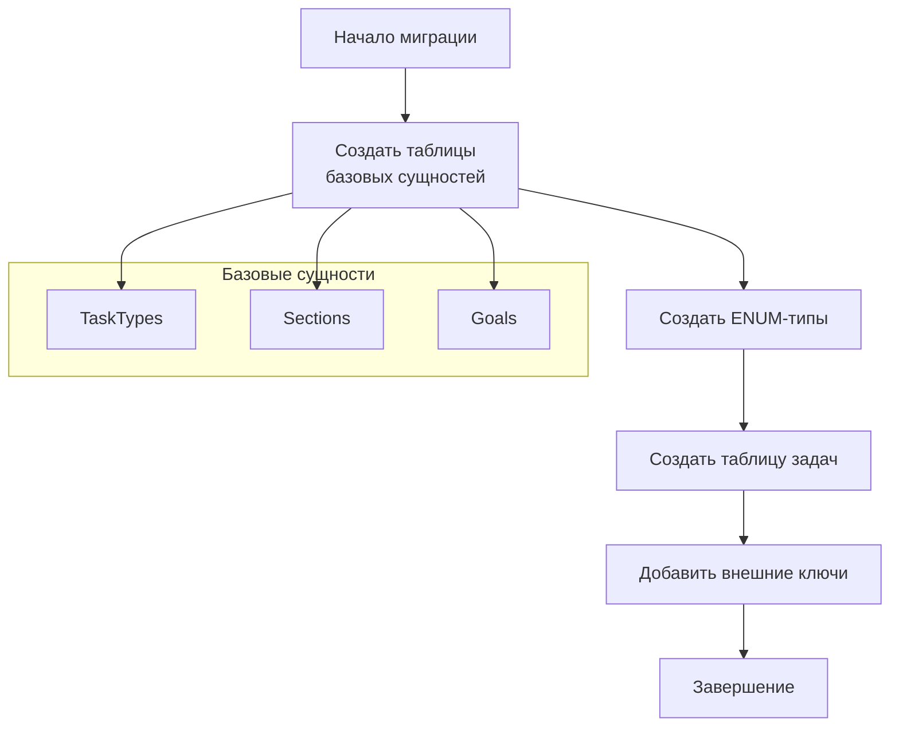



# Создание и поддержка структуры базы данных

## Работа с PostgreSQL через библиотеку Doobie

После проектирования алгебр и создания мок-реализаций наступает этап разработки продакшен-реализаций,
которые будут взаимодействовать с реальной системой хранения данных. 
Мы будем использовать **PostgreSQL** — зрелую,
надежную и полнофункциональную реляционную систему управления базами данных (СУБД).

> 💡 **Примечание о переносимости**: Описанные ниже архитектурные принципы и подходы к работе с данными
> являются универсальными и применимы к большинству реляционных баз данных (MySQL, Oracle, SQL Server и др.).
> Технические отличия будут заключаться в основном в синтаксисе SQL-диалектов,
> особенностях драйверов и настройках подключения к конкретной СУБД.

### Выбор библиотеки для доступа к данным: Doobie

Для реализации взаимодействия с PostgreSQL будем использовать библиотеку [Doobie](https://typelevel.org/doobie/index.html).

Doobie — это чисто функциональная JDBC-слой библиотека для работы с реляционными базами данных.
Ее ключевые преимущества:

- **Строго функциональный подход**: Полная интеграция с экосистемой Cats Effect, использование `IO`
  и других абстрактных эффектов для описания всех операций с побочными эффектами (ввод-вывод, работа с сетью).
  Это обеспечивает предсказуемость, тестируемость и композируемость кода.
- **Типобезопасность на уровне компиляции**: Многие распространенные ошибки
  (несоответствие типов между Scala и SQL, опечатки в именах колонок, неверное количество параметров)
  выявляются на этапе компиляции, а не во время выполнения, что значительно повышает надежность приложения.
- **Высокая композируемость**: Запросы в Doobie построены на базе примитивов,
  которые можно комбинировать с помощью монадических операций (`map`, `flatMap`) и аппликативных функторов.
  Это позволяет строить сложные, динамические SQL-запросы из простых, повторно используемых компонентов.
- **Прозрачность и контролируемость**: Библиотека предоставляет удобные инструменты для логирования запросов и их выполнения.

Для начала работы с Doobie необходимо добавить соответствующие зависимости в конфигурацию сборки проекта (файл `project/Dependencies.scala`).

Структура зависимостей для модуля, работающего с базой данных:

```dotty
// Файл: project/Dependencies.scala
object Dependencies {
  object doobie {
    // Рекомендуется использовать актуальную стабильную версию.
    private val version = "1.0.0-RC13"
    val core            = "org.typelevel" %% "doobie-core"     % version
    val free            = "org.typelevel" %% "doobie-free"     % version
    val hikari          = "org.typelevel" %% "doobie-hikari"   % version
    val postgres        = "org.typelevel" %% "doobie-postgres" % version
  }

  object iron {
    ...
    val doobie          = "io.github.iltotore" %% "iron-doobie"     % version
  }

  object log4cats {
    private val version = "2.8.0"
    val core            = "org.typelevel" %% "log4cats-core"   % version
    val slf4j           = "org.typelevel" %% "log4cats-slf4j"  % version
    val logback         = "ch.qos.logback" % "logback-classic" % "1.6.3"
  }

  // ... другие блоки зависимостей ...

  // Корневой список библиотек для основного модуля приложения (pdp)
  val pdpLibs: Seq[ModuleID] =
    Seq(
      ...
      doobie.core,
      doobie.free,
      doobie.hikari,
      doobie.postgres,
      iron.cats,
      iron.circe,
      iron.core,
      iron.doobie,
      iron.pureconfig,
      log4cats.core,
      log4cats.logback,
      log4cats.slf4j,
    )
}
```

### Следующие шаги после настройки зависимостей

После успешного подключения необходимых библиотек мы можем приступить к реализации следующих ключевых задач:

1. **Создание интерпретаторов алгебр для PostgreSQL**: Реализация трейтов `TaskTypeService[F[_]]`, `TaskService[F[_]]`
   и других с использованием Doobie's `ConnectionIO` или `Transactor[F]`.
2. **Настройка подключения к базе данных**: Конфигурация пула соединений (`HikariCP` или аналоги),
   создание `Transactor` — объекта, который преобразует программы Doobie (`ConnectionIO`) в целевой эффект `F[_]` (например, `IO`).
3. **Реализация CRUD-операций**: Написание или генерация SQL-запросов
   для операций `insert`, `select`, `update`, `delete` для каждой из наших сущностей,
   используя компиляторы запросов Doobie (`Update`, `Query`).

## Создание и поддержка структуры базы данных

При работе с реляционными базами данных недостаточно просто выполнять операции чтения и записи данных (DML). 
Необходимо также управлять самой структурой хранилища: 
создавать и модифицировать таблицы, определять типы данных, 
устанавливать связи между сущностями и настраивать ограничения целостности. 
Для решения этой задачи мы создаем специализированный **сервис миграций**.

#### Ключевые функции сервиса миграций:

- **Создание таблиц (CREATE TABLE)**: Инициализация структурированных контейнеров для хранения различных типов данных, 
  с определением типов колонок, первичных ключей и других атрибутов.
- **Создание пользовательских типов данных (CREATE TYPE)**: Определение домен-специфичных типов, таких как ENUM в PostgreSQL, 
  которые обеспечивают семантическую точность и ограничение допустимых значений на уровне БД.
- **Установка связей между таблицами (FOREIGN KEY)**: Формальное определение отношений "один-ко-многим" 
  или "многие-ко-многим" между сущностями, что является основой реляционной модели.
- **Настройка ограничений целостности (CONSTRAINTS)**: Реализация бизнес-правил непосредственно 
  в схеме данных через CHECK-ограничения, UNIQUE-ограничения и NOT NULL, что предотвращает попадание некорректных данных в систему.
- **Обеспечение идемпотентности**: Использование конструкций `CREATE TABLE IF NOT EXISTS` гарантирует, 
  что скрипты миграции можно безопасно запускать многократно без ошибок.

### Проектирование и реализация сервиса миграций PostgreSQL

Создаем класс `PostgreSQLMigrationService`, который инкапсулирует всю логику инициализации схемы БД. 
Класс объявляется как `private[pdp]`, что ограничивает его использование только в пределах пакета `pdp`, 
и делает его доступным только для внутреннего использования, предотвращая случайный вызов извне.

```dotty
// pdp/src/main/scala/ru/scalabook/pdp/services/postgresql/PostgreSQLMigrationService.scala
/** Сервис для управления структурой базы данных PostgreSQL. Отвечает за
  * создание таблиц, типов, установку связей и ограничений.
  *
  * @param xa
  *   {{{Transactor[F]}}} - абстракция Doobie для выполнения запросов в
  *   контексте F.
  */
private[pdp] class PostgreSQLMigrationService[F[_]: {MonadCancelThrow, Logger}](
    xa: Transactor[F]
):
  import PostgreSQLMigrationService.*

  def migrate(): F[Boolean] =
    checkExistFK
      .query[Boolean]
      .option
      .transact(xa)
      .flatMap:
        case Some(v) if v =>
          Logger[F].info("No migration required").as(true)
        case _ =>
          Logger[F].info("Database initialization") *>
            initialize()

  /** Основной метод инициализации базы данных. Выполняет последовательность
    * DDL-запросов для создания всей необходимой структуры. Все операции
    * выполняются в единой транзакции для атомарности.
    *
    * @return
    *   {{{F[Boolean]}}} - эффект, представляющий операцию инициализации.
    */
  def initialize(): F[Boolean] =
    val program =
      for
        _ <- createUsersTable.update.run
        _ <- createTaskTypesTable.update.run
        _ <- addUsersFKToTable("task_types").update.run
        _ <- createSectionsTable.update.run
        _ <- addUsersFKToTable("sections").update.run
        _ <- createGoalsTable.update.run
        _ <- addUsersFKToTable("goals").update.run
        _ <- createStatusEnum.update.run
        _ <- createTasksTable.update.run
        _ <- addSectionFKToTable("tasks").update.run
        _ <- addGoalFKToTable("tasks").update.run
        _ <- addUsersFKToTable("tasks").update.run
        _ <- taskTypeFK.update.run
        _ <- createCompletedTasksTable.update.run
        _ <- addSectionFKToTable("completed_tasks").update.run
        _ <- addGoalFKToTable("completed_tasks").update.run
        _ <- addUsersFKToTable("completed_tasks").update.run
      yield true
    program.transact(xa)
  end initialize

end PostgreSQLMigrationService

private[pdp] object PostgreSQLMigrationService:
  /** Запрос для проверки, была ли уже миграция */
  private val checkExistFK: Fragment =
    sql"""SELECT EXISTS (
           SELECT 1
           FROM information_schema.tables
           WHERE table_schema = 'public'
           AND table_name = 'users'
       );"""

  private val createUsersTable: Fragment =
    sql"""CREATE TABLE IF NOT EXISTS users (
         id UUID DEFAULT gen_random_uuid() PRIMARY KEY, 
         name VARCHAR(255) NOT NULL, 
         password VARCHAR(255) NOT NULL
         );"""

  private val createTaskTypesTable: Fragment =
    sql"""CREATE TABLE IF NOT EXISTS task_types (
         id SERIAL PRIMARY KEY, 
         name VARCHAR(255) NOT NULL, 
         user_id UUID NOT NULL, 
         displayed BOOLEAN NOT NULL DEFAULT TRUE, 
         ordinal INT NOT NULL DEFAULT 1000
         );"""

  private val createSectionsTable: Fragment =
    sql"""CREATE TABLE IF NOT EXISTS sections (
         id SERIAL PRIMARY KEY, 
         name VARCHAR(255) NOT NULL, 
         user_id UUID NOT NULL, 
         displayed BOOLEAN NOT NULL DEFAULT TRUE, 
         ordinal INT NOT NULL DEFAULT 1000
         );"""

  private val createGoalsTable: Fragment =
    sql"""CREATE TABLE IF NOT EXISTS goals (
         id SERIAL PRIMARY KEY, 
         name VARCHAR(255) NOT NULL, 
         user_id UUID NOT NULL, 
         displayed BOOLEAN NOT NULL DEFAULT TRUE, 
         ordinal INT NOT NULL DEFAULT 1000
         );"""

  private val createStatusEnum: Fragment =
    sql"""CREATE TYPE StatusEnum AS ENUM
         ('InProgress', 'Planned', 'KnowledgeBase', 'Completed');"""

  private val createTasksTable: Fragment =
    sql"""CREATE TABLE IF NOT EXISTS tasks (
         id UUID DEFAULT gen_random_uuid() PRIMARY KEY, 
         name VARCHAR(255) NOT NULL, 
         user_id UUID NOT NULL, 
         task_type_id INT NOT NULL, 
         status StatusEnum NOT NULL, 
         section_id INT NOT NULL, 
         goal_id INT NOT NULL, 
         ordinal INT NOT NULL, 
         start_date DATE, 
         end_date DATE, 
         information TEXT, 
         plan VARCHAR[], 
         duration BIGINT NOT NULL, 
         time_spent BIGINT);"""

  private val createCompletedTasksTable: Fragment =
    sql"""CREATE TABLE IF NOT EXISTS completed_tasks (
         id SERIAL PRIMARY KEY, 
         task_id UUID NOT NULL, 
         task_type_id INT NOT NULL, 
         name VARCHAR(255) NOT NULL, 
         user_id UUID NOT NULL, 
         section_id INT NOT NULL, 
         goal_id INT NOT NULL, 
         duration BIGINT NOT NULL, 
         rating INT NOT NULL, 
         review TEXT, 
         start_date DATE, 
         end_date DATE);"""

  private val taskTypeFK =
    sql"""ALTER TABLE tasks
            ADD CONSTRAINT fk_task_types
            FOREIGN KEY (task_type_id) REFERENCES task_types(id);"""

  private def addSectionFKToTable(tableName: String): Fragment =
    Fragment.const(
      s"""ALTER TABLE "$tableName"
            ADD CONSTRAINT fk_section
            FOREIGN KEY (section_id) REFERENCES sections(id);"""
    )

  private def addGoalFKToTable(tableName: String): Fragment =
    Fragment.const(
      s"""ALTER TABLE "$tableName"
            ADD CONSTRAINT fk_goal
            FOREIGN KEY (goal_id) REFERENCES goals(id);"""
    )

  private def addUsersFKToTable(tableName: String): Fragment =
    Fragment.const(
      s"""ALTER TABLE "$tableName"
            ADD CONSTRAINT fk_users
            FOREIGN KEY (user_id) REFERENCES users(id);"""
    )
end PostgreSQLMigrationService
```

### Важность порядка выполнения операций

Последовательность выполнения DDL-запросов строго регламентирована:



**Логика порядка:**

1. **Сначала базовые таблицы**: `task_types`, `sections`, `goals` создаются первыми, так как на них ссылаются другие таблицы.
2. **Затем пользовательские типы**: ENUM `StatusEnum` должен существовать до создания таблиц задач, которые его используют.
3. **Таблицы задач**: Создаются после того, как все типы и базовые таблицы готовы.
4. **Внешние ключи в конце**: Устанавливаются после создания всех таблиц, на которые они ссылаются.

---

**Ссылки:**

- [Персональный план развития][plugin]
- [Репозиторий с исходниками][repo]

[repo]: https://gitverse.ru/scalabook/pdp
[plugin]: https://artemkorsakov.github.io/personal-development-plan/ru/
