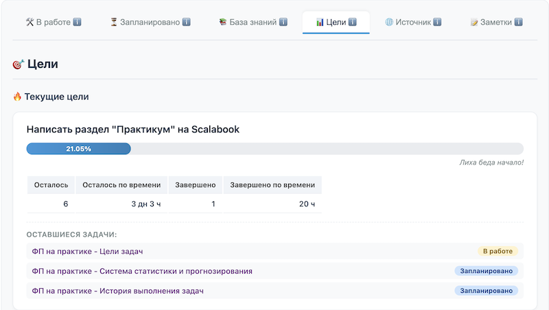



# Статистика

Статистика — это инструмент, который превращает разрозненные задачи в **осмысленную картину прогресса**. 
Пользователь видит не просто список дел, а ответ на вопрос: «Насколько я продвинулся к своим целям?» 
Это ключевой элемент мотивации: без него работа над долгосрочными целями превращается в бесконечную рутину без ощущения движения.

## Статистика по целям

Для начала разберем статистику **по целям**. 

### Модели данных

#### `Statistics` — агрегатор всей статистики

```dotty
final case class Statistics(
    goalsStats: Vector[GoalsStats]
)

object Statistics:
  def calculate(
      tasks: Vector[TaskResult],
      goals: Map[GoalId, GoalName]
  ): Statistics =
    Statistics(
      goalsStats = GoalsStats.calculate(tasks, goals)
    )
```

**Разбор:**

- **`goalsStats: Vector[GoalsStats]`** — вектор статистик по каждой цели пользователя. Одна цель = один элемент вектора.
- **`Statistics.calculate`** — фабричный метод, который принимает все задачи и карту «ID цели → имя цели» 
  и делегирует вычисление в `GoalsStats.calculate`.

**Почему `Map[GoalId, GoalName]`, а не `Vector[Goal]`?**

Потому что для статистики нужны **только имена целей**. 
Передавать полные объекты `Goal` (с `userId`, `displayed`, `ordinal` и т.д.) избыточно. 
Карта даёт быстрый доступ по ID — O(1) вместо O(n) при поиске в векторе.

#### `GoalsStats` — статистика по одной цели

```dotty
final case class GoalsStats(
    name: GoalName,
    all: Int,
    allDuration: FiniteDuration,
    completed: Int,
    completedDuration: FiniteDuration,
    remainingTasks: Vector[GoalTaskStats]
):
  lazy val remaining: Int                    = all - completed
  lazy val remainingDuration: FiniteDuration = allDuration - completedDuration
  lazy val progress: Double                  =
    if allDuration.toMinutes == 0 then 0.0
    else (completedDuration.toMinutes * 10000 / allDuration.toMinutes) / 100.00

  lazy val status: GoalStatus =
    if completed == 0 then Planned
    else if remaining > 0 then Current
    else Achieved
```

**Хранимые поля:**

| Поле                | Тип                     | Назначение                                 |
| ------------------- | ----------------------- | ------------------------------------------ |
| `name`              | `GoalName`              | Название цели для отображения              |
| `all`               | `Int`                   | Общее количество задач, привязанных к цели |
| `allDuration`       | `FiniteDuration`        | Суммарная трудоёмкость всех задач          |
| `completed`         | `Int`                   | Количество выполненных задач               |
| `completedDuration` | `FiniteDuration`        | Суммарная трудоёмкость выполненных задач   |
| `remainingTasks`    | `Vector[GoalTaskStats]` | Топ-3 невыполненные задачи для отображения |

**Вычисляемые поля (`lazy val`):**

- **`remaining = all - completed`** — сколько задач осталось. Не храним отдельно, потому что это производная величина. 
  Хранение дублирующих данных — источник рассинхронизации.
- **`remainingDuration = allDuration - completedDuration`** — сколько времени осталось.
- **`progress`** — процент выполнения, вычисляется **по времени**, а не по количеству задач.

**Почему прогресс по времени, а не по количеству?**

Рассмотрим пример: цель имеет 2 задачи — одну на 1 час и одну на 10 часов. Если выполнена 1-часовая, то:

- **По количеству:** 1/2 = 50%.
- **По времени:** 1/11 ≈ 9%.

По времени — **честнее**. Одна большая задача может весить больше, чем десять мелких. 
Пользователь получает реальную оценку прогресса.

**Формула `progress`:**

```dotty
(completedDuration.toMinutes * 10000 / allDuration.toMinutes) / 100.00
```

**Пример:** `completedDuration = 30 мин`, `allDuration = 90 мин`:

- `30 * 10000 / 90 = 3333` (целочисленное деление)
- `3333 / 100.00 = 33.33` — прогресс 33.33%.

**Вычисление `status`:**

```dotty
if completed == 0 then Planned
else if remaining > 0 then Current
else Achieved
```

Три статуса цели:

- **`Planned`** — ни одна задача не выполнена. Цель ждёт своего часа.
- **`Current`** — часть задач выполнена, но остались другие. Цель в работе.
- **`Achieved`** — все задачи выполнены. Цель достигнута.

### `GoalsStats.calculate` — построение статистики

```dotty
def calculate(
    tasks: Vector[TaskResult],
    goals: Map[GoalId, GoalName]
): Vector[GoalsStats] =
  tasks.groupBy(_.goalId).flatMap {
    case (goalId, tasks) =>
      val (completedTasks, remainingTasks) =
        tasks.partition(_.status == Completed)
      val topRemainingTasks =
        remainingTasks
          .sortBy(t => (t.status.ordinal, t.ordinal))
          .take(3)
          .map(task => GoalTaskStats(task.id, task.name, task.status))

      goals.get(goalId).map: name =>
        GoalsStats(
          name = name,
          all = tasks.length,
          allDuration = tasks.foldLeft(FiniteDuration(0L, TimeUnit.MINUTES))(
            (acc, t) => acc + t.duration
          ),
          completed = completedTasks.length,
          completedDuration =
            completedTasks.foldLeft(FiniteDuration(0L, TimeUnit.MINUTES))(
              (acc, t) => acc + t.duration
            ),
          remainingTasks = topRemainingTasks
        )
  }.toVector
```

**Пошаговый разбор:**

**1. Группировка задач по цели:**

```dotty
tasks.groupBy(_.goalId)
```

Все задачи с одинаковым `goalId` собираются в `Map[GoalId, Vector[TaskResult]]`.

**2. Разделение на выполненные и оставшиеся:**

```dotty
val (completedTasks, remainingTasks) = tasks.partition(_.status == Completed)
```

- **`completedTasks`** — задачи со статусом `Completed`.
- **`remainingTasks`** — все остальные (в работе, запланированные, в базе знаний).

**3. Сортировка оставшихся задач:**

```dotty
val topRemainingTasks =
  remainingTasks
    .sortBy(t => (t.status.ordinal, t.ordinal))
    .take(3)
    .map(task => GoalTaskStats(task.id, task.name, task.status))
```

- **`sortBy(t => (t.status.ordinal, t.ordinal))`** — сортировка по двум ключам:
    - **`status.ordinal`** — сначала идут задачи с более «активным» статусом. 
      Порядок задан в `enum Status`: `InProgress` → `Planned` → `KnowledgeBase` → `Completed`.
      Статуса `Completed` в `remainingTasks` не будет, поэтому задачи отсортируются по статусам `InProgress` → `Planned` → `KnowledgeBase`.
    - **`ordinal`** — при равных статусах — по порядковому номеру задачи.
- **`.take(3)`** — оставляем только три задачи. Больше не нужно: пользователь видит «что дальше», а не весь список.
- **`.map(task => GoalTaskStats(...))`** — преобразуем в облегчённый DTO, содержащий только `id`, `name`, `status`.

**Почему `take(3)`?**

Пользователю достаточно видеть 2–3 следующие задачи, чтобы понимать, куда двигаться. Отображать весь список — загромождать UI. 
Если нужно больше — есть страница статусов со списками задач.

**4. Агрегация длительностей:**

```dotty
allDuration = tasks.foldLeft(FiniteDuration(0L, TimeUnit.MINUTES))(
  (acc, t) => acc + t.duration
)
```

`foldLeft` суммирует длительности всех задач, начиная с нуля. Результат — `FiniteDuration`.

**5. Использование `flatMap`:**

```dotty
tasks.groupBy(_.goalId).flatMap {
  case (goalId, tasks) =>
    goals.get(goalId).map: name =>
      GoalsStats(...)
}.toVector
```

- **`goals.get(goalId)`** возвращает `Option[GoalName]`.
- **`.map(name => GoalsStats(...))`** — если имя найдено, создаём `GoalsStats`.
- **`.flatMap`** «разворачивает» `Option` — если имя не найдено, цель **игнорируется**.

### `GoalTaskStats` — облегчённая модель задачи

```dotty
final case class GoalTaskStats(
    id: TaskId,
    name: TaskName,
    status: Status
)
```

Минимальная модель для отображения задачи в списке оставшихся. Содержит только:

- **`id`** — для ссылки на страницу задачи.
- **`name`** — для отображения.
- **`status`** — для бейджа статуса.

Не содержит `duration`, `progress`, `plan` — это избыточно для списка.

## UI: вкладка «📊 Цели»

### Кнопка вкладки

```html
<button
    class="tab-btn @if(tab == "statistics"){active}"
    data-tab="statistics"
    onclick="switchTab('statistics')"
>
    📊 Цели
    <span title="Статистика по целям">ℹ️</span>
</button>
```

- **`📊 Цели`** — название вкладки. Лаконично, сразу говорит о содержимом.
- **`data-tab="statistics"`** — идентификатор для JS-функции `switchTab`.
- **`title`** — подсказка при наведении.



### Контент вкладки

```html
<div id="tab-statistics" class="tab-content @if(tab == "statistics"){active}">
    @statistics
</div>
```

HTML-фрагмент `@statistics` рендерится на сервере и вставляется в вкладку. Это позволяет отделить логику группировки целей по статусам в Scala-коде, а не в шаблоне.

### Шаблон `goalsStats.scala.html`

Шаблон принимает **три готовых вектора** — уже отфильтрованных по статусу цели:

```html
@(currentGoals: Vector[GoalsStats], plannedGoals: Vector[GoalsStats],
achievedGoals: Vector[GoalsStats])
```

**Почему три вектора, а не один с фильтрацией в шаблоне?**

Потому что фильтрация — это **логика**, а не отображение. Она должна быть на сервере. Шаблон получает готовые данные и просто рендерит их в три блока.

#### Блок «Текущие цели»

```html
@if(currentGoals.nonEmpty) {
<div class="goals-subsection">
  <h3 class="goals-subsection-title">🔥 Текущие цели</h3>
  <div class="goals-list">
    @for(goal <- currentGoals) {
    <div class="goal-card">
      <div class="goal-name">@goal.name.value</div>

      <div class="goal-progress-container">
        <div class="goal-progress-bar">
          <div class="goal-progress-fill" style="width: @{goal.progress}%">
            <span class="goal-progress-text">@{goal.progress}%</span>
          </div>
        </div>
        <div class="goal-motivation">@motivation(goal.progress)</div>
      </div>

      <table class="stats-table goal-stats-table">
        <thead>
          <tr>
            <th>Осталось</th>
            <th>Осталось по времени</th>
            <th>Завершено</th>
            <th>Завершено по времени</th>
          </tr>
        </thead>
        <tbody>
          <tr>
            <td class="stat-value">@goal.remaining</td>
            <td class="stat-value">
              @toDurationDescription(goal.remainingDuration)
            </td>
            <td class="stat-value">@goal.completed</td>
            <td class="stat-value">
              @toDurationDescription(goal.completedDuration)
            </td>
          </tr>
        </tbody>
      </table>

      @if(goal.remainingTasks.nonEmpty) {
      <div class="goal-remaining-tasks">
        <div class="goal-remaining-title">Оставшиеся задачи:</div>
        <ul class="goal-remaining-list">
          @for(task <- goal.remainingTasks) {
          <li class="goal-remaining-item">
            <a href="/task/@task.id" class="goal-task-link" target="_blank">
              @task.name.value
            </a>
            <span
              class="goal-task-status status-@task.status.toString.toLowerCase"
            >
              @task.status.show
            </span>
          </li>
          }
        </ul>
      </div>
      }
    </div>
    }
  </div>
</div>
}
```

**Ключевые детали:**

**1. Прогресс-бар с мотивацией:**

```html
<div class="goal-progress-fill" style="width: @{goal.progress}%">
  <span class="goal-progress-text">@{goal.progress}%</span>
</div>
<div class="goal-motivation">@motivation(goal.progress)</div>
```

- **Ширина** — процент прогресса, передаётся в inline-стиль.
- **Текст внутри** — то же значение для точности.
- **Мотивация** — функция `motivation`, возвращающая фразу в зависимости от процента.

**2. Таблица метрик:**

Четыре колонки: осталось (задачи), осталось (время), завершено (задачи), завершено (время). Компактно и информативно.

**`@toDurationDescription(goal.remainingDuration)`** — функция форматирования `FiniteDuration` в человекочитаемый вид: `"2 ч 30 мин"`, `"5 дн"` и т.д.

**3. Список оставшихся задач:**

```html
<a href="/task/@task.id" class="goal-task-link" target="_blank">
  @task.name.value
</a>
<span class="goal-task-status status-@task.status.toString.toLowerCase">
  @task.status.show
</span>
```

- **Ссылка на задачу** — открывается в новой вкладке (`target="_blank"`). Пользователь может быстро перейти к задаче, не теряя страницу статистики.
- **Бейдж статуса** — класс `status-inprogress`, `status-planned`, `status-knowledgebase` для цветовой кодировки.

#### Блок «Планируемые цели»

```html
@if(plannedGoals.nonEmpty) {
<div class="goals-subsection">
  <h3 class="goals-subsection-title">📋 Планируемые цели</h3>
  ...
</div>
}
```

Структура та же, что и у текущих, но:

- **Нет прогресс-бара** — потому что прогресс всегда 0%.
- **Нет мотивашки** — нечего мотивировать, если ничего не начато.

#### Блок «Достигнутые цели»

```html
@if(achievedGoals.nonEmpty) {
<div class="goals-subsection">
  <h3 class="goals-subsection-title">🏆 Достигнутые цели</h3>
  @for(goal <- achievedGoals) {
  <div class="goal-card achieved">...</div>
  }
</div>
}
```

- **Класс `achieved`** — зелёная рамка, светлый фон. Визуальная награда.
- **Нет прогресс-бара и нет списка задач** — всё выполнено, показывать нечего.

**Почему нет списка задач?** Все задачи завершены. Отображать их — избыточно. Пользователь видит: «цель достигнута, всё сделано».

### Вспомогательные функции

#### Функция `motivation`

```dotty
def motivation(progress: Double): String =
  if progress >= 75 then "Ещё немного и цель будет достигнута"
  else if progress >= 50 then "Уже полдела сделано! Ты молодец!"
  else if progress >= 25 then "Прекрасная работа! Продолжай в том же духе!"
  else "Лиха беда начало!"
```

**Разбор уровней:**

| Прогресс | Фраза                                         | Смысл                              |
| -------- | --------------------------------------------- | ---------------------------------- |
| ≥ 75%    | «Ещё немного и цель будет достигнута»         | Финиш близко, не сбавляй темп      |
| ≥ 50%    | «Уже полдела сделано! Ты молодец!»            | Середина пройдена, можно гордиться |
| ≥ 25%    | «Прекрасная работа! Продолжай в том же духе!» | Начало положено, есть движение     |
| < 25%    | «Лиха беда начало!»                           | Первый шаг — самый трудный         |

**Почему именно эти фразы?**

Они **поддерживают** пользователя, а не просто констатируют факт. «Полдела сделано» — это признание усилий. «Ещё немного» — это надежда на финиш. «Лиха беда начало» — это поддержка в самом трудном моменте, когда прогресс ещё мал.

#### Функция `toDurationDescription`

```dotty
def toDurationDescription(duration: FiniteDuration): String =
  val minutes = duration.toMinutes
  if minutes < 60 then s"$minutes мин"
  else if minutes < 1440 then
    s"${math.round(minutes * 100.0 / 60.0) / 100.0} ч"
  else s"${math.round(minutes * 100.0 / 1440.0) / 100.0} дн"
```

**Логика:**

- **Меньше часа** → `"45 мин"`.
- **Меньше суток** → `"2.5 ч"` (округление до сотых).
- **Больше суток** → `"3.75 дн"`.

## Итог по целям

**Что видит пользователь:**

- **Текущие цели** с прогресс-барами и мотивацией.
- **Планируемые цели** с объёмами предстоящей работы.
- **Достигнутые цели** — визуальная награда.
- **Метрики по каждой цели**: сколько задач осталось и сколько это времени.
- **Список ближайших задач** с прямыми ссылками.

**Ключевая идея:** статистика — это не просто цифры, а **инструмент мотивации**. 
Прогресс-бар, мотивационная фраза, топ-3 задачи и визуальное разделение по статусам — всё работает на то, 
чтобы пользователь видел свой путь и продолжал двигаться. 

---

**Ссылки:**

- [Персональный план развития][plugin]
- [Репозиторий с исходниками][repo]

[repo]: https://gitverse.ru/scalabook/pdp
[plugin]: https://artemkorsakov.github.io/personal-development-plan/ru/
