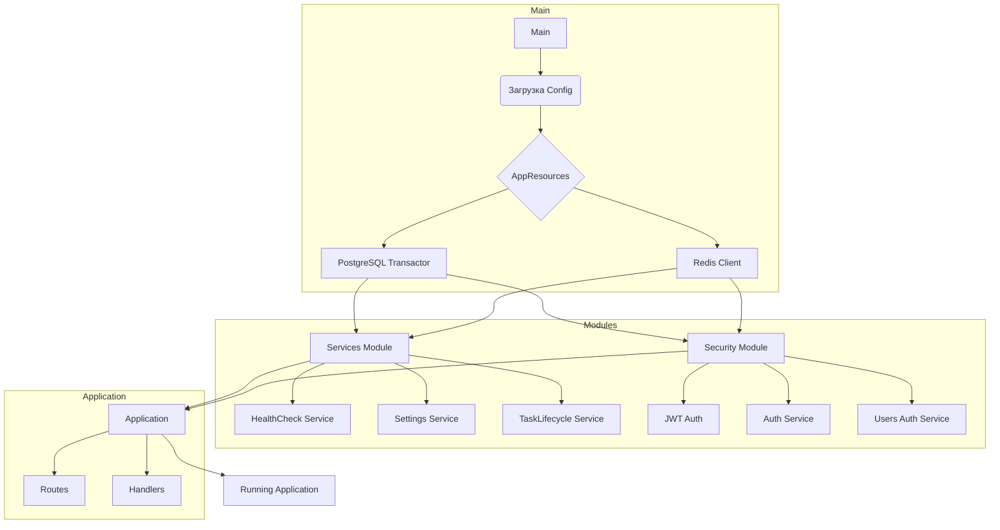

# Запуск сервера

В этом разделе мы завершим сборку приложения, объединив все ранее созданные компоненты в единое работающее целое. 
Мы настроим конфигурацию, создадим модули сервисов и HTTP API, определим управление ресурсами и, наконец, запустим сервер.

## Конфигурация приложения

Любое серьезное приложение требует гибкой настройки параметров окружения: 
адресов серверов, параметров подключения к базам данных, секретных ключей и так далее. 
Для этого мы используем библиотеку **PureConfig** в связке с **Iron** для обеспечения типобезопасности на этапе компиляции.

### Модели конфигурации

Создадим набор `case class`-ов, которые описывают структуру нашего конфигурационного файла. 
Использование уточненных типов позволяет нам наложить ограничения на значения прямо в определении типа, 
гарантируя, что некорректная конфигурация просто не скомпилируется или вызовет ошибку при загрузке.

```dotty
// Модель для конфигурации HTTP-сервера
final case class HttpServerConfig(
    host: Host,
    port: Port
) derives ConfigReader

object HttpServerConfig:
  // Читатель для типа Host: проверяем, что строка — корректный IP-адрес или имя хоста
  given ConfigReader[Host] =
    ConfigReader[String].emap: host =>
      Host.fromString(host).toRight(UserValidationFailed(s"Invalid host: $host"))

  // Читатель для типа Port: проверяем, что число входит в допустимый диапазон портов
  given ConfigReader[Port] =
    ConfigReader[Int].emap: port =>
      Port.fromInt(port).toRight(UserValidationFailed(s"Invalid port: $port"))

// Тип для непустой строки без пробелов по краям.
type NonEmptyString = NonEmptyString.T
object NonEmptyString extends RefinedType[String, Not[Empty] & Trimmed]

// Уточненный тип для пользовательского номера порта.
type UserPortNumber = Int :| Interval.Closed[1024, 49151]

// Модель для конфигурации PostgreSQL
final case class PostgreSQLConfig(
    host: NonEmptyString,
    port: UserPortNumber, // Используем уточненный тип
    user: NonEmptyString,
    password: Secret[NonEmptyString], // Используем Secret для конфиденциальных данных
    database: NonEmptyString,
    max: Int :| Positive
)

// Модель для конфигурации Redis
final case class RedisConfig(uri: NonEmptyString)

// Тип для ключа JWT.
type JwtAccessTokenKeyConfig = JwtAccessTokenKeyConfig.T
object JwtAccessTokenKeyConfig extends RefinedType[String, Not[Empty] & Trimmed]

// Модель для конфигурации JWT-токенов
final case class TokenConfig(
    jwtAccessTokenKey: Secret[JwtAccessTokenKeyConfig],
    expiration: FiniteDuration
) derives ConfigReader

// Читатель для Secret[A]. Мы можем прочитать A, для которого определен ConfigReader,
// а затем обернуть его в Secret.
given secretReader[A: {ConfigReader, Show}]: ConfigReader[Secret[A]] =
  ConfigReader[A].map(Secret.apply)

/** `Config` — корневой объект конфигурации. */
final case class Config(
    httpServerConfig: HttpServerConfig,
    postgresql: PostgreSQLConfig,
    redis: RedisConfig,
    token: TokenConfig
) derives ConfigReader
```

### Файл конфигурации (`application.conf`)

Все описанные выше модели будут заполнены из файла `application.conf`, 
который должен находиться в директории `src/main/resources`. 
Здесь мы задаем конкретные значения для всех параметров.

```conf
# Конфигурация HTTP-сервера
http-server-config = {
  host = "0.0.0.0"
  port = 8080
}

# Конфигурация подключения к PostgreSQL
postgresql = {
  host = "postgres"
  port = 5432
  user = "postgres"
  password = "my-password"
  database = "pdp"
  max = 10  
}

# Конфигурация подключения к Redis
redis = {
  uri = "redis://redis"
}

# Конфигурация JWT-токенов
token {
  jwt-access-token-key = "my-secret-key-for-jwt"
  expiration = 1 day
}
```

Такой подход позволяет централизованно управлять всеми настройками, 
а использование уточненных типов и `Secret` добавляет слой безопасности, 
предотвращая случайное использование некорректных или незащищенных данных.

## Модульная архитектура сервисов

Для поддержания чистоты архитектуры и следования принципу единственной ответственности, 
мы группируем связанную функциональность в отдельные модули. 
Наше приложение будет состоять из основных модулей: `Security` и `Services`.

### Модуль `Security`

Этот модуль инкапсулирует всю логику, связанную с безопасностью и аутентификацией. 
Он отвечает за создание JWT-аутентификации, сервиса аутентификации и сервиса для поиска пользователей.

```dotty
sealed trait Security[F[_]] private (
    // Верификатор JWT-подписи
    val userJwtAuth: JwtVerification[F],
    // Сервис для операций входа/выхода
    val auth: AuthService[F],         
    // Сервис для поиска пользователей по токену 
    val usersAuth: UsersAuthService[F, UserInfo] 
)

object Security:
  def make[F[_]: {Sync, MonadCancelThrow}](
      cfg: Config,
      transactor: Transactor[F],              // Doobie-транзактор для работы с БД
      redis: RedisCommands[F, String, String] // Клиент Redis
  ): F[Security[F]] =
    for
      crypto <- Crypto.make[F] // Сервис для хэширования паролей
      secretKeyValue = cfg.token.jwtAccessTokenKey.value.value
      secretKey      <- SecretKey(secretKeyValue).liftTo[F]

      // Настройка JWT-подписания (для Tokens.create)
      userJwtSigning <- JwtSigningBuilder
        .default[F]
        .hmac(HS256, secretKey)
        .build

      // Настройка JWT-верификации (для middleware)
      userJwtVerification <- JwtVerificationBuilder
        .default[F]
        .hmac(HS256, secretKey)
        .build
    yield
      // Создание сервиса для работы с токенами
      val tokens = Tokens.make[F](userJwtSigning, cfg.token.expiration)

      // Создание сервиса для работы с пользователями в PostgreSQL
      val usersService = new PostgreSQLUsersService[F](transactor)

      // Создание сервиса аутентификации, который объединяет всё вышеперечисленное
      val auth = AuthService.make[F](
        tokenExpiration = cfg.token.expiration,
        tokens = tokens,
        usersService = usersService,
        redis = redis,
        crypto = crypto
      )

      // Создание сервиса для аутентификации пользователей на основе Redis
      val usersAuth = UsersAuthService.make[F](redis)

      new Security[F](userJwtVerification, auth, usersAuth) {}
end Security
```

### Модуль `Services`

Этот модуль объединяет все бизнес-сервисы приложения, которые работают с данными. 
Он создает экземпляры сервисов для работы с типами задач, разделами, целями и задачами, 
а также сервис проверки работоспособности.

```dotty
sealed trait Services[F[_]] private (
    healthCheck: HealthCheck[F],
    settingsService: SettingsService[F],
    taskLifecycleService: TaskLifecycleService[F]
)

object Services:
  def make[F[_]: {Sync, MonadCancelThrow, Temporal}](
      transactor: Transactor[F],
      redis: RedisCommands[F, String, String]
  ): Services[F] =
    // 1. Сервис проверки работоспособности PostgreSQL и Redis
    val healthCheck =
      HealthCheck.make[F](PostgreSQLHealthCheck.make[F](transactor), redis)

    // 2. Создание низкоуровневых сервисов для работы с БД
    val typeService    = new PostgreSQLTaskTypeService[F](transactor)
    val sectionService = new PostgreSQLSectionService[F](transactor)
    val goalService    = new PostgreSQLGoalService[F](transactor)
    val taskService    = new PostgreSQLTaskService[F](transactor)
    val historyService = new PostgreSQLHistoryService[F](transactor)

    // 3. Сервис для операций с настройками (CRUD для типов, разделов, целей, задач)
    val settingsService = SettingsService[F](
      typeService,
      sectionService,
      goalService,
      taskService
    )

    // 4. Сервис для управления жизненным циклом задач (выполнение, откладывание и т.д.)
    val taskLifecycleService = TaskLifecycleService[F](
      typeService,
      sectionService,
      goalService,
      taskService,
      historyService
    )

    new Services[F](
      healthCheck,
      settingsService,
      taskLifecycleService
    ) {}
```

Обратите внимание, что все конкретные реализации сервисов (например, `PostgreSQLTaskTypeService`) 
создаются и используются внутри модуля. 
Внешний мир взаимодействует только с высокоуровневыми интерфейсами (`SettingsService`, `TaskLifecycleService`), 
которые уже содержат в себе бизнес-логику.

## Управление ресурсами

Некоторые компоненты нашего приложения, такие как подключение к базе данных или Redis-клиент, являются _ресурсами_. 
Они должны быть созданы, использованы и корректно закрыты. Для этого в Cats Effect [используется тип `Resource`](../cats-effect/std/resource.md). 
Мы создадим единый модуль `AppResources`, который будет отвечать за инициализацию и жизненный цикл всех таких ресурсов.

```dotty
sealed trait AppResources[F[_]](
    val transactor: Transactor[F],              // Doobie-транзактор
    val redis: RedisCommands[F, String, String] // Redis-клиент
)

object AppResources:
  def make[F[_]: {Async, Logger, MkRedis}](
      config: Config
  ): Resource[F, AppResources[F]] =
    // Функция для создания ресурса подключения к PostgreSQL
    def makePGResource(pgcfg: PostgreSQLConfig): Resource[F, Transactor[F]] = {
      val url =
        s"jdbc:postgresql://${pgcfg.host.value}:${pgcfg.port}/${pgcfg.database.value}"
      for
        hikariConfig <- Resource.pure {
          val config = new HikariConfig()
          config.setDriverClassName("org.postgresql.Driver")
          config.setJdbcUrl(url)
          config.setUsername(pgcfg.user.value)
          config.setPassword(pgcfg.password.value.value)
          config.setMaximumPoolSize(pgcfg.max)
          config
        }
        // Создаем транзактор из JDBC URL
        xa <- HikariTransactor.fromHikariConfig[F](hikariConfig)
        _  <- Resource.eval(checkPostgresConnection(xa))
        _  <- Resource.eval(migration(xa))
      yield xa
    }

    // Вспомогательная функция для проверки подключения к PostgreSQL
    def checkPostgresConnection(xa: Transactor[F]): F[Boolean] =
      sql"select version();"
        .query[String]
        .option
        .transact(xa)
        .flatMap {
          case Some(v) => 
            Logger[F].info(s"Connected to Postgres $v").as(true)
          case None    =>
            new RuntimeException("Invalid Postgres connection")
              .raiseError[F, Boolean]
        }

    // Функция для запуска миграций базы данных
    def migration(xa: Transactor[F]): F[Boolean] =
      new PostgreSQLMigrationService(xa).migrate()

    // Функция для создания ресурса подключения к Redis
    def makeRedisResource(c: RedisConfig)
        : Resource[F, RedisCommands[F, String, String]] =
      Redis[F].utf8(c.uri.value).evalTap(checkRedisConnection)

    // Вспомогательная функция для проверки подключения к Redis
    def checkRedisConnection(
        redis: RedisCommands[F, String, String]
    ): F[Boolean] =
      redis.info.flatMap:
        _.get("redis_version").traverse_ { v =>
          Logger[F].info(s"Connected to Redis $v")
        }.as(true)

    // Объединяем оба ресурса в один с помощью parMapN.
    // Это значит, что они будут инициализироваться параллельно.
    (
      makePGResource(config.postgresql),
      makeRedisResource(config.redis)
    ).parMapN(new AppResources[F](_, _) {})
  end make
```

## Точка входа (Main)

Теперь, когда у нас есть все строительные блоки, мы можем собрать их вместе в главном объекте приложения.

```dotty
// pdp/src/main/scala/ru/scalabook/pdp/Main.scala
object Main extends IOApp.Simple:
  given Logger[IO] = Slf4jLogger.getLogger[IO]

  override def run: IO[Unit] =
    readConfig().flatMap: config =>
      AppResources.make[IO](config)
        .evalMap { resources =>
          val services: Services[IO] =
            Services.make[IO](resources.transactor, resources.redis)

          Security.make[IO](
            config,
            resources.transactor,
            resources.redis
          ).map: security =>
            makeApplication(services, security)
        }
        .flatMap: application =>
          ServerBuilder(
            config.httpServerConfig.port,
            config.httpServerConfig.host,
            application
          )
            .build
            .server
        .useForever

  private def readConfig(): IO[Config] =
    IO.fromEither(
      ConfigSource.default.load[Config].left.map(errors =>
        new IllegalArgumentException(s"Invalid config: ${errors.prettyPrint()}")
      )
    )

  private def makeApplication(
      services: Services[IO],
      security: Security[IO]
  ): Application =
    val healthHandler =
      HealthHandler(services.healthCheck)

    healthHandler.handler
      .orElse(assets)
      .orElse(Application.notFound)
```

### Разбор работы `Main`

1. **Загрузка конфигурации**: `ConfigSource.default.load[Config]` читает `application.conf` и пытается создать объект `Config`. 
   Если конфигурация невалидна (например, нарушены ограничения уточненных типов), 
   мы выбрасываем исключение с подробным описанием ошибок.
2. **Создание ресурсов**: `AppResources.make[IO](config)` создает `Resource[IO, AppResources[IO]]`. 
   Этот ресурс включает в себя транзактор для PostgreSQL и клиент для Redis. 
   На этом этапе также происходят проверка подключения к базам данных и запуск миграций.
3. **Сборка модулей**: Метод `evalMap` на `Resource` позволяет нам получить доступ к созданным ресурсам 
   и, используя их, построить наши модули `Services` и `Security`. 
   `evalMap` гарантирует, что это произойдет после успешного создания ресурсов, но до того, как ресурсы будут освобождены.
4. **Запуск сервера**: `flatMap` создает сервис, используя `Application`. 
5. **Ожидание**: `useForever` — это удобный метод, который эквивалентен `.use(_ => IO.never)`. 
   Он запускает сервер и переводит основную программу в бесконечное ожидание, не давая ей завершиться. 
   Сервер будет работать до тех пор, пока процесс не будет остановлен извне.

## Общая архитектура

На следующей диаграмме представлен общий обзор компонентов нашего приложения и их взаимосвязей.



## Резюме

Мы завершили создание нашего приложения:

- **Типобезопасная конфигурация** с использованием PureConfig и Iron помогает предотвратить ошибки на ранних этапах.
- **Модульная архитектура** (`Security`, `Services`) позволяет четко разделить ответственность и упрощает тестирование и поддержку.
- **Управление ресурсами** через `Resource` из Cats Effect гарантирует, что все подключения к внешним системам будут корректно созданы и освобождены.
- **Композиция** всех частей в `Main` демонстрирует, как простые, изолированные компоненты собираются в сложную, но надежную систему.

Теперь у нас есть полностью функциональное приложение, готовое к развертыванию. 


## Запуск и проверка

Можно запустить приложение в sbt-консоли: `pdp/run`.

И открыть в браузере адрес `http://localhost:8080/health_check`:

В ответ вы получите JSON с текущим состоянием зависимостей:

```json
{
  "redis": "Okay",
  "postgres": "Okay"
}
```

### Что дальше

Мы настроили минимальный работающий HTTP-сервер с одним эндпоинтом `/health_check`.
Дальше шаг за шагом будем добавлять новые эндпоинты: регистрацию, логин, работу с задачами,
настройки пользователя. Каждый новый эндпоинт будет оформлен как отдельный `Handler`,
зарегистрирован в `Main` через `orElse` и покрыт тестами.

---

**Ссылки:**

- [Репозиторий с исходниками][repo]
- [Gabriel Volpe - Practical FP in Scala][pfp]

[repo]: https://gitverse.ru/scalabook/pdp
[pfp]: https://leanpub.com/pfp-scala
