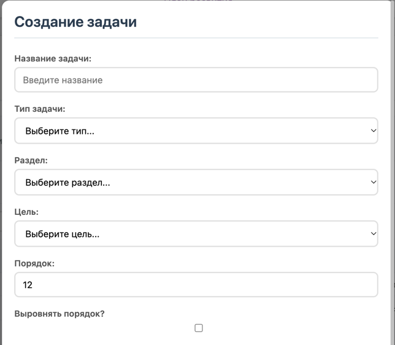



# Выравнивание порядка

На закладке Запланировано находятся задачи с четко установленным порядком выполнения.
Возможны 4-ре ситуации, когда этот порядок может быть нарушен:

- Создание новой задачи
- Редактирование задачи
- Постановка задачи в очередь

В этом случае возможны сложности при выравнивании порядка, когда нужно будет поставить задачу в середину очереди.

Давайте добавим во все 4-ре операции признак "Выровнять порядок", при нажатии на которую у всех задач того же статуса,
у которых порядок меньше порядка обновляемой задачи, порядок остается неизменным, а у задач с порядком равным или большим
текущему порядок будет идти строго в арифметической прогрессии от текущего.

Например, есть задачи: 1,2,3,5,6,7. Добавляем задачу с порядком 2;
Тогда новые порядки будут 1,2,3(2),4(3),5(5),6(6),7(7)

Добавляем в postgresql новую операцию

TaskService:

```dotty
def updateOrdinal(ordinals: NonEmptyVector[(TaskId, Ordinal)]): F[Boolean]
```

PostgreSQLTaskService:

```dotty
def updateOrdinal(ordinals: NonEmptyVector[(TaskId, Ordinal)]): F[Boolean] =
  val (taskId, ordinal) = ordinals.head
  ordinals.tail.foldLeft(
    sql"""UPDATE tasks SET ordinal = $ordinal WHERE id = $taskId""".update.run
  ) {
    case (acc, (taskId, ordinal)) =>
      acc *>
        sql"""UPDATE tasks SET ordinal = $ordinal WHERE id = $taskId""".update.run
  }
    .transact(xa)
    .map(_ > 0)
```

MockTaskService:

```dotty
def updateOrdinal(ordinals: NonEmptyVector[(TaskId, Ordinal)]): F[Boolean] =
  tasksSrc.update: source =>
    ordinals.foldLeft(source) {
      case (source, (taskId, ordinal)) =>
        source.get(taskId) match
          case None       => source
          case Some(task) =>
            source + (taskId -> task.copy(ordinal = ordinal))
    }.as(true)
```

Теперь перейдем к жизненному циклу задачи:

`TaskLifecycleService`:

```dotty
def reorderTasks(
    userId: UserId,
    ordinal: Ordinal,
    status: Status
): F[Boolean] =
  taskService.getAll(
    userId = userId,
    maybeStatus = status.some,
    maybeTaskType = none,
    maybeSectionId = none
  ).flatMap: tasks =>
    val reorderedTasks: Vector[(TaskId, Ordinal)] =
      tasks.collect {
        case task if task.ordinal.value >= ordinal.value =>
          task.id -> task.ordinal
      }
        .sortBy(_._2)
        .foldLeft((Vector.empty[(TaskId, Ordinal)], ordinal.next)) {
          case ((acc, ordinal), (taskId, _)) =>
            (
              acc :+ (taskId -> ordinal),
              ordinal.next
            )
        }._1

    NonEmptyVector
      .fromVector(reorderedTasks)
      .map(taskService.updateOrdinal)
      .getOrElse(true.pure[F])
```

Добавляем в CreateTaskRequest, EditTaskRequest, QueueTaskRequest поле `ordinalShift: Option[String]`:

```dotty
final case class QueueTaskRequest(
    token: String,
    ordinal: Int,
    ordinalShift: Option[String]
) derives FormCodec
```

Дорабатываем `CreateTaskHandler`:

Теперь если выставлено выравнивание порядка, то мы вначале выравниваем порядок у всех задач с порядком больше чем у создаваемой,
а затем только создаем задачку:

```dotty
val runReorderTasks: IO[Boolean] =
  if request.ordinalShift.contains("on") then
    taskLifecycleService.reorderTasks(
      userId = user.id,
      ordinal = task.ordinal,
      status = task.status
    )
  else IO(true)

val run: IO[String] =
  for
    _    <- runReorderTasks
    _    <- taskLifecycleService.create(task)
    view <-
      getViewAfterCreateTask(
        settingsService = settingsService,
        userId = user.id,
        token = jwtToken,
        tab = request.tab
      )
  yield view
```

Добавляем в `createTask.scala.html`:

```html
<div class="form-group">
    <label for="ordinalShift">Выровнять порядок?</label>
    <input id="ordinalShift" name="ordinalShift" type="checkbox" />
</div>
```



Аналогично дорабатываем `EditTaskHandler`:

```dotty
val runReorderTasks: IO[Boolean] =
  if request.ordinalShift.contains("on") then
    taskLifecycleService.reorderTasks(
      userId = user.id,
      ordinal = task.ordinal,
      status = task.status
    )
  else IO(true)

val run: IO[Option[String]] =
  for
    _    <- runReorderTasks
    _    <- taskLifecycleService.update(task)
    view <- getViewTask(
      taskLifecycleService = taskLifecycleService,
      userId = user.id,
      taskId = task.id,
      jwtToken = jwtToken,
      errorMessage = none
    )
  yield view.map(_.toString)
```


Добавляем в `editTask.scala.html`:

```html
<div class="form-group">
    <label for="ordinalShift">Выровнять порядок?</label>
    <input id="ordinalShift" name="ordinalShift" type="checkbox" />
</div>
```

Аналогично дорабатываем `QueueTaskHandler`:

```dotty
final case class QueueTaskHandler(
    middleware: JwtAuthMiddleware[IO, UserInfo],
    taskLifecycleService: TaskLifecycleService[IO]
)(using Logger[IO]) extends AuthorizationHandler(middleware):
  val handler: Handler =
    Routes.queueFormTask.handleIO: (uuid: String, request: QueueTaskRequest) =>
      val run: ((UserInfo, JwtToken)) => IO[Option[String]] =
        (user, jwtToken) =>
          TaskId.parse(uuid) match
            case Validated.Valid(taskId) =>
              Ordinal.either(request.ordinal) match
                case Right(ordinal) =>
                  val runReorderTasks: IO[Boolean] =
                    if request.ordinalShift.contains("on") then
                      taskLifecycleService.reorderTasks(
                        userId = user.id,
                        ordinal = ordinal,
                        status = Status.Planned
                      )
                    else IO(true)
                  
                  for
                    _ <- runReorderTasks
                    _ <- taskLifecycleService.enqueue(
                      id = taskId,
                      userId = user.id,
                      ordinal = ordinal
                    )
                    maybeView <- getViewTask(
                      taskLifecycleService = taskLifecycleService,
                      userId = user.id,
                      taskId = taskId,
                      jwtToken = jwtToken,
                      errorMessage = none
                    )
                  yield maybeView.map(_.toString)
                case Left(error) =>
                  getViewTask(
                    taskLifecycleService = taskLifecycleService,
                    userId = user.id,
                    taskId = taskId,
                    jwtToken = jwtToken,
                    errorMessage = error.some
                  ).map(_.map(_.toString))
            case Validated.Invalid(error) =>
              Logger[IO].error(error).as(none)
      handleUserIOByTokenOpt(run)(request.token)
```

Добавляем в `task.scala.html` в блоке `<!-- Модальное окно для выбора порядка -->`:

```html
<div class="form-group">
    <label for="ordinalShift">Выровнять порядок?</label>
    <input id="ordinalShift" name="ordinalShift" type="checkbox" />
</div>
```

## Предрасчитанный порядок

На странице создания задачи добавляем предрассчитанный порядок - 
следующий свободный порядок задач данного статуса.

При редактировании и откладывании задачи порядок уже существует, а при постановке в очередь - уже рассчитывается.

Добавляем в CreateTaskModalHandler расчет следующего порядка для задач "В работе" и "Запланировано":

```dotty
final case class CreateTaskModalHandler(
    middleware: JwtAuthMiddleware[IO, UserInfo],
    settingsService: SettingsService[IO],
    taskLifecycleService: TaskLifecycleService[IO]
)(using Logger[IO]) extends AuthorizationHandler(middleware):
  val handler: Handler =
    Routes.getTaskCreate.handleIO:
      (tab: String, authorization: Authorization) =>
        handleUserIO: (user, token) =>
          val ordinalIO: IO[Ordinal] =
            TaskStatus.find(tab) match
              case Some(status)
                  if status == TaskStatus.InProgress ||
                    status == TaskStatus.Planned =>
                taskLifecycleService.taskService
                  .getAll(
                    userId = user.id,
                    maybeStatus = status.some,
                    maybeTaskType = none,
                    maybeSectionId = none
                  )
                  .map(_.map(_.ordinal.next).maxOption.getOrElse(Ordinal.Min))
              case _ => Ordinal.Max.pure[IO]

          ordinalIO.flatMap: ordinal =>
            val request = CreateTaskRequest.empty(
              token = token.value,
              tab = tab,
              ordinal = ordinal.value
            )

            getViewEmptyCreateTaskModal(
              settingsService = settingsService,
              userId = user.id,
              request = request
            )
        .apply(authorization)
end CreateTaskModalHandler
```


---

**Ссылки:**

- [Персональный план развития][plugin]
- [Репозиторий с исходниками][repo]

[repo]: https://gitverse.ru/scalabook/pdp
[plugin]: https://artemkorsakov.github.io/personal-development-plan/ru/
