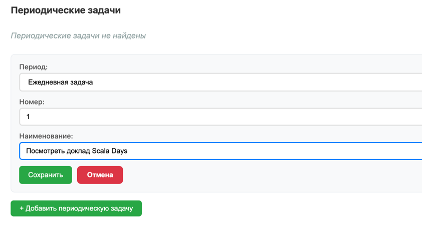
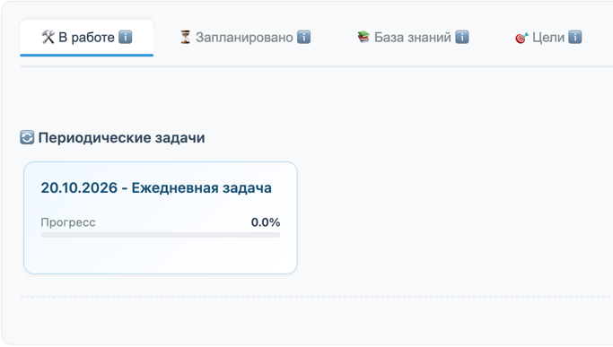
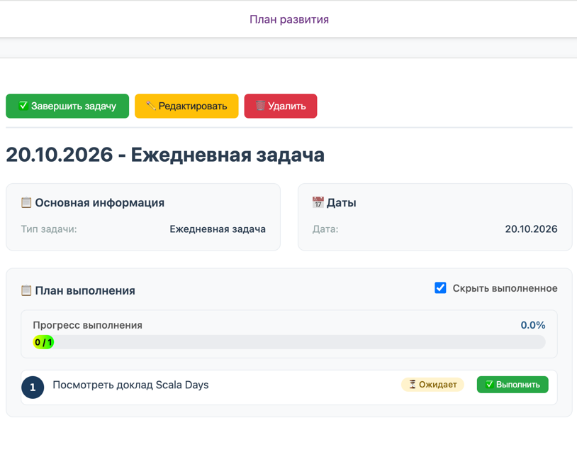

# Периодические задачи

## Основная концепция

Периодические задачи — это автоматизированная система для управления **повторяющимися действиями** в вашем личном плане развития. 
В отличие от разовых задач, которые создаются и завершаются вручную, периодические задачи **генерируются автоматически по заданному расписанию**.

Представьте: вы решили смотреть [Scala Days](https://www.youtube.com/playlist?list=PLSwkkO70hN24) по докладу каждый день и 
ежемесячно актуализировать план развития. 
Вместо того чтобы каждый день создавать задачи вручную, вы настраиваете **шаблоны** — 
и система сама создаёт нужные задачи в нужные даты. 
Это превращает рутину в **автоматический процесс**, который не требует вашего внимания.

## Зачем это нужно?

### Автоматизация рутины

Избавляет от необходимости вручную создавать одни и те же задачи. 
Пользователь один раз настраивает «Ежедневная задача: посмотреть доклад Scala Days» — и система каждый день создаёт новую задачу на сегодня. 
Не нужно помнить, не нужно копировать, не нужно вводить заново.



### Контроль регулярности

Помогает не пропускать важные повторяющиеся действия. 
Если сегодняшняя задача «Посмотреть доклад Scala Days» не завершена — она видна в списке «В работе». 



Это визуальное напоминание: «ты ещё не сделал это сегодня». Без периодических задач такие действия легко забываются.



### Снижение когнитивной нагрузки

Не нужно держать в голове список повторяющихся дел. 
Пользователь освобождает ментальное пространство для творческих задач, потому что рутина автоматизирована. 
Это ключевое преимущество: мозг не тратит энергию на «а что я должен сделать сегодня?» — система уже подготовила список.

## Настройка системы

В разделе настроек пользователь создаёт **шаги периодических задач** — шаблоны, из которых будут генерироваться задачи. 
Каждый шаг содержит три поля:

- **Название** — что именно нужно делать («Зарядка», «Чтение», «Медитация»).
- **Порядок** — номер шага в плане (`1`, `1.2`, `1.2.3`). Определяет последовательность выполнения.
- **Период** — как часто повторять (`Daily`, `Weekly`, `Monthly`, `Quarterly`, `Yearly`).

Для каждого шага доступны кнопки **«Редактировать»** и **«Удалить»**. 
Редактирование позволяет изменить название, номер, период и — опционально — **выровнять порядок** соседних шагов.

### Модель `PeriodicType`

Периодичность задаётся перечислением с пятью значениями:

```dotty
enum PeriodicType:
  case Daily, Weekly, Monthly, Quarterly, Yearly
```

**Разбор значений:**

| Значение        | Смысл         | Пример использования                        |
| --------------- | ------------- | ------------------------------------------- |
| **`Daily`**     | Каждый день   | Посмотреть доклад, прочитать статью         |
| **`Weekly`**    | Раз в неделю  | Обзор недели, планёрка с собой              |
| **`Monthly`**   | Раз в месяц   | Подведение итогов, обзор целей              |
| **`Quarterly`** | Раз в квартал | Ретроспектива квартала, корректировка плана |
| **`Yearly`**    | Раз в год     | Годовой обзор, постановка целей на год      |

**Почему именно эти пять?** Они покрывают **типичные горизонты планирования** в персональном развитии. 
Ежедневные — для привычек. Еженедельные — для тактического обзора. Ежемесячные — для стратегического. 
Ежеквартальные и ежегодные — для долгосрочной рефлексии. 
Пользователю не нужно создавать произвольные интервалы (например, «каждые 3 дня») — это усложнило бы систему и запутало пользователя.

### Сериализация `PeriodicType`

```dotty
object PeriodicType:
  given Meta[PeriodicType] =
    Meta[String].timap(PeriodicType.valueOf)(_.toString)
```

**Что делает `Meta`:** Doobie использует `Meta` для преобразования между Scala-типом и типом колонки в PostgreSQL. 
`Meta[String].timap(...)` создаёт `Meta[PeriodicType]` из `Meta[String]`:

> `Meta` используется на уровне Doobie, но в самой БД хранится **не строка, а enum** (`PeriodicTypeEnum`). 
> Поэтому в запросах используется явное приведение `${periodicType}::PeriodicTypeEnum`.

**Отображение:**

```dotty
given Show[PeriodicType] =
  Show.show {
    case Daily     => "Ежедневная задача"
    case Weekly    => "Еженедельная задача"
    case Monthly   => "Ежемесячная задача"
    case Quarterly => "Ежеквартальная задача"
    case Yearly    => "Ежегодная задача"
  }
```

`Show` даёт **человекочитаемое** представление для UI. В отличие от `toString` (который даёт `"Daily"`), 
`show` даёт «Ежедневная задача» — понятно пользователю.

**Поиск по строке:**

```dotty
def find(source: String): Option[PeriodicType] =
  values.find(_.toString.equalsIgnoreCase(source.replaceAll("\\W", "")))
```

**Разбор:**

- **`source.replaceAll("\\W", "")`** — удаляет все не-словесные символы. `"daily-task"` → `"dailytask"`, `"Daily!"` → `"Daily"`.
- **`equalsIgnoreCase`** — сравнение без учёта регистра. `"daily"`, `"DAILY"`, `"Daily"` — все найдут `Daily`.
- **`values.find`** — возвращает первый совпавший enum или `None`.

**Зачем `find`, если есть `Decoder`?** `find` используется для **парсинга из HTML-форм**. 
Пользователь отправляет `"daily"` (из `value` в `<option>`), а сервер превращает это в `PeriodicType.Daily`. 
`Decoder` — для JSON, `find` — для форм. Разные контексты — разные утилиты.

### Модель `PeriodicStep`

```dotty
final case class PeriodicStep(
    id: PeriodicStepId,
    number: StepNumber,
    name: StepName,
    userId: UserId,
    periodicType: PeriodicType
)

object PeriodicStep:
  type PeriodicStepId = PeriodicStepId.T
  object PeriodicStepId extends RefinedType[Int, GreaterEqual[0]]
```

**Разбор полей:**

| Поле               | Тип              | Назначение                       |
| ------------------ | ---------------- | -------------------------------- |
| **`id`**           | `PeriodicStepId` | Уникальный идентификатор шага    |
| **`number`**       | `StepNumber`     | Номер шага (`1`, `1.2`, `1.2.3`) |
| **`name`**         | `StepName`       | Название шага                    |
| **`userId`**       | `UserId`         | Владелец шага                    |
| **`periodicType`** | `PeriodicType`   | Периодичность                    |

**`PeriodicStepId`** — уточнённый тип над `Int` с ограничением `GreaterEqual[0]`. 
Отрицательные ID запрещены на уровне типа. Это защита от ошибок: `PeriodicStepId(-1)` не скомпилируется.

**`StepNumber` и `StepName`** — те же типы, что и в обычных задачах. 
Это даёт **единообразие**: номера шагов и их названия подчиняются тем же правилам 
(номер — `^\d+(?:\.\d+)*$`, имя — от 2 до 300 символов с `Trimmed`).

### DTO `CreatePeriodicStep`

```dotty
final case class CreatePeriodicStep(
    number: StepNumber,
    name: StepName,
    userId: UserId,
    periodicType: PeriodicType
)
```

DTO для создания шага. Отличается от `PeriodicStep` отсутствием `id` — ID генерируется БД при `INSERT`.

**Почему отдельный DTO, а не `PeriodicStep` без `id`?** Потому что `PeriodicStep` требует `id`, а при создании его ещё нет. 
Использование `PeriodicStep` с временным ID (например, `-1`) — антипаттерн: 
легко забыть заменить ID и получить некорректные данные. 
Отдельный DTO делает намерение **явным**: «это данные для создания, у них ещё нет ID».

## Сервис `PeriodicStepService`

```dotty
private[services] trait PeriodicStepService[F[_]]:
  def create(newItem: CreatePeriodicStep): F[PeriodicStepId]
  def get(id: PeriodicStepId, userId: UserId): F[Option[PeriodicStep]]
  def getByUser(userId: UserId): F[Vector[PeriodicStep]]
  def update(item: PeriodicStep): F[Boolean]
  def updateAll(items: NonEmptyVector[PeriodicStep]): F[Boolean]
  def delete(id: PeriodicStepId): F[Boolean]
```

**Разбор методов:**

- **`create`** — создаёт шаг и возвращает сгенерированный ID.
- **`get`** — получает шаг по ID **с проверкой владельца** (`userId`). Возвращает `Option`,
  потому что шаг может не существовать (или принадлежать другому пользователю).
- **`getByUser`** — получает все шаги пользователя.
- **`update`** — обновляет один шаг. Возвращает `Boolean` — был ли шаг найден и обновлён.
- **`updateAll`** — обновляет несколько шагов в одной транзакции. Ключевой метод для **переупорядочивания**.
- **`delete`** — удаляет шаг по ID.

**Почему `updateAll`, а не `update` в цикле?** `updateAll` использует **транзакцию**: 
если один `UPDATE` упадёт, все изменения откатятся. 
Это критично для переупорядочивания: нельзя оставить шаги в «полу-обновлённом» состоянии с дубликатами номеров.

## Миграция БД

```dotty
private val createPeriodicTypeEnum: Fragment =
  sql"""CREATE TYPE PeriodicTypeEnum AS ENUM
       ('Daily', 'Weekly', 'Monthly', 'Quarterly', 'Yearly');"""

private val createPeriodicStepTable: Fragment =
  sql"""CREATE TABLE IF NOT EXISTS periodic_steps (
       id SERIAL PRIMARY KEY,
       number VARCHAR(255) NOT NULL,
       name VARCHAR(255) NOT NULL,
       user_id UUID NOT NULL,
       periodic_type PeriodicTypeEnum NOT NULL
       );"""
```

**Разбор:**

- **`CREATE TYPE PeriodicTypeEnum AS ENUM (...)`** — создаёт **пользовательский тип** PostgreSQL. 
  В отличие от `VARCHAR`, enum гарантирует, что в колонке `periodic_type` могут быть **только** эти пять значений. 
  Попытка вставить `'Unknown'` приведёт к ошибке на уровне БД — это дополнительная защита.

- **`periodic_type PeriodicTypeEnum NOT NULL`** — колонка имеет enum-тип. При вставке нужно явное приведение: `${periodicType}::PeriodicTypeEnum`.

**Почему enum, а не `VARCHAR`?** Enum даёт:

- **Типовую безопасность** на уровне БД.
- **Компактное хранение** (enum хранится как целое число, а не строка).
- **Валидацию** при вставке.

**Минус enum:** добавление нового значения требует `ALTER TYPE ... ADD VALUE`. 
Если в будущем появится `BiWeekly` — нужно мигрировать тип. Для стабильного набора из пяти значений это приемлемо.

## Реализация `PostgreSQLPeriodicStepService`

### `create`

```dotty
def create(newItem: CreatePeriodicStep): F[PeriodicStepId] =
  sql"""INSERT INTO periodic_steps (number, name, user_id, periodic_type)
        VALUES (${newItem.number}, ${newItem.name}, ${newItem.userId}, ${newItem.periodicType}::PeriodicTypeEnum)
        RETURNING id"""
    .query[PeriodicStepId]
    .unique
    .transact(xa)
```

**Разбор:**

- **`INSERT`** — вставляет новый шаг.
- **`${newItem.periodicType}::PeriodicTypeEnum`** — явное приведение к enum. 
  Без него PostgreSQL не поймёт, что строка `"Daily"` должна стать значением enum.
- **`RETURNING id`** — возвращает сгенерированный ID за один запрос.
- **`.query[PeriodicStepId].unique`** — ожидает ровно одну строку, читает её как `PeriodicStepId`.

### `get`

```dotty
def get(id: PeriodicStepId, userId: UserId): F[Option[PeriodicStep]] =
  sql"""SELECT id, number, name, user_id, periodic_type FROM periodic_steps WHERE id = $id AND user_id = $userId"""
    .query[PeriodicStep].option.transact(xa)
```

Возвращает `Option[PeriodicStep]`. `.option` превращает «нет строк» в `None`, «есть строка» — в `Some`.
Запрос фильтрует и по `id`, и по `user_id` — сервис сам гарантирует, что пользователь не получит чужой шаг.

### `getByUser`

```dotty
def getByUser(userId: UserId): F[Vector[PeriodicStep]] =
  sql"""SELECT id, number, name, user_id, periodic_type FROM periodic_steps WHERE user_id = $userId"""
    .query[PeriodicStep]
    .to[Vector]
    .transact(xa)
```

Возвращает **все** шаги пользователя. `.to[Vector]` собирает строки в вектор.

> **Почему не сортируется в запросе?** 
> Сортировка выполняется **в сервисе настроек** перед передачей в UI — по `(periodicType.ordinal, number)`. 
> Это даёт гибкость: если понадобится другая сортировка, её можно изменить в одном месте — в `getViewSettings`, а не в SQL.

### `update`

```dotty
def update(item: PeriodicStep): F[Boolean] =
  getUpdateFragment(item)
    .update.run.transact(xa).map(_ > 0)

private def getUpdateFragment(step: PeriodicStep): Fragment =
  sql"""UPDATE periodic_steps
       SET number = ${step.number}, name = ${step.name}, user_id = ${step.userId}, periodic_type = ${step.periodicType}::PeriodicTypeEnum
       WHERE id = ${step.id}"""
```

**Разбор:**

- **`getUpdateFragment`** — вынесен в отдельный метод, чтобы переиспользовать в `update` и `updateAll`. Это устраняет дублирование SQL.
- **`.update.run`** — выполняет `UPDATE`, возвращает количество затронутых строк.
- **`.map(_ > 0)`** — `true`, если строка была обновлена.

### `updateAll`

```dotty
def updateAll(items: NonEmptyVector[PeriodicStep]): F[Boolean] =
  items.tail.foldLeft(getUpdateFragment(items.head).update.run) {
    case (acc, step) =>
      acc *> getUpdateFragment(step).update.run
  }
    .transact(xa)
    .map(_ > 0)
```

**Пошаговый разбор:**

1. **`items.head`** — первый элемент используется как начальное значение для `foldLeft`.
2. **`items.tail.foldLeft(...)`** — проходим по остальным элементам.
3. **`acc *> getUpdateFragment(step).update.run`** — композиция эффектов: сначала предыдущий `UPDATE`, потом текущий.
4. **`.transact(xa)`** — всё в одной транзакции.
5. **`.map(_ > 0)`** — `true`, если хотя бы один `UPDATE` затронул строку.

**Почему `*>`, а не `flatMap`?** `*>` — это `productR`: выполняет левый эффект, игнорирует его результат, выполняет правый. 
Для `UPDATE` результат не важен — важно, что оба выполнились. `*>` короче и выразительнее, чем `flatMap(_ => ...)`.

### `delete`

```dotty
def delete(id: PeriodicStepId): F[Boolean] =
  sql"""DELETE FROM periodic_steps WHERE id = $id"""
    .update.run.transact(xa).map(_ > 0)
```

Простой `DELETE` с проверкой, что строка была удалена.

## `SettingsService` — интеграция

`SettingsService` — агрегатор, который управляет всеми справочниками. Для периодических задач он предоставляет пять методов.

### `createStep`

```dotty
def createStep(newItem: CreatePeriodicStep): F[PeriodicStepId] =
  periodicStepService.create(newItem)
```

Простое делегирование. `SettingsService` не добавляет логику — просто проксирует вызов в `PeriodicStepService`.

### `updateStep`

```dotty
def updateStep(item: PeriodicStep): F[Boolean] =
  periodicStepService.update(item)
```

Тоже делегирование. Валидация (например, проверка владельца) выполняется в хэндлере или в `reorderSteps`.

### `getSteps`

```dotty
def getSteps(userId: UserId): F[Vector[PeriodicStep]] =
  periodicStepService.getByUser(userId)
```

Загружает все шаги пользователя. Сортировка — на уровне `getViewSettings`.

### `deleteStep`

```dotty
def deleteStep(id: PeriodicStepId, userId: UserId): F[Boolean] =
  periodicStepService.get(id, userId).flatMap:
    case Some(_) => periodicStepService.delete(id)
    case None    => false.pure[F]
```

**Разбор:**

1. **`periodicStepService.get(id, userId)`** — загружаем шаг **с проверкой владельца**: метод
   принимает `userId` и фильтрует по нему. Если шаг принадлежит другому пользователю — вернёт `None`.
2. **`case Some(_) => periodicStepService.delete(id)`** — шаг существует **и** принадлежит пользователю — удаляем.
3. **`case None => false.pure[F]`** — если шага нет или он чужой — возвращаем `false`.

**Почему проверка владельца ушла из `SettingsService`?** В `cb36973` проверка владельца переехала
в низкоуровневый `PeriodicStepService`: `get(id, userId)` уже фильтрует по `user_id`.
Раньше `SettingsService` сам сравнивал `item.userId == userId`, теперь это делает сервис. 
Это разделение ответственности: низкоуровневый сервис делает «что сказано», высокоуровневый — «что разрешено».

> Проверка принадлежности жила в `SettingsService` и защищала от **удаления чужого шага**. 
> Без неё пользователь мог бы отправить `DELETE /settings/periodic_steps/42` и удалить шаг другого пользователя, если угадать ID. 
> Это критическая уязвимость. Теперь та же защита встроена в `PeriodicStepService.get(id, userId)`: чужая запись просто не находится.

### `reorderSteps`

```dotty
def reorderSteps(
    ids: NonEmptyVector[PeriodicStepId],
    periodicType: PeriodicType,
    userId: UserId
): F[Boolean] =
  periodicStepService.getByUser(userId).flatMap: items =>
    NonEmptyVector.fromVector(items.filter(_.periodicType == periodicType)) match
      case None =>
        MonadThrow[F].raiseError(
          new IllegalArgumentException("Items list is empty")
        )
      case Some(neItems) =>
        val notFoundIds = ids.filterNot(id => neItems.exists(_.id == id))
        if notFoundIds.nonEmpty then
          MonadThrow[F].raiseError(
            new IllegalArgumentException(
              s"Some ids are not found: ${notFoundIds.mkString(", ")}"
            )
          )
        else
          val sortedItems = neItems.sortBy { step =>
            ids.toVector.indexOf(step.id)
          }

          val initialNumber = PlanStep.FirstStepNumber
          val initialAcc    = NonEmptyVector.one(
            sortedItems.head.copy(number = initialNumber)
          )
          val updated =
            sortedItems.tail
              .foldLeft((initialAcc, initialNumber)) {
                case ((acc, number), step) =>
                  val level      = step.number.level
                  val nextNumber = number.next(level)
                  (
                    acc :+ step.copy(number = nextNumber),
                    nextNumber
                  )
              }._1

          periodicStepService.updateAll(updated)
        end if
```

**Пошаговый разбор:**

**1. Загрузка шагов пользователя:**

```dotty
periodicStepService.getByUser(userId).flatMap: items =>
```

Загружаем все шаги пользователя.

**2. Фильтрация по типу:**

```dotty
items.filter(_.periodicType == periodicType)
```

Оставляем только шаги **того же типа**, что и переупорядочиваемый. 
Это важно: шаги разных типов не должны смешиваться. Ежедневные шаги нумеруются отдельно от еженедельных.

**3. Проверка на пустоту:**

```dotty
case None =>
  MonadThrow[F].raiseError(
    new IllegalArgumentException("Items list is empty")
  )
```

Если у пользователя нет шагов этого типа — ошибка. Это защита от вызова `reorderSteps` в некорректном контексте.

**4. Проверка, что все ID найдены:**

```dotty
val notFoundIds = ids.filterNot(id => neItems.exists(_.id == id))
if notFoundIds.nonEmpty then
  MonadThrow[F].raiseError(
    new IllegalArgumentException(
      s"Some ids are not found: ${notFoundIds.mkString(", ")}"
    )
  )
```

Если хотя бы один ID из запроса не найден среди шагов пользователя — ошибка. Это защита от:

- **Опечаток** (пользователь передал `999` вместо `99`).
- **Чужих ID** (пользователь пытается переупорядочить шаги другого пользователя).
- **Устаревших данных** (шаг был удалён между загрузкой и переупорядочиванием).

**5. Сортировка по порядку из запроса:**

```dotty
val sortedItems = neItems.sortBy { step =>
  ids.toVector.indexOf(step.id)
}
```

- **`ids.indexOf(step.id)`** — позиция шага в новом порядке. Например, если `ids = [3, 1, 4, 2]`, то шаг с `id = 3` имеет индекс `0`.
- **`sortBy`** — сортируем по индексу. Шаги идут в порядке, указанном в `ids`.

**6. Перенумерация:**

```dotty
val initialNumber = PlanStep.FirstStepNumber
val initialAcc    = NonEmptyVector.one(
  sortedItems.head.copy(number = initialNumber)
)
```

- **`PlanStep.FirstStepNumber`** — начальный номер (`StepNumber("1")`).
- **`sortedItems.head.copy(number = initialNumber)`** — первому шагу присваиваем номер `1`.
- **`initialAcc`** — аккумулятор с первым шагом.

```dotty
val updated =
  sortedItems.tail
    .foldLeft((initialAcc, initialNumber)) {
      case ((acc, number), step) =>
        val level      = step.number.level
        val nextNumber = number.next(level)
        (
          acc :+ step.copy(number = nextNumber),
          nextNumber
        )
    }._1
```

- **`sortedItems.tail`** — остальные шаги (без первого).
- **`foldLeft((initialAcc, initialNumber))`** — аккумулятор: `(вектор шагов, текущий номер)`.
- **`step.number.level`** — уровень вложенности шага (количество точек в номере).
- **`number.next(level)`** — следующий номер на этом уровне.
- **`step.copy(number = nextNumber)`** — обновляем номер шага.
- **`._1`** — извлекаем вектор шагов.

**Как работает перенумерация:**

1. Первый шаг получает номер `1`.
2. Следующий шаг получает `next(level)` от текущего номера.
3. Если шаг на верхнем уровне (`level = 0`), `next(0)` даёт следующий номер: `1 → 2`, `2 → 3`.
4. Если шаг вложенный (`level = 1`), `next(1)` даёт `1.1` от `1`, `2.1` от `2`, `2.2` от `2.1` и т.д.

**7. Сохранение:**

```dotty
periodicStepService.updateAll(updated)
```

Все обновления в одной транзакции. Если что-то упадёт — откат.

## Шаблоны

### `Views.settings` — общий вид

Метод рендера страницы настроек:

```dotty
def settings(
    token: JwtToken,
    taskTypes: Vector[TaskType],
    sections: Vector[Section],
    goals: Vector[Goal],
    periodicSteps: Vector[PeriodicStep],
    errorTaskTypeMessage: Option[String],
    errorSectionMessage: Option[String],
    errorGoalMessage: Option[String],
    errorPeriodicStepMessage: Option[String]
): Frag
```

Раздел «Периодические задачи» в настройках группирует шаги **по типу периода**. Для каждого типа — своя таблица:

```dotty
div(cls := "periodic-type-section")(
  h4(cls := "periodic-type-title")(pt.show),
  table(cls := "periodic-steps-table")(
    thead(tr(th("Номер"), th("Наименование"), th(""))),
    tbody(
      attr("hx-target") := "closest tr",
      attr("hx-swap")   := "outerHTML"
    )(
      stepsForType.map { step =>
        tr(
          cls                           := "periodic-step-row",
          attr("data-periodic-step-id") := step.id.value.toString
        )(
          td(step.number.value),
          td(
            cls                   := "markdown-content",
            attr("data-markdown") := step.name.value.toString
          )(
            button(
              cls            := "edit-btn",
              attr("hx-get") :=
                s"/settings/periodic_steps/${step.id.value}/edit",
              attr("hx-trigger") := "edit",
              attr("onclick")    := "handleEditClick(this)"
            )("✏️ Редактировать"),
            button(
              cls               := "delete-btn",
              attr("hx-delete") :=
                s"/settings/periodic_steps/${step.id.value}",
              Htmx.appTarget,
              Htmx.appSwap,
              attr("hx-confirm") :=
                s"""Вы уверены, что хотите удалить периодическую задачу «${step.name.value}»?"""
            )("🗑️ Удалить")
          )
        )
      }*
    )
  )
)
```

**Разбор данных:**

- **`periodicSteps`** — входной параметр: `Vector[PeriodicStep]`, уже отсортированный по `(periodicType.ordinal, number)`.
- Метод группирует шаги по `periodicType` через `PeriodicType.values`.
- **`periodicType.show`** — выводим человекочитаемое название типа в заголовке секции
  `<h4>` («Ежедневная задача», «Еженедельная задача» и т.д.).
- **Таблица без колонки «Период»** — тип вынесен в заголовок.

**Преимущества группировки:**

1. **Визуальная структура:** пользователь сразу видит, какие задачи ежедневные, какие еженедельные.
2. **Быстрый поиск:** чтобы найти ежедневные, не нужно читать колонку «Период» в каждой строке.
3. **Стабильный порядок:** типы идут в порядке `enum`, независимо от данных.

### `Views.getPeriodicStepRow` — строка для htmx-ответа

Метод рендера обычной строки периодического шага (не редактируемой):

```dotty
def getPeriodicStepRow(step: PeriodicStep): String =
  tr(
    cls                           := "periodic-step-row",
    attr("data-periodic-step-id") := step.id.value.toString
  )(
    td(
      button(
        cls             := "refresh-btn",
        attr("onclick") := "htmx.process(this); this.click();",
        attr("hx-get")  := "/settings",
        Htmx.appTarget,
        Htmx.appSwap
      )("🔄 Обновить"),
      step.periodicType.show
    ),
    td(step.number.value),
    td(
      cls                   := "markdown-content",
      attr("data-markdown") := step.name.value.toString
    ),
    td(
      button(
        cls            := "edit-btn",
        attr("hx-get") := s"/settings/periodic_steps/${step.id.value}/edit",
        attr("hx-trigger") := "edit",
        attr("onclick")    := "handleEditClick(this)"
      )("✏️ Редактировать"),
      button(
        cls               := "delete-btn",
        attr("hx-delete") := s"/settings/periodic_steps/${step.id.value}",
        Htmx.appTarget,
        Htmx.appSwap,
        attr("hx-confirm") :=
          s"""Вы уверены, что хотите удалить периодическую задачу «${step.name.value}»?"""
      )("🗑️ Удалить")
    )
  ).render
```

**Разбор:**

- **`step: PeriodicStep`** — единственный входной параметр. Токен здесь не нужен — row не содержит формы.
- **`hx-get="/settings"`** — кнопка «Обновить» перезагружает всю страницу настроек.
- **`<td class="markdown-content" data-markdown="...">`** — имя шага хранится в `data-markdown` атрибуте для клиентской разметки.

### `EditPeriodicStepRequest.render` — редактируемая строка

Метод рендера редактируемой строки периодического шага:

```dotty
def render(
    step: PeriodicStep,
    token: JwtToken,
    maybeError: Option[String]
): Tag =
  val path = s"/settings/periodic_steps/${step.id.value}"

  tr(
    cls                := "periodic-step-row editing",
    attr("hx-trigger") := "cancel",
    attr("hx-get")     := path,
    td(
      select(
        name := "periodicType",
        cls  := "edit-input",
        required,
        PeriodicType.values.map { pt =>
          option(
            (value := pt.toString.toLowerCase) ::
              (if pt == step.periodicType then List[Modifier](selected)
               else List.empty[Modifier])
          )(pt.show)
        }
      )
    ),
    td(
      input(
        cls           := "edit-input",
        name          := "number",
        value         := step.number.toString,
        pattern       := "^\\d+(?:\\.\\d+)*$",
        attr("title") := "Только цифры и точки (например: 1.2.3)",
        autofocus
      )
    ),
    td(
      input(
        cls   := "edit-input",
        name  := "name",
        value := step.name.toString
      ),
      div(
        cls := "periodic-step-ordinal-shift",
        label(
          input(
            name   := "ordinalShift",
            cls    := "edit-checkbox",
            `type` := "checkbox"
          ),
          "Выровнять порядок"
        )
      )
    ),
    td(
      Htmx.hiddenToken(token.value),
      button(cls := "cancel-btn", attr("hx-get") := path)("❌ Отмена"),
      button(
        cls                := "save-btn",
        attr("hx-put")     := path,
        attr("hx-include") := "closest tr"
      )("💾 Сохранить"),
      maybeError.map(msg => div(cls := "error")(msg)).getOrElse(frag())
    )
  )
```

**Разбор:**

- **`step: PeriodicStep`** — редактируемый шаг.
- **`token: JwtToken`** — JWT-токен для аутентификации (отправляется в скрытом поле).
- **`maybeError: Option[String]`** — сообщение об ошибке, если валидация не прошла.
- **`class="periodic-step-row editing"`** — дополнительный класс `editing` для «одновременного редактирования только одной строки».
- **`hx-trigger="cancel"`** — строка реагирует на событие `cancel` (когда пользователь открывает другую строку).
- **`hx-get="/settings/periodic_steps/1"`** — при `cancel` возвращает обычную строку (не редактируемую).
- **`select` для типа** — позволяет изменить период.
- **`input` для номера** — с `pattern` и `title`.
- **`input` для имени** — обычное текстовое поле.
- **Чекбокс «Выровнять порядок»** — при сохранении запускает `reorderSteps`.
- **`hx-include="closest tr"`** — при сохранении включает все поля из строки (`periodicType`, `number`, `name`, `ordinalShift`, `token`).

**Почему `hx-include="closest tr"`?** Потому что `<tr>` не является `<form>`. 
`hx-include` собирает значения всех полей внутри `<tr>` и отправляет их в PUT-запросе. 
Это стандартный паттерн для редактирования строк таблицы.

## Роуты

```dotty
final case class CreatePeriodicStepRequest(
    token: String,
    periodicType: String,
    number: String,
    name: String
) derives FormCodec

final case class EditPeriodicStepRequest(
    token: String,
    periodicType: String,
    number: String,
    name: String,
    ordinalShift: Option[String]
) derives FormCodec
```

**Разбор DTO:**

- **`CreatePeriodicStepRequest`** — для POST-создания. Без `ordinalShift` (при создании выравнивание не нужно — новый шаг просто добавляется в конец).
- **`EditPeriodicStepRequest`** — для PUT-редактирования. С `ordinalShift: Option[String]` (чекбокс может быть отмечен или нет).

**Почему `periodicType: String`, а не `PeriodicType`?** 
Потому что форма отправляет `"daily"` (из `value` в `<option>`), а не enum. 
Парсинг в `PeriodicType.find` происходит в хэндлере — это позволяет вернуть **понятную ошибку**, если тип не распознан.

**Почему `number: String`, а не `StepNumber`?** Аналогично: форма отправляет `"1.2.3"`, а парсинг в `StepNumber.either` — в хэндлере.

**Почему `ordinalShift: Option[String]`?** Чекбокс отправляет `"on"`, если отмечен, и **не отправляет поле**, если не отмечен. 
`Option[String]` моделирует оба случая: `Some("on")` и `None`.

### Маршруты

Все маршруты шагов объявлены как приватные значения внутри класса `PeriodicStepHandlers`.
Общий путь с параметром `periodicStepIdParam` выделен в отдельное значение `path`,
а остальные маршруты строятся на его основе:

```dotty
private val path = Path.root / "settings" / "periodic_steps" / periodicStepIdParam

private val createRoute = Route(
  Request.post(Path.root / "settings" / "periodic_steps")
    .withEntity(Entity.formOf[CreatePeriodicStepRequest]),
  Response.ok(Entity.html).orNotFound
)

private val editRoute = Route(
  Request.put(path).withEntity(Entity.formOf[EditPeriodicStepRequest]),
  Response.ok(Entity.html).orNotFound
)

private val editRowRoute = Route(
  Request.get(path / "edit").extractHeader[Authorization],
  Response.ok(Entity.html).orNotFound
)

private val getRowRoute = Route(
  Request.get(path).extractHeader[Authorization],
  Response.ok(Entity.html).orNotFound
)

private val deleteRoute = Route(
  Request.delete(path).extractHeader[Authorization],
  Response.ok(Entity.html).orNotFound
)
```

`periodicStepIdParam` — это типизированный параметр пути (`Param[PeriodicStepId]`),
поэтому в хэндлеры ID шага приходит уже как `PeriodicStepId`.

**Разбор маршрутов:**

| Маршрут                                  | Метод  | Назначение                  |
| ---------------------------------------- | ------ | --------------------------- |
| **`/settings/periodic_steps`**           | POST   | Создание шага               |
| **`/settings/periodic_steps/{id}`**      | PUT    | Редактирование шага         |
| **`/settings/periodic_steps/{id}/edit`** | GET    | Форма редактирования        |
| **`/settings/periodic_steps/{id}`**      | GET    | Обычная строка (для отмены) |
| **`/settings/periodic_steps/{id}`**      | DELETE | Удаление шага               |

## Хэндлеры

### `CreatePeriodicStep.parse`

```dotty
object CreatePeriodicStep:
  def parse(
      request: CreatePeriodicStepRequest,
      userId: UserId
  ): ValidatedNec[String, CreatePeriodicStep] =
    (
      StepNumber.either(request.number).toValidatedNec,
      StepName.either(request.name).toValidatedNec,
      PeriodicType.find(
        request.periodicType
      ).toValidNec(s"Periodic type not found: ${request.periodicType}")
    ).mapN {
      case (number, name, periodicType) =>
        CreatePeriodicStep(
          number = number,
          name = name,
          userId = userId,
          periodicType = periodicType
        )
    }
```

**Пошаговый разбор:**

1. **`StepNumber.either(request.number)`** — валидация номера. Возвращает `Either[String, StepNumber]`.
2. **`StepName.either(request.name)`** — валидация имени.
3. **`PeriodicType.find(request.periodicType)`** — поиск периода по строке. Возвращает `Option[PeriodicType]`.
4. **`.toValidatedNec`** — превращает `Either`/`Option` в `ValidatedNec`.
5. **`.mapN`** — комбинирует три результата. Если все валидны — создаёт `CreatePeriodicStep`. Если есть ошибки — аккумулирует их.

**Почему `ValidatedNec`, а не `Either`?** `ValidatedNec` **аккумулирует** все ошибки, а не останавливается на первой. 
Пользователь видит сразу все проблемы («номер невалиден», «имя слишком короткое», «тип не найден»), а не исправляет по одной.

### Класс `PeriodicStepHandlers`

Все пять операций над шагами собраны в один класс `PeriodicStepHandlers`. Каждая операция — это
отдельный публичный `val`-хэндлер, декларативно связанный со своим маршрутом:

```dotty
final case class PeriodicStepHandlers(
    middleware: JwtAuthMiddleware[IO, UserInfo],
    settingsService: SettingsService[IO]
)(using Logger[IO]) extends AuthorizationHandler(middleware):
  val createHandler: Handler =
    createRoute.handleIO: (request: CreatePeriodicStepRequest) =>
      val create: ((UserInfo, JwtToken)) => IO[String] =
        (user, jwtToken) =>
          CreatePeriodicStep.parse(request, user.id) match
            case Validated.Valid(newItem) =>
              settingsService
                .createStep(newItem)
                .flatMap: _ =>
                  getViewSettings(
                    settingsService = settingsService,
                    userId = user.id,
                    jwtToken = jwtToken
                  )
                .recoverWith:
                  case ex: IllegalArgumentException =>
                    getViewSettings(
                      settingsService = settingsService,
                      userId = user.id,
                      jwtToken = jwtToken,
                      errorPeriodicStepMessage = ex.getMessage.some
                    )
            case Validated.Invalid(errors) =>
              getViewSettings(
                settingsService = settingsService,
                userId = user.id,
                jwtToken = jwtToken,
                errorPeriodicStepMessage = errors.toChain.toVector.mkString("; ").some
              )
      // ToDo: https://github.com/creativescala/krop/pull/57
      val authorization: Authorization =
        Authorization(Token(AuthScheme.Bearer, request.token))
      withUserFromHeader(authorization)(create)

  val editHandler: Handler = ...
  val editRowHandler: Handler = ...
  val getRowHandler: Handler = ...
  val deleteHandler: Handler = ...
end PeriodicStepHandlers
```

**Пошаговый разбор `createHandler`:**

1. **`createRoute.handleIO: (request: CreatePeriodicStepRequest) => ...`** — регистрируем обработчик на маршрут `createRoute`.
2. **`val create: ((UserInfo, JwtToken)) => IO[String]`** — каррированная лямбда. Сначала получаем запрос, потом — пользователя.
3. **`CreatePeriodicStep.parse(request, user.id)`** — валидация запроса.
4. **`Valid(newItem)`** — если валидно, создаём шаг через `settingsService.createStep`.
5. **`.flatMap: _ => getViewSettings(...)`** — после создания загружаем обновлённую страницу настроек.
6. **`.recoverWith`** — при ошибке (например, дубликат шага) показываем страницу с сообщением.
7. **`Invalid(errors)`** — при ошибке валидации показываем страницу с объединёнными сообщениями.

> Такая группировка — общий паттерн всего проекта: операции одной сущности
> (создание, редактирование, удаление, отображение строк) собираются в один класс,
> а не размазываются по множеству отдельных классов-хэндлеров.

**Почему после создания возвращается вся страница настроек?** Потому что htmx заменяет `#app`. 
Пользователь видит обновлённый список шагов, включая новый. Это проще, чем возвращать только новую строку.

**Почему `recoverWith` на `IllegalArgumentException`?** 
`createStep` может бросить исключение (например, при нарушении уникальности). 
Мы ловим его и показываем сообщение, а не роняем приложение.

### `getViewSettings`

`SettingsViews` предоставляет два варианта функции: перегрузку без параметров ошибок
(используется для успешных операций) и полную перегрузку с четырьмя `Option`-параметрами
для вывода сообщений об ошибках:

```dotty
private[settings] object SettingsViews:
  def getViewSettings(
      settingsService: SettingsService[IO],
      userId: UserId,
      jwtToken: JwtToken
  ): IO[String] =
    getViewSettings(
      settingsService = settingsService,
      userId = userId,
      jwtToken = jwtToken,
      errorTaskTypeMessage = none,
      errorSectionMessage = none,
      errorGoalMessage = none,
      errorPeriodicStepMessage = none
    )

  def getViewSettings(
      settingsService: SettingsService[IO],
      userId: UserId,
      jwtToken: JwtToken,
      errorTaskTypeMessage: Option[String],
      errorSectionMessage: Option[String],
      errorGoalMessage: Option[String],
      errorPeriodicStepMessage: Option[String]
  ): IO[String] =
    for
      taskTypes     <- settingsService.getTaskTypes(userId)
      sections      <- settingsService.getSections(userId)
      goals         <- settingsService.getGoals(userId)
      periodicSteps <- settingsService.getSteps(userId)
    yield
      val sortedSteps: Vector[PeriodicStep] =
        periodicSteps.sortBy(step => (step.periodicType.ordinal, step.number))

      Views.settings(
        token = jwtToken.value,
        taskTypes = taskTypes,
        sections = sections,
        goals = goals,
        periodicSteps = sortedSteps,
        errorTaskTypeMessage = errorTaskTypeMessage,
        errorSectionMessage = errorSectionMessage,
        errorGoalMessage = errorGoalMessage,
        errorPeriodicStepMessage = errorPeriodicStepMessage
      ).render
```

**Разбор:**

1. **Два варианта** — короткий (без ошибок) делегирует полному, передавая `none` для всех сообщений.
2. **Загрузка** четырёх справочников: `taskTypes`, `sections`, `goals`, `periodicSteps`.
3. **Сортировка шагов** по `(periodicType.ordinal, number)`:
    - Сначала по типу периода (`Daily` → `Weekly` → ...).
    - При равных типах — по номеру шага.
4. **Рендер `Views.settings`** с отсортированными данными и переданными сообщениями об ошибках.

### `editRowHandler` — форма редактирования

```dotty
val editRowHandler: Handler =
  editRowRoute.handleIO:
    (stepId: PeriodicStepId, authorization: Authorization) =>
      withUserFromHeader(
        authorization
      ): (user: UserInfo, jwtToken: JwtToken) =>
        getPeriodicStep(stepId, user.id).map: step =>
          EditPeriodicStepRequest.render(
            step,
            jwtToken.value,
            none
          ).render
```

**Разбор:**

1. **`stepId: PeriodicStepId`** — ID приходит типизированным из пути через `periodicStepIdParam`.
2. **`getPeriodicStep(stepId, user.id)`** — приватный вспомогательный метод, который загружает
   все шаги пользователя и находит нужный:
   ```dotty
   private def getPeriodicStep(stepId: PeriodicStepId, userId: UserId): IO[PeriodicStep] =
     for
       steps <- settingsService.getSteps(userId)
       step  <- IO.fromOption(
         steps.find(_.id == stepId)
       )(new IllegalArgumentException("Шаг не найден"))
     yield step
   ```
3. **Рендер `EditPeriodicStepRequest.render`** — редактируемая строка.

> Шаг загружается через `getSteps` и поиск в векторе — O(n). Для больших списков это может быть медленно. 
> В текущей реализации `getSteps` проще и достаточно.

### `editHandler` — сохранение правок

```dotty
val editHandler: Handler =
  editRoute.handleIO:
    (stepId: PeriodicStepId, request: EditPeriodicStepRequest) =>
      val edit: ((UserInfo, JwtToken)) => IO[String] =
        (user, jwtToken) =>
          val rearrange = request.ordinalShift.contains("on")

          PeriodicStep.parse(stepId, request, user.id) match
            case Validated.Valid(updated) =>
              val run =
                if rearrange then
                  for
                    items <- settingsService.getSteps(user.id)
                    _     <- settingsService.updateStep(updated)
                    (beforeUpdated, afterUpdated) =
                      items
                        .filter(step =>
                          step.periodicType == updated.periodicType &&
                            step.id != updated.id
                        )
                        .partition(_.number < updated.number)
                    ids =
                      NonEmptyVector.one(updated.id)
                        .prependVector(
                          beforeUpdated.sortBy(_.number).map(_.id)
                        )
                        .appendVector(
                          afterUpdated.sortBy(_.number).map(_.id)
                        )
                    _ <- settingsService.reorderSteps(
                      ids,
                      updated.periodicType,
                      user.id
                    )
                  yield ()
                else
                  settingsService.updateStep(updated).void

              run.map: _ =>
                Views.getPeriodicStepRow(
                  updated,
                  jwtToken.value
                )
              .recoverWith:
                case ex: IllegalArgumentException =>
                  getRow(
                    stepId = stepId,
                    userId = user.id,
                    jwtToken = jwtToken,
                    errorMessage = ex.getMessage.some
                  )
            case Validated.Invalid(errors) =>
              getRow(
                stepId = stepId,
                userId = user.id,
                jwtToken = jwtToken,
                errorMessage = errors.mkString_(";").some
              )
          end match
      // ToDo: https://github.com/creativescala/krop/pull/57
      val authorization: Authorization =
        Authorization(Token(AuthScheme.Bearer, request.token))
      withUserFromHeader(authorization)(edit)
```

**Пошаговый разбор:**

1. `val rearrange = request.ordinalShift.contains("on")` — проверка, отмечен ли чекбокс «Выровнять порядок».
2. `PeriodicStep.parse(stepId, request, user.id)` — валидация запроса. Создаёт обновлённый `PeriodicStep` с новыми значениями.
3. Два сценария:
   - **`rearrange = true`** — с переупорядочиванием:
       1. Загружаем все шаги пользователя.
       2. Обновляем текущий шаг.
       3. Разделяем остальные шаги на две группы:
           - `beforeUpdated` — шаги с номером **меньше** нового.
           - `afterUpdated` — шаги с номером **больше или равным** новому.
       4. Формируем новый порядок: `[before] + [updated] + [after]`.
       5. Вызываем `reorderSteps` с новым порядком.
   - **`rearrange = false`** — просто `updateStep(updated)` без переупорядочивания.
4. `run.map: _ => Views.getPeriodicStepRow(updated, ...)`** — при успехе возвращаем **только обновлённую строку**. 
     htmx заменит её в таблице (`hx-target="closest tr"`).
5. `recoverWith`** — при ошибке возвращаем редактируемую строку с сообщением.
6. `Invalid(errors)`** — при ошибке валидации возвращаем редактируемую строку с ошибками.

> Приватная функция `getRow` — аналог `getPeriodicStep`, но рендерит строку в режиме
> редактирования (метод `EditPeriodicStepRequest.render`) с сообщением об ошибке.

**Почему возвращается только строка, а не вся страница?** Потому что `hx-put` на строке имеет `hx-target="closest tr"`. 
htmx заменяет только эту строку — остальные не трогаются. Это быстрее и не сбрасывает скролл.

**Как работает `partition`:**

```dotty
val (beforeUpdated, afterUpdated) = items
  .filter(step => step.periodicType == updated.periodicType && step.id != updated.id)
  .partition(_.number < updated.number)
```

- **`filter`** — оставляем только шаги **того же типа**, исключая текущий (он уже обновлён).
- **`partition(_.number < updated.number)`** — делит на две группы: «до» и «после».

**Формирование `ids`:**

```dotty
val ids = NonEmptyVector.one(updated.id)
  .prependVector(beforeUpdated.sortBy(_.number).map(_.id))
  .appendVector(afterUpdated.sortBy(_.number).map(_.id))
```

- **`NonEmptyVector.one(updated.id)`** — текущий шаг в центре.
- **`.prependVector(beforeUpdated.sortBy(_.number).map(_.id))`** — шаги «до» (отсортированные по номеру) перед текущим.
- **`.appendVector(afterUpdated.sortBy(_.number).map(_.id))`** — шаги «после» после текущего.

Результат: `[before..., updated, after...]` — новый порядок.

**Почему `sortBy(_.number)`?** Потому что `beforeUpdated` и `afterUpdated` — неупорядоченные векторы. 
`sortBy` гарантирует, что шаги сохранят свой относительный порядок.

### `getRowHandler` — обычная строка

```dotty
val getRowHandler: Handler =
  getRowRoute.handleIO:
    (stepId: PeriodicStepId, authorization: Authorization) =>
      withUserFromHeader(authorization):
        (user: UserInfo, jwtToken: JwtToken) =>
          getPeriodicStep(stepId, user.id).map: step =>
            Views.getPeriodicStepRow(
              step,
              jwtToken.value
            )
```

**Разбор:** аналогично `editRowHandler`, но рендерит **обычную** строку, а не редактируемую.

### `deleteHandler` — удаление шага

```dotty
val deleteHandler: Handler =
  deleteRoute.handleIO:
    (stepId: PeriodicStepId, authorization: Authorization) =>
      withUserFromHeader(
        authorization
      ): (user: UserInfo, jwtToken: JwtToken) =>
        for
          _    <- settingsService.deleteStep(stepId, user.id)
          view <- getViewSettings(
            settingsService = settingsService,
            userId = user.id,
            jwtToken = jwtToken
          )
        yield view
```

**Разбор:**

1. **`stepId: PeriodicStepId`** — типизированный ID шага из пути.
2. **`settingsService.deleteStep(stepId, user.id)`** — удаление шага с проверкой владельца.
3. **`getViewSettings(...)`** — загрузка обновлённой страницы настроек.

**Почему после удаления возвращается вся страница?** 
Потому что `hx-delete` на кнопке имеет `hx-target="#app"`. 
Удаление шага может затронуть несколько секций (если шаг был последним в секции — секция исчезает). 
Возврат всей страницы гарантирует корректное отображение.

## Полный поток работы

### Создание шага

1. **Пользователь открывает «Настройки»** → видит раздел «Периодические задачи» с таблицами по типам.
2. **Кликает «+ Добавить периодическую задачу»** → форма становится видимой.
3. **Заполняет форму:**
    - Период: «Ежедневная задача» (из `select`).
    - Номер: `1`.
    - Наименование: `Зарядка`.
4. **Кликает «Сохранить»** → htmx отправляет POST на `/settings/periodic_steps` с телом:
   ```json
   {
     "token": "...",
     "periodicType": "daily",
     "number": "1",
     "name": "Зарядка"
   }
   ```
5. **`PeriodicStepHandlers.createHandler`** валидирует запрос через `CreatePeriodicStep.parse`:
    - `StepNumber("1")` — валиден.
    - `StepName("Зарядка")` — валиден.
    - `PeriodicType.find("daily")` → `Some(Daily)`.
6. **Создаёт шаг** через `settingsService.createStep(newItem)`.
7. **Возвращает обновлённую страницу** настроек с новым шагом в таблице «Ежедневная задача».

### Редактирование шага

1. **Пользователь кликает «✏️ Редактировать»** на шаге.
2. **htmx отправляет GET** на `/settings/periodic_steps/{id}/edit`.
3. **`PeriodicStepHandlers.editRowHandler`** загружает шаг и рендерит **редактируемую строку**:
    - `select` для типа.
    - `input` для номера.
    - `input` для имени.
    - Чекбокс «Выровнять порядок».
    - Кнопки «Отмена» и «Сохранить».
4. **Пользователь меняет номер с `1` на `2`** и отмечает «Выровнять порядок».
5. **Кликает «💾 Сохранить»** → htmx отправляет PUT на `/settings/periodic_steps/{id}` с телом:
   ```json
   {
     "token": "...",
     "periodicType": "daily",
     "number": "2",
     "name": "Зарядка",
     "ordinalShift": "on"
   }
   ```
6. **`PeriodicStepHandlers.editHandler`:**
    - Валидирует запрос.
    - Видит `rearrange = true`.
    - Загружает все шаги пользователя.
    - Обновляет текущий шаг.
    - Разделяет остальные на «до» и «после».
    - Формирует новый порядок: `[шаги до] + [текущий] + [шаги после]`.
    - Вызывает `reorderSteps`.
    - Возвращает **обновлённую строку**.
7. **htmx заменяет строку** — пользователь видит шаг с номером `2`, а остальные шаги перенумерованы.

### Удаление шага

1. **Пользователь кликает «🗑️ Удалить»** на шаге.
2. **Браузер показывает `confirm`** с вопросом.
3. **Пользователь подтверждает** → htmx отправляет DELETE на `/settings/periodic_steps/{id}`.
4. **`PeriodicStepHandlers.deleteHandler`:**
    - Валидирует ID.
    - Вызывает `settingsService.deleteStep(stepId, user.id)`.
    - Загружает обновлённую страницу.
5. **htmx заменяет `#app`** — шаг исчезает из таблицы. Если шаг был последним в секции — секция тоже исчезает.

## Итог

Периодические задачи превращают рутину в **автоматический процесс**. 
Пользователь настраивает шаблоны один раз — и система сама создаёт задачи в нужные даты. 
Это освобождает ментальное пространство для творчества и помогает не пропускать важные повторяющиеся действия.

---

**Ссылки:**

- [Репозиторий с исходниками][repo]

[repo]: https://gitverse.ru/scalabook/pdp
