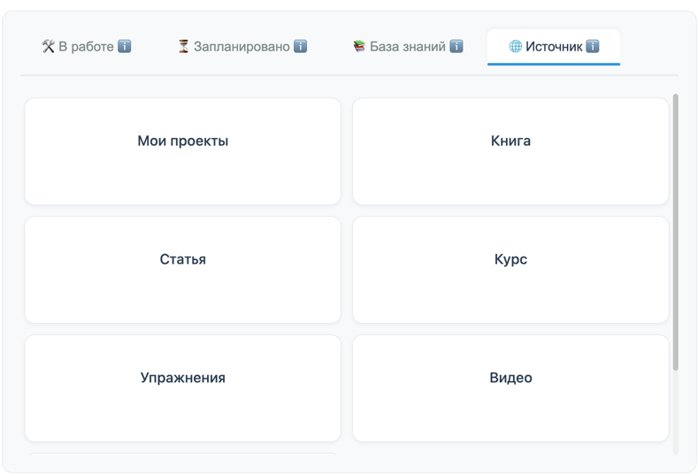
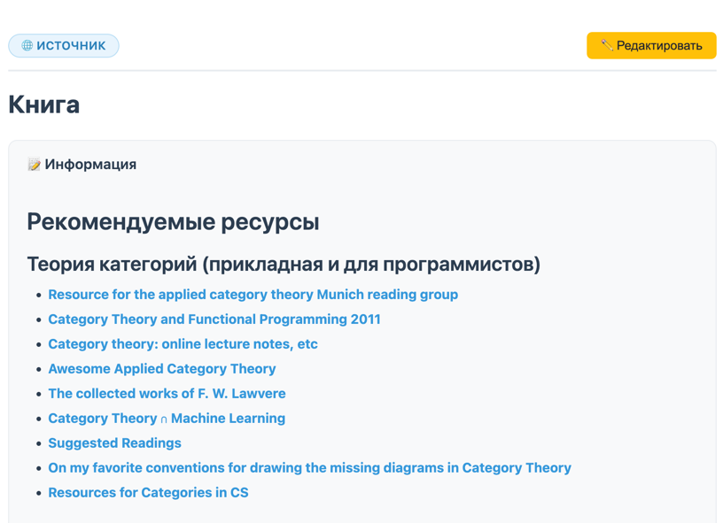

# Источники задач

Когда пользователь работает с большим планом развития, рано или поздно наступает момент, 
когда задачи определённого типа заканчиваются. 
Например, все книги по Scala прочитаны, все статьи по категориям изучены, а новые задачи создавать не из чего. 
Возникает вопрос: **где искать следующие задачи?**

Раздел **«Источники задач»** решает эту проблему. 
Для каждого типа задач (книга, статья, курс, видео) создаётся отдельная страница, 
где пользователь ведёт список источников — конкретных книг, сайтов, курсов, из которых можно брать задачи. 
Это превращает список задач из статичного набора в **живой поток**, который всегда можно пополнить.



## Модель данных

Источник — это отдельная сущность, связанная с типом задачи и пользователем. 
Он хранит текстовое описание (часто в markdown-формате): список книг, ссылки на сайты, названия курсов.

### DTO для создания источника

```dotty
final case class CreateSource(
    taskTypeId: TaskTypeId,
    userId: UserId,
    information: String
)
```

- **`taskTypeId`** — тип задачи, к которому относится источник. Например, «Книги».
- **`userId`** — владелец источника.
- **`information`** — содержимое источника. Изначально пустое, заполняется через страницу редактирования.

### Полная модель источника

```dotty
final case class Source(
    id: SourceId,
    taskTypeId: TaskTypeId,
    userId: UserId,
    information: String
)

object Source:
  type SourceId = SourceId.T
  object SourceId extends RefinedType[Int, GreaterEqual[0]]
```

- **`SourceId`** — уточнённый тип над `Int` с ограничением `GreaterEqual[0]`.
- **`information`** — основной контент источника. Может быть пустым сразу после создания.

### Миграция базы данных

В миграцию добавляется новая таблица `sources`:

```dotty
_ <- createSourcesTable.update.run
_ <- addUsersFKToTable("sources").update.run
_ <- taskTypeSourcesFK.update.run

private val createSourcesTable: Fragment =
  sql"""CREATE TABLE IF NOT EXISTS sources (
       id SERIAL PRIMARY KEY,
       task_type_id INT NOT NULL,
       user_id UUID NOT NULL,
       information TEXT
       );"""
```

**Разбор полей:**

- **`id SERIAL PRIMARY KEY`** — автоинкрементный идентификатор. PostgreSQL сам генерирует его при `INSERT`.
- **`task_type_id INT NOT NULL`** — ссылка на тип задачи. `NOT NULL` гарантирует, что источник всегда привязан к типу.
- **`user_id UUID NOT NULL`** — ссылка на пользователя.
- **`information TEXT`** — основной контент. `TEXT` вместо `VARCHAR(n)` — потому что информация может быть длинной (список книг с аннотациями).

**Внешние ключи:**

- **`addUsersFKToTable("sources")`** — гарантирует, что `user_id` ссылается на существующего пользователя.
- **`taskTypeSourcesFK`** — гарантирует, что `task_type_id` ссылается на существующий тип задачи.

## Сервис `SourcesService`

Интерфейс сервиса определяет четыре операции: создание, чтение, обновление, удаление.

```dotty
private[services] trait SourcesService[F[_]]:

  /** Создаёт новый источник задач. */
  def create(newItem: CreateSource): F[SourceId]

  /** Получает источник по типу задачи и пользователю. */
  def get(taskTypeId: TaskTypeId, userId: UserId): F[Option[Source]]

  /** Обновляет источник */
  def update(source: Source): F[Boolean]

  /** Удаляет источник заданного типа. */
  def delete(taskTypeId: TaskTypeId, userId: UserId): F[Boolean]
```

**Ключевые решения:**

- **`get` возвращает `Option[Source]`** — источник может отсутствовать (например, если пользователь только что удалил его).
- **`delete` принимает `taskTypeId` и `userId`**, а не `SourceId`. Это логичнее: пользователь удаляет источник **по типу задачи**, а не по внутреннему ID.
- **`create` возвращает `SourceId`** — чтобы вызывающий код мог использовать его для дальнейших операций.

### Реализация `PostgreSQLSourcesService`

```dotty
private[pdp] class PostgreSQLSourcesService[F[_]: MonadCancelThrow](
    xa: Transactor[F]
) extends SourcesService[F]:

  def create(newItem: CreateSource): F[SourceId] =
    sql"""INSERT INTO sources (task_type_id, user_id, information)
              VALUES (${newItem.taskTypeId}, ${newItem.userId}, ${newItem.information})
              RETURNING id"""
      .query[SourceId]
      .unique
      .transact(xa)

  def get(taskTypeId: TaskTypeId, userId: UserId): F[Option[Source]] =
    sql"""SELECT id, task_type_id, user_id, information FROM sources WHERE task_type_id = $taskTypeId AND user_id = $userId"""
      .query[Source]
      .option
      .transact(xa)

  def update(source: Source): F[Boolean] =
    sql"""UPDATE sources
         SET task_type_id = ${source.taskTypeId}, user_id = ${source.userId}, information = ${source.information}
         WHERE id = ${source.id}"""
      .update.run.transact(xa).map(_ > 0)

  def delete(taskTypeId: TaskTypeId, userId: UserId): F[Boolean] =
    sql"""DELETE FROM sources WHERE task_type_id = $taskTypeId AND user_id = $userId"""
      .update.run.transact(xa).map(_ > 0)
```

**Разбор каждого метода:**

**`create`:** использует `RETURNING id`, чтобы получить сгенерированный PostgreSQL ID за один запрос. 
`INSERT` + `RETURNING` — эффективный способ создать запись и сразу узнать её ID.

**`get`:** возвращает `Option[Source]`. Doobie сам преобразует результат в `Option` через `.option`.

**`update`:** обновляет все поля источника. `WHERE id = ${source.id}` гарантирует, что обновится ровно одна запись. 
`.map(_ > 0)` превращает количество затронутых строк в `Boolean`.

**`delete`:** удаляет источник по `taskTypeId` и `userId`, а не по `id`. 
Это удобно: пользователь на странице типа задачи может удалить источник, не зная его внутреннего ID.

## Интеграция в `SettingsService`

`SettingsService` — это агрегатор, который управляет всеми справочниками приложения: типами задач, разделами, целями и теперь — источниками.

```dotty
final case class SettingsService[F[_]: MonadThrow](
    taskTypeService: TaskTypeService[F],
    sectionService: SectionService[F],
    goalService: GoalService[F],
    taskService: TaskService[F],
    sourcesService: SourcesService[F],
    periodicStepService: PeriodicStepService[F]
):

  def createTaskType(newItem: CreateTaskType): F[TaskTypeId] =
    createItem[TaskType, TaskTypeName, TaskTypeId](
      getAll = taskTypeService.getByUser(newItem.userId),
      getName = _.name,
      name = newItem.name,
      create =
        taskTypeService.create(newItem).flatTap { taskTypeId =>
          val newSource = CreateSource(
            taskTypeId = taskTypeId,
            userId = newItem.userId,
            information = ""
          )
          sourcesService.create(newSource)
        }
    )
```

**Ключевая деталь:** при создании нового типа задачи **автоматически создаётся пустой источник**. 
Это гарантирует, что у каждого типа задачи всегда есть связанная страница источника — даже если пользователь её ещё не заполнил.

### Удаление типа задачи

```dotty
def deleteTaskType(id: TaskTypeId, userId: UserId): F[Boolean] =
  taskService.existsTaskType(id, userId).ifM(
    MonadThrow[F].raiseError(
      new IllegalArgumentException(
        s"Невозможно удалить тип задачи с ID $id: тип используется в задачах"
      )
    ),
    taskTypeService.get(id, userId).flatMap:
      case Some(_) =>
        sourcesService.delete(id, userId) *>
          taskTypeService.delete(id)
      case None => false.pure[F]
  )
```

**Пошагово:**

1. **`taskService.existsTaskType(id, userId)`** — проверяем, есть ли задачи с этим типом.
2. **Если есть** — выбрасываем `IllegalArgumentException` с понятным сообщением. Это защита от «осиротевших» задач.
3. **Если нет** — загружаем тип задачи через `taskTypeService.get(id, userId)`:
   - `get` принимает `userId` и фильтрует по владельцу: если тип существует **и** принадлежит пользователю — удаляем источник (`sourcesService.delete`), затем сам тип (`taskTypeService.delete`).
   - Иначе — возвращаем `false`.

**Почему сначала источник, потом тип?** Если бы мы сначала удалили тип, а потом источник, 
между двумя операциями оставался бы «висячий» источник с несуществующим `task_type_id`. 

## Сервис `DashboardService`

`DashboardService` — это отдельный сервис для операций, связанных с дашбордом (главной страницей). 
Он инкапсулирует работу с источниками задач:

```dotty
final case class DashboardService[F[_]: Monad](
    sourcesService: SourcesService[F]
):
  def updateSource(
      taskTypeId: TaskTypeId,
      userId: UserId,
      information: String
  ): F[Boolean] =
    sourcesService.get(taskTypeId, userId).flatMap:
      case Some(source) =>
        sourcesService.update(source.copy(information = information))
      case None => false.pure[F]

  def getSource(taskTypeId: TaskTypeId, userId: UserId): F[Option[Source]] =
    sourcesService.get(taskTypeId, userId)
end DashboardService
```

**`updateSource`** — метод «обновить или ничего не делать». Если источник найден — обновляем его `information`. 
Если нет — возвращаем `false` без ошибки. Это удобно для UI: пользователь может открыть форму редактирования, 
источник уже удалён — и вместо падения он увидит сообщение об ошибке.

**`getSource`** — просто делегирует в `sourcesService.get`. 
Возможно, в будущем здесь появится дополнительная логика (например, кеширование).

## UI: вкладка «Источник» на главной странице

На главной странице (`Views.welcome`) появляется новая вкладка:

```html
<button
        class="tab-btn active"
data-tab="sources"
onclick="switchTab('sources')"
>
🌐 Источник
<span title="Ресурсы для пополнения Базы знаний">ℹ️</span>
</button>

<!-- Вкладка: Источник -->
<div id="tab-sources" class="tab-content active">
<div class="tasks-grid">
    <div id="1" class="task-card source-card" onclick="openSource('1')">
        <div class="task-title">Книги по Scala</div>
    </div>
</div>
```

**Разбор:**

- **Карточки, а не таблица** — источники не имеют метрик (прогресса, дат), поэтому таблица не нужна. 
  Карточки с названием типа задачи — минималистично и читаемо.
- **`onclick="openSource('1')"`** — JavaScript-функция `openSource` открывает `/source/{id}` в новой вкладке.
- **Отображается только `name`** — тип задачи («Книги по Scala»), а не информация источника. Это список типов, а не список источников.

### Модель карточки

```dotty
final case class TableTaskTypeCard(
    id: TaskTypeId,
    name: TaskTypeName
)
```

Минимальная модель — только ID и имя. Используется для рендеринга карточек на вкладке.

### JavaScript

```javascript
function openSource(sourceId) {
  const baseUrl = window.location.origin;
  window.open(baseUrl + "/source/" + sourceId, "_blank");
}
```

Открытие в новой вкладке — чтобы пользователь не терял контекст главной страницы. Вернувшись, он увидит те же фильтры и вкладку.

## Роут и хэндлер страницы источника

Хэндлеры источника консолидированы в класс `SourceHandlers`. Маршруты объявлены
приватно на основе общего пути `path = Path.root / "source" / taskTypeIdParam`.

### Роут

```dotty
private val openSource = Route(
  Request.get(path).extractHeader[`Cookie`],
  Response.ok(Entity.html)
)
```

- **`taskTypeIdParam`** — типизированный `Param[TaskTypeId]`: декодирует путь
  сразу в `TaskTypeId`, без ручного `TaskTypeId.either`.
- **`extractHeader[`Cookie`]`** — извлекаем куки, чтобы проверить авторизацию.

### DTO страницы

```dotty
final case class SourceCard(
    id: TaskTypeId,
    name: String,
    information: String
)
```

- **`id`** — ID типа задачи (используется для URL редактирования).
- **`name`** — имя типа задачи.
- **`information`** — контент источника в markdown.

### Хэндлер `openHandler`

```dotty
val openHandler: Handler =
  openSource.handleIO: (taskTypeId: TaskTypeId, cookie: Cookie) =>
    withUserFromCookieOpt(cookie)(
      f = (user, jwtToken) =>
        for
          maybeTaskType <-
            settingsService.getTaskType(taskTypeId, user.id)
          maybeSource <-
            dashboardService.getSource(taskTypeId, user.id)
        yield (maybeTaskType, maybeSource).mapN {
          case (taskType, source) =>
            val html =
              View.source(
                source = SourceCard(
                  id = taskTypeId,
                  name = taskType.name.value,
                  information = source.information
                ),
                token = jwtToken.value,
                errorMessage = none
              )
            View.base(Title, html)
        },
      fallbackPage = NotFoundView
    )
```

**Пошаговый разбор:**

1. **`withUserFromCookieOpt(cookie)(f, fallbackPage)`** — извлекает токен из куки `token`, проверяет
   его через middleware и передаёт `(user, jwtToken)` в лямбду `f`. Если токена нет или
   невалиден — возвращает `fallbackPage` (404). Извлечение токена из куки инкапсулировано
   в `AuthorizationHandler`.
2. **Типизированный ID** — `taskTypeIdParam` сразу декодирует путь в `TaskTypeId`,
   ветки `Right`/`Left` не нужны.
3. **Загрузка двух сущностей:** тип задачи и источник. 
4. **`(maybeTaskType, maybeSource).mapN`** — если обе сущности найдены, собираем `SourceCard` и рендерим `View.source`. 
   Если хотя бы одна не найдена — `None`, и `withUserFromCookieOpt` подставит `fallbackPage` (404).

`NotFoundView` — готовая строка HTML из `WelcomeViews`, объединяющая `View.base(Title, ...)` и `View.notFound()`. Используется повторно во всех хэндлерах дашборда.

## Страница источника

Метод `Views.source` отображает наименование и информацию:

```html
<div id="app" class="app-container">
  <div id="sourceDetailBlock" class="task-detail-container">
    <div class="task-detail-header">
      <div class="task-detail-nav">
        <span class="task-detail-status-badge source-badge">🌐 Источник</span>
      </div>
      <div class="task-detail-actions">
        <button
          class="edit-task-btn"
          hx-get="/source/1/edit"
          hx-target="#app"
          hx-swap="outerHTML"
        >
          ✏️ Редактировать
        </button>
      </div>
    </div>

    <div class="messageBlock">
      <div class="error">Ошибка</div>
    </div>

    <h1 class="task-detail-title">Книги по Scala</h1>

    <div class="task-detail-section full-width">
      <h3>📝 Информация</h3>
      <div
        class="task-detail-information markdown-content"
        data-markdown="## Теория категорий"
      >
        <p class="empty-message">Информация отсутствует</p>
      </div>
    </div>
  </div>
</div>
```

**Ключевые моменты:**

- **`data-markdown`** — атрибут с markdown-текстом. JavaScript-функция `renderMarkdown` (в `pdp.js`) найдёт его и отрендерит через `marked.js`.
- **Класс `markdown-content`** — стилизация (заголовки, списки, код, ссылки).
- **Заглушка для пустого источника** — условный рендеринг при пустом `information`.

## Редактирование источника

### Роуты

Маршруты приватные, объявлены внутри `SourceHandlers` на общем пути
`path = Path.root / "source" / taskTypeIdParam`:

```dotty
private val editFormSource = Route(
  Request.get(path / "edit").extractHeader[Authorization],
  Response.ok(Entity.html).orNotFound
)
private val editSource = Route(
  Request.put(path).withEntity(Entity.formOf[EditSourceRequest]),
  Response.ok(Entity.html).orNotFound
)
```

- **GET `/source/{id}/edit`** — открывает форму редактирования.
- **PUT `/source/{id}`** — сохраняет изменения.
- **`taskTypeIdParam`** — декодирует сегмент пути сразу в `TaskTypeId`.

### Модель `EditSourceRequest`

```dotty
final case class EditSourceRequest(
    token: String,
    name: String,
    information: String
) derives FormCodec
```

Три поля: токен для аутентификации, имя (не редактируется, но передаётся для отображения), информация.

### Форма редактирования

Метод `Views.editSource` содержит одно редактируемое поле — `information`:

```html
<!-- Наименование (только для чтения) -->
<div class="form-group">
  <label for="sourceName">Наименование:</label>
  <input
    id="sourceName"
    name="name"
    type="text"
    value="Книги по Scala"
    class="form-input"
    readonly
  />
</div>

<!-- Информация (markdown) -->
<div class="task-detail-section full-width">
  <h3>📝 Информация</h3>
  <textarea
    id="information"
    name="information"
    rows="20"
    class="form-textarea"
    placeholder="Введите описание источника в markdown-формате..."
  >
## Теория категорий</textarea>
</div>
```

**`readonly` для `name`** — пользователь видит, к какому типу задачи относится источник, но не может изменить это поле. 
Это соответствует требованию: редактируется только информация.

**`rows="20"`** — высота поля для длинных описаний (список книг, ссылки, аннотации).

### Хэндлер формы редактирования

```dotty
val editFormHandler: Handler =
  editFormSource.handleIO:
    (taskTypeId: TaskTypeId, authorization: Authorization) =>
      withUserFromHeaderOpt(authorization): (user, jwtToken) =>
        for
          maybeTaskType <-
            settingsService.getTaskType(taskTypeId, user.id)
          maybeSource <-
            dashboardService.getSource(taskTypeId, user.id)
        yield (maybeTaskType, maybeSource).mapN {
          case (taskType, source) =>
            View.editSource(
              source = SourceCard(
                id = taskTypeId,
                name = taskType.name.value,
                information = source.information
              ),
              token = jwtToken.value,
              errorMessage = none
            ).render
        }
```

**Что делает:**

1. **`withUserFromHeaderOpt(authorization)(...)`** — мягкая проверка токена. `authorization`
   из заголовка — первый аргумент, лямбда `(user, jwtToken)` — второй.
2. **Типизированный ID** — `taskTypeIdParam` уже декодировал путь в `TaskTypeId`.
3. **Загрузка типа задачи и источника.**
4. **Рендер `Views.editSource`** с заполненной информацией.

### Хэндлер обработки редактирования

```dotty
val editHandler: Handler =
  editSource.handleIO: (taskTypeId: TaskTypeId, request: EditSourceRequest) =>
    val run: ((UserInfo, JwtToken)) => IO[Option[String]] =
      (user, jwtToken) =>
        val source = SourceCard(
          id = taskTypeId,
          name = request.name,
          information = request.information
        )

        dashboardService.updateSource(
          taskTypeId,
          user.id,
          request.information
        )
          .map: _ =>
            View.source(
              source = source,
              token = jwtToken.value,
              errorMessage = none
            ).render.some
          .recover:
            case ex: IllegalArgumentException =>
              View.editSource(
                source = source,
                token = jwtToken.value,
                errorMessage = ex.getMessage.some
              ).render.some
    // ToDo: https://github.com/creativescala/krop/pull/57
    val authorization: Authorization =
      Authorization(Token(AuthScheme.Bearer, request.token))
    withUserFromHeaderOpt(authorization)(run)
```

**Пошаговый разбор:**

1. **Типизированный ID** — декодирован из пути `taskTypeIdParam`, ручная валидация не нужна.
2. **Сборка `SourceCard`** из данных формы.
3. **`dashboardService.updateSource`** — обновление информации в БД.
4. **При успехе** — рендер страницы источника с обновлённой информацией.
5. **При ошибке** — рендер формы редактирования с сообщением об ошибке. Пользователь может исправить данные и отправить снова.
6. **`withUserFromHeaderOpt(authorization)(run)`** — токен приходит в теле запроса, поэтому вручную
   собираем заголовок `Authorization` из `request.token` и вызываем `withUserFromHeaderOpt`.

**Почему используется `SourceCard`, а не `Source`?** 
Потому что `Source` требует `SourceId` (внутренний ID), а у нас его нет в запросе — приходит только `taskTypeId`. 
`SourceCard` использует `TaskTypeId` вместо `SourceId`, что соответствует модели данных UI.

## Полный поток работы с источниками

Рассмотрим сценарий:

1. **Пользователь создаёт тип задачи «Книги»** в настройках. Автоматически создаётся пустой источник.
2. **На главной странице появляется вкладка «🌐 Источник»** с карточкой «Книги».
3. **Пользователь кликает на карточку** → открывается `/source/{taskTypeId}` в новой вкладке.
4. **Страница источника показывает** наименование «Книги» и пустую информацию.
5. **Пользователь кликает «✏️ Редактировать»** → открывается форма с `readonly` наименованием и пустым textarea.
6. **Пользователь вводит список книг** в markdown-формате:
   ```markdown
   ## Теория категорий (прикладная и для программистов)
   
   - **[Resource for the applied category theory Munich reading group](https://github.com/drever/act-munich)**
   - **[Category Theory and Functional Programming 2011](https://wiki.portal.chalmers.se/cse/pmwiki.php/CTFP11/CTFP11)**
   - **[Category theory: online lecture notes, etc](https://www.logicmatters.net/categories)**
   - **[Awesome Applied Category Theory](https://github.com/statebox/awesome-applied-ct)**
   - **[The collected works of F. W. Lawvere](https://github.com/mattearnshaw/lawvere)**
   - **[Category Theory ∩ Machine Learning](https://github.com/bgavran/Category_Theory_Machine_Learning/blob/master/README.md)**
   - **[Suggested Readings](https://diliberti.github.io/Read/Read.html)**
   - **[On my favorite conventions for drawing the missing diagrams in Category Theory](http://angg.twu.net/math-b.html#favorite-conventions)**
   - **[Resources for Categories in CS](https://blog.hde.design/published/2015-12-06-Resources-CT-CS.html)**
   ```
7. **Кликает «💾 Сохранить»** → PUT-запрос обновляет `information` в БД.
8. **htmx заменяет `#app`** — пользователь видит страницу источника с отрендеренным markdown: заголовки, чек-листы.
9. **Через месяц, когда все книги прочитаны и надо наполнить Базу знаний новыми книгами**, 
   пользователь возвращается на страницу источника и создает новые задачи по перечисленным книгам.



## Преимущества подхода

**1. Разделение задач и источников.** Задачи — это конкретные действия. 
Источники — это «склад» материалов, из которых задачи черпаются.

**2. Привязка к типу задачи.** Источник принадлежит типу задачи, а не пользователю напрямую. 
Если у пользователя 5 типов задач, у него будет 5 источников. 
Это упрощает поиск: «Где мои книги?» — в источнике «Книги».

**3. Markdown для гибкости.** Информация источника — это текст с markdown-разметкой. 
Пользователь может структурировать его как угодно: чек-листы, таблицы, ссылки, заголовки. Никаких ограничений на формат.

**4. Автоматическое создание.** Источник создаётся вместе с типом задачи. 
Пользователю не нужно помнить, что «надо ещё создать источник» — это происходит само.

**5. Защита от удаления.** Нельзя удалить тип задачи, если с ним связаны задачи. 
Это предотвращает «осиротевшие» задачи и сохраняет целостность данных.

## Итог

**Что создано:**

| Компонент                      | Назначение                                                        |
| ------------------------------ | ----------------------------------------------------------------- |
| **Таблица `sources`**          | Хранение источников в БД                                          |
| **`SourcesService`**           | CRUD-операции над источниками                                     |
| **`PostgreSQLSourcesService`** | Реализация для PostgreSQL                                         |
| **`DashboardService`**         | Операции для UI-страниц                                           |
| **`SettingsService`**          | Интеграция: создание/удаление источника при работе с типом задачи |
| **Вкладка «Источник»**         | На главной странице                                               |
| **`SourceHandlers.openHandler`**      | Страница источника                                                |
| **`SourceHandlers.editFormHandler`**  | Форма редактирования                                              |
| **`SourceHandlers.editHandler`**      | Сохранение изменений                                              |
| **`Views.source`**             | Отображение источника                                             |
| **`Views.editSource`**         | Форма редактирования                                              |

**Ключевые архитектурные решения:**

- **Источник привязан к типу задачи, а не к пользователю напрямую.** Это упрощает навигацию и группировку.
- **Markdown для `information`.** Гибкость формата важнее строгой структуры.
- **Автоматическое создание источника** при создании типа задачи.
- **Защита от удаления типа задачи**, если есть связанные задачи.
- **Отдельный `DashboardService`** для UI-операций, чтобы не смешивать их с бизнес-логикой `SettingsService`.

Теперь у пользователя всегда есть «следующий шаг», когда текущие задачи исчерпаны: 
открыть источник, создать из материалов задачи, добавить новые материалы. 
Раздел источников превращает статичный список задач в **живой поток пополнения**.

---

**Ссылки:**

- [Репозиторий с исходниками][repo]

[repo]: https://gitverse.ru/scalabook/pdp
