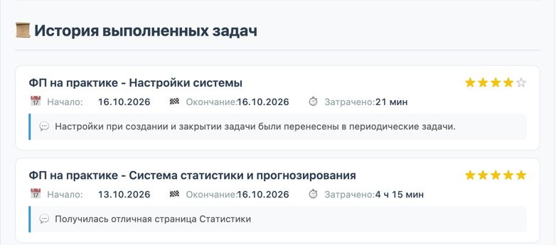

# История выполненных задач

История — это раздел, который показывает **архив всех завершённых задач**. 
Пользователь видит не просто список дел, а свой путь: что он сделал, за какое время, с какой оценкой и какими выводами. 
Это одновременно **инструмент рефлексии** (пользователь учится на своём опыте) 
и **источник мотивации** (визуальное подтверждение прогресса).

В отличие от статистики, которая агрегирует данные в числа и проценты, история показывает **каждую задачу в отдельности**. 
Каждая карточка — это маленькая история успеха: что было сделано, как долго, насколько качественно.



## DTO `CompletedTaskCard`

Каждая запись в истории — это облегчённая модель завершённой задачи. 
Она не содержит план, информацию или тип задачи — только то, что важно для отображения в списке.

```dotty
final case class CompletedTaskCard(
    taskId: TaskId,
    name: TaskName,
    rating: Rating,
    review: Review,
    duration: FiniteDuration,
    startDate: LocalDate,
    endDate: LocalDate
)
```

**Разбор полей:**

| Поле            | Тип              | Назначение                                                                       |
| --------------- | ---------------- | -------------------------------------------------------------------------------- |
| **`taskId`**    | `TaskId`         | Идентификатор задачи. Используется для ссылки на страницу `/task/{id}` при клике |
| **`name`**      | `TaskName`       | Название задачи для отображения                                                  |
| **`rating`**    | `Rating`         | Оценка, которую пользователь поставил при завершении (1–5)                       |
| **`review`**    | `Review`         | Отзыв — краткая рефлексия о выполненной работе                                   |
| **`duration`**  | `FiniteDuration` | Фактическая продолжительность задачи                                             |
| **`startDate`** | `LocalDate`      | Дата начала работы                                                               |
| **`endDate`**   | `LocalDate`      | Фактическая дата завершения                                                      |

**Почему именно эти поля?** Они образуют **минимально достаточный набор** для отображения записи в истории:

- **Что сделал:** `name`.
- **Как долго:** `startDate`, `endDate`, `duration`.
- **Насколько качественно:** `rating`, `review`.
- **Куда перейти:** `taskId`.

Ничего лишнего — ни типа задачи, ни раздела, ни цели. 
Если пользователю нужно узнать подробности, он кликает на задачу и переходит на её страницу.

## Шаблон `history.scala.html`

Шаблон принимает вектор завершенных задач.

```html
@import ru.scalabook.pdp.http.dto.CompletedTaskCard
@import ru.scalabook.pdp.models.toDurationDescription
@import java.time.format.DateTimeFormatter

@(completedTasks: Vector[CompletedTaskCard])
```

**Импорты:**

- **`CompletedTaskCard`** — DTO.
- **`toDurationDescription`** — функция форматирования `FiniteDuration` в человекочитаемый вид (`"2 ч 30 мин"`, `"45 мин"`, `"3 дн"`).
- **`DateTimeFormatter`** — для форматирования дат в вид `dd.MM.yyyy`.

### Общая структура

```html
<div class="history-section">
  <h2 class="history-title">📜 История выполненных задач</h2>

  @if(completedTasks.nonEmpty) {
  <div class="history-list">...</div>
  } else {
  <div class="empty-message">
    История пуста. Завершите первую задачу, чтобы она появилась здесь.
  </div>
  }
</div>
```

**Разбор:**

- **`.history-section`** — контейнер раздела.
- **`📜 История выполненных задач`** — заголовок. Свиток ассоциируется с историей и архивом.
- **`@if(completedTasks.nonEmpty)`** — ветвление: если есть задачи, показываем список; если нет — заглушку.
- **`.empty-message`** — сообщение для пустой истории с подсказкой: «Завершите первую задачу, чтобы она появилась здесь».

### Карточка задачи

Каждая завершённая задача обёрнута в `.history-item` с `onclick`:

```html
@for(task <- completedTasks) {
<div class="history-item" onclick="openTask('@task.taskId')">...</div>
}
```

**Разбор:**

- **`onclick="openTask('@task.taskId')"`** — при клике на любую часть карточки вызывается JS-функция `openTask`, 
  которая открывает `/task/{id}` в новой вкладке.

**Почему открывается в новой вкладке?**

Потому что пользователь работает с историей. Открытие задачи в новой вкладке сохраняет контекст: вернувшись, 
он увидит ту же историю, тот же скролл, тот же порядок. Тот же подход используется в карточках задач на главной странице.

### Заголовок карточки: наименование и рейтинг

```html
<div class="history-item-header">
   <div class="history-task-name">@task.name.value</div>
   <div class="history-task-rating">
      @for(_ <- 1 to task.rating.r) {
      <span class="star-filled">★</span>
      }
      @for(_ <- task.rating.r + 1 to 5) {
      <span class="star-empty">☆</span>
      }
   </div>
</div>
```

**Как строится рейтинг:**

- **Первый цикл** — от 1 до `rating.r`. Это заполненные звёзды (★).
- **Второй цикл** — от `rating.r + 1` до 5. Это пустые звёзды (☆).

**Пример:** для `rating.r = 4`:

- Заполненные: `★★★★`
- Пустые: `☆`
- Итог: `★★★★☆`

### Метаданные: даты и продолжительность

```html
<div class="history-meta-grid">
  <div class="history-meta-item">
    <span class="meta-icon">📅</span>
    <span class="meta-label">Начало:</span>
    <span class="meta-value"
      >@task.startDate.format(DateTimeFormatter.ofPattern("dd.MM.yyyy"))</span
    >
  </div>
  <div class="history-meta-item">
    <span class="meta-icon">🏁</span>
    <span class="meta-label">Окончание:</span>
    <span class="meta-value"
      >@task.endDate.format(DateTimeFormatter.ofPattern("dd.MM.yyyy"))</span
    >
  </div>
  <div class="history-meta-item">
    <span class="meta-icon">⏱️</span>
    <span class="meta-label">Затрачено:</span>
    <span class="meta-value">@toDurationDescription(task.duration)</span>
  </div>
</div>
```

**Разбор:**

Три метрики, каждая с иконкой, подписью и значением:

| Метрика       | Иконка | Формат       |
| ------------- | ------ | ------------ |
| **Начало**    | 📅     | `01.03.2026` |
| **Окончание** | 🏁     | `15.03.2026` |
| **Затрачено** | ⏱️      | `2 ч 30 мин` |

### Ревью

```html
<div class="history-review">
   <div class="history-review-icon">💬</div>
   <div class="history-review-text">@task.review.value</div>
</div>
```

**Почему отзыв важен?** Отзыв — это **рефлексия**. 
Когда пользователь завершает задачу и пишет «Книга оказалась сложнее, чем я думал, но примеры помогли», он фиксирует опыт. 
Через месяц, просматривая историю, он вспомнит эти выводы. Без отзыва история становится безликой: список названий и дат.

## Полный поток работы

1. **Пользователь открывает вкладку «📜 История»** → сервер загружает завершённые задачи пользователя.

2. **Сервер формирует `Vector[CompletedTaskCard]`** — для каждой завершённой задачи берёт ID, имя, оценку, отзыв, длительность, даты.

3. **Рендерится `history.scala.html`** — карточки в списке.

4. **Пользователь видит:**
    - Последние завершенные задачи сверху.
    - Рейтинг звёздами.
    - Даты начала и окончания.
    - Затраченное время.
    - Отзыв.

5. **Пользователь кликает на карточку** → `openTask('@task.taskId')` открывает `/task/{id}` в новой вкладке.

6. **Пользователь возвращается** — история остаётся на месте, скролл и порядок сохранены.


История — это **зеркало прогресса**. 
Она превращает завершённые задачи из забытых записей в осмысленный архив достижений. 
В сочетании со статистикой и целями она делает приложение полноценным инструментом для персонального развития: 
не только «что делать», но и «что уже сделано».

---

**Ссылки:**

- [Репозиторий с исходниками][repo]

[repo]: https://gitverse.ru/scalabook/pdp
