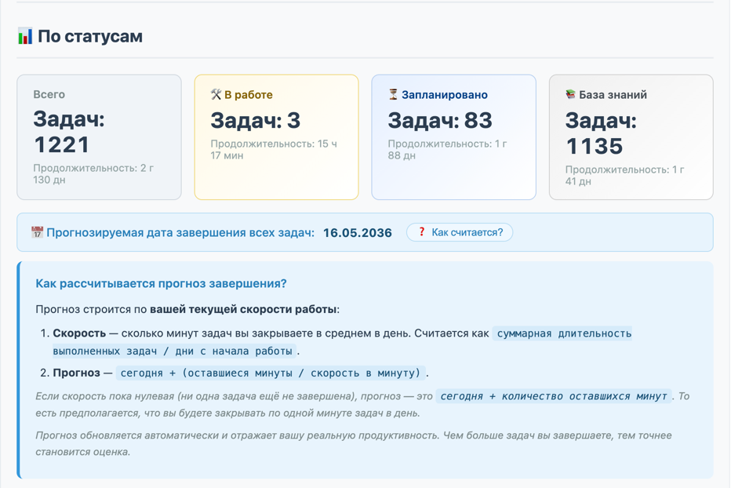
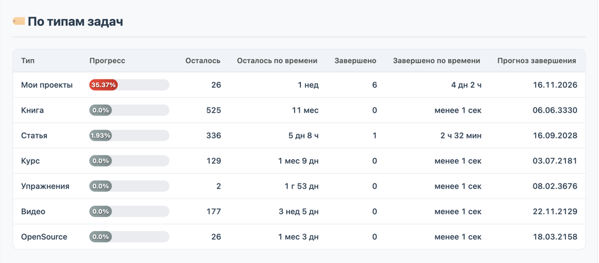
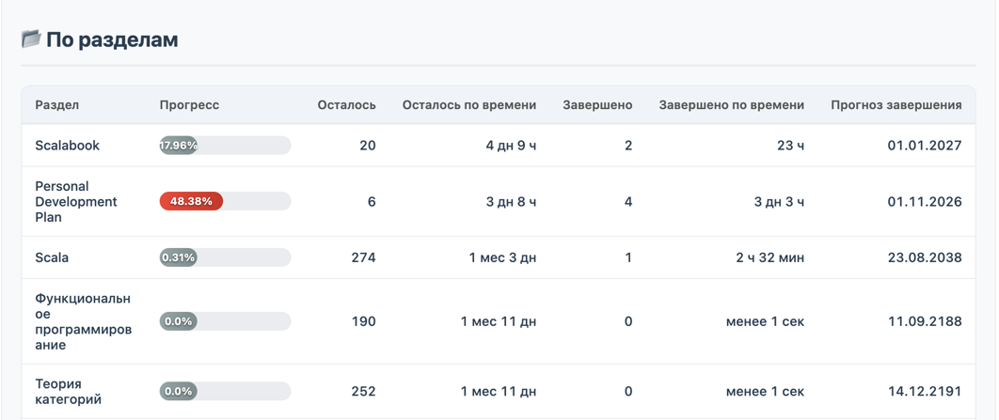



# Статистика по задачам

Статистика — это раздел, который превращает разрозненные задачи в **осмысленную картину прогресса**. 
Пользователь видит не просто список дел, а ответы на ключевые вопросы: сколько работы в каком состоянии, 
какие типы материалов преобладают, по каким разделам он продвинулся, и когда всё это закончится. 
Без статистики работа над долгосрочными целями превращается в бесконечную рутину без ощущения движения — 
статистика даёт это ощущение и помогает принимать решения.

Раздел состоит из трех блоков:

1. **По статусам** (`byStatus`) — распределение задач по состояниям работы.
2. **По типам задач** (`byTaskType`) — распределение по форматам материалов (книга, видео, статья).
3. **По разделам** (`bySection`) — распределение по тематическим разделам.

Все блоки строятся из **единого источника данных** — вектора `TaskResult`. 
Это гарантирует согласованность: одна и та же задача учитывается одинаково во всех срезах.

## Прогноз завершения

Прогноз завершения — самая сложная и самая полезная часть статистики. 
Он отвечает на вопрос: «Если я продолжу работать с текущей скоростью, когда я закончу?» 
Расчёт строится на **фактической скорости работы**, а не на предположениях.

### Расчёт прогресса

```dotty
private[stats] def calculateProgress(
    current: FiniteDuration,
    all: FiniteDuration
): Double =
  if all.toMinutes == 0 then 0.0
  else (current.toMinutes * 10000 / all.toMinutes) / 100.00
```

**Разбор:**

- **`current`** — сколько уже сделано (обычно `completedDuration`).
- **`all`** — общая длительность (обычно `restDuration + completedDuration`).
- **`if all.toMinutes == 0 then 0.0`** — защита от деления на ноль. Если суммарная длительность всех задач нулевая, прогресс равен `0.0`.
- **`(current.toMinutes * 10000 / all.toMinutes) / 100.00`** — целочисленное деление с последующим превращением в проценты.

**Пример:** `current = 30 мин`, `all = 90 мин`:

- `30 * 10000 / 90 = 3333` (целочисленное деление)
- `3333 / 100.00 = 33.33` — прогресс 33.33%.

**Почему прогресс по времени, а не по количеству задач?**

Потому что одна большая задача может весить больше, чем десять мелких. 
Если из двух задач выполнена одна на 1 час, а другая на 10 часов, то прогресс по количеству — 50%, а по времени — всего 9%. 
Второй вариант честнее: он отражает **реальное усилие**, а не формальный счёт.

### Прогноз даты завершения

```dotty
private[stats] def calculatePlannedEndDate(
    completedTasks: Vector[TaskResult],
    restTasks: Vector[TaskResult]
): PlannedDate =
  val now = LocalDate.now()
  val statsStartDate =
    completedTasks.flatMap(_.startDate).minOption.getOrElse(now)
  val days           = 1 + (now.toEpochDay - statsStartDate.toEpochDay)
  val speedInMinutes = calculateDuration(completedTasks).toMinutes / days
  val restMinutes = calculateDuration(restTasks).toMinutes
  val restDays    =
    if speedInMinutes == 0 then restMinutes
    else restMinutes / speedInMinutes

  PlannedDate(restDays)
```

**Пошаговый разбор:**

1. **`val now = LocalDate.now()`** — сегодняшняя дата, точка отсчёта.
2. **`statsStartDate`** — дата начала работы. Берётся как **минимальная дата старта** среди выполненных задач. 
   Если ни одна задача ещё не начиналась — используется `now`.
3. **`days = 1 + (now.toEpochDay - statsStartDate.toEpochDay)`** — сколько дней прошло с начала работы. 
   Прибавляем `1`, чтобы избежать нуля: если задача началась и закончилась сегодня, `days = 1`, а не `0`.
4. **`speedInMinutes = calculateDuration(completedTasks).toMinutes / days`** — **скорость работы** в минутах в день. 
   Сколько минут задач в среднем закрывается за день.
   **Пример:** выполнено 600 минут за 10 дней → `speedInMinutes = 60` минут в день.
5. **`restMinutes = calculateDuration(restTasks).toMinutes`** — сколько минут осталось на все незавершённые задачи.
6. **`restDays`** — количество дней до завершения. 
   Если скорость нулевая (`speedInMinutes == 0`, пока ничего не завершено), берётся `restMinutes` как есть — 
   это fallback, который даёт «бесконечный», но не абсурдный прогноз.
   **Пример:** `restMinutes = 300`, `speedInMinutes = 60` → `restDays = 5` → прогноз — `сегодня + 5 дней`.
7. **`PlannedDate(restDays)`** — результат упаковывается в `PlannedDate`. 
   Функция возвращает **не просто дату**, а количество дней до неё.

### Модель `PlannedDate`

```dotty
final case class PlannedDate(
    daysUntil: Long
):
  val date: LocalDate = LocalDate.now().plusDays(daysUntil)

object PlannedDate:
  given Render[PlannedDate] with
    def render(value: PlannedDate): String =
      val module = value.daysUntil % 10
      val days   =
        if module == 1 then s"${value.daysUntil} день"
        else if module > 4 || module == 0 then s"${value.daysUntil} дней"
        else s"${value.daysUntil} дня"
      s"${value.date.render} ($days)"
```

**Разбор:**

- **`daysUntil`** — сколько дней осталось до прогнозируемой даты завершения.
- **`date`** — вычисляемая дата: `сегодня + daysUntil`. Сама дата не хранится, а **выводится** из `daysUntil` каждый раз. 
  Благодаря этому модель всегда актуальна относительно текущего дня, даже если прошло время с момента расчёта.
- **`given Render[PlannedDate]`** — человекочитаемое отображение: дата в формате `dd.MM.yyyy` плюс относительная подпись 
  («день», «дня», «дней») по правилам русской морфологии. Стандартный `Render[LocalDate]` рендерит только саму дату.

**Почему `PlannedDate`, а не просто `LocalDate`?** Потому что пользователю важно не только «когда», но и «сколько осталось». 
Модель объединяет абсолютную дату и относительное количество дней, а `Render` автоматически подбирает правильное склонение. 
Это делает прогноз наглядным: `07.11.2026 (5 дней)` вместо сухой даты.

Прогноз **динамичен**: чем больше задач завершается, тем точнее становится оценка. 
Он не требует ручной настройки и автоматически адаптируется к темпу пользователя.

## Разбивка по статусам



Блок показывает, сколько задач и времени находится в каждом из трёх активных статусов: `InProgress`, `Planned`, `KnowledgeBase`. 
Завершённые задачи в блок не входят — они уже сделаны.

### Модель `StatusDuration`

```dotty
final case class StatusDuration(
    tasks: Int,
    duration: FiniteDuration
)

object StatusDuration:
  def calculate(tasks: Vector[TaskResult]): StatusDuration =
    StatusDuration(
      tasks = tasks.length,
      duration = calculateDuration(tasks)
    )
```

**Разбор:**

- **`tasks`** — количество задач в статусе.
- **`duration`** — суммарная длительность задач в статусе.
- **`calculate`** — простой агрегатор. Принимает вектор задач, возвращает `StatusDuration` с количеством и суммой длительностей.

### Модель `StatusStats`

```dotty
final case class StatusStats(
    inProgress: StatusDuration,
    planned: StatusDuration,
    knowledgeBase: StatusDuration,
    plannedEndDate: PlannedDate
):
  lazy val all: StatusDuration = StatusDuration(
    tasks = inProgress.tasks + planned.tasks + knowledgeBase.tasks,
    duration = inProgress.duration + planned.duration + knowledgeBase.duration
  )
```

**Разбор:**

- **`inProgress`**, **`planned`**, **`knowledgeBase`** — три `StatusDuration` для трёх активных статусов.
- **`plannedEndDate`** — прогнозируемая дата завершения всех задач (`PlannedDate`).
- **`all`** — агрегат по всем трём статусам.

### Фабричный метод `calculate`

```dotty
object StatusStats:
  def calculate(tasks: Vector[TaskResult]): StatusStats =
    val grouped            = tasks.groupBy(_.status)
    val completedTasks     = grouped.getOrElse(Completed, Vector.empty)
    val inProgressTasks    = grouped.getOrElse(InProgress, Vector.empty)
    val plannedTasks       = grouped.getOrElse(Planned, Vector.empty)
    val knowledgeBaseTasks = grouped.getOrElse(KnowledgeBase, Vector.empty)

    StatusStats(
      inProgress = StatusDuration.calculate(inProgressTasks),
      planned = StatusDuration.calculate(plannedTasks),
      knowledgeBase = StatusDuration.calculate(knowledgeBaseTasks),
      plannedEndDate = calculatePlannedEndDate(
        completedTasks = completedTasks,
        restTasks = inProgressTasks ++ plannedTasks ++ knowledgeBaseTasks
      )
    )
```

**Пошаговый разбор:**

1. **`tasks.groupBy(_.status)`** — группировка задач по статусу. Получается `Map[Status, Vector[TaskResult]]`.
2. **`grouped.getOrElse(Completed, Vector.empty)`** — извлечение задач каждого статуса. 
   Если статуса нет в ассоциативном массиве `grouped` — пустой вектор.
3. **Три `StatusDuration.calculate`** — агрегация по каждому активному статусу.
4. **`plannedEndDate`** — прогноз завершения. Использует:
    - **`completedTasks`** — для расчёта скорости.
    - **`restTasks = inProgressTasks ++ plannedTasks ++ knowledgeBaseTasks`** — для расчёта оставшейся длительности.
   **Почему все три статуса объединяются в `restTasks`?** Потому что с точки зрения прогноза неважно, 
   в каком статусе задача — важно, что она ещё не завершена. Оставшееся время складывается из всех незавершённых задач.

**Почему `Completed` не входит в `StatusStats`?** Потому что блок показывает **текущую работу**, а не историю. 
Завершённые задачи отображаются в блоке «Цели» и в других срезах. 
Если включить `Completed` в `StatusStats`, пользователь увидит много задач, которые уже не требуют внимания, 
и общая картина размоется.

## Разбивка по типам задач



Блок показывает статистику по каждому типу задач: книга, видео, статья. 
Для каждого типа — сколько задач осталось и завершено, сколько времени, прогресс и прогноз.

### Модель `TaskTypeDuration`

```dotty
final case class TaskTypeDuration(
    name: TaskTypeName,
    restTasks: Int,
    restDuration: FiniteDuration,
    completedTasks: Int,
    completedDuration: FiniteDuration,
    plannedEndDate: PlannedDate
):
  lazy val progress: Double =
    calculateProgress(
      current = completedDuration,
      all = restDuration + completedDuration
    )
```

**Разбор:**

- **`name`** — название типа задачи (например, «Книга»).
- **`restTasks`**, **`restDuration`** — сколько задач и времени осталось.
- **`completedTasks`**, **`completedDuration`** — сколько задач и времени завершено.
- **`plannedEndDate`** — прогноз завершения задач этого типа (`PlannedDate`).
- **`progress`** — доля завершённого времени от общего.

**Почему именно `completedDuration / (restDuration + completedDuration)`?** 
Потому что это **доля выполненного** от общего объёма. 
Когда `restDuration = 0`, прогресс = 100%. Когда `completedDuration = 0`, прогресс = 0%. 
Это интуитивно понятная метрика для пользователя: «насколько я продвинулся по этому типу материалов».

### Фабричный метод `calculate`

```dotty
object TaskTypeDuration:
  def calculate(
      name: TaskTypeName,
      tasks: Vector[TaskResult]
  ): TaskTypeDuration = {
    val (completedTasks, restTasks) = tasks.partition(_.status == Completed)
    val plannedEndDate: PlannedDate =
      calculatePlannedEndDate(
        completedTasks = completedTasks,
        restTasks = restTasks
      )

    TaskTypeDuration(
      name = name,
      restTasks = restTasks.length,
      restDuration = calculateDuration(restTasks),
      completedTasks = completedTasks.length,
      completedDuration = calculateDuration(completedTasks),
      plannedEndDate = plannedEndDate
    )
  }
```

**Пошаговый разбор:**

1. **`tasks.partition(_.status == Completed)`** — разделение задач на завершённые и оставшиеся. `partition` возвращает кортеж из двух векторов.

2. **`plannedEndDate`** — прогноз для этого типа задач. 
   Считается **отдельно**, потому что скорость работы по разным типам может отличаться. 
   Например, по книгам пользователь работает быстрее, чем по видео.

3. **Сборка `TaskTypeDuration`** — количество и длительности по каждой группе.

**Почему прогноз считается для каждого типа?** Потому что тип — это естественная единица планирования. 
Пользователь может понять: «Книги я закончу через месяц, а видео — через три». Это даёт основу для приоритизации.

### Модель `TaskTypesStats`

```dotty
final case class TaskTypesStats(
    taskTypes: Vector[TaskTypeDuration]
)
```

Простой контейнер: вектор статистик по типам. Порядок задаётся сортировкой при построении.

### Фабричный метод `calculate`

```dotty
object TaskTypesStats:
  def calculate(
      tasks: Vector[TaskResult],
      taskTypes: Map[TaskTypeId, TaskTypeName],
      sortedTaskTypes: Map[TaskTypeName, Ordinal]
  ): TaskTypesStats =
    TaskTypesStats(
      tasks
        .groupBy(_.taskTypeId)
        .toVector
        .flatMap { case (id, tasks) =>
          taskTypes.get(id).map(n => TaskTypeDuration.calculate(n, tasks))
        }.sortBy(taskTypeDuration =>
          sortedTaskTypes.getOrElse(taskTypeDuration.name, Ordinal.Max)
        )
    )
```

**Пошаговый разбор:**

1. **`tasks.groupBy(_.taskTypeId)`** — группировка задач по ID типа. Получается `Map[TaskTypeId, Vector[TaskResult]]`.

2. **`.toVector.flatMap { case (id, tasks) => ... }`** — проход по каждой группе:
    - **`taskTypes.get(id)`** — находим имя типа по ID. Если типа нет в справочнике (например, он удалён) — 
      задача **игнорируется** (`.flatMap` разворачивает `Option`).
    - **`TaskTypeDuration.calculate(n, tasks)`** — считаем статистику по типу.

3. **`.sortBy(taskTypeDuration => sortedTaskTypes.getOrElse(taskTypeDuration.name, Ordinal.Max))`** — сортировка по `Ordinal` из справочника. 
   Если тип не найден в `sortedTaskTypes` — ставим его в конец (`Ordinal.Max`).

**Почему `Ordinal.Max` для отсутствующих?** Потому что если тип задачи не имеет порядкового номера 
(например, только что создан), логично поместить его в конец списка, а не в начало. 
Это не ломает существующий порядок для известных типов.

## Разбивка по разделам



Блок полностью аналогичен разбивке по типам задач, но работает с разделами.

### Модель `SectionDuration`

```dotty
final case class SectionDuration(
    name: SectionName,
    restTasks: Int,
    restDuration: FiniteDuration,
    completedTasks: Int,
    completedDuration: FiniteDuration,
    plannedEndDate: PlannedDate
):
  lazy val progress: Double =
    calculateProgress(
      current = completedDuration,
      all = restDuration + completedDuration
    )
```

**Разбор:** полностью идентичен `TaskTypeDuration`, только имя имеет тип `SectionName`.

**Почему модели продублированы, а не обобщены?**

Потому что типы имён разные (`TaskTypeName` vs `SectionName`). 
Обобщение через параметр типа усложнило бы сигнатуры и не дало бы выигрыша — две модели легко читаются независимо. 
Кроме того, если в будущем `SectionDuration` получит специфичное поле (например, «количество подразделов»), 
дублирование окажется преимуществом.

### Фабричный метод `calculate`

```dotty
object SectionDuration:
  def calculate(
      name: SectionName,
      tasks: Vector[TaskResult]
  ): SectionDuration = {
    val (completedTasks, restTasks) = tasks.partition(_.status == Completed)
    val plannedEndDate: PlannedDate =
      calculatePlannedEndDate(
        completedTasks = completedTasks,
        restTasks = restTasks
      )

    SectionDuration(
      name = name,
      restTasks = restTasks.length,
      restDuration = calculateDuration(restTasks),
      completedTasks = completedTasks.length,
      completedDuration = calculateDuration(completedTasks),
      plannedEndDate = plannedEndDate
    )
  }
```

**Разбор:** аналогично `TaskTypeDuration.calculate`. Разделение на завершённые и оставшиеся, прогноз по разделу, сборка модели.

### Модель `SectionsStats`

```dotty
final case class SectionsStats(
    sections: Vector[SectionDuration]
)
```

### Фабричный метод `calculate`

```dotty
object SectionsStats:
  def calculate(
      tasks: Vector[TaskResult],
      sections: Map[SectionId, SectionName],
      sortedSections: Map[SectionName, Ordinal]
  ): SectionsStats =
    SectionsStats(
      tasks
        .groupBy(_.sectionId)
        .toVector
        .flatMap { case (id, tasks) =>
          sections.get(id).map(n => SectionDuration.calculate(n, tasks))
        }.sortBy(sectionDuration =>
          sortedSections.getOrElse(sectionDuration.name, Ordinal.Max)
        )
    )
```

**Разбор:** идентичен `TaskTypesStats.calculate`, но с `SectionId`/`SectionName`.

## Сборка всего вместе

### Модель `TasksStats`

```dotty
final case class TasksStats(
    byStatus: StatusStats,
    byTaskType: TaskTypesStats,
    bySection: SectionsStats
)
```

Агрегатор трёх срезов: по статусам, типам задач и разделам.

### Фабричный метод `calculate`

```dotty
object TasksStats:
  def calculate(
      tasks: Vector[TaskResult],
      taskTypes: Map[TaskTypeId, TaskTypeName],
      sections: Map[SectionId, SectionName],
      sortedTaskTypes: Map[TaskTypeName, Ordinal],
      sortedSections: Map[SectionName, Ordinal]
  ): TasksStats =
    TasksStats(
      byStatus = StatusStats.calculate(tasks),
      byTaskType = TaskTypesStats.calculate(tasks, taskTypes, sortedTaskTypes),
      bySection = SectionsStats.calculate(tasks, sections, sortedSections)
    )
```

**Разбор:**

- **`byStatus = StatusStats.calculate(tasks)`** — не требует справочников, работает с самими задачами.
- **`byTaskType`** и **`bySection`** — требуют карт имён и порядков для сортировки.

**Почему все три среза используют один и тот же `tasks`?** Потому что источник данных един. 
Это гарантирует согласованность: если задача в статусе `InProgress`, она войдёт в `byStatus.inProgress`, 
в `byTaskType` для своего типа и в `bySection` для своего раздела. 
Никаких рассинхронизаций.

### Модель `Statistics`

```dotty
final case class Statistics(
    goalsStats: Vector[GoalsStats],
    tasksStats: TasksStats
)
```

Верхнеуровневый агрегатор всей статистики. `goalsStats` — это блок «Цели», `tasksStats` — блок «По задачам» с тремя срезами.

### Фабричный метод `calculate`

```dotty
object Statistics:
  def calculate(
      tasks: Vector[TaskResult],
      taskTypes: Map[TaskTypeId, TaskTypeName],
      sections: Map[SectionId, SectionName],
      goals: Map[GoalId, GoalName],
      sortedTaskTypes: Map[TaskTypeName, Ordinal],
      sortedSections: Map[SectionName, Ordinal],
      sortedGoals: Map[GoalName, Ordinal]
  ): Statistics =
    Statistics(
      goalsStats = GoalsStats.calculate(tasks, goals).sortBy(stats =>
        sortedGoals.getOrElse(stats.name, Ordinal.Max)
      ),
      tasksStats = TasksStats.calculate(
        tasks = tasks,
        taskTypes = taskTypes,
        sections = sections,
        sortedTaskTypes = sortedTaskTypes,
        sortedSections = sortedSections
      )
    )
end Statistics
```

**Пошаговый разбор:**

1. **`GoalsStats.calculate(tasks, goals)`** — считаем статистику по целям. Возвращает `Vector[GoalsStats]`.

2. **`.sortBy(stats => sortedGoals.getOrElse(stats.name, Ordinal.Max))`** — сортировка целей по `Ordinal`. Отсутствующие — в конец.

3. **`TasksStats.calculate(...)`** — считаем статистику по задачам с тремя срезами.

4. **Сборка `Statistics`** — два блока: цели и задачи.

## Полный поток работы

Рассмотрим сценарий от клика до отображения:

1. **Пользователь открывает вкладку «📊 Статистика»** → сервер собирает статистику.

2. **Хэндлер загружает данные:**
    - Все задачи пользователя: `Vector[TaskResult]`.
    - Справочники: `taskTypes`, `sections`, `goals`.
    - Порядки сортировки: `sortedTaskTypes`, `sortedSections`, `sortedGoals`.

3. **`Statistics.calculate(...)`** выполняет:
    - **`GoalsStats.calculate(tasks, goals)`** — группирует задачи по целям, считает прогресс, формирует топ-3 оставшихся задач по каждой цели.
    - **`StatusStats.calculate(tasks)`** — группирует по статусам, считает прогресс и общий прогноз завершения.
    - **`TaskTypesStats.calculate(tasks, ...)`** — группирует по типам, считает прогресс и прогноз по каждому типу.
    - **`SectionsStats.calculate(tasks, ...)`** — группирует по разделам, считает прогресс и прогноз по каждому разделу.

4. **Сервер рендерит шаблон** `statistics.scala.html`, передавая `Statistics`. 
   Прогнозируемые даты выводятся через `PlannedDate.render` — пользователь видит не сухую дату, 
   а дату с подписью «дней осталось», например `07.11.2026 (5 дней)`.

5. **Пользователь видит четыре блока:**
    - **Цели** — с прогресс-барами и мотивашками.
    - **По статусам** — с карточками и общим прогнозом.
    - **По типам задач** — с таблицей и прогресс-барами.
    - **По разделам** — с таблицей и прогресс-барами.

## Итог

**Что создано:**

| Компонент                                    | Назначение                                |
| -------------------------------------------- | ----------------------------------------- |
| **`calculateProgress`**                      | Формула прогресса с защитой от нуля       |
| **`calculatePlannedEndDate`**                | Прогноз даты на основе скорости           |
| **`PlannedDate`**                            | Прогноз как «дата + количество дней»      |
| **`StatusDuration`**, **`StatusStats`**      | Статистика по статусам                    |
| **`TaskTypeDuration`**, **`TaskTypesStats`** | Статистика по типам задач                 |
| **`SectionDuration`**, **`SectionsStats`**   | Статистика по разделам                    |
| **`TasksStats`**                             | Агрегатор трёх срезов по задачам          |
| **`Statistics`**                             | Агрегатор всей статистики (цели + задачи) |

**Ключевые решения:**

- **Прогресс по времени**, а не по количеству задач — честнее и информативнее.
- **Прогноз на основе фактической скорости** — автоматически адаптируется к темпу пользователя.
- **Защита от деления на ноль** — статистика не падает при пустых данных.
- **Единый источник данных** — все блоки согласованы.
- **Сортировка по `Ordinal`** — пользователь видит элементы в привычном порядке.
- **Единообразие моделей** — `TaskTypeDuration` и `SectionDuration` структурно идентичны, что упрощает чтение и поддержку.
- **Прогноз как `PlannedDate`** — модель хранит количество дней до завершения, а дата выводится на её основе. 
  Рендер добавляет относительную подпись «дней осталось», делая прогноз наглядным.

Статистика — это **инструмент принятия решений и мотивации**. 
Она показывает, где пользователь находится, куда движется и когда достигнет цели. 
Прогнозы завершения на разных уровнях дают точки контроля, а прогресс-бары — мгновенное понимание состояния. 
Без статистики система управления персональным развитием была бы просто списком задач; 
со статистикой она становится **навигатором по пути**.

---

**Ссылки:**

- [Репозиторий с исходниками][repo]

[repo]: https://gitverse.ru/scalabook/pdp
