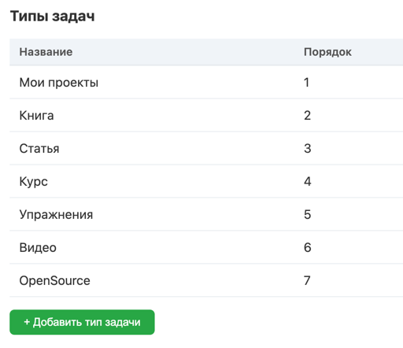
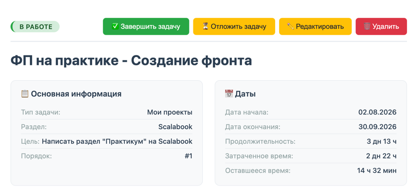



# Основные типы задач

В следующих главах мы сосредоточимся на персональных планах развития (ИПР) для разработчиков, 

## Ключевой принцип: Баланс мотивации и поддержки

Создание эффективного плана развития строится на двух «китах»:

1. **Внутренняя мотивация.** Это главный двигатель. Нельзя заставить взрослого человека учиться из-под палки. 
   Если сотрудник читает книгу или проходит курс только потому, что «так надо», это приводит к:
   - **Прокрастинации:** Постоянному откладыванию на потом.
   - **Отторжению:** Информация не усваивается по-настоящему.

   **Простая аналогия:** Студент, который весь семестр гуляет, а за неделю до сессии судорожно заучивает билеты. 
   Он может даже сдать экзамены на «отлично», но эти знания будут поверхностными и очень быстро испарятся из памяти. 
   Наша цель — не «сдать сессию», а получить прочные, долговечные знания.

2. **Внешняя поддержка.** Одной мотивации часто недостаточно. Задача сообщества — помочь разработчику, создав благоприятную среду для роста:
   - **Готовые планы:** Предоставить [проверенные маршруты обучения](https://roadmap.sh/), 
     чтобы разработчик не тратил время на поиски качественных материалов.
   - **Автоматизация:** Упростить рутинные процессы (например, отслеживание прогресса), 
     чтобы снизить барьер для начала занятий и риск прокрастинации.

## Какие могут быть типы задач в плане развития?

Чтобы план был разнообразным и эффективным, он может включать в себя задачи разных форматов. 
Вот основные возможные типы:

**1. Книга**

- **Что это?** Не только бумажные издания, но и электронные книги (PDF, ePub), а также специализированные сайты-учебники.
- **Зачем нужно?** Несмотря на мнение, что книги быстро устаревают, они остаются лучшим источником **фундаментальных знаний**. 
  _Хорошая_ книга закладывает базу, которая остается актуальной годами, в отличие от быстро меняющихся технологий.

**2. Статья / Блог**

- **Что это?** Отдельные статьи или циклы публикаций в блогах, где эксперт глубоко разбирает конкретную узкую тему.
- **Зачем нужно?** Статья позволяет очень детально погрузиться в какую-то одну проблему, часто глубже, 
  чем это может позволить себе книга. 
  Это идеальный формат для изучения конкретного инструмента, метода или решения специфической проблемы.

**3. Подкаст**

- **Что это?** Аудиозаписи, обычно в формате беседы или монолога.
- **Зачем нужно?** Этот формат развивает не столько технические (hard skills), сколько **гибкие навыки (soft skills)**. 
  Живой голос, интонации и эмоции спикеров создают более тесную связь со слушателем. 
  Подкасты часто вдохновляют, мотивируют и дают пищу для размышлений о карьере, подходах к работе и т.д.

**4. Видео**

- **Что это?** Записи выступлений с конференций, онлайн-митапов или специализированные обучающие ролики.
- **Зачем нужно?** Видео сочетает в себе визуальную информацию и живой контекст. 
  Вы не только слушаете доклад, но и видите реакцию аудитории, слайды, демонстрации. 
  Часто в конце выступления зрители (среди которых могут быть другие эксперты) задают вопросы, 
  что дает ценную **обратную связь** и раскрывает тему с новых сторон.

**5. Курс**

- **Что это?** Структурированная программа, которая объединяет теорию и **практику**. 
  Обычно включает лекции, упражнения, домашние задания и проекты.
- **Зачем нужно?** Это самый эффективный способ развить **практические навыки**. 
  Курс заставляет не просто пассивно потреблять информацию, а сразу применять ее на практике, что повышает качество обучения.

**6. Пользовательский тип**

- **Что это?** Любые другие задачи на развитие.
- **Примеры:**
    - **Ведение собственного блога или подкаста.** Чтобы что-то понятно объяснить другим, 
      нужно самому разобраться в теме еще глубже: хорошая площадка для этого - собственный блог.
    - **Участие в open-source проектах.** Позволяет поработать с реальным кодом, научиться читать чужой код и взаимодействовать с комьюнити.
    - **Выступление с докладом.** Систематизация и передача знаний коллегам.
    - **Работа над pet-проектом.** Реализация собственной идеи.

Использование комбинации этих типов задач делает план развития сбалансированным, интересным и максимально эффективным.

## Поля задач: подробное описание

Чтобы план развития был структурированным, удобным для отслеживания и анализа прогресса, 
каждая задача имеет набор полей. 

1. **Наименование**.  
   Краткое название задачи, которое должно ясно отражать её содержание.  
   Пример: 
   - _Изучить книгу "Clean Code"_
   - _Сдать курс по Python_

2. **Идентификатор пользователя**.
   Идентификатор пользователя, которому принадлежит задача.

3. **Тип задачи**.
   Указывает, к какому формату относится задача.  
   Пример: 
   - _Книга_
   - _Статья_
   - _Курс_

4. **Статус задачи**.
   Отражает текущее состояние выполнения задачи.  
   Примеры статусов: 
   - _В работе_  
   - _Запланировано_  
   - _База знаний_  
   - _Завершено_

5. **Раздел задачи**.  
   Позволяет сгруппировать задачи по тематическим разделам внутри ИПР.  
   Пример:
   - _Алгоритмы_ 
   - _Функциональное программирование_
   - _Soft skills_

6. **Цель задачи**. 
   Описывает глобальную цель, к которой ведет выполнение задачи.
   Пример: 
   - _Разработать приложение для учета задач_  
   - _Повысить свой уровень до Ведущего разработчика_
   - _Написать книгу_
   - _Сдать диплом_

7. **Порядок выполнения**. 
   Определяет последовательность, в которой должны выполняться задачи.  
   Пример: _1_, _2_, _3_

8. **Дата взятия в работу**.
   Дата, когда задача была начата.  
   Пример:
   - _01.10.2025_

9. **Дата окончания**. 
   Планируемая дата окончания.  
   Пример: 
   - _15.10.2025_

10. **Информация**.  
    Дополнительные сведения о задаче: комментарии, примечания, цели, источники и т.д.  
    Пример:
    - _"Важно понять основы чистого кода перед началом проектной работы."_

11. **План выполнения**.  
    Описание того, как будет выполняться задача, какие шаги предполагаются.  
    Пример:
    - _"Прочитать первую главу, выполнить упражнения, выписать ключевые идеи."_

12. **Продолжительность**.  
    Приблизительное время на задачу.   
    Пример:
    - _4 часа_

### Зачем это нужно?

Учёт всех этих полей позволяет:

- **Планировать развитие систематически**, без хаоса.
- **Отслеживать прогресс** в режиме реального времени.
- **Оценивать эффективность** каждой задачи.
- **Гибко адаптировать план**, если что-то не сработало.
- **Мотивировать себя** через достижения и результаты.

Каждый пункт помогает сделать обучение более структурированным и управляемым, 
что особенно важно при долгосрочных целях профессионального роста.

---

**Ссылки:**

- [Репозиторий с исходниками][repo]

[repo]: https://gitverse.ru/scalabook/pdp
