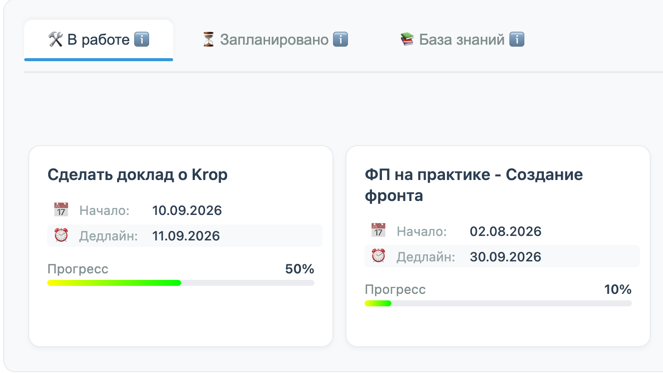



# Статусы и типы задач

## Статусы задачи

Каждая задача в персональном плане развития имеет статус, который определяет её текущее состояние и этап выполнения.
Статусы позволяют отслеживать прогресс, планировать нагрузку и анализировать эффективность обучения.



Рассмотрим следующие статусы задач:

### **В работе**

**Описание:**  

Задачи, над которыми вы сейчас работаете. Это активные задачи, которые находятся в процессе выполнения.

**Характеристики:**

- У задачи заполнены все поля.
- Проставлена **дата взятия в работу** и **планируемая дата окончания**.
- Есть подробный **план выполнения**, который можно актуализировать по мере необходимости.
- Задачи в этом статусе обычно не превышают количество 3-5 штук, так как важно сохранять фокус.

**Пример использования:** 

Если вы по утрам читаете книгу "Clean Code", днем слушаете подкаст о карьере разработчика,
а вечером смотрите обучающее видео — эти три задачи будут находиться в статусе "В работе".

### **Запланировано**

**Описание:** 

Задачи, которые уже детализированы и ожидают своего часа для взятия в работу. Они находятся в очереди на выполнение.

**Характеристики:**

- Все поля задачи заполнены, кроме **даты взятия в работу** и **даты окончания**.
- Есть детальный **план выполнения**, поэтому задачу можно взять в работу в любой момент.
- Эти задачи могут быть использованы как ближайший резерв, когда закончатся задачи "В работе".

**Пример использования:**  

Вы подготовили список из 10 статей, которые хотите прочесть. 
На данный момент вы читаете одну ("В работе"), а остальные находятся в статусе "Запланировано".

### **База знаний**

**Описание:**  

Это задачи, которые пока не имеют детального плана выполнения. 
Они находятся в вашей "базе" как потенциальные цели, но ещё не готовы к началу работы.

**Характеристики:**

- У задачи **не заполнен план выполнения**.
- Нельзя брать в работу, пока не будет сформирован четкий план.
- Представляет собой список возможностей для будущего развития.

**Пример использования:**  

Вы решили, что хотели бы начать свой блог, но пока не знаете, как это сделать. 
Эта задача находится в "Базе знаний", потому что вы ещё не определились с шагами реализации.

### **Завершено**

**Описание:**

Задачи, которые были полностью выполнены. Этот статус фиксирует завершение работы и позволяет сохранить историю достижений.

**Характеристики:**

- Задача выполнена в полном объеме согласно изначальному или актуализированному плану.
- Проставлена **фактическая дата окончания**.
- Задачи в этом статусе служат архивом вашего прогресса и могут использоваться для анализа пройденного пути.

**Пример использования:**

Вы прочитали книгу "Clean Code", выполнили все практические задания к ней и оформили конспект основных принципов. 
После этого вы завершаете задачу и указываете дату окончания, отмечая это достижение в своем плане.

### Реализация статусов в коде

Статусы реализуются в виде [перечисления (`enum`)](https://docs.scala-lang.org/scala3/reference/enums/enums.html).
Перечисление (enum) — это специальный тип данных, позволяющий определить фиксированный набор именованных констант.

Создадим файл `Status.scala` в директории `pdp/src/main/scala/ru/scalabook/pdp/models`.

```dotty
// pdp/src/main/scala/ru/scalabook/pdp/models/Status.scala
package ru.scalabook.pdp.models

enum Status:
  case InProgress, Planned, KnowledgeBase, Completed
```

Таким образом, каждая задача может иметь один из перечисленных статусов.

## Типы задач

В системе управления индивидуальным планом развития (ИПР) важно иметь возможность гибко описывать разные форматы задач.
Каждый тип задачи связан с конкретным форматом контента или деятельностью, например:

- Изучение книги
- Чтение статьи
- Слушание подкаста
- Просмотр видео
- Прохождение курса

Для типов создадим `case class TaskType` с заданными ограничениями на типы полей.

Для работы с ограничениями на типы данных (например, проверка длины строки, минимального значения числа и т.д.) 
будем использовать библиотеку [Iron](https://github.com/Iltotore/iron), 
которая позволяет создавать [**уточнённые типы** (refined types)](../../libs/refined.md).

Чтобы использовать Iron, нужно добавить её в список зависимостей проекта в файле `Dependencies.scala`:

```dotty
object Dependencies {
  // ...

  object iron {
    private val version = "3.3.2"
    val core = "io.github.iltotore" %% "iron" % version
  }

  val pdpLibs: Seq[ModuleID] =
    Seq(
      cats.catsEffect,
      iron.core
    )

  // ...
}
```

### `TaskType`

Создадим файл `TaskType.scala` в директории `pdp/src/main/scala/ru/scalabook/pdp/models`.

```dotty
// pdp/src/main/scala/ru/scalabook/pdp/models/TaskType.scala
final case class TaskType(
    id: TaskTypeId,
    name: TaskTypeName,
    userId: UserId,
    displayed: Boolean,
    ordinal: Ordinal
)

object TaskType:
  type TaskTypeId = TaskTypeId.T
  object TaskTypeId extends RefinedType[Int, GreaterEqual[0]]

  type TaskTypeName = TaskTypeName.T
  object TaskTypeName
      extends RefinedType[String, MinLength[2] & MaxLength[30] & Trimmed]
      
// pdp/src/main/scala/ru/scalabook/pdp/models/User.scala      
object User:
  opaque type UserId = UUID

  object UserId:
    def apply(uuid: UUID): UserId = uuid 
    
// pdp/src/main/scala/ru/scalabook/pdp/models/src.scala
type Ordinal = Ordinal.T
object Ordinal extends RefinedType[Int, Positive]:
  val Max: T = Ordinal(1000)

  given Ordering[Ordinal] with
    def compare(x: Ordinal, y: Ordinal): Int =
      x.value - y.value          
```

Это обычный [**case class**](https://docs.scala-lang.org/ru/tour/case-classes.html):

- `final` — указывает, что класс не может быть расширен (используется для гарантии иммутабельности и безопасности).
- `case class` автоматически предоставляет:
    - конструктор
    - методы `equals`, `hashCode`, `toString`
    - поддержку сопоставления с шаблоном
- `id` — идентификатор типа задачи
    - должен быть ≥ 0
- `name` — название типа задачи
    - От 2 до 30 символов
    - Строка должна быть обрезана (без пробелов в начале и конце)
- `userId` - идентификатор пользователя
- `displayed` — флаг, указывающий, включен ли тип задачи в пользовательском интерфейсе
- `ordinal` — порядковый номер типа

### Что такое "уточненные типы" (Refined Types)?

Библиотека Iron позволяет создавать типы с ограничениями. 
Вместо простого `Int` или `String` мы создаем типы, которые гарантируют, что данные соответствуют определенным правилам.

##### Пример без уточненных типов:

```dotty
// Проблема: никаких проверок!
case class TaskType(id: Int, name: String)

// Можно создать некорректные данные:
val bad1 = TaskType(-1, "A")         // ID отрицательный, имя слишком короткое
val bad2 = TaskType(1, "   test   ") // Лишние пробелы
```

##### Пример с уточненными типами:

```dotty
// Решение: типы с ограничениями
case class TaskType(id: TaskTypeId, name: TaskTypeName)

// Некорректные данные не скомпилируются!
val bad1 = TaskType(TaskTypeId(-1), TaskTypeName("name"))
// -- Constraint Error --------------------------------------------------------
// Could not satisfy a constraint for type scala.Int.
// 
// Value: -1
// Message: Should be greater than or equal to 0
// ----------------------------------------------------------------------------

val bad2 = TaskType(TaskTypeId(1), TaskTypeName("   test   "))
// -- Constraint Error --------------------------------------------------------
// Could not satisfy a constraint for type java.lang.String.
// 
// Value: test
// Message: Should have a minimum length of 2 & 
//          Should have a maximum length of 30 & 
//          Should not have leading or trailing whitespaces
// ----------------------------------------------------------------------------
```

#### Зачем нужны opaque types (запечатанные типы)?

[Создание новых типов](https://iltotore.github.io/iron/docs/reference/newtypes.html) через

```dotty
type A = A.T
object A extends RefinedType...
```

создает [запечатанный (opaque)](https://docs.scala-lang.org/ru/scala3/book/types-opaque-types.html) тип `A`.

Проблема, которую они решают:

Без запечатанных типов:

```dotty
type UserId = Int
type ProductId = Int

def getUser(id: UserId): User = ???
def getProduct(id: ProductId): Product = ???

// Проблема: можно перепутать ID!
val userId: UserId = 123
getProduct(userId) // Ошибка, но компилятор не поймет!
```

С запечатанными типами:

```dotty
type UserId = UserId.T
object UserId extends RefinedType[Int, Positive]

type ProductId = ProductId.T
object ProductId extends RefinedType[Int, Positive]

// Теперь нельзя перепутать!
val userId: UserId = UserId(123)
getProduct(userId) 
// Ошибка компиляции:
// Found: (userId : UserId)
// Required: ProductId
```

#### Практические примеры использования

```dotty
// Корректные примеры:
TaskType(TaskTypeId(5), TaskTypeName("Блог"))
TaskType(TaskTypeId(6), TaskTypeName("Open Source"))

// Некорректные примеры (не скомпилируются):
// Ошибка: -1 < 0
TaskType(TaskTypeId(-1), TaskTypeName("Тест"))
// Ошибка: название не подходит по размерам
TaskType(TaskTypeId(5), TaskTypeName("A"))
TaskType(
  TaskTypeId(0),
  TaskTypeName("Очень длинное название, которое не подходит")
)
// Ошибка: есть лишние пробелы
TaskType(TaskTypeId(5), TaskTypeName(" тест "))
```

#### Преимущества такого подхода

1. **Безопасность типов** — компилятор проверяет корректность данных
2. **Ясность кода** — типы документируют свои ограничения
3. **Предотвращение ошибок** — многие ошибки обнаруживаются на этапе компиляции
4. **Легкость рефакторинга** — изменения типов автоматически проверяются компилятором

## Разделы задач

В системе управления ИПР важно не только описывать отдельные задачи, 
но и группировать их по тематическим разделам. 
Это помогает лучше структурировать контент и облегчает навигацию по задачам.

**Разделы** — это категоризации задач, которые позволяют:

- **Группировать однотипные задачи** (например, все задачи по алгоритмам).
- **Упрощать поиск и фильтрацию** задач в интерфейсе.
- **Создавать логическую последовательность** в обучении (например, сначала изучить основы программирования, потом — продвинутые алгоритмы).
- **Оценивать прогресс** по конкретной теме.

Примеры типичных разделов:

- **Алгоритмы**
- **Функциональное программирование**
- **Soft skills**
- **Базы данных**
- **Web-разработка**
- **Проектирование архитектур**
- **Тестирование**

### Реализация раздела в коде

Чтобы реализовать разделы в проекте, мы создаем класс `Section`:

```dotty
// pdp/src/main/scala/ru/scalabook/pdp/models/Section.scala
final case class Section(
    id: SectionId,
    name: SectionName,
    userId: UserId,
    displayed: Boolean,
    ordinal: Ordinal
)

object Section:
  type SectionId = SectionId.T
  object SectionId extends RefinedType[Int, GreaterEqual[0]]

  type SectionName = SectionName.T
  object SectionName
      extends RefinedType[String, MinLength[2] & MaxLength[100] & Trimmed]    
```

### Пример использования

```dotty
Section(
  SectionId(1), 
  SectionName("Алгоритмы"), 
  UserId(UUID.randomUUID()), 
  true, 
  Ordinal(1)
)
```

## Глобальные цели

Важно не только иметь задачи, но и определять их цели. 
**Цели** — это мета-описания, которые помогают понять, зачем выполнять ту или иную задачу 
и как она связана с профессиональным ростом.

**Цели задач** — это описание ожидаемых результатов от выполнения задачи, которые позволяют:

- **Объяснять ценность задачи** — зачем её выполнять, какие навыки развивает.
- **Мотивировать пользователя** — показывать, как задача связана с карьерным ростом.
- **Связывать задачи с компетенциями** — определять, какие именно навыки развивает задача.
- **Оценивать релевантность задачи** — помогает понять, подходит ли задача для текущего уровня развития.

Примеры типичных целей:

- **Научиться писать чистый и поддерживаемый код**
- **Освоить принципы функционального программирования**
- **Развить навыки работы с базами данных**
- **Приобрести опыт проектирования распределённых систем**
- **Улучшить навыки командной работы и коммуникации**
- **Понять основы тестирования ПО**

### Реализация цели в коде

Чтобы реализовать цели в проекте, мы создаем класс `Goal`:

```dotty
// pdp/src/main/scala/ru/scalabook/pdp/models/Goal.scala
final case class Goal(
    id: GoalId,
    name: GoalName,
    userId: UserId,
    displayed: Boolean,
    ordinal: Ordinal
)

object Goal:
  type GoalId = GoalId.T
  object GoalId extends RefinedType[Int, GreaterEqual[0]]

  type GoalName = GoalName.T
  object GoalName
      extends RefinedType[String, MinLength[2] & MaxLength[200] & Trimmed]
```

### Пример использования

```dotty
Goal(
  GoalId(1), 
  GoalName("Освоить основы алгоритмического мышления"), 
  UserId(UUID.randomUUID()), 
  true, 
  Ordinal(1)
)
```

### Связь целей с задачами

На практике цели обычно связываются с задачами через отношения "один-ко-многим":

**Одна цель** может быть связана с **несколькими задачами** 
(например, цель "Освоить функциональное программирование" может включать 
задачи по изучению монад, функторов и чистых функций).

Использование целей задач дает следующие преимущества:

- **Прозрачность обучения** — пользователь понимает, какие навыки он развивает, выполняя задачу.
- **Мотивационный аспект** — понимание "зачем" повышает вовлеченность.

Цели превращают задачи из простых упражнений в осмысленные шаги профессионального развития, 
делая систему ИПР более эффективной и персонализированной.

## Задача

Каждая задача имеет набор полей, 
обеспечивающих единообразие, структурированность и удобство отслеживания прогресса. 

### Список полей

| Поле          | Тип данных          | Описание                                                                            |
|---------------|---------------------|-------------------------------------------------------------------------------------|
| `id`          | `TaskId` (`UUID`)   | Уникальный идентификатор задачи                                                     |
| `name`        | `TaskName`          | Название задачи                                                                     |
| `userId`      | `UserId`            | Идентификатор пользователя, которому принадлежит задача                             |
| `taskTypeId`  | `TaskTypeId`        | Идентификатор типа задачи                                                           |
| `status`      | `Status`            | Текущий статус задачи                                                               |
| `sectionId`   | `SectionId`         | Идентификатор раздела, к которому относится задача                                  |
| `goalId`      | `GoalId`            | Идентификатор цели, которую выполняет задача                                        |
| `ordinal`     | `Ordinal`           | Порядковый номер задачи. Используется для определения последовательности выполнения |
| `startDate`   | `Option[LocalDate]` | Дата, когда задача была взята в работу                                              |
| `endDate`     | `Option[LocalDate]` | Планируемая дата завершения                                                         |
| `information` | `String`            | Дополнительная информация о задаче (например, описание, примечания, источники)      |
| `plan`        | `Plan`              | План выполнения задачи — список шагов или действий, необходимых для её завершения   |
| `duration`    | `FiniteDuration`    | Трудоемкость задачи                                                                 |
| `timeSpent`   | `FiniteDuration`    | Затраченное время                                                                   |

```dotty
// pdp/src/main/scala/ru/scalabook/pdp/models/Task.scala
final case class Task(
    id: TaskId,
    name: TaskName,
    userId: UserId,
    taskTypeId: TaskTypeId,
    status: Status,
    sectionId: SectionId,
    goalId: GoalId,
    ordinal: Ordinal,
    startDate: Option[LocalDate],
    endDate: Option[LocalDate],
    information: String,
    plan: Plan,
    duration: FiniteDuration,
    timeSpent: FiniteDuration
)

object Task:
  opaque type TaskId = UUID
  object TaskId:
    def apply(uuid: UUID): TaskId = uuid
    
    def parse(uuid: String): Validated[String, TaskId] =
      Try(UUID.fromString(uuid)).toValidated.leftMap(_.getMessage)

  type TaskName = TaskName.T
  object TaskName
      extends RefinedType[String, MinLength[2] & MaxLength[200] & Trimmed]
```

Для описания шагов плана создадим отдельные файлы `Plan.scala` и `PlanStep.scala`:

```dotty
// pdp/src/main/scala/ru/scalabook/pdp/models/Plan.scala
final case class Plan(steps: List[PlanStep]):
  lazy val progress: Double =
    val completed = steps.count(_.completed).toDouble
    completed / steps.length

object Plan:
  val Empty: Plan = Plan(List.empty)
  
// pdp/src/main/scala/ru/scalabook/pdp/models/Plan.scala
final case class PlanStep(
    number: StepNumber,
    step: StepName,
    completed: Boolean
)

object PlanStep:
  /** Номер пункта плана в формате: n.n.n */
  type StepNumber = StepNumber.T

  object StepNumber
      extends RefinedType[String, Match["^\\d+(?:\\.\\d+)*$"]]:
    given Ordering[StepNumber] =
      @tailrec
      def loop(list1: List[Int], list2: List[Int]): Boolean =
        (list1, list2) match
          case (h1 :: t1, h2 :: t2) if h1 == h2 => loop(t1, t2)
          case (h1 :: t1, h2 :: t2)             => h1 < h2
          case _                                => list1.isEmpty

      Ordering.fromLessThan { case (step1, step2) =>
        loop(
          list1 = step1.value.split("\\.").flatMap(_.toIntOption).toList,
          list2 = step2.value.split("\\.").flatMap(_.toIntOption).toList
        )
      }

  type StepName = StepName.T
  object StepName
      extends RefinedType[String, MinLength[2] & MaxLength[300] & Trimmed]
end PlanStep  
```

### Разбор каждого поля

#### `id: TaskId`

- **Описание**: Уникальный идентификатор задачи.
- **Ограничения**: создаем отдельный [непрозрачный тип](https://docs.scala-lang.org/ru/scala3/book/types-opaque-types.html)
  для безопасности типов, чтобы случайно не перепутать идентификаторы разных объектов 
  (например, идентификатор задачи и идентификатор пользователя)
- **Пример**: `b7a98f3e-5f4d-4c6f-916a-51e05f3c0001`

#### `name: TaskName`

- **Описание**: Название задачи.
- **Ограничения**:
    - От 2 до 200 символов без начальных или конечных пробелов
- **Пример**: `"Изучить книгу 'Clean Code'"`

#### `userId: UserId`

- **Описание**: Идентификатор владельца задачи.
- **Зачем нужно**: Для реализации многопользовательской модели.

#### `taskTypeId: TaskTypeId`

- **Описание**: Идентификатор типа задачи.
- **Пример**: `TaskTypeId(1)`

#### `status: Status`

- **Описание**: Текущий статус задачи.
- **Возможные значения**:
    - `Status.InProgress` – задача в работе
    - `Status.Planned` – задача запланирована
    - `Status.KnowledgeBase` – задача в базе знаний
    - `Status.Completed` – задача выполнена

#### `sectionId: SectionId`

- **Описание**: Идентификатор раздела, к которому относится задача.
- **Пример**: `SectionId(1)`

#### `goalId: GoalId`

- **Описание**: Идентификатор цели, которую выполняет задача.
- **Пример**: `GoalId(1)`

#### `ordinal: Ordinal`

- **Описание**: Порядковый номер задачи - её приоритет.
- **Ограничения**: Должно быть положительное число (`Positive`)
- **Пример**: `1`, `2`, `3`, ...

#### `startDate: Option[LocalDate]`

- **Описание**: Дата начала работы над задачей.
- **Пример**: `Some(2025-01-10)`

#### `endDate: Option[LocalDate]`

- **Описание**: Планируемая дата окончания работы над задачей.
- **Пример**: `Some(2025-01-20)`

#### `information: String`

- **Описание**: Дополнительная информация о задаче.
- **Пример**: `"Данное учебное пособие — это классический, проверенный временем труд..."`
- **Зачем нужно**: Хранит описание, примечания и любую другую информацию, которая может быть полезна при выполнении задачи.

#### `plan: Plan`

- **Описание**: План выполнения задачи — список шагов или действий, необходимых для её завершения.
- **Структура**: `Plan(steps: List[PlanStep])`, где каждый `PlanStep` содержит номер шага (например, `1.2.3`), описание шага и признак выполнения.
- **Пример**: 
  ```scala
  Plan(List(PlanStep("1", "Прочитать первую главу", completed = true), 
              PlanStep("2", "Сделать конспект", completed = false)))
  ```
- **Зачем нужно**: Позволяет разбить задачу на конкретные шаги, отслеживать прогресс (через `plan.progress`) 
  и использовать его как чек-лист. Наличие плана — обязательное условие для взятия задачи в работу или постановки в очередь.

#### `duration: FiniteDuration`

- **Описание**: Трудоемкость задачи — сколько времени планируется на неё потратить.
- **Пример**: `FiniteDuration(120, TimeUnit.MINUTES)`

#### `timeSpent: FiniteDuration`

- **Описание**: Затраченное время — сколько времени реально было потрачено на задачу.
- **Пример**: `FiniteDuration(95, TimeUnit.MINUTES)`

## Тестирование кода

Одной из самых важных частей разработки программного обеспечения является тестирование кода.
Хорошо написанные тесты дают уверенность в том, что код работает так, как задумано,
помогают ловить регрессии при рефакторинге и служат живой документацией к проекту.
Давайте разберём, как писать тесты на Scala 3 с использованием
библиотеки **Weaver**.

### Что такое Weaver?

[Weaver](https://typelevel.org/weaver-test/) — это лёгкий фреймворк для тестирования,
созданный специально для проектов, использующих **Cats Effect**. Его главные преимущества:

- **Простой и лаконичный API** — тесты выглядят почти как обычный Scala-код.
- **Полная поддержка эффектов** — `IO`, `Resource` и других типов Cats Effect «из коробки».
- **Параллельный запуск тестов** — тесты выполняются параллельно по умолчанию, что ускоряет сборку.
- **Понятные сообщения об ошибках** — при падении теста сразу видно, что именно пошло не так.

### Пример: сортировка шагов плана

Рассмотрим реальный пример из нашего проекта — тестирование сортировки шагов плана.
Каждый шаг имеет номер вида `1`, `1.1`, `1.2.1`, `2.1` и т.д. Такие номера нужно сортировать
естественным образом: `1.2` должно идти раньше `1.10`, хотя как строки они сортируются наоборот.

```dotty
// pdp/src/test/scala/ru/scalabook/pdp/models/PlanStepSuite.scala
object PlanStepSuite extends SimpleIOSuite:
  pureTest("StepNumber ordering should sort correctly") {
    val unsorted = List(
      StepNumber("1.10"),
      StepNumber("1.2"),
      StepNumber("1"),
      StepNumber("1.1"),
      StepNumber("2.1"),
      StepNumber("2"),
      StepNumber("1.2.1"),
      StepNumber("1.1.1")
    )

    val expected = List(
      StepNumber("1"),
      StepNumber("1.1"),
      StepNumber("1.1.1"),
      StepNumber("1.2"),
      StepNumber("1.2.1"),
      StepNumber("1.10"),
      StepNumber("2"),
      StepNumber("2.1")
    )

    expect.same(expected, unsorted.sorted)
  }
```

### Соглашения о написании тестов

Чтобы тесты оставались полезными и читаемыми, придерживайтесь следующих правил:

1. **Один тест — одна проверка.** Тест должен отвечать на один вопрос.
   Если проверок несколько, лучше разбить их на отдельные тесты.

2. **Понятные названия.** Название теста должно описывать поведение, а не реализацию.
   Плохо: `test("parse works")`. Хорошо: `test("parse should reject empty string")`.

3. **Структура Given-When-Then.** Разделяйте тест на три части:
  - **Given** — подготовка данных (например, неотсортированный список).
  - **When** — действие (например, `.sorted`).
  - **Then** — проверка (например, `expect.same`).

4. **Изолированность.** Каждый тест должен работать независимо от других.
   Не полагайтесь на порядок выполнения тестов.

5. **Тестируйте крайние случаи.** Помимо «счастливого пути», проверяйте пустые значения,
   границы диапазонов, некорректный ввод.

6. **Тесты как документация.** Хорошо написанные тесты показывают, как использовать код.
   Если вам нужно понять, как работает функция, — посмотрите на её тесты.

Тесты — это не «дополнительная работа», а **неотъемлемая часть кода**.
Пишите их вместе с реализацией, а не после. Это поможет вам быстрее находить ошибки
и сделает рефакторинг безопасным.

---

**Ссылки:**

- [Персональный план развития][plugin]
- [Репозиторий с исходниками][repo]

[repo]: https://gitverse.ru/scalabook/pdp
[plugin]: https://artemkorsakov.github.io/personal-development-plan/ru/
