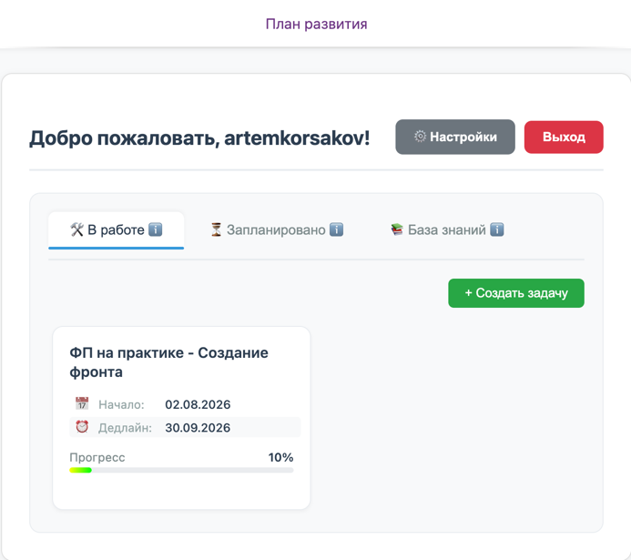
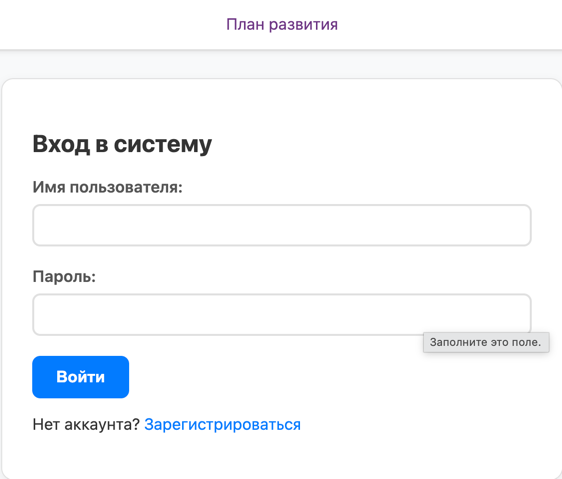

# Главная страница

Начнём с главной страницы приложения. Это точка входа, куда попадает пользователь при открытии сайта.
Главная страница должна решать две задачи:

1. **Если пользователь уже авторизован** (в куках есть валидный JWT-токен) — показать его рабочий стол
   с задачами, разбитыми по вкладкам.
2. **Если пользователь не авторизован** — показать форму входа.

Такой подход избавляет от лишних кликов: пользователю не нужно каждый раз логиниться заново,
если он уже вошёл в систему.

## Описание маршрута главной страницы

Маршрут главной страницы объявлен непосредственно в хэндлере. Его ключевое отличие от `/health_check` —
**извлечение HTTP-заголовка Cookie**: именно в куках хранится JWT-токен, по которому мы определяем,
залогирован ли пользователь.

```dotty
private val route =
  Route(
    Request.get(Path.root).extractHeader[Cookie],
    Response.ok(Entity.html)
  )
```

**Разбор маршрута:**

- **`Request.get(Path.root)`** — GET-запрос на корневой путь `/`.
- **`.extractHeader[Cookie]`** — извлекает из запроса заголовок `Cookie`. Тип `Cookie`
  определён в http4s и содержит список всех кук, отправленных браузером. Krop автоматически
  преобразует заголовок в этот тип и передаёт его в хэндлер.
- **`Response.ok(Entity.html)`** — успешный ответ (200 OK) с HTML-телом.

## Создание `InitialHandler`

`InitialHandler` — это хэндлер, который решает, что показать пользователю: рабочий стол или форму входа.

```dotty
final case class InitialHandler(
    middleware: JwtAuthMiddleware[IO, UserInfo],
    taskLifecycleService: TaskLifecycleService[IO],
    periodicTaskLifecycleService: PeriodicTaskLifecycleService[IO],
    notesService: NotesService[IO],
    historyService: HistoryService[IO]
)(using Logger[IO]) extends AuthorizationHandler(middleware):
  private val route =
    Route(
      Request.get(Path.root).extractHeader[Cookie],
      Response.ok(Entity.html)
    )

  val handler: Handler =
    route.handleIO: (cookie: Cookie) =>
      withUserFromCookie(cookie)(
        f = (user, jwtToken) =>
          getViewWelcomeHtml(
            taskLifecycleService = taskLifecycleService,
            periodicTaskLifecycleService = periodicTaskLifecycleService,
            notesService = notesService,
            historyService = historyService,
            user = user,
            jwtToken = jwtToken,
            tab = DefaultTab
          ).map(welcome => Views.base(Title, raw(welcome))),
        fallbackPage = Views.base(Title, Views.login(none))
      )
```

**Пошаговый разбор:**

1. **Зависимости хэндлера:**
    - `middleware: JwtAuthMiddleware[IO, UserInfo]` — middleware для проверки JWT-токенов.
      Умеет превращать строку токена в объект `UserInfo` (информация о пользователе: id, username).
    - Сервисы загрузки задач, периодических задач, заметок и истории.
    - `using Logger[IO]` — логгер для записи ошибок.

2. **`extends AuthorizationHandler(middleware)`** — наследуемся от базового класса.
   Это даёт доступ к методам `withUserFromCookie`/`withUserFromCookieOpt` (см. «Базовый класс
   `AuthorizationHandler`»).

3. **`private val route`** — маршрут объявлен внутри хэндлера.

4. **`route.handleIO`** — регистрируем обработчик, принимающий `Cookie`. Метод `handleIO`
   используется вместо `handle`, потому что логика требует эффекта `IO` (проверка токена, загрузка задач).

5. **`withUserFromCookie(cookie)(f, fallbackPage)`** — передаём куку **первым** аргументом,
   лямбду `f` и `fallbackPage` — вторым. Метод сам:
    - Извлекает токен из куки `token`.
    - Проверяет его через `middleware.fromToken.run` и передаёт `(user, jwtToken)` в `f`.
    - Если токена в куке нет или он невалиден — возвращает `fallbackPage`
      (заранее сформированную страницу логина).

6. **`f = (user, jwtToken) => ...`** — формирует приветственную страницу через
   `getViewWelcomeHtml` и оборачивает её в `Views.base(Title, ...)`. Если токен валиден — пользователь
   видит свой рабочий стол; иначе — `fallbackPage` (форма входа).

Любая проблема с токеном (истёк, повреждён, неверная подпись) **не роняет приложение**:
пользователь просто увидит форму входа, как будто он не авторизован. Ошибка при этом логируется.

### Базовый класс `AuthorizationHandler`

`AuthorizationHandler` — это вспомогательный трейт, который инкапсулирует логику
проверки токена. Он используется всеми защищёнными хэндлерами (настройки, задачи, таймер и т.д.).

Реализация выглядит так:

```dotty
trait AuthorizationHandler(middleware: JwtAuthMiddleware[IO, UserInfo])(using
    Logger[IO]
):
  def withUserFromHeader(authorization: Authorization)(
      f: ((UserInfo, SignedJwt)) => IO[String]
  ): IO[Option[String]] =
    withUserFromHeaderOpt(authorization)(f(_).map(_.some))

  def withUserFromHeaderOpt(authorization: Authorization)(
      f: ((UserInfo, SignedJwt)) => IO[Option[String]]
  ): IO[Option[String]] =
    middleware
      .run(authorization)
      .flatMap(f)
      .recoverWith:
        case ex: AuthorizationException =>
          Logger[IO].error(ex)(
            s"Ошибка при парсинге токена: ${ex.getMessage}"
          ).as(Views.error().some)
        case ex =>
          Logger[IO].error(ex)(s"Ошибка: ${ex.getMessage}").as(none)

  def withUserFromCookieOpt(cookie: Cookie)(
      f: ((UserInfo, SignedJwt)) => IO[Option[String]],
      fallbackPage: => String
  ): IO[String] =
    withUserFromCookie(cookie)(
      f(_).map(_.getOrElse(fallbackPage)),
      fallbackPage
    )

  def withUserFromCookie(cookie: Cookie)(
      f: ((UserInfo, SignedJwt)) => IO[String],
      fallbackPage: => String
  ): IO[String] =
    cookie.values
      .collectFirst {
        case rq if rq.name == "token" => rq.content
      } match
      case Some(token) =>
        middleware.fromToken.run(token)
          .flatMap(f)
          .recoverWith:
            case ex: AuthorizationException =>
              Logger[IO].error(ex)(
                s"Ошибка при парсинге токена: ${ex.getMessage}"
              )
                .as(fallbackPage)
            case ex =>
              Logger[IO].error(ex)(s"Ошибка: ${ex.getMessage}")
                .as(fallbackPage)
      case None =>
        Logger[IO].debug("В cookies не найден токен пользователя")
          .as(fallbackPage)
end AuthorizationHandler
```

**Что делает:**

1. Все методы принимают **два** аргумента: исходные данные (`authorization` или `cookie`)
   **и** каррированную функцию `f`, которой передаётся `(user, token)`.
2. Метод вызывает middleware для проверки токена.
3. Если токен валиден — передаёт `(user, token)` в пользовательскую функцию `f`.
4. Если заголовка/куки нет или токен невалиден — возвращается `fallbackPage`.

**Два способа передать токен:**

- **`withUserFromHeader` / `withUserFromHeaderOpt` с `Authorization`** — токен приходит
  в заголовке `Authorization: Bearer <token>` (формы `/auth/login`, `/auth/logout`,
  действия задачи). Возвращают `IO[Option[String]]`.
- **`withUserFromCookie` / `withUserFromCookieOpt` с `Cookie`** — токен хранится в куки
  `token` (открытие страниц: `/home`, `/task/{uuid}`, `/note/{uuid}` и т.д.). Трейт сам
  извлекает токен из куки и возвращает `IO[String]`, подставляя `fallbackPage` при
  отсутствии/невалидности токена. `fallbackPage` — **по имени** (`=> String`), то есть
  вычисляется только при необходимости. Для мягкой версии (`withUserFromCookieOpt`) лямбда
  возвращает `Option`, и при `None` тоже подставляется `fallbackPage`.

**Преимущества такого подхода:**

- **Единообразие**: все защищённые хэндлеры используют один и тот же механизм проверки.
- **Безопасность по умолчанию**: если разработчик забыл проверить токен — компилятор
  заставит его использовать `withUserFromHeader`, потому что обычный `handleIO` не даст доступ
  к `UserInfo`.
- **Единая точка для токена из куки**: извлечение `token` из куки и подстановка
  `fallbackPage` реализованы один раз в `AuthorizationHandler`, а не в каждом хэндлере.

## Что такое `JwtAuthMiddleware`

`JwtAuthMiddleware` — это типобезопасная обёртка над проверкой JWT-токена.
Он построен на `Kleisli` — специальном типе из Cats, который представляет функцию,
возвращающую значение в контексте эффекта `F`.

```dotty
type JwtAuthMiddleware[F[_], A] = Kleisli[F, Authorization, (A, SignedJwt)]
```

**Расшифровка типа:**

- **`F[_]`** — эффект (в нашем случае `IO`).
- **`A`** — тип пользователя (у нас `UserInfo`).
- **`Authorization`** — заголовок HTTP-запроса, содержащий токен.
- **`(A, SignedJwt)`** — результат: пользователь + сам токен (нужен для дальнейших запросов).

Проще говоря, `JwtAuthMiddleware[IO, UserInfo]` — это функция вида
`Authorization → IO[(UserInfo, SignedJwt)]`.

```dotty
object JwtAuthMiddleware:
  def apply[F[_]: MonadThrow as MT, A](
      verification: JwtVerification[F],
      authenticate: SignedJwt => F[Option[A]]
  ): JwtAuthMiddleware[F, A] =
    Kleisli {
      case Authorization(Token(AuthScheme.Bearer, token)) =>
        val parsedAndVerified: F[SignedJwt] =
          for
            signedJwt <- SignedJwt.fromString(token).liftTo[F]
            _         <- signedJwt.verifyWith(verification)
          yield signedJwt

        parsedAndVerified.attempt.flatMap:
          case Right(signedJwt) =>
            authenticate(signedJwt)
              .flatMap: opt =>
                MT.fromOption(opt, AuthorizationException("Not found"))
              .map(a => (a, signedJwt))
          case Left(_) =>
            MT.raiseError(AuthorizationException("Invalid access token"))
      case _ =>
        MT.raiseError(AuthorizationException("Bearer token not found"))
    }

  extension [F[_], A](middleware: JwtAuthMiddleware[F, A])
    def fromToken: Kleisli[F, String, (A, SignedJwt)] =
      middleware
        .local[String]((token: String) =>
          Authorization(Token(AuthScheme.Bearer, token))
        )
```

**Что делает `apply`:**

1. **Сопоставление с образцом заголовка `Authorization`:** ожидается схема `Bearer <token>`.
   Если заголовок не соответствует этому формату — `AuthorizationException("Bearer token not found")`.

2. **Парсинг и верификация токена:** строка `token` конвертируется в `SignedJwt` через
   `SignedJwt.fromString`, после чего `verifyWith(verification)` проверяет подпись, срок действия
   и целостность токена. Обе операции помещаются в эффект `F` через `.liftTo[F]`.

3. **Обработка результата проверки:** через `.attempt` разделяются два исхода:
   - **Успех** — вызывается `authenticate(signedJwt)` для поиска пользователя.
     Если вернётся `None` — выбрасывается `AuthorizationException("Not found")`.
   - **Ошибка** — любая проблема с токеном (неверная подпись, истёкший срок и т.д.)
     преобразуется в `AuthorizationException("Invalid access token")`.

4. **Возврат пары `(A, SignedJwt)`** — аутентифицированный пользователь и сам токен.

**Расширение `fromToken`** упрощает вызов middleware, когда у нас есть только строка токена
(например, из куки). Оно «заворачивает» строку в правильный заголовок `Authorization: Bearer <token>`
и вызывает middleware.

## Формирование приветственной страницы

Если токен валиден, формируем приветственную страницу с задачами пользователя.
Логика вынесена в объект `WelcomeViews`:

```dotty
object WelcomeViews:
  val Title: String       = "План развития"
  val DefaultTab: String  = "in-progress"

  def getViewWelcomeHtml(
      taskLifecycleService: TaskLifecycleService[IO],
      periodicTaskLifecycleService: PeriodicTaskLifecycleService[IO],
      notesService: NotesService[IO],
      historyService: HistoryService[IO],
      user: UserInfo,
      jwtToken: SignedJwt,
      tab: String
  ): IO[String] =
    for
      notes <- notesService.getByUser(user.id)
      (taskResults, taskTypes, sections, goals) <- taskLifecycleService.getAll(...)
      completedTasks <- historyService.getByUser(user.id)
      periodicTasks  <- periodicTaskLifecycleService.getTasks(user.id)
    yield
      val typesMap    = taskTypes.map(t => (t.id, t.name)).toMap
      val sectionsMap = sections.map(t => (t.id, t.name)).toMap
      val goalsMap    = goals.map(t => (t.id, t.name)).toMap
      ...
      // Карточки вкладок
      val plannedTasks =
        plannedResults.map(task =>
          TablePlannedTaskCard.fromTaskResult(task, typesMap, sectionsMap, goalsMap))
      val knowledgeBaseTasks =
        knowledgeBaseResults.map(task =>
          TableKnowledgeBaseTaskCard.fromTaskResult(task, typesMap, sectionsMap, goalsMap))

      // Множества id присутствующих типов, разделов и целей
      val plannedGoalIds = plannedResults.map(task => task.goalId).toSet
      val knowledgeBaseGoalIds = knowledgeBaseResults.map(task => task.goalId).toSet

      // Списки опций фильтров
      val plannedGoalFilters =
        goals.sortBy(_.ordinal).collect {
          case t if plannedGoalIds(t.id) => t.name.value
        }
      val knowledgeBaseGoalFilters =
        goals.sortBy(_.ordinal).collect {
          case t if knowledgeBaseGoalIds(t.id) => t.name.value
        }

      Views.welcome(
        username = user.username.value,
        token = jwtToken,
        tab = tab,
        inProgress = Views.welcomeInProgress(inProgressTasks, periodicTasks),
        planned = Views.welcomePlanned(plannedTasks, plannedTaskTypes, plannedSections, plannedGoalFilters),
        knowledgeBase = Views.welcomeKnowledgeBase(knowledgeBaseTasks, knowledgeBaseTaskTypes, knowledgeBaseSections, knowledgeBaseGoalFilters),
        goals = Views.goalsStats(currentGoals, plannedGoals, achievedGoals),
        statistics = Views.statistics(stats),
        sources = Views.welcomeSources(taskTypes),
        notes = Views.welcomeNotes(notes),
        history = Views.history(historyTasks)
      ).render
```

**Что происходит пошагово:**

1. **`DefaultTab`** — вкладка, открытая по умолчанию (`"in-progress"`).

2. **Загрузка данных** несколькими сервисами в `for`-комнате:
    - `taskLifecycleService.getAll(userId, none, none, none)` — задачи, типы, разделы и цели;
    - `notesService.getByUser` — заметки;
    - `historyService.getByUser` — завершённые задачи;
    - `periodicTaskLifecycleService.getTasks` — периодические задачи на сегодня.

3. **Построение карт `typesMap`, `sectionsMap`, `goalsMap`** — id → имя, чтобы
   карточки задач могли показать «обогащённые» имена вместо id.

4. **Группировка задач по статусам:**
    - **`inProgressResults`** — задачи «В работе», отсортированные по `(endDate, ordinal)`.
    - **`plannedResults`** — задачи «Запланировано», отсортированные по `ordinal`.
    - **`knowledgeBaseResults`** — задачи «База знаний», отсортированные по имени.

5. **Подготовка опций для фильтров.** Здесь важный момент: **фильтры должны показывать
   только те типы, разделы и цели, которые реально встречаются в задачах данной вкладки.**
   Иначе пользователь увидит в выпадающем списке значения, которые нигде не используются,
   и это создаст путаницу.

    - **`plannedTaskTypeNames`, `plannedSectionNames`, `plannedGoalIds`** — множества id,
      встречающихся в запланированных задачах.
    - **`knowledgeBaseTaskTypeNames`, `knowledgeBaseSectionNames`, `knowledgeBaseGoalIds`** —
      то же для базы знаний.

6. **Формирование отсортированных списков опций (включая цели):**
    - Проходим по всем `types`, `sections` и `goals` в порядке `ordinal` и оставляем
      только те, чьи id встречаются в соответствующем `Set`. Так фильтр показывает
      значения в правильном порядке (не алфавитном, а по `ordinal`).
    - `plannedGoalFilters` и `knowledgeBaseGoalFilters` — **новые** списки целей
      для фильтра «Цель» на вкладках «Запланировано» и «База знаний».

7. **`Views.welcome(...)`** — собираем страницу из уже отрисованных HTML-фрагментов
   вкладок. Каждая вкладка рендерится отдельным шаблоном: `welcomeInProgress`,
   `welcomePlanned`, `welcomeKnowledgeBase`, `goalsStats`, `statistics`, `welcomeSources`,
   `welcomeNotes`, `history`. Списки фильтров (`taskTypes`, `sections`, `goals`) передаются
   только во вкладки, где они нужны.

## Внешний вид страницы

Если всё прошло успешно, пользователь видит приветственную страницу с восемью вкладками
(«В работе», «Запланировано», «База знаний», «Цели», «Статистика», «Источник», «Заметки»,
«История»):



Если что-то пошло не так — пользователь видит страницу логина:

```dotty
Views.base(Title, Views.login(none))
```



## Рендеринг представлений (scalatags)

Для формирования HTML используются чистые Scala-функции с DSL [scalatags](https://github.com/lihaoyi/scalatags) — типобезопасной
библиотекой для построения HTML в Scala-коде. Это позволяет ловить ошибки разметки на этапе
компиляции, а не в рантайме. Все функции-рендеры собраны в объекте `Views`
(`Views.scala`). scalatags-код типобезопасен: компилятор проверяет структуру DOM-дерева,
наличие необходимых атрибутов и корректность типов.

### Базовый рендер `Views.base`

Функция-обёртка для всех страниц приложения. Содержит общие элементы: `<head>`,
подключение CSS и JS, верхнюю панель с заголовком.

```dotty
def base(pageTitle: String, pageContent: Modifier): String
```

Строит `<html lang="ru">` с `<head>`, содержащим мета-информацию.
Затем `<body>` с `<header class="app-header">` (ссылка на `/`) и
`<main class="main-content">`, оборачивающим содержимое.

**Параметры:**

- **`pageTitle: String`** — заголовок страницы, отображается в браузерной вкладке и в шапке.
  Клик по нему ведёт на главную страницу.
- **`pageContent: Modifier`** — основное содержимое страницы (scalatags-фрагмент), вставляется
  в `<main>`. Если передаётся уже готовая HTML-строка (например, результат `WelcomeViews`),
  её оборачивают в `raw(...)`.

**Важно:** здесь подключается **htmx** — библиотека для обновления частей страницы без перезагрузки.
Именно она используется на welcome-странице для переключения вкладок, отправки форм и обновления
списка задач. Без неё все действия требовали бы полной перезагрузки страницы.

### Рендер `Views.login`

Страница формы входа. Показывается, если пользователь не авторизован.

```dotty
def login(errorMessage: Option[String]): Frag
```

Функция рендерит `<div id="app" class="app-container-narrow">` с заголовком
`<h2>Вход в систему</h2>`, форму через `LoginRequest.render("loginForm", "/auth/login", "Войти")`,
блок ошибки через `errorBlock(errorMessage)` и ссылку «Зарегистрироваться» с htmx-атрибутами
(`hx-get="/register"`, `Htmx.appTarget`, `Htmx.appSwap`).

**Особенности:**

- **`errorMessage: Option[String]`** — опциональное сообщение об ошибке (например,
  «Неверный логин или пароль»). Если оно есть — отображается под формой в блоке `.error`.
- Форма отправляется через htmx: `hx-post="/auth/login"`, `hx-target="#app"`,
  `hx-swap="outerHTML"`.
- **`hx-post="/auth/login"`** — форма отправляется через htmx без перезагрузки страницы.
- **`hx-target="#app"`** — ответ сервера заменяет содержимое блока `#app`. Если логин
  успешен, сервер вернёт welcome-страницу; если нет — ту же форму с сообщением об ошибке.
- **`hx-swap="outerHTML"`** — заменяет весь блок `#app`, а не только его содержимое.
- **Ссылка на регистрацию** — тоже использует htmx: `hx-get="/register"` подгружает
  форму регистрации вместо формы входа.

## Регистрация хэндлера в Main

В конце добавляем `initialHandler` в цепочку обработчиков приложения:

```dotty
    val initialHandler =
      InitialHandler(middleware, services.taskLifecycleService)

    initialHandler.handler
      .orElse(healthHandler.handler)
      .orElse(assets)
      .orElse(Application.notFound)
```

**Порядок важен:**

1. **`initialHandler.handler`** — обрабатывает `/` (главную страницу).
2. **`healthHandler.handler`** — обрабатывает `/health_check`.
3. **`assets`** — отдаёт статические файлы (`/assets/css/pdp.css`, `/assets/js/pdp.js`,
   `/assets/icons/favicon.ico`).
4. **`Application.notFound`** — запасной вариант: если ничего не подошло, возвращаем 404.

Krop пробует обработчики по очереди через `orElse` и останавливается на первом,
который «подошёл» к запросу.

## Итог

Мы настроили главную страницу приложения с проверкой авторизации через JWT-токен в куках.
Если пользователь авторизован — он видит свой рабочий стол с задачами, разбитыми по вкладкам.
Если нет — форму входа с возможностью перейти к регистрации. Вся логика обработки ошибок
изолирована: проблемы с токеном не роняют приложение, а мягко приводят пользователя к форме логина.

Ключевые идеи:

- **JWT в куках** — токен хранится в HTTP-куке `token`, что позволяет автоматически
  подставлять его при каждом запросе к тому же домену.
- **Middleware для проверки** — `JwtAuthMiddleware` инкапсулирует всю логику проверки
  токена: декодирование, валидацию подписи, поиск пользователя.
- **Формирование контекстных фильтров** — фильтры показывают только те типы, разделы
  и цели, которые реально встречаются в задачах вкладки.
- **htmx для интерактивности** — переключение вкладок, открытие модальных окон и отправка
  форм происходят без перезагрузки страницы.
- **scalatags для разметки** — HTML строится в Scala-коде и проверяется компилятором.

---

**Ссылки:**

- [Репозиторий с исходниками][repo]

[repo]: https://gitverse.ru/scalabook/pdp
