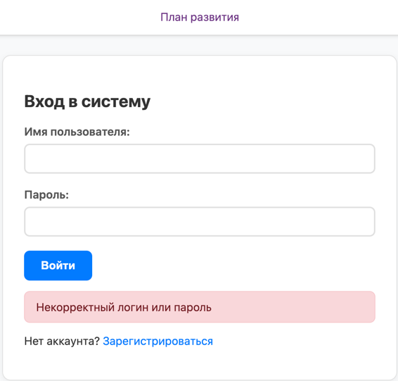



# Страницы входа и выхода

После того как мы настроили главную страницу с проверкой авторизации, нужно реализовать два ключевых
эндпоинта: **вход в систему** (`/auth/login`) и **выход из системы** (`/auth/logout`).
Логин проверяет учётные данные пользователя и выдаёт JWT-токен, а logout инвалидирует токен
(в нашем случае — удаляет его из Redis), чтобы им нельзя было воспользоваться повторно.

## Вход в систему (Login)

### Описание маршрута

Для логина регистрируем новый роут:

```dotty
val login = Route(
  Request.post(Path.root / "auth" / "login")
    .withEntity(Entity.formOf[LoginRequest]),
  Response.ok(Entity.html).orNotFound
)
```

**Разбор маршрута:**

- **`Request.post(Path.root / "auth" / "login")`** — POST-запрос на путь `/auth/login`.
  Логин всегда POST, потому что мы передаём чувствительные данные (пароль) в теле запроса.
- **`.withEntity(Entity.formOf[LoginRequest])`** — тело запроса имеет тип `application/x-www-form-urlencoded`
  и автоматически десериализуется в `LoginRequest`. Это стандартный формат для HTML-форм,
  который отправляет htmx по умолчанию. Krop с помощью `FormCodec[LoginRequest]`
  (кодек, который мы описывали в разделе про модели) превращает пары `username=...&password=...`
  в типизированный объект.
- **`Response.ok(Entity.html).orNotFound`** — успешный ответ (200 OK) с HTML-телом.
  `.orNotFound` — запасной вариант: если что-то пойдёт не так, вернётся 404.
  На практике это редко срабатывает, потому что ошибки обрабатываются внутри хэндлера и возвращаются пользователю в блоке ошибок.

### Хэндлер `LoginHandler`

```dotty
final case class LoginHandler(
    authService: AuthService[IO],
    taskLifecycleService: TaskLifecycleService[IO]
)(using Logger[IO]):
  val handler: Handler =
    Routes.login.handleIO: (request: LoginRequest) =>
      request.parse
        .map { case (username, password) =>
          authService
            .login(username, password)
            .flatMap: (token, id) =>
              getViewWelcome(
                taskLifecycleService = taskLifecycleService,
                user = UserInfo(id, username),
                jwtToken = token,
                tab = DefaultTab
              ).map(_.some)
            .recoverWith:
              case UserNotFound(_) | InvalidPassword(_) =>
                asError()
              case ex =>
                Logger[IO].error(ex)(s"Ошибка: ${ex.getMessage}").as(none)
        }.valueOr(_ => asError())

  private def asError(): IO[Option[String]] =
    View.login("Некорректный логин или пароль".some).toString.some.pure[IO]
end LoginHandler
```

**Пошаговый разбор:**

1. **Зависимости:**
    - `authService: AuthService[IO]` — сервис аутентификации. Умеет проверять логин/пароль
      и генерировать JWT-токен.
    - `taskLifecycleService: TaskLifecycleService[IO]` — сервис для загрузки задач пользователя.
      Нужен, чтобы сразу после логина показать приветственную страницу с задачами.
    - `using Logger[IO]` — логгер для записи ошибок.

2. **`Routes.login.handleIO`** — регистрируем обработчик, принимающий `LoginRequest`.

3. **`request.parse`** — валидируем поля запроса. `LoginRequest.parse` возвращает
   `ValidatedNec[String, (UserName, Password)]`:
   ```dotty
   def parse: ValidatedNec[String, (UserName, Password)] =
      (
        UserName.either(request.username).left.map(er =>
          s"Логин: $er"
        ).toValidatedNec,
        Password.either(request.password).left.map(er =>
          s"Пароль: $er"
        ).toValidatedNec
      ).mapN((a, b) => (a, b))
   ```
    - Если поля пустые или не соответствуют ограничениям — возвращается ошибка.
    - Если всё в порядке — возвращается пара `(UserName, Password)`.

4. **`.map { case (username, password) => ... }`** — если валидация прошла успешно,
   вызываем `authService.login(username, password)`.

5. **`authService.login`** — проверяет пользователя в БД:
    - Если пользователь найден и пароль верный — возвращает `(JwtToken, UserId)`.
    - Если пользователь не найден — выбрасывает `UserNotFound`.
    - Если пароль неверный — выбрасывает `InvalidPassword`.

6. **`.flatMap: (token, id) => ...`** — при успехе формируем приветственную страницу
   через `getViewWelcome` (та же функция, что использовалась в `InitialHandler`).
   Оборачиваем результат в `Option` через `.some`.

7. **`.recoverWith`** — обработка ошибок:
    - **`UserNotFound` / `InvalidPassword`** — возвращаем форму логина с сообщением
      «Некорректный логин или пароль».
    - **Любое другое исключение** — логируем и возвращаем `None`.

8. **`.valueOr(_ => asError())`** — обрабатывает случай, когда `request.parse` вернул ошибку.
   Например, если пользователь отправил пустую форму. В этом случае тоже показываем форму
   логина с сообщением об ошибке.

9. **`asError()`** — возвращает `Option[String]`, содержащий HTML-страницу логина с сообщением
   об ошибке. Это значение передаётся в `hx-target="#app"` и заменяет содержимое главного контейнера.

**Особенность возвращаемого типа `IO[Option[String]]`:**

Хэндлер возвращает `IO[Option[String]]`, где `Some(html)` — HTML для отображения, `None` —
сигнал о том, что нужно показать 404 страницу (`.orNotFound` в роуте).

### Обработка ошибок

Если пользователь ввёл неверный логин или пароль, он увидит форму входа с сообщением об ошибке:



Сообщение формируется в `asError()`:

```dotty
private def asError(): IO[Option[String]] =
  View.login("Некорректный логин или пароль".some).toString.some.pure[IO]
```

Обратите внимание: сообщение **одинаково** и для несуществующего пользователя, и для
неверного пароля. Это осознанное решение для безопасности: злоумышленник не может
перебором логинов определить, какие пользователи зарегистрированы в системе.

## Выход из системы (Logout)

### Описание маршрута

```dotty
val logout = Route(
  Request.post(Path.root / "auth" / "logout").extractHeader[Authorization],
  Response.ok(Entity.html).orNotFound
)
```

**Разбор маршрута:**

- **`Request.post(Path.root / "auth" / "logout")`** — POST-запрос на `/auth/logout`.
  Выход должен быть POST, а не GET, потому что это изменяющая операция (инвалидация токена).
  GET-запросы должны быть идемпотентными и не менять состояние.
- **`.extractHeader[Authorization]`** — извлекает HTTP-заголовок `Authorization` из запроса.
  Именно там передаётся JWT-токен: `Authorization: Bearer <token>`.

### Хэндлер `LogoutHandler`

```dotty
final case class LogoutHandler(
    authService: AuthService[IO],
    middleware: JwtAuthMiddleware[IO, UserInfo]
)(using Logger[IO]) extends AuthorizationHandler(middleware):
  val handler: Handler =
    Routes.logout.handleIO:
      handleUserIO: (user: UserInfo, token: JwtToken) =>
        authService.logout(token, user.username)
          .as(View.login(none).toString)
```

**Пошаговый разбор:**

1. **`extends AuthorizationHandler(middleware)`** — наследуемся от базового класса
   `AuthorizationHandler`, который инкапсулирует логику проверки токена. Это избавляет
   от необходимости вручную извлекать токен из заголовка и валидировать его в каждом хэндлере.

2. **`handleUserIO: (user: UserInfo, token: JwtToken) => ...`** — специальный метод,
   который:
    - Проверяет токен через middleware.
    - Если токен валиден — передаёт в лямбду `user` (информация о пользователе)
      и `token` (сам JWT-токен).
    - Если невалиден — автоматически возвращает ошибку `AuthorizationException`,
      которую обрабатывает `AuthorizationHandler`.

3. **`authService.logout(token, user.username)`** — инвалидирует токен. В нашей реализации
   это означает удаление токена из Redis (хранилища активных сессий).
   После этого токен нельзя будет использовать повторно.

4. **`.as(View.login(none).toString)`** — после успешного выхода возвращаем страницу логина.
   `none` означает, что сообщения об ошибке нет.

**Возвращаемый тип `IO[String]`:**

Здесь хэндлер возвращает `IO[String]` — просто HTML-страницу логина. После выхода
пользователь видит форму входа, как будто он только что зашёл на сайт.

### Базовый класс `AuthorizationHandler`

`AuthorizationHandler` — это вспомогательный трейт, который инкапсулирует логику
проверки токена. Он используется всеми защищёнными хэндлерами (настройки, задачи, таймер и т.д.).

Типичная реализация выглядит так:

```dotty
trait AuthorizationHandler(middleware: JwtAuthMiddleware[IO, UserInfo])(using
    Logger[IO]
):
  def handleUserIO(f: ((UserInfo, JwtToken)) => IO[String])
      : Authorization => IO[Option[String]] =
    handleUserIOOpt(a => f(a).map(_.some))

  def handleUserIOOpt(f: ((UserInfo, JwtToken)) => IO[Option[String]])
      : Authorization => IO[Option[String]] =
    (authorization: Authorization) =>
      middleware
        .run(authorization)
        .flatMap(f)
        .recoverWith:
          case ex: AuthorizationException =>
            Logger[IO].error(ex)(
              s"Ошибка при парсинге токена: ${ex.getMessage}"
            )
              .as(
                View.login("Возникла ошибка авторизации".some).toString.some
              )
          case ex =>
            Logger[IO].error(ex)(s"Ошибка: ${ex.getMessage}").as(none)

  def handleUserIOByToken(f: ((UserInfo, JwtToken)) => IO[String])
      : String => IO[Option[String]] =
    handleUserIOByTokenOpt(a => f(a).map(_.some))

  def handleUserIOByTokenOpt(f: ((UserInfo, JwtToken)) => IO[Option[String]])
      : String => IO[Option[String]] =
    (token: String) =>
      middleware.fromToken.run(token)
        .flatMap(f)
        .recoverWith:
          case ex: AuthorizationException =>
            Logger[IO].error(ex)(
              s"Ошибка при парсинге токена: ${ex.getMessage}"
            )
              .as(
                View.login("Возникла ошибка авторизации".some).toString.some
              )
          case ex =>
            Logger[IO].error(ex)(s"Ошибка: ${ex.getMessage}").as(none)
end AuthorizationHandler
```

**Что делает:**

1. Вызывает middleware для проверки токена.
2. Если токен валиден — передаёт `(user, token)` в пользовательскую функцию `f`.
3. Если заголовка нет или токен невалиден, то происходит переход на форму логина с соответствующей ошибкой.

**Преимущества такого подхода:**

- **Единообразие**: все защищённые хэндлеры используют один и тот же механизм проверки.
- **Безопасность по умолчанию**: если разработчик забыл проверить токен — компилятор
  заставит его использовать `handleUserIO`, потому что обычный `handleIO` не даст доступ
  к `UserInfo`.
- **Меньше кода**: не нужно в каждом хэндлере писать одно и то же извлечение заголовка.

## Регистрация хэндлеров в Main

После создания `LoginHandler` и `LogoutHandler` добавляем их в цепочку обработчиков:

```dotty
val loginHandler  = LoginHandler(authService, services.taskLifecycleService)
val logoutHandler = LogoutHandler(authService, middleware)

initialHandler.handler
  .orElse(loginHandler.handler)
  .orElse(logoutHandler.handler)
  .orElse(healthHandler.handler)
  .orElse(assets)
  .orElse(Application.notFound)
```

## Итог

Мы реализовали два ключевых эндпоинта для аутентификации:

1. **`/auth/login`** — принимает логин и пароль в формате `application/x-www-form-urlencoded`,
   проверяет их через `AuthService`, генерирует JWT-токен и показывает приветственную
   страницу с задачами. При ошибке показывает форму логина с сообщением.

2. **`/auth/logout`** — принимает JWT-токен в заголовке `Authorization`, инвалидирует его
   через `AuthService` (удаляет из Redis), после чего возвращает страницу логина.

Оба эндпоинта используют htmx для замены содержимого страницы без перезагрузки:
клиент отправляет запрос, сервер возвращает HTML, htmx подставляет его в `#app`.

**Ключевые архитектурные решения:**

- **Форма логина** не различает «пользователь не найден» и «неверный пароль» — это защита
  от перебора логинов.
- **`AuthorizationHandler`** инкапсулирует проверку токена и делает код защищённых
  хэндлеров лаконичным.
- **Единый интерфейс `Handler`** — упрощает их композицию через `orElse`.

---

**Ссылки:**

- [Персональный план развития][plugin]
- [Репозиторий с исходниками][repo]

[repo]: https://gitverse.ru/scalabook/pdp
[plugin]: https://artemkorsakov.github.io/personal-development-plan/ru/
