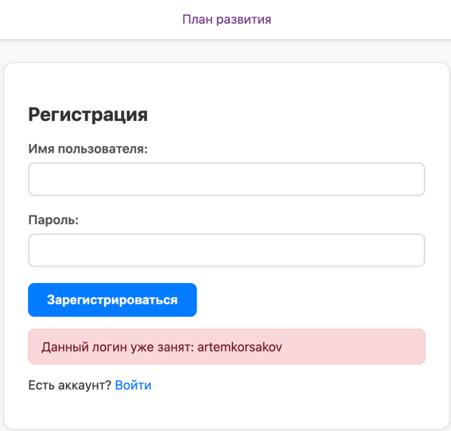



# Регистрация пользователя

Регистрация — это первый шаг, который проходит новый пользователь при знакомстве с приложением.

## Форма регистрации

### Маршрут

```dotty
val register =
  Route(
    Request.get(Path.root / "register"),
    Response.ok(Entity.html)
  )
```

**Разбор маршрута:**

- **`Request.get(Path.root / "register")`** — GET-запрос на путь `/register`.
  Это простая отдача статической формы — никаких данных от пользователя мы не получаем.
- **`Response.ok(Entity.html)`** — успешный ответ (200 OK) с HTML-телом.

### Хэндлер `RegisterHandler`

```dotty
object RegisterHandler:
  val handler: Handler =
    Routes.register.handle { () =>
      View.register(None).toString
    }
```

**Разбор хэндлера:**

- **`object RegisterHandler`** — это `object`, а не `case class`, потому что у хэндлера
  нет зависимостей. Он просто отдаёт статический HTML.
- **`Routes.register.handle`** — используем `handle`, а не `handleIO`, потому что
  логика чистая: никаких эффектов (`IO`) не требуется, только рендер шаблона.
- **`() => ...`** — лямбда без аргументов, потому что запрос не содержит параметров.
- **`View.register(None)`** — рендерим Twirl-шаблон `register.scala.html`, передавая `None`
  в качестве сообщения об ошибке. Это значит «ошибки нет, показываем чистую форму».

### Шаблон `register.scala.html`

```html
@import ru.scalabook.pdp.frontend.Views.DefaultTab

@(errorMessage: Option[String])
<div id="app" class="app-container-narrow">
    <h2>Регистрация</h2>

    <form id="registerForm">
        <div class="form-group">
            <label for="username">Имя пользователя:</label>
            <input id="username" name="username" type="text" required/>
        </div>
        <div class="form-group">
            <label for="password">Пароль:</label>
            <input id="password" name="password" type="password" required/>
        </div>
        <button
                type="button"
                hx-post="/new_user"
                hx-target="#app"
                hx-swap="outerHTML"
        >Зарегистрироваться
        </button>
    </form>

    <div class="messageBlock">
        @errorMessage.map { msg =>
        <div class="error">@msg</div>
        }
    </div>

    <p>
        Есть аккаунт?
        <a href="/">Войти</a>
    </p>
</div>
```

**Ключевые моменты:**

1. **`@(errorMessage: Option[String])`** — параметр шаблона. Если ошибка есть — показываем её под формой.
2. **Форма регистрации** — два поля: `username` и `password`. Оба обязательны (`required`).
3. **Кнопка «Зарегистрироваться»** — использует htmx:
    - `hx-post="/new_user"` — отправляет POST-запрос на `/new_user`.
    - `hx-target="#app"` — ответ сервера заменяет содержимое блока `#app`.
    - `hx-swap="outerHTML"` — заменяет весь блок, а не только его содержимое.
4. **Блок `messageBlock`** — опциональное сообщение об ошибке (например, «Логин уже занят»).
5. **Ссылка «Войти»** — использует htmx:
    - `onclick="htmx.process(this); this.click();"` — обязательный трюк: сначала htmx
      обрабатывает элемент (навешивает обработчики), затем программно вызывается клик.
      Без этого htmx-атрибуты могут не сработать после динамической подстановки HTML.
    - `hx-get="/home/@DefaultTab"` — GET-запрос на `/home/in-progress`.
    - `hx-target="#app"` — заменяет содержимое `#app` на страницу входа.

Открывается такая форма:


## Создание нового пользователя

Когда пользователь заполнил форму и нажал «Зарегистрироваться», htmx отправляет POST-запрос
на `/new_user`. Здесь происходит вся логика создания нового пользователя.

### Маршрут

```dotty
val newUser = Route(
  Request.post(Path.root / "new_user")
    .withEntity(Entity.formOf[LoginRequest]),
  Response.status(HttpStatus.Created, Entity.html)
    .orElse(Response.status(HttpStatus.Ok, Entity.html))
    .orNotFound
)
```

**Разбор маршрута:**

- **`Request.post(Path.root / "new_user")`** — POST-запрос на `/new_user`.
- **`.withEntity(Entity.formOf[LoginRequest])`** — тело запроса в формате
  `application/x-www-form-urlencoded`, десериализуется в `LoginRequest`.
  Мы переиспользуем `LoginRequest`, потому что поля те же: `username` и `password`.
- **`Response.status(HttpStatus.Created, Entity.html)`** — успешный ответ `201 Created`.
  Это правильный статус для создания нового ресурса (пользователя).
- **`.orElse(Response.status(HttpStatus.Ok, Entity.html))`** — запасной вариант `200 OK`,
  если возникла ошибка при регистрации и её нужно отобразить пользователю.
- **`.orNotFound`** — 404, если ничего не совпало.

### Хэндлер `NewUserHandler`

```dotty
final case class NewUserHandler(
    authService: AuthService[IO],
    taskLifecycleService: TaskLifecycleService[IO]
)(using Logger[IO]):
  val handler: Handler =
    Routes.newUser.handleIO {
      (request: LoginRequest) =>
        UserRegistration.parse(request)
          .map { registration =>
            authService
              .newUser(registration.username, registration.password)
              .flatMap: (token, id) =>
                getViewWelcome(
                  taskLifecycleService = taskLifecycleService,
                  user = UserInfo(id, registration.username),
                  jwtToken = token,
                  tab = DefaultTab
                ).map(_.asRight.some)
              .recoverWith:
                case UserNameInUse(username) =>
                  asError(s"Данный логин уже занят: $username")
                case ex =>
                  Logger[IO].error(ex)(s"Ошибка: ${ex.getMessage}").as(none)
          }.valueOr(errors => asError(errors.mkString_(";")))
    }

  private def asError(error: String): IO[Option[Either[String, String]]] =
    View.register(error.some).toString.asLeft.some.pure[IO]
```

**Пошаговый разбор:**

1. **`UserRegistration.parse(request)`** — валидируем поля запроса. Раньше для этого был
   отдельный расширяющий объект `Parser` с методом `request.parse` (удалён в `f186beb`).
   Теперь это метод компаньона, возвращает `ValidatedNec[String, UserRegistration]`:
    - Если `username` или `password` пустые, слишком короткие или длинные — ошибка.
    - Если всё в порядке — `UserRegistration(username, password)`.
2. **`.map { registration => ... }`** — при успешной валидации вызываем
   `authService.newUser(registration.username, registration.password)`.
3. **`authService.newUser`** — создаёт пользователя в БД:
    - Если логин свободен — создаёт пользователя и возвращает `(JwtToken, UserId)`.
    - Если логин занят — выбрасывает `UserNameInUse(username)`.
    - Другие ошибки (например, проблема с БД) — обычные исключения.
4. **`.flatMap: (token, id) => ...`** — при успехе формируем приветственную страницу
   через `getViewWelcome`, оборачиваем результат в `Right` и `Some`.
5. **`.recoverWith`** — обработка ошибок:
    - **`UserNameInUse(username)`** — возвращаем форму регистрации с сообщением
      «Данный логин уже занят: {username}».
    - **Любое другое исключение** — логируем и возвращаем `None`.
6. **`.valueOr(errors => asError(errors.mkString_(";")))`** — если `UserRegistration.parse` вернул ошибку
   (например, пустой логин), формируем форму регистрации с сообщением об ошибке.
   `errors.mkString_(";")` объединяет все ошибки в одну строку через `;`.

**Особенность возвращаемого типа `IO[Option[Either[String, String]]]`:**

Это сложный тип, который кодирует три возможных состояния:

| Тип                 | Значение             | Код ответа | Что означает                                                  |
| ------------------- | -------------------- | -----------| ------------------------------------------------------------- |
| `Some(Right(html))` | Успех                | 201        | Регистрация прошла, показываем welcome-страницу               |
| `Some(Left(html))`  | Ошибка бизнес-логики | 200        | Логин занят или невалидные данные, показываем форму с ошибкой |
| `None`              | Внутренняя ошибка    | 404        | Что-то пошло не так, возвращаем 404 страницу                  |

Такая структура позволяет **htmx-клиенту** различать успех и ошибку: например, при успехе
можно сразу перейти на главную страницу, а при ошибке — показать сообщение.

**Метод `asError`:**

```dotty
private def asError(error: String): IO[Option[Either[String, String]]] =
  View.register(error.some).toString.asLeft.some.pure[IO]
```

Возвращает форму регистрации с сообщением об ошибке, обёрнутую в `Left` и `Some`.
Это сигнал клиенту: «регистрация не удалась, покажи форму с ошибкой».

## Полный поток регистрации

Рассмотрим сценарий от начала до конца:

1. **Пользователь открывает `/register`** → `RegisterHandler` отдаёт форму регистрации.
2. **Пользователь заполняет поля и нажимает «Зарегистрироваться»** → htmx отправляет
   POST на `/new_user`.
3. **Сервер валидирует данные** → если логин/пароль не соответствуют ограничениям,
   возвращается форма с ошибкой.
4. **Сервер создаёт пользователя** → если логин свободен, `AuthService.newUser`
   создаёт запись в БД и генерирует JWT-токен.
5. **Сервер формирует welcome-страницу** → показывает пользователю его рабочий стол
   (пока пустой).
6. **htmx подставляет HTML** → в блок `#app` вставляется приветственная страница.
   URL в браузере не меняется (htmx не обновляет адресную строку автоматически).
7. **Пользователь авторизован** → при следующих визитах на `/` токен из куки подхватится
   автоматически, и пользователь сразу увидит свой рабочий стол.

## Обработка ошибок

### Логин занят

Если пользователь попытался зарегистрироваться с логином, который уже существует,
он увидит форму с сообщением:

```
Данный логин уже занят: artemkorsakov
```

Это сообщение формируется в `.recoverWith`:

```dotty
case UserNameInUse(username) =>
  asError(s"Данный логин уже занят: $username")
```



**Важно:** мы показываем имя занятого логина, чтобы пользователь мог выбрать другое.
Это отличается от случая со входом в систему (где мы скрываем, существует ли пользователь),
потому что при регистрации сокрытие не имеет смысла — пользователь и так знает,
какой логин он вводит.

### Невалидные данные

Если логин или пароль не проходят валидацию (например, слишком короткие),
показывается форма с сообщением об ошибке.
Ошибки накапливаются в `Validated` и объединяются через `;`.


### Внутренние ошибки

Если произошла внутренняя ошибка (например, БД недоступна), пользователь увидит 404 страницу (`None`), 
а в лог запишется подробная информация.

## Итог

Мы реализовали полный цикл регистрации пользователя:

- **`/register`** — отдаёт форму регистрации.
- **`/new_user`** — принимает данные формы, создаёт пользователя, генерирует JWT-токен
  и показывает welcome-страницу.

**Ключевые архитектурные решения:**

- **Переиспользование `LoginRequest`** — форма регистрации и форма логина имеют одинаковые
  поля, поэтому мы используем один и тот же тип для десериализации.
- **Тип `IO[Option[Either[String, String]]]`** — кодирует три состояния (успех / ошибка
  бизнес-логики / внутренняя ошибка) и позволяет клиенту различать их.
- **htmx для интерактивности** — все переходы и отправки форм происходят без перезагрузки
  страницы. Пользователь видит мгновенную реакцию на свои действия.
- **Валидация на нескольких уровнях** — `UserRegistration.parse` проверяет формат данных,
  `authService.newUser` — бизнес-правила (например, уникальность логина).
- **Единый механизм ошибок** — все ошибки возвращаются в виде HTML-формы с сообщением,
  что упрощает обработку на клиенте.

После регистрации пользователь автоматически авторизован: JWT-токен записан в куки,
и при следующем визите `InitialHandler` сразу покажет ему рабочий стол.

---

**Ссылки:**

- [Репозиторий с исходниками][repo]

[repo]: https://gitverse.ru/scalabook/pdp
