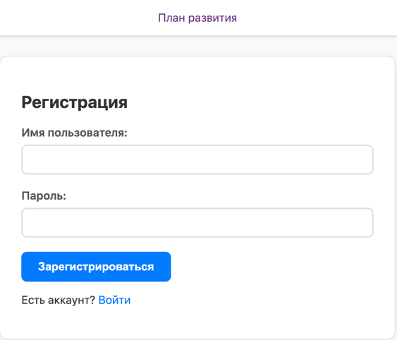
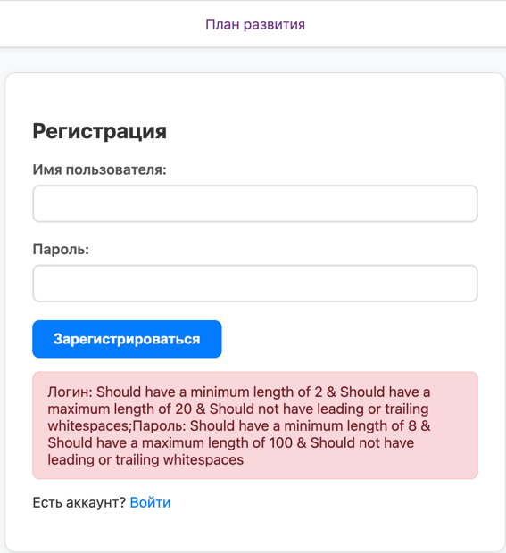

# Регистрация пользователя

Регистрация — это первый шаг, который проходит новый пользователь при знакомстве с приложением.

## Форма регистрации

### Маршрут

Каждый хэндлер объявляет свои маршруты у себя. Для формы регистрации маршрут объявляется как приватная
переменная `formRoute` внутри `RegisterHandler`:

```dotty
private val formRoute =
  Route(
    Request.get(Path.root / "register"),
    Response.ok(Entity.html)
  )
```

**Разбор маршрута:**

- **`Request.get(Path.root / "register")`** — GET-запрос на путь `/register`.
  Это простая отдача статической формы — никаких данных от пользователя мы не получаем.
- **`Response.ok(Entity.html)`** — успешный ответ (200 OK) с HTML-телом.

### Хэндлер `RegisterHandler`

Хэндлера создания пользователя `RegisterHandler` владеет **двумя** обработчиками: 
`formHandler` (отдача формы) и `registerHandler` (обработка POST-запроса).

```dotty
final case class RegisterHandler(
    authService: AuthService[IO],
    taskLifecycleService: TaskLifecycleService[IO]
)(using Logger[IO]):
  private val formRoute =
    Route(
      Request.get(Path.root / "register"),
      Response.ok(Entity.html)
    )

  val formHandler: Handler =
    formRoute.handle(() => View.register(none).render)
```

Фрагмент из `Main.scala`, где оба обработчика регистрируются:

```dotty
.orElse(registerHandler.formHandler)
.orElse(registerHandler.registerHandler)
```

**Разбор хэндлера:**

- **`final case class RegisterHandler`** — это `case class`, потому что
  хэндлеру создания пользователя нужны зависимости (`authService`, сервисы для welcome-страницы).
  Форма и создание пользователя живут в одном хэндлере.
- **`private val formRoute`** — маршрут объявлен внутри хэндлера (маршруты вынесены из `Routes.scala`).
- **`formRoute.handle`** — используем `handle`, а не `handleIO`, потому что
  логика чистая: никаких эффектов (`IO`) не требуется, только рендер шаблона.
- **`() => ...`** — лямбда без аргументов, потому что запрос не содержит параметров.
- **`View.register(none).render`** — вызываем метод `Views.register` с `None` в качестве
  сообщения об ошибке (`Frag`), затем `.render` превращает его в HTML-строку.
  Это значит «ошибки нет, показываем чистую форму».
- **`formHandler` / `registerHandler`** — два отдельных `Handler`, каждый со своим маршрутом.
  В `Main.scala` они подключаются через `.orElse`.

### Рендер формы `Views.register`

Метод `Views.register` — это scalatags-функция в объекте `Views`. Она принимает
`errorMessage: Option[String]` и возвращает `Frag` (scalatags-фрагмент, который можно
превратить в HTML через `.render`). Рендерится:

- Обёртка `<div id="app" class="app-container-narrow">`.
- Заголовок `<h2>Регистрация</h2>`.
- Форма — результат `LoginRequest.render("registerForm", "/register/new", "Зарегистрироваться")`:
  поля `username` и `password`, кнопка с `hx-post="/register/new"`, `hx-target="#app"`,
  `hx-swap="outerHTML"`.
- Блок ошибок `errorBlock(errorMessage)`.
- Ссылка: `p("Есть аккаунт?", a(href := "/")("Войти"))` — обычный anchor, не htmx.

**Ключевые моменты:**

1. **`Views.register(errorMessage: Option[String])`** — метод объекта `Views`.
   Если ошибка есть — показываем её под формой.
2. **Форма регистрации** — два поля: `username` и `password`. Оба обязательны (`required`).
   Рендерится через `LoginRequest.render("registerForm", "/register/new", "Зарегистрироваться")`.
3. **Кнопка «Зарегистрироваться»** — использует htmx:
     - `hx-post="/register/new"` — отправляет POST-запрос на `/register/new`.
     - `hx-target="#app"` — ответ сервера заменяет содержимое блока `#app`.
     - `hx-swap="outerHTML"` — заменяет весь блок, а не только его содержимое.
4. **Блок `errorBlock`** — опциональное сообщение об ошибке (например, «Логин уже занят»).
5. **Ссылка «Войти»** — обычный `<a href="/">Войти</a>`, не htmx.

Открывается такая форма:



## Создание нового пользователя

Когда пользователь заполнил форму и нажал «Зарегистрироваться», htmx отправляет POST-запрос
на `/register/new`. Здесь происходит вся логика создания нового пользователя.

### Маршрут

Маршрут для создания пользователя объявлен в том же `RegisterHandler` как приватная
переменная `registerRoute`:

```dotty
private val registerRoute = Route(
  Request.post(Path.root / "register" / "new")
    .withEntity(Entity.formOf[LoginRequest]),
  Response.status(HttpStatus.Created, Entity.html)
    .orElse(Response.status(HttpStatus.Ok, Entity.html))
)
```

**Разбор маршрута:**

- **`Request.post(Path.root / "register" / "new")`** — POST-запрос на `/register/new`.
- **`.withEntity(Entity.formOf[LoginRequest])`** — тело запроса в формате
  `application/x-www-form-urlencoded`, десериализуется в `LoginRequest`.
  Мы переиспользуем `LoginRequest`, потому что поля те же: `username` и `password`.
- **`Response.status(HttpStatus.Created, Entity.html)`** — успешный ответ `201 Created`.
  Это правильный статус для создания нового ресурса (пользователя).
- **`.orElse(Response.status(HttpStatus.Ok, Entity.html))`** — запасной вариант `200 OK`,
  если возникла ошибка при регистрации и её нужно отобразить пользователю.

### Хэндлер `RegisterHandler` (создание пользователя)

```dotty
final case class RegisterHandler(
    authService: AuthService[IO],
    taskLifecycleService: TaskLifecycleService[IO],
    periodicTaskLifecycleService: PeriodicTaskLifecycleService[IO],
    notesService: NotesService[IO],
    historyService: HistoryService[IO]
)(using Logger[IO]):
  // ...
  val registerHandler: Handler =
    registerRoute.handleIO {
      (request: LoginRequest) =>
        UserRegistration.parse(request)
          .map { registration =>
            authService
              .newUser(registration.username, registration.password)
              .flatMap: (token, id) =>
                getViewWelcome(
                  taskLifecycleService = taskLifecycleService,
                  periodicTaskLifecycleService = periodicTaskLifecycleService,
                  notesService = notesService,
                  historyService = historyService,
                  user = UserInfo(id, registration.username),
                  jwtToken = token,
                  tab = DefaultTab
                ).map(_.asRight)
              .recoverWith:
                case UserNameInUse(username) =>
                  asError(s"Данный логин уже занят: $username")
                case ex =>
                  Logger[IO].error(ex)(s"Ошибка: ${ex.getMessage}") *>
                    asError("Произошла ошибка при регистрации.")
          }.valueOr(errors => asError(errors.mkString_(";")))
    }

  private def asError(error: String): IO[Either[String, String]] =
    View.register(error.some).render.asLeft.pure[IO]
```

**Пошаговый разбор:**

1. **`UserRegistration.parse(request)`** — валидируем поля запроса. Раньше для этого был
   отдельный расширяющий объект `Parser` с методом `request.parse` (удалён в `f186beb`).
   Теперь это метод компаньона, возвращает `ValidatedNec[String, UserRegistration]`:
    - Если `username` или `password` пустые, слишком короткие или длинные — ошибка.
    - Если всё в порядке — `UserRegistration(username, password)`.
2. **`.map { registration => ... }`** — при успешной валидации вызываем
   `authService.newUser(registration.username, registration.password)`.
3. **`authService.newUser`** — создаёт пользователя в БД:
    - Если логин свободен — создаёт пользователя и возвращает `(JwtToken, UserId)`.
    - Если логин занят — выбрасывает `UserNameInUse(username)`.
    - Другие ошибки (например, проблема с БД) — обычные исключения.
4. **`.flatMap: (token, id) => ...`** — при успехе формируем приветственную страницу
   через `getViewWelcome`, оборачиваем результат в `Right`.
5. **`.recoverWith`** — обработка ошибок:
    - **`UserNameInUse(username)`** — возвращаем форму регистрации с сообщением
      «Данный логин уже занят: {username}».
    - **Любое другое исключение** — логируем и возвращаем форму с сообщением
      «Произошла ошибка при регистрации».
6. **`.valueOr(errors => asError(errors.mkString_(";")))`** — если `UserRegistration.parse` вернул ошибку
   (например, пустой логин), формируем форму регистрации с сообщением об ошибке.
   `errors.mkString_(";")` объединяет все ошибки в одну строку через `;`.

**Особенность возвращаемого типа `IO[Either[String, String]]`:**

Этот тип кодирует два возможных состояния:

| Тип                 | Значение             | Код ответа | Что означает                                                  |
| ------------------- | -------------------- | -----------| ------------------------------------------------------------- |
| `Right(html)`       | Успех                | 201        | Регистрация прошла, показываем welcome-страницу               |
| `Left(html)`        | Ошибка                | 200        | Логин занят или невалидные данные, показываем форму с ошибкой |

Благодаря этому **htmx-клиенту** проще различать результат: при успехе возвращается `201 Created`,
при ошибке — `200 OK` с формой и сообщением. Отдельного кодирования «внутренней ошибки» больше нет —
любое исключение приводит к форме с ошибкой (статус `200`).

**Метод `asError`:**

```dotty
private def asError(error: String): IO[Either[String, String]] =
  View.register(error.some).render.asLeft.pure[IO]
```

Возвращает форму регистрации с сообщением об ошибке, обёрнутую в `Left`.
Это сигнал клиенту: «регистрация не удалась, покажи форму с ошибкой».

## Полный поток регистрации

Рассмотрим сценарий от начала до конца:

1. **Пользователь открывает `/register`** → `RegisterHandler.formHandler` отдаёт форму регистрации.
2. **Пользователь заполняет поля и нажимает «Зарегистрироваться»** → htmx отправляет
   POST на `/register/new`.
3. **Сервер валидирует данные** → если логин/пароль не соответствуют ограничениям,
   возвращается форма с ошибкой.
4. **Сервер создаёт пользователя** → если логин свободен, `AuthService.newUser`
   создаёт запись в БД и генерирует JWT-токен.
5. **Сервер формирует welcome-страницу** → показывает пользователю его рабочий стол
   (пока пустой).
6. **htmx подставляет HTML** → в блок `#app` вставляется приветственная страница.
   URL в браузере не меняется (htmx не обновляет адресную строку автоматически).
7. **Пользователь авторизован** → при следующих визитах на `/` токен из куки подхватится
   автоматически, и пользователь сразу увидит свой рабочий стол.

## Обработка ошибок

### Логин занят

Если пользователь попытался зарегистрироваться с логином, который уже существует,
он увидит форму с сообщением:

```
Данный логин уже занят: artemkorsakov
```

Это сообщение формируется в `.recoverWith`:

```dotty
case UserNameInUse(username) =>
  asError(s"Данный логин уже занят: $username")
```


**Важно:** мы показываем имя занятого логина, чтобы пользователь мог выбрать другое.
Это отличается от случая со входом в систему (где мы скрываем, существует ли пользователь),
потому что при регистрации сокрытие не имеет смысла — пользователь и так знает,
какой логин он вводит.

### Невалидные данные

Если логин или пароль не проходят валидацию (например, слишком короткие),
показывается форма с сообщением об ошибке.
Ошибки накапливаются в `Validated` и объединяются через `;`.



### Внутренние ошибки

Если произошла внутренняя ошибка (например, БД недоступна), в лог запишется подробная
информация, а пользователь увидит форму регистрации с сообщением
«Произошла ошибка при регистрации».

## Итог

Мы реализовали полный цикл регистрации пользователя:

- **`/register`** — отдаёт форму регистрации (`formHandler`).
- **`/register/new`** — принимает данные формы, создаёт пользователя, генерирует JWT-токен
  и показывает welcome-страницу (`registerHandler`).

**Ключевые архитектурные решения:**

- **Переиспользование `LoginRequest`** — форма регистрации и форма логина имеют одинаковые
  поля, поэтому мы используем один и тот же тип для десериализации.
- **Два обработчика в одном `RegisterHandler`** — `formHandler` (отдача формы) и
  `registerHandler` (создание пользователя) объединены в один хэндлер с двумя маршрутами.
- **Тип `IO[Either[String, String]]`** — кодирует два состояния (успех / ошибка) —
  `Right` даёт `201 Created`, `Left` даёт `200 OK` с формой и сообщением об ошибке.
- **htmx для интерактивности** — все переходы и отправки форм происходят без перезагрузки
  страницы. Пользователь видит мгновенную реакцию на свои действия.
- **Валидация на нескольких уровнях** — `UserRegistration.parse` проверяет формат данных,
  `authService.newUser` — бизнес-правила (например, уникальность логина).
- **Единый механизм ошибок** — все ошибки возвращаются в виде HTML-формы с сообщением,
  что упрощает обработку на клиенте.

После регистрации пользователь автоматически авторизован: JWT-токен записан в куки,
и при следующем визите `InitialHandler` сразу покажет ему рабочий стол.

---

**Ссылки:**

- [Репозиторий с исходниками][repo]

[repo]: https://gitverse.ru/scalabook/pdp
