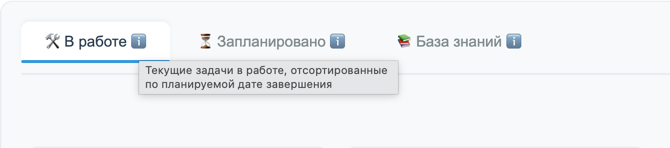
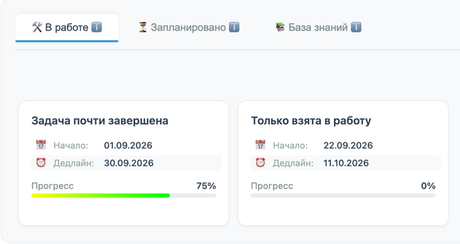
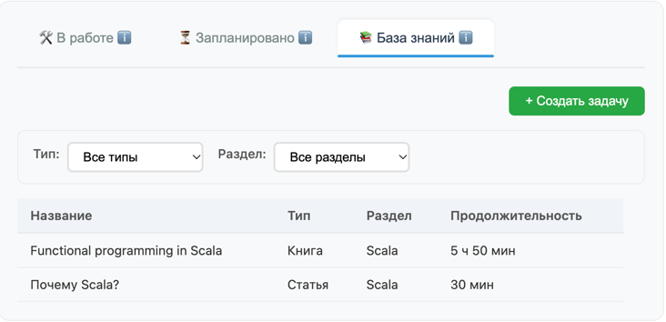

# Рендер представления «Рабочий стол»

`views/Views.scala` — объект со всеми рендер-методами приложения в [репозитории](https://gitverse.ru/scalabook/pdp/content/master/pdp/src/main/scala/ru/scalabook/pdp/views/Views.scala).

Это рабочий стол пользователя, куда он попадает после авторизации.
Метод `Views.welcome` рендерит восемь вкладок (задачи в разных статусах, цели, статистику,
источники, заметки, историю), кнопки управления (настройки и выход), а также служит
«хостом» для всех модальных окон.

Основная задача метода — быть **единым экраном** для работы с задачами: пользователь видит
свой прогресс, может переключаться между вкладками, фильтровать задачи по типу, разделу
и цели, создавать новые задачи, открывать существующие и управлять их статусами. Всё это
происходит без перезагрузки страницы благодаря htmx.

Сам метод `Views.welcome` не содержит логики отображения вкладок — он лишь **компонует**
уже готовые HTML-фрагменты, которые формируются отдельными методами-рендерерами:

- `Views.welcomeInProgress` — вкладка «В работе»;
- `Views.welcomePlanned` — вкладка «Запланировано»;
- `Views.welcomeKnowledgeBase` — вкладка «База знаний»;
- `Views.goalsStats` — вкладка «Цели»;
- `Views.statistics` — вкладка «Статистика»;
- `Views.welcomeSources` — вкладка «Источник»;
- `Views.welcomeNotes` — вкладка «Заметки»;
- `Views.history` — вкладка «История».

## Импорты и параметры

```dotty
import ru.scalabook.pdp.views.Views
import dev.profunktor.auth.jwt.JwtToken

def welcome(
    username: String,
    token: JwtToken,
    tab: String,
    inProgress: Modifier,
    planned: Modifier,
    knowledgeBase: Modifier,
    goals: Modifier,
    statistics: Modifier,
    sources: Modifier,
    notes: Modifier,
    history: Modifier
): Frag
```

**Импорт:**

- **`JwtToken`** — тип JWT-токена. Передаётся в `Views.welcome`, чтобы рендер
  сохранил его в куки и заголовки через невидимый iframe.
- **`Views`** — объект со всеми рендер-методами. В handlers импортируется напрямую:
  `import ru.scalabook.pdp.views.Views`.

**Параметры метода:**

| Параметр        | Тип      | Назначение                                                                               |
| --------------- | -------- | ---------------------------------------------------------------------------------------- |
| `username`      | `String` | Имя пользователя для приветствия. Отображается в шапке: «Добро пожаловать, $username!»    |
| `token`         | `JwtToken`| JWT-токен. Используется кнопкой «Выход» и сохранением в куки                              |
| `tab`           | `String` | Текущая активная вкладка: `"in-progress"`, `"planned"`, `"knowledge-base"`, `"goals"`, `"statistics"`, `"sources"`, `"notes"`, `"history"` |
| `inProgress`    | `Modifier` | Готовый кусок вкладки «В работе» (метод `Views.welcomeInProgress`)                         |
| `planned`       | `Modifier` | Готовый кусок вкладки «Запланировано» (метод `Views.welcomePlanned`)                       |
| `knowledgeBase` | `Modifier` | Готовый кусок вкладки «База знаний» (метод `Views.welcomeKnowledgeBase`)                   |
| `goals`         | `Modifier` | Готовый кусок вкладки «Цели» (метод `Views.goalsStats`)                                    |
| `statistics`    | `Modifier` | Готовый кусок вкладки «Статистика» (метод `Views.statistics`)                              |
| `sources`       | `Modifier` | Готовый кусок вкладки «Источник» (метод `Views.welcomeSources`)                            |
| `notes`         | `Modifier` | Готовый кусок вкладки «Заметки» (метод `Views.welcomeNotes`)                               |
| `history`       | `Modifier` | Готовый кусок вкладки «История» (метод `Views.history`)                                    |

**Почему каждый из восьми параметров — это `Modifier`, а не набор данных?**

`Views.welcome` — это **компоновщик**. Он не знает ни о задачах, ни о целях, ни
о статистике: он лишь раскладывает уже готовые scalatags-фрагменты по вкладкам.
Возвращаемый тип `Frag` в хэндлерах превращается в HTML-строку через `.render`.
Это позволяет держать метод тривиальным, а всю логику формирования каждой вкладки
выносить в отдельные рендер-методы и в `WelcomeViews`.

**Почему фильтры вкладок не передаются сюда?**

Списки типов, разделов и целей для фильтров — **локальная** деталь вкладок
«Запланировано» и «База знаний». Каждый такой список готовит `WelcomeViews`
только для той вкладки, где он нужен, и передаёт его в соответствующий метод рендерера.
`Views.welcome` о фильтрах ничего не знает.

## Структура разметки

Разметка организована вокруг контейнера `#app`. Это **ключевой элемент** для htmx:
когда сервер возвращает новую страницу или её фрагмент, htmx заменяет именно содержимое `#app`.

```dotty
frag(
  div(
    `id` := "app",
    cls  := "app-container",
    iframe(
      attr("onload") := s"""saveUserCookies('${token.value}')""",
      style          := "display:none;"
    ),
```

**Разбор структуры:**

- **`#app`** — главный контейнер. Класс `app-container` задаёт широкую ширину
  (на всю страницу), в отличие от `app-container-narrow`, который используется
  на страницах логина и регистрации.
- **`<iframe>`** — технический трюк: невидимый iframe с `onload`, который сохраняет
  токен в `localStorage` и куки при загрузке страницы. Атрибут `style="display:none"`
  скрывает его от пользователя.
- **`#welcomeBlock`** — блок с приветствием, кнопками и вкладками.
- **`#modal-container`** — пустой контейнер, в который htmx будет подгружать модальные окна
  (создание задачи, планирование, старт, завершение и т.д.).

**Почему `#modal-container` вынесен наружу?**

Модальные окна — это оверлеи, которые должны перекрывать **всю** страницу, а не только
её центральную часть. Если бы `#modal-container` был внутри `#welcomeBlock`, то при замене
содержимого `#app` модалки бы «слетали». Вынесение наружу делает их независимыми
от содержимого `#app`.

### Сохранение токена в куки

```dotty
iframe(
  attr("onload") := s"""saveUserCookies('${token.value}')""",
  style          := "display:none;"
)
```

**Зачем это нужно:**

Когда пользователь логинится, сервер устанавливает куку `token` через HTTP-заголовок
`Set-Cookie`. Однако клиентский JavaScript **не всегда** может прочитать эту куку, если
она помечена как `HttpOnly`. Кроме того, при некоторых сценариях (например, при работе
с htmx и замене HTML) куки могут не обновиться.

Этот iframe решает проблему: при загрузке страницы `welcome` он вызывает
`saveUserCookies('${token.value}')`, который:

1. Сохраняет токен в `localStorage` (доступен из JavaScript).
2. Дублирует токен в обычную куку (не `HttpOnly`), доступную из JS.

Так JavaScript-функции (например, `openTask`, `filterPlannedTasks`) могут использовать токен
для запросов.

## Верхняя панель

```dotty
div(
  cls := "welcome-header",
  div(cls := "welcome-user")(
    h2(s"Добро пожаловать, $username!")
  ),
  div(cls := "welcome-actions")(
    ...
  )
),
```

**Структура:**

- **`.welcome-user`** — блок с приветствием. Отображает имя пользователя из `$username`.
- **`.welcome-actions`** — блок с кнопками действий.

**Кнопка «Настройки»:**

```dotty
button(
  `type`          := "button",
  attr("onclick") := "htmx.process(this); this.click();",
  attr("hx-get")  := "/settings",
  Htmx.appTarget,
  Htmx.appSwap,
  cls := "settings-btn"
)("⚙️ Настройки")
```

- **`hx-get="/settings"`** — GET-запрос на страницу настроек.
- **`hx-target="#app"`** — заменяем содержимое `#app` на страницу настроек.
- **`hx-swap="outerHTML"`** — заменяем весь блок `#app`, а не только его содержимое.
- **`onclick="htmx.process(this); this.click();"`** — важно: после того как HTML был вставлен
  через `outerHTML`, htmx не всегда автоматически обрабатывает новые элементы.
  `htmx.process(this)` «навешивает» обработчики на элемент, а `this.click()` программно
  вызывает клик — теперь htmx отправляет запрос.

**Кнопка «Выход»:**

```dotty
button(
  `type`          := "button",
  attr("onclick") :=
    "clearUserCookies(); htmx.process(this); this.click();",
  attr("hx-post") := "/auth/logout",
  Htmx.appTarget,
  Htmx.appSwap,
  attr("hx-headers") :=
    s"""{"Authorization": "Bearer ${token.value}"}""",
  cls := "danger-btn"
)("Выход")
```

- **`onclick="clearUserCookies(); htmx.process(this); this.click();"`** — сначала очищаем
  куки (чтобы даже если запрос не пройдёт, пользователь вышел локально), затем
  обрабатываем и вызываем клик.
- **`hx-post="/auth/logout"`** — POST-запрос на выход.
- **`hx-headers='{"Authorization": "Bearer ${token.value}"}'`** — передаём токен в заголовке.
  Это важно, потому что после `clearUserCookies()` токена в куке уже нет, а на сервере
  нужно проверить его валидность, чтобы удалить из чёрного списка.

## Вкладки

Вкладки — это механизм навигации между восемью представлениями рабочего стола. Каждая
вкладка имеет свою логику отображения: «В работе» показывает карточки с прогресс-барами,
«Запланировано» и «База знаний» — таблицы с фильтрами, остальные — цели, статистику,
источники, заметки и историю.

В `Views.scala` вкладки строятся с помощью приватных хелперов `tabButton` и `tabContent`,
а класс активного таба вычисляется функцией `activeIf`:

```dotty
val activeIf = (name: String) =>
  if tab == name then "active" else ""
```

```dotty
// Кнопка вкладки: класс активной вкладки добавляется через s"tab-btn $activeClass"
private def tabButton(activeClass: String, dataTab: String, text: String, title: String): Tag =
  button(
    cls              := s"tab-btn $activeClass",
    attr("data-tab") := dataTab,
    attr("onclick")  := s"switchTab('$dataTab')"
  )(text, span(attr("title") := title)("ℹ️"))
```

Разметка вкладок собирается из восьми `tabButton` и восьми контейнеров `tabContent`:

```dotty
div(
  cls := "tabs-container",
  div(cls := "tabs-header")(
    tabButton(
      activeIf("in-progress"),
      "in-progress",
      "🛠️ В работе",
      "Текущие задачи в работе, отсортированные по планируемой дате завершения"
    ),
    tabButton(
      activeIf("planned"),
      "planned",
      "⏳ Запланировано",
      "Запланированные, но ещё не начатые задачи"
    ),
    tabButton(
      activeIf("knowledge-base"),
      "knowledge-base",
      "📚 База знаний",
      "Материалы для изучения, по которым пока ещё не сформирован детализированный план"
    ),
    tabButton(
      activeIf("goals"),
      "goals",
      "🎯 Цели",
      "Статистика по целям"
    ),
    tabButton(
      activeIf("statistics"),
      "statistics",
      "📊 Статистика",
      "Статистика по задачам"
    ),
    tabButton(
      activeIf("sources"),
      "sources",
      "🌐 Источник",
      "Ресурсы для пополнения Базы знаний"
    ),
    tabButton(
      activeIf("notes"),
      "notes",
      "📝 Заметки",
      "Заметки и записи, не привязанные к задачам"
    ),
    tabButton(
      activeIf("history"),
      "history",
      "📜 История",
      "📜 История выполненных задач"
    )
  ),
  tabContent(
    "tab-in-progress",
    activeIf("in-progress"),
    inProgress
  ),
  tabContent("tab-planned", activeIf("planned"), planned),
  tabContent(
    "tab-knowledge-base",
    activeIf("knowledge-base"),
    knowledgeBase
  ),
  tabContent("tab-goals", activeIf("goals"), goals),
  tabContent(
    "tab-statistics",
    activeIf("statistics"),
    statistics
  ),
  tabContent("tab-sources", activeIf("sources"), sources),
  tabContent("tab-notes", activeIf("notes"), notes),
  tabContent("tab-history", activeIf("history"), history)
)
```

**Как работает переключение вкладок:**

1. **Каждая кнопка** имеет атрибут `data-tab` с именем вкладки и `onclick="switchTab('...')"`.
2. **Функция `switchTab`** ([в pdp.js](https://gitverse.ru/scalabook/pdp/content/master/pdp/src/universal/assets/js/pdp.js), 
   путь `pdp/src/universal/assets/js/pdp.js`):
   - Убирает класс `active` у всех кнопок и всех блоков `.tab-content`.
   - Добавляет `active` к нажатой кнопке и соответствующему блоку.
3. **При первой загрузке** активная вкладка определяется параметром `tab`:
   класс вычисляется `activeIf(tab)` в Scala, и если имя совпадает, добавляется `"active"`.
4. **Содержимое вкладки** — это готовый HTML-фрагмент, подставленный в соответствующий
   контейнер `#tab-...` (для «В работе» возвращается `Views.welcomeInProgress`, для
   «Запланировано» — `Views.welcomePlanned` и т.д.). После замены содержимого `#app`
   (например, при создании задачи) htmx обновляет только те фрагменты, которые изменились на сервере.

**Зачем нужен `<span title="...">ℹ️</span>`?**

Это иконка-подсказка. При наведении на неё браузер показывает всплывающий текст,
объясняющий, что означает вкладка. Например, для «В работе»:
«Текущие задачи в работе, отсортированные по планируемой дате завершения».

Это улучшает UX: пользователь, впервые попавший на страницу, понимает, что где лежит.



## Вкладка «В работе»



Метод `Views.welcomeInProgress` принимает
два параметра: `tasks` (обычные задачи в работе, карточки `TableInProgressTaskCard`)
и `periodicTasks` (периодические задачи на сегодня, карточки `TablePeriodicTaskCard`).
Хост-метод `Views.welcome` подставляет результат в контейнер `#tab-in-progress`.

```dotty
frag(
  div(cls := "tab-actions")(
    button(
      cls            := "add-btn",
      attr("hx-get") := "/task/create/in-progress",
      Htmx.modalTarget,
      Htmx.modalSwap,
      attr("onclick") := "openCreateTaskModal()"
    )("+ Создать задачу")
  ),
  if periodicTasks.nonEmpty then
    div(cls := "periodic-tasks-section")(
      h3(cls := "periodic-tasks-title")("🔄 Периодические задачи"),
      div(cls := "tasks-grid")(
        periodicTasks.map(_.render)*
      )
    )
  else frag(),
  div(cls := "tasks-grid")(
    tasks.map(_.render)*
  )
)
```

**Особенности вкладки:**

- **Карточки, а не таблица** — задачи «В работе» отображаются карточками, потому что
  для них важны прогресс-бар и дедлайн, а не табличные метрики.
- **Периодические задачи** — если на сегодня созданы периодические задачи (см.
  [документацию по периодическим задачам](../periodic.md)), они выводятся отдельным блоком
  «🔄 Периодические задачи» над обычными.
- **Клик по карточке** — открывает страницу задачи в новой вкладке браузера
  (`onclick="openTask('...')" `). Функция `openTask` формирует URL `/task/{id}`
  и открывает его в новом окне.
- **Кнопка «Создать задачу»** — открывает модальное окно с формой создания задачи.
  Запрос идёт на `/task/create/in-progress`, а результат вставляется в `#modal-container`.
- **Фильтров нет** — в отличие от «Запланировано» и «Базы знаний», задачи «В работе»
  не фильтруются: их обычно немного, и для них важнее контекст (прогресс и дедлайн).

**Структура карточки:**

```dotty
final case class TableInProgressTaskCard(
    id: TaskId,
    name: TaskName,
    startDate: Option[LocalDate],
    endDate: Option[LocalDate],
    progress: Double
):
  lazy val isOverdue: Boolean = endDate.exists(_.isBefore(LocalDate.now()))

  def render: Tag =
    div(
      attr("id") := id.toString,
      cls        := "task-card",
      onclick    := s"openTask('${id.value}')",
      div(cls := "task-title")(name.value),
      div(
        cls := "task-meta-grid",
        div(
          cls := "task-meta-item",
          span(cls := "meta-icon")("📅"),
          span(cls := "meta-label")("Начало:"),
          span(cls := "meta-value")(startDate.render)
        ),
        div(
          cls := "task-meta-item" + (if isOverdue then " overdue" else ""),
          span(cls := "meta-icon")("⏰"),
          span(cls := "meta-label")("Дедлайн:"),
          span(cls := "meta-value")(endDate.render)
        )
      ),
      progressBar((progress * 100).toInt.toDouble)
    )
```

**Разбор:**

- **Название задачи** — заголовок карточки.
- **Мета-данные** — даты начала и дедлайна. Форматируются через `DateTimeFormatter.ofPattern("dd.MM.yyyy")`.
  Если даты нет (например, задача не взята в работу) — отображается `—`.
- **Прогресс-бар** — визуализация прогресса. `task.progress` — число от 0.0 до 1.0,
  умножаем на 100 и округляем до целого. Ширина `.progress-fill` задаётся inline-стилем.

## Вкладка «Запланировано»


Метод `Views.welcomePlanned` принимает
четыре параметра: `tasks` (карточки `TablePlannedTaskCard`), `taskTypes`, `sections`
и `goals` (списки для фильтров). Хост-метод подставляет результат вызова в контейнер `#tab-planned`.

Хелпер `filterGroup` формирует `<select>` с подписью и опциями:

```dotty
def welcomePlanned(
    tasks: Vector[TablePlannedTaskCard],
    taskTypes: Vector[String],
    sections: Vector[String],
    goals: Vector[String]
): Modifier =
  frag(
    div(cls := "tab-actions")(
      addTaskButton("/task/create/planned")
    ),
    div(cls := "filter-container")(
      filterGroup(
        "plannedTypeFilter",
        "Тип:",
        taskTypes,
        "filterPlannedTasks()",
        "Все типы"
      ),
      filterGroup(
        "plannedSectionFilter",
        "Раздел:",
        sections,
        "filterPlannedTasks()",
        "Все разделы"
      ),
      filterGroup(
        "plannedGoalFilter",
        "Цель:",
        goals,
        "filterPlannedTasks()",
        "Все цели"
      ),
      div(cls := "filter-group")(
        button(
          `type`          := "button",
          cls             := "reset-filter-btn",
          attr("onclick") := "resetPlannedFilters()"
        )("🔄 Сброс фильтра")
      ),
      div(cls := "filter-group filter-total")(
        span(cls := "filter-total-label")("Всего:"),
        span(
          cls  := "filter-total-value",
          `id` := "plannedTotal"
        )(tasks.length)
      )
    ),
    div(cls := "tasks-table-container")(
      table(cls := "tasks-table", `id` := "plannedTasksTable")(
        thead(tr(th("Название"), th("Тип"), th("Раздел"), th("Порядок"))),
        tbody(tasks.map(_.render)*)
      )
    )
  )
```

**Особенности вкладки:**

- **Таблица, а не карточки** — запланированные задачи сравниваются по типу, разделу,
  цели и порядковому номеру, поэтому таблица удобнее.
- **Три фильтра** — по типу, разделу и цели. Списки опций (`taskTypes`, `sections`,
  `goals`) приходят из сервиса и содержат **только те значения, которые реально есть**
  в этой вкладке. Это важно: пользователь не видит бесполезных опций.
- **Фильтрация на клиенте** — JavaScript-функция `filterPlannedTasks()` скрывает строки,
  которые не соответствуют выбранным фильтрам. Это быстро (не требует запроса к серверу)
  и удобно: пользователь может комбинировать фильтры в реальном времени.
- **Кнопка «🔄 Сброс фильтра»** — `resetPlannedFilters()` возвращает все три выпадающих
  списка к значению «Все».
- **Счётчик «Всего»** — элемент `#plannedTotal` показывает количество видимых в данный
  момент строк и обновляется при каждой фильтрации.

**Рендеринг строк таблицы:**

Сами строки таблицы рендерятся карточкой `TablePlannedTaskCard` через typeclass
`Render`. Карточка содержит уже «обогащённые» данные — имена типа, раздела и цели вместо
их id:

```dotty
final case class TablePlannedTaskCard(
    id: TaskId,
    name: TaskName,
    taskType: String,
    section: String,
    goal: String,
    ordinal: Ordinal
):
  def render: Tag =
    tr(
      cls                       := "task-row",
      attr("data-task-type")    := taskType,
      attr("data-task-section") := section,
      attr("data-task-goal")    := goal,
      onclick                   := s"openTask('${id.value}')",
      td(name.value),
      td(taskType),
      td(section),
      td(ordinal.value)
    )
```

**Ключевые моменты:**

- **`data-task-type`, `data-task-section` и `data-task-goal`** — атрибуты, по которым
  JavaScript-функция `filterPlannedTasks()` понимает, показать строку или скрыть.
- **Клик по строке** — открывает задачу в новой вкладке. `onclick="openTask('...')"`.
- **Колонка «Порядок»** — показывает `task.ordinal`, по которому задачи сортируются.

## Вкладка «База знаний»



Метод `Views.welcomeKnowledgeBase` принимает
четыре параметра: `tasks` (карточки `TableKnowledgeBaseTaskCard`), `taskTypes`,
`sections` и `goals`. Хост-метод подставляет результат в контейнер `#tab-knowledge-base`.

```dotty
  def welcomeKnowledgeBase(
      tasks: Vector[TableKnowledgeBaseTaskCard],
      taskTypes: Vector[String],
      sections: Vector[String],
      goals: Vector[String]
  ): Modifier =
    frag(
      div(cls := "tab-actions")(
        addTaskButton("/task/create/knowledge-base")
      ),
      div(cls := "size-legend")(
        sizeLegendItem("size-small", "Мелкая", "меньше часа"),
        sizeLegendItem("size-medium", "Средняя", "меньше 8 часов"),
        sizeLegendItem("size-large", "Большая", "больше 8 часов")
      ),
      div(cls := "filter-container")(
        filterGroup(
          "knowledgeTypeFilter",
          "Тип:",
          taskTypes,
          "filterKnowledgeTasks()",
          "Все типы"
        ),
        filterGroup(
          "knowledgeSectionFilter",
          "Раздел:",
          sections,
          "filterKnowledgeTasks()",
          "Все разделы"
        ),
        filterGroup(
          "knowledgeGoalFilter",
          "Цель:",
          goals,
          "filterKnowledgeTasks()",
          "Все цели"
        ),
        div(cls := "filter-group")(
          button(
            `type`          := "button",
            cls             := "reset-filter-btn",
            attr("onclick") := "resetKnowledgeFilters()"
          )("🔄 Сброс фильтра")
        ),
        div(cls := "filter-group filter-total")(
          span(cls := "filter-total-label")("Всего:"),
          span(cls := "filter-total-value", `id` := "knowledgeTotal")(
            tasks.length
          )
        )
      ),
      div(cls := "tasks-table-container")(
        table(cls := "tasks-table", `id` := "knowledgeTasksTable")(
          thead(
            tr(
              th("Название"),
              th("Тип"),
              th("Раздел"),
              th("Продолжительность")
            )
          ),
          tbody(tasks.map(_.render)*)
        )
      )
    )
```

**Отличия от «Запланировано»:**

- **Легенда размеров** — сверху таблицы расположен блок `.size-legend`, который поясняет
  цветные бейджи размера задачи (мелкая / средняя / большая).
- **Последняя колонка** — «Продолжительность» вместо «Порядок». Для задач в базе знаний
  важна оценка трудоёмкости, т.к. задача ещё не запланирована и очередность у задач одинаковая.
- **Три фильтра** — `knowledgeTypeFilter`, `knowledgeSectionFilter` и `knowledgeGoalFilter`.
- **Функции `filterKnowledgeTasks()` и `resetKnowledgeFilters()`** — аналогичны
  функциям вкладки «Запланировано», но работают с другой таблицей и другим счётчиком.

**Рендеринг строк таблицы:**

Строки рендерит карточка `TableKnowledgeBaseTaskCard`. Помимо названия, типа и раздела,
она показывает продолжительность в виде бейджа с иконкой, отражающей категорию размера:

- `Small` (< 1 часа, 🌱) — мелкая задача;
- `Medium` (< 8 часов, 🌳) — средняя задача;
- `Large` (> 8 часов, 🌲) — большая задача.

Каждая строка несёт атрибуты `data-task-type`, `data-task-section` и `data-task-goal`
для клиентской фильтрации и `onclick="openTask('...')"` для открытия задачи.

## Клиентская фильтрация

Фильтрация задач — это **клиентская** логика (реализована в `pdp.js`, без запроса
к серверу).

**Единая функция `filterTasks`:**

```js
function filterTasks(tableId, typeFilterId, sectionFilterId, goalFilterId, totalId) {
    const typeFilter = document.getElementById(typeFilterId).value;
    const sectionFilter = document.getElementById(sectionFilterId).value;
    const goalFilter = document.getElementById(goalFilterId).value;

    const rows = document.querySelectorAll('#' + tableId + ' tbody tr');
    let visibleCount = 0;

    rows.forEach(function(row) {
        const taskType = row.getAttribute('data-task-type');
        const taskSection = row.getAttribute('data-task-section');
        const taskGoal = row.getAttribute('data-task-goal');

        const typeMatch = typeFilter === 'all' || taskType === typeFilter;
        const sectionMatch = sectionFilter === 'all' || taskSection === sectionFilter;
        const goalMatch = goalFilter === 'all' || taskGoal === goalFilter;

        if (typeMatch && sectionMatch && goalMatch) {
            row.style.display = '';
            visibleCount++;
        } else {
            row.style.display = 'none';
        }
    });

    const totalElement = document.getElementById(totalId);
    if (totalElement) {
        totalElement.textContent = visibleCount;
    }
}
```

**Как это работает:**

1. Функция читает текущие значения трёх `<select>` — тип, раздел и цель.
2. Для каждой строки таблицы берёт атрибуты `data-task-type`, `data-task-section`
   и `data-task-goal` (их проставляет карточка при рендеринге).
3. Строка показывается, **только если она подходит под все три фильтра одновременно**
   (логика И). Значение `"all"` означает «фильтр отключён».
4. Счётчик `#plannedTotal` / `#knowledgeTotal` обновляется в реальном времени.

**Обёртки для каждой вкладки:**

```js
function filterPlannedTasks() {
    filterTasks('plannedTasksTable', 'plannedTypeFilter', 'plannedSectionFilter', 'plannedGoalFilter', 'plannedTotal');
}

function filterKnowledgeTasks() {
    filterTasks('knowledgeTasksTable', 'knowledgeTypeFilter', 'knowledgeSectionFilter', 'knowledgeGoalFilter', 'knowledgeTotal');
}

function resetPlannedFilters() {
    document.getElementById('plannedTypeFilter').value = 'all';
    document.getElementById('plannedSectionFilter').value = 'all';
    document.getElementById('plannedGoalFilter').value = 'all';
    filterPlannedTasks();
}

function resetKnowledgeFilters() {
    document.getElementById('knowledgeTypeFilter').value = 'all';
    document.getElementById('knowledgeSectionFilter').value = 'all';
    document.getElementById('knowledgeGoalFilter').value = 'all';
    filterKnowledgeTasks();
}
```

**Почему фильтр хранится на клиенте, а не на сервере?**

Вкладки «Запланировано» и «База знаний» уже полностью отрисованы на сервере (все строки
в DOM). Значит, фильтровать их можно мгновенно на клиенте — без дополнительных запросов.
Сервер при этом отвечает только за **подготовку списка доступных параметров**: `WelcomeViews`
собирает из видимых задач множество id и превращает его в отсортированный список
имён, передавая его в параметр `goals` метода `Views.welcomePlanned` / `Views.welcomeKnowledgeBase`.

## Контейнер для модальных окон

```dotty
div(`id` := "modal-container")
```

Модальные окна — это отдельные HTML-фрагменты, которые подгружаются с сервера при клике
на кнопку «Создать задачу», «Взять в работу», «Завершить задачу» и т.д. (Эти кнопки будут разобраны в разделе "Страница задачи").
htmx вставляет их в `#modal-container` через `hx-target="#modal-container"` и `hx-swap="innerHTML"`.

**Типы модальных окон:**

| Модальное окно  | Триггер                                         | Эндпоинт              |
| --------------- | ----------------------------------------------- | --------------------- |
| Создание задачи | Кнопка «+ Создать задачу» на любой вкладке      | `/task/create/{tab}`  |
| Планирование    | Кнопка «📋 В очередь» на странице задачи        | `/task/{id}/queue`    |
| Начало работы   | Кнопка «🚀 Взять в работу» на странице задачи   | `/task/{id}/start`    |
| Завершение      | Кнопка «✅ Завершить задачу» на странице задачи | `/task/{id}/complete` |

## Как всё работает вместе

Рассмотрим полный сценарий:

1. **Пользователь логинится** → сервер возвращает `Views.welcome` с восемью вкладками.
   По умолчанию открыта «В работе».
2. **Пользователь кликает на вкладку «Запланировано»** → JavaScript-функция `switchTab`
   меняет активный класс. **Запроса к серверу нет** — все вкладки уже отрисованы.
3. **Пользователь выбирает фильтр по цели** → `filterPlannedTasks()` мгновенно скрывает
   строки, не соответствующие выбранной цели (комбинируя с фильтрами типа и раздела).
   Счётчик «Всего» обновляется. **Запроса к серверу нет** — все строки уже в DOM.
4. **Пользователь нажимает «+ Создать задачу»** → htmx отправляет GET на
   `/task/create/planned`. Сервер возвращает HTML модального окна. htmx вставляет
   его в `#modal-container`.
5. **Пользователь заполняет форму и нажимает «Создать»** → htmx отправляет POST
   на `/tasks`. Сервер создаёт задачу и возвращает обновлённый `Views.welcome`.
   htmx заменяет содержимое `#app` — пользователь видит новую задачу в таблице.
6. **Пользователь кликает на строку задачи** → JavaScript-функция `openTask` открывает
   новую вкладку браузера с URL `/task/{id}`. Там отображается детальная страница задачи.
7. **Пользователь нажимает «Выход»** → `clearUserCookies()` очищает куки, затем htmx
   отправляет POST на `/auth/logout`. Сервер инвалидирует токен и возвращает форму логина.
   htmx заменяет `#app` — пользователь видит форму входа.

## Итог

Метод `Views.welcome` — это **рабочий стол** пользователя, который:

1. **Показывает восемь представлений**: задачи в работе, запланированные, база знаний,
   цели, статистику, источники, заметки и историю.
2. **Позволяет фильтровать задачи** по типу, разделу и цели прямо на клиенте,
   с кнопкой сброса и живым счётчиком.
3. **Интегрируется с htmx** для загрузки модальных окон и отправки форм без перезагрузки.
4. **Хранит JWT-токен** в куках и `localStorage` для последующих запросов.
5. **Даёт быстрый доступ** к настройкам и выходу через кнопки в шапке.

Рендер-метод построен так, чтобы **минимизировать количество запросов** к серверу:
переключение вкладок и фильтрация происходят на клиенте, а сервер используется только
для операций, изменяющих состояние (создание, обновление, удаление задач).

---

**Ссылки:**

- [Репозиторий с исходниками][repo]

[repo]: https://gitverse.ru/scalabook/pdp
