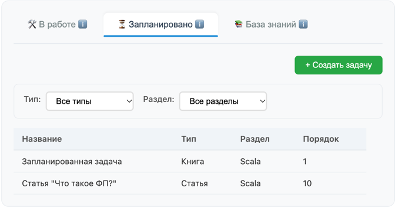



# Шаблон `welcome.scala.html`

`welcome.scala.html` — [центральный шаблон всего приложения](https://gitverse.ru/scalabook/pdp/content/master/pdp/src/main/twirl/ru/scalabook/pdp/views/welcome.scala.html). 
Это рабочий стол пользователя, куда он попадает после авторизации. 
Шаблон отображает восемь вкладок (задачи в разных статусах, цели, статистику,
источники, заметки, историю), кнопки управления (настройки и выход), а также служит
«хостом» для всех модальных окон.

Основная задача шаблона — быть **единым экраном** для работы с задачами: пользователь видит
свой прогресс, может переключаться между вкладками, фильтровать задачи по типу, разделу
и цели, создавать новые задачи, открывать существующие и управлять их статусами. Всё это
происходит без перезагрузки страницы благодаря htmx.

Сам `welcome.scala.html` не содержит логики отображения вкладок — он лишь **компонует**
уже готовые HTML-фрагменты, которые формируются отдельными шаблонами:

- `welcomeInProgress.scala.html` — вкладка «В работе»;
- `welcomePlanned.scala.html` — вкладка «Запланировано»;
- `welcomeKnowledgeBase.scala.html` — вкладка «База знаний»;
- `goalsStats.scala.html` — вкладка «Цели»;
- `statistics.scala.html` — вкладка «Статистика»;
- `welcomeSources.scala.html` — вкладка «Источник»;
- `welcomeNotes.scala.html` — вкладка «Заметки»;
- `history.scala.html` — вкладка «История».

## Импорты и параметры

```html
@import dev.profunktor.auth.jwt.JwtToken

@(username: String, token: JwtToken, tab: String, inProgress: Html, planned: Html,
  knowledgeBase: Html, goals: Html, statistics: Html, sources: Html, notes: Html, history: Html)
```

**Импорт:**

- **`JwtToken`** — тип JWT-токена. Передаётся в `welcome.scala.html`, чтобы шаблон
  сохранил его в куки и заголовки через невидимый iframe.

**Параметры шаблона:**

| Параметр        | Тип      | Назначение                                                                               |
| --------------- | -------- | ---------------------------------------------------------------------------------------- |
| `username`      | `String` | Имя пользователя для приветствия. Отображается в шапке: «Добро пожаловать, @username!»    |
| `token`         | `JwtToken`| JWT-токен. Используется кнопкой «Выход» и сохранением в куки                              |
| `tab`           | `String` | Текущая активная вкладка: `"in-progress"`, `"planned"`, `"knowledge-base"`, `"goals"`, `"statistics"`, `"sources"`, `"notes"`, `"history"` |
| `inProgress`    | `Html`   | Готовый HTML вкладки «В работе» (шаблон `welcomeInProgress`)                              |
| `planned`       | `Html`   | Готовый HTML вкладки «Запланировано» (шаблон `welcomePlanned`)                            |
| `knowledgeBase` | `Html`   | Готовый HTML вкладки «База знаний» (шаблон `welcomeKnowledgeBase`)                        |
| `goals`         | `Html`   | Готовый HTML вкладки «Цели» (шаблон `goalsStats`)                                         |
| `statistics`    | `Html`   | Готовый HTML вкладки «Статистика» (шаблон `statistics`)                                   |
| `sources`       | `Html`   | Готовый HTML вкладки «Источник» (шаблон `welcomeSources`)                                 |
| `notes`         | `Html`   | Готовый HTML вкладки «Заметки» (шаблон `welcomeNotes`)                                    |
| `history`       | `Html`   | Готовый HTML вкладки «История» (шаблон `history`)                                         |

**Почему каждый из восьми параметров — это `Html`, а не набор данных?**

`welcome.scala.html` — это **компоновщик**. Он не знает ни о задачах, ни о целях, ни
о статистике: он лишь раскладывает уже готовые HTML-фрагменты по вкладкам. Это позволяет
держать шаблон тривиальным, а всю логику формирования каждой вкладки выносить в отдельные
шаблоны и в `WelcomeViews`.

**Почему фильтры вкладок не передаются сюда?**

Списки типов, разделов и целей для фильтров — **локальная** деталь вкладок
«Запланировано» и «База знаний». Каждый такой список готовит `WelcomeViews`
только для той вкладки, где он нужен, и передаёт его в соответствующий шаблон.
`welcome.scala.html` о фильтрах ничего не знает.

## Структура разметки

Разметка организована вокруг контейнера `#app`. Это **ключевой элемент** для htmx:
когда сервер возвращает новую страницу или её фрагмент, htmx заменяет именно содержимое `#app`.

```html
<div id="app" class="app-container">
  <iframe onload="saveUserCookies('@token.value')" style="display:none;"></iframe>
  <div id="welcomeBlock" class="welcome-container">...</div>
  <div id="modal-container"></div>
</div>
```

**Разбор структуры:**

- **`#app`** — главный контейнер. Класс `app-container` задаёт широкую ширину
  (на всю страницу), в отличие от `app-container-narrow`, который используется
  на страницах логина и регистрации.
- **`<iframe>`** — технический трюк: невидимый iframe с `onload`, который сохраняет
  токен в `localStorage` и куки при загрузке страницы. Атрибут `style="display:none"`
  скрывает его от пользователя.
- **`#welcomeBlock`** — блок с приветствием, кнопками и вкладками.
- **`#modal-container`** — пустой контейнер, в который htmx будет подгружать модальные окна
  (создание задачи, планирование, старт, завершение и т.д.).

**Почему `#modal-container` вынесен наружу?**

Модальные окна — это оверлеи, которые должны перекрывать **всю** страницу, а не только
её центральную часть. Если бы `#modal-container` был внутри `#welcomeBlock`, то при замене
содержимого `#app` модалки бы «слетали». Вынесение наружу делает их независимыми
от содержимого `#app`.

### Сохранение токена в куки

```html
<iframe onload="saveUserCookies('@token.value')" style="display:none;"></iframe>
```

**Зачем это нужно:**

Когда пользователь логинится, сервер устанавливает куку `token` через HTTP-заголовок
`Set-Cookie`. Однако клиентский JavaScript **не всегда** может прочитать эту куку, если
она помечена как `HttpOnly`. Кроме того, при некоторых сценариях (например, при работе
с htmx и замене HTML) куки могут не обновиться.

Этот iframe решает проблему: при загрузке страницы `welcome` он вызывает
`saveUserCookies('@token.value')`, который:

1. Сохраняет токен в `localStorage` (доступен из JavaScript).
2. Дублирует токен в обычную куку (не `HttpOnly`), доступную из JS.

Так JavaScript-функции (например, `openTask`, `filterPlannedTasks`) могут использовать токен
для запросов.

## Верхняя панель

```html
<div class="welcome-header">
  <div class="welcome-user">
    <h2>Добро пожаловать, @username!</h2>
  </div>
  <div class="welcome-actions">
    <button ... class="settings-btn">⚙️ Настройки</button>
    <button ... class="danger-btn">Выход</button>
  </div>
</div>
```

**Структура:**

- **`.welcome-user`** — блок с приветствием. Отображает имя пользователя из `@username`.
- **`.welcome-actions`** — блок с кнопками действий.

**Кнопка «Настройки»:**

```html
<button
  type="button"
  onclick="htmx.process(this); this.click();"
  hx-get="/settings"
  hx-target="#app"
  hx-swap="outerHTML"
  class="settings-btn"
>
  ⚙️ Настройки
</button>
```

- **`hx-get="/settings"`** — GET-запрос на страницу настроек.
- **`hx-target="#app"`** — заменяем содержимое `#app` на страницу настроек.
- **`hx-swap="outerHTML"`** — заменяем весь блок `#app`, а не только его содержимое.
- **`onclick="htmx.process(this); this.click();"`** — важно: после того как HTML был вставлен
  через `outerHTML`, htmx не всегда автоматически обрабатывает новые элементы.
  `htmx.process(this)` «навешивает» обработчики на элемент, а `this.click()` программно
  вызывает клик — теперь htmx отправляет запрос.

**Кнопка «Выход»:**

```html
<button
  type="button"
  onclick="clearUserCookies(); htmx.process(this); this.click();"
  hx-post="/auth/logout"
  hx-target="#app"
  hx-swap="outerHTML"
  hx-headers='{"Authorization": "Bearer @token.value"}'
  class="danger-btn"
>
  Выход
</button>
```

- **`onclick="clearUserCookies(); htmx.process(this); this.click();"`** — сначала очищаем
  куки (чтобы даже если запрос не пройдёт, пользователь вышел локально), затем
  обрабатываем и вызываем клик.
- **`hx-post="/auth/logout"`** — POST-запрос на выход.
- **`hx-headers='{"Authorization": "Bearer @token"}'`** — передаём токен в заголовке.
  Это важно, потому что после `clearUserCookies()` токена в куке уже нет, а на сервере
  нужно проверить его валидность, чтобы удалить из чёрного списка.

## Вкладки

Вкладки — это механизм навигации между восемью представлениями рабочего стола. Каждая
вкладка имеет свою логику отображения: «В работе» показывает карточки с прогресс-барами,
«Запланировано» и «База знаний» — таблицы с фильтрами, остальные — цели, статистику,
источники, заметки и историю.

```html
<div class="tabs-container">
    <div class="tabs-header">
        <button class="tab-btn @if(tab == "in-progress"){active}"
                data-tab="in-progress"
                onclick="switchTab('in-progress')">
            🛠️ В работе
            <span title="Текущие задачи в работе, отсортированные по планируемой дате завершения">ℹ️</span>
        </button>
        <button class="tab-btn @if(tab == "planned"){active}"
                data-tab="planned"
                onclick="switchTab('planned')">
            ⏳ Запланировано
            <span title="Запланированные, но ещё не начатые задачи">ℹ️</span>
        </button>
        <button class="tab-btn @if(tab == "knowledge-base"){active}"
                data-tab="knowledge-base"
                onclick="switchTab('knowledge-base')">
            📚 База знаний
            <span title="Материалы для изучения, по которым пока ещё не сформирован детализированный план">ℹ️</span>
        </button>
        <button class="tab-btn @if(tab == "goals"){active}" data-tab="goals" onclick="switchTab('goals')">
            🎯 Цели
            <span title="Статистика по целям">ℹ️</span>
        </button>
        <button class="tab-btn @if(tab == "statistics"){active}" data-tab="statistics" onclick="switchTab('statistics')">
            📊 Статистика
            <span title="Статистика по задачам">ℹ️</span>
        </button>
        <button class="tab-btn @if(tab == "sources"){active}" data-tab="sources" onclick="switchTab('sources')">
            🌐 Источник
            <span title="Ресурсы для пополнения Базы знаний">ℹ️</span>
        </button>
        <button class="tab-btn @if(tab == "notes"){active}" data-tab="notes" onclick="switchTab('notes')">
            📝 Заметки
            <span title="Заметки и записи, не привязанные к задачам">ℹ️</span>
        </button>
        <button class="tab-btn @if(tab == "history"){active}" data-tab="history" onclick="switchTab('history')">
            📜 История
            <span title="📜 История выполненных задач">ℹ️</span>
        </button>
    </div>

    <div id="tab-in-progress" class="tab-content @if(tab == "in-progress"){active}">@inProgress</div>
    <div id="tab-planned" class="tab-content @if(tab == "planned"){active}">@planned</div>
    <div id="tab-knowledge-base" class="tab-content @if(tab == "knowledge-base"){active}">@knowledgeBase</div>
    ...
</div>
```

**Как работает переключение вкладок:**

1. **Каждая кнопка** имеет атрибут `data-tab` с именем вкладки и `onclick="switchTab('...')"`.
2. **Функция `switchTab`** ([в pdp.js](https://gitverse.ru/scalabook/pdp/content/master/pdp/src/main/resources/assets/js/pdp.js)):
   - Убирает класс `active` у всех кнопок и всех блоков `.tab-content`.
   - Добавляет `active` к нажатой кнопке и соответствующему блоку.
3. **При первой загрузке** активная вкладка определяется параметром `tab`:
   `@if(tab == "in-progress"){active}`.
4. **Содержимое вкладки** — это подставленный HTML-фрагмент (`@inProgress`, `@planned`,
   `@knowledgeBase` и т.д.). После замены содержимого `#app` (например, при создании задачи)
   htmx обновляет только те фрагменты, которые изменились на сервере.

**Зачем нужен `<span title="...">ℹ️</span>`?**

Это иконка-подсказка. При наведении на неё браузер показывает всплывающий текст,
объясняющий, что означает вкладка. Например, для «В работе»:
«Текущие задачи в работе, отсортированные по планируемой дате завершения».

Это улучшает UX: пользователь, впервые попавший на страницу, понимает, что где лежит.


## Вкладка «В работе»

Вкладка формируется отдельным шаблоном `welcomeInProgress.scala.html`, который принимает
два параметра: `tasks` (обычные задачи в работе, карточки `TableInProgressTaskCard`)
и `periodicTasks` (периодические задачи на сегодня, карточки `TablePeriodicTaskCard`).
Хост-шаблон подставляет результат в `@inProgress`.

```html
@(tasks: Vector[TableInProgressTaskCard], periodicTasks: Vector[TablePeriodicTaskCard])

<div class="tab-actions">
    <button class="add-btn"
            hx-get="/task/create/in-progress"
            hx-target="#modal-container"
            hx-swap="innerHTML"
            onclick="openCreateTaskModal()">
        + Создать задачу
    </button>
</div>

<!-- Периодические задачи -->
@if(periodicTasks.nonEmpty) {
<div class="periodic-tasks-section">
    <h3 class="periodic-tasks-title">🔄 Периодические задачи</h3>
    <div class="tasks-grid">
        @for(task <- periodicTasks) { @task.renderHtml }
    </div>
</div>
}

<!-- Обычные задачи -->
<div class="tasks-grid">
    @for(task <- tasks) { @task.renderHtml }
</div>
```

**Особенности вкладки:**

- **Карточки, а не таблица** — задачи «В работе» отображаются карточками, потому что
  для них важны прогресс-бар и дедлайн, а не табличные метрики.
- **Периодические задачи** — если на сегодня созданы периодические задачи (см.
  документацию по периодическим задачам), они выводятся отдельным блоком
  «🔄 Периодические задачи» над обычными.
- **Клик по карточке** — открывает страницу задачи в новой вкладке браузера
  (`onclick="openTask('@task.id')"`). Функция `openTask` формирует URL `/task/{id}`
  и открывает его в новом окне.
- **Кнопка «Создать задачу»** — открывает модальное окно с формой создания задачи.
  Запрос идёт на `/task/create/in-progress`, а результат вставляется в `#modal-container`.
- **Фильтров нет** — в отличие от «Запланировано» и «Базы знаний», задачи «В работе»
  не фильтруются: их обычно немного, и для них важнее контекст (прогресс и дедлайн).

**Структура карточки:**

```html
<div class="task-title">@task.name</div>

<div class="task-meta-grid">
  <div class="task-meta-item">
    <span class="meta-icon">📅</span>
    <span class="meta-label">Начало:</span>
    <span class="meta-value">@task.startDate.map(...).getOrElse("—")</span>
  </div>
  <div class="task-meta-item">
    <span class="meta-icon">⏰</span>
    <span class="meta-label">Дедлайн:</span>
    <span class="meta-value">@task.endDate.map(...).getOrElse("—")</span>
  </div>
</div>

<div class="task-progress">
  <div class="progress-label">
    <span>Прогресс</span>
    <span class="progress-percent">@{(task.progress * 100).toInt}%</span>
  </div>
  <div class="progress-bar">
    <div
      class="progress-fill"
      style="width: @{(task.progress * 100).toInt}%"
    ></div>
  </div>
</div>
```

**Разбор:**

- **Название задачи** — заголовок карточки.
- **Мета-данные** — даты начала и дедлайна. Форматируются через `DateTimeFormatter.ofPattern("dd.MM.yyyy")`.
  Если даты нет (например, задача не взята в работу) — отображается `—`.
- **Прогресс-бар** — визуализация прогресса. `task.progress` — число от 0.0 до 1.0,
  умножаем на 100 и округляем до целого. Ширина `.progress-fill` задаётся inline-стилем.


## Вкладка «Запланировано»

Вкладка формируется отдельным шаблоном `welcomePlanned.scala.html`, который принимает
четыре параметра: `tasks` (карточки `TablePlannedTaskCard`), `taskTypes`, `sections`
и `goals` (списки для фильтров). Хост-шаблон подставляет результат вызова в `@planned`.

```html
@(tasks: Vector[TablePlannedTaskCard], taskTypes: Vector[String], sections: Vector[String], goals: Vector[String])

<div class="tab-actions">
    <button class="add-btn"
            hx-get="/task/create/planned"
            hx-target="#modal-container"
            hx-swap="innerHTML"
            onclick="openCreateTaskModal()">
        + Создать задачу
    </button>
</div>

<!-- Фильтры -->
<div class="filter-container">
    <div class="filter-group">
        <label for="plannedTypeFilter">Тип:</label>
        <select id="plannedTypeFilter" class="filter-select" onchange="filterPlannedTasks()">
            <option value="all">Все типы</option>
            @for(taskType <- taskTypes) {
            <option value="@taskType">@taskType</option>
            }
        </select>
    </div>
    <div class="filter-group">
        <label for="plannedSectionFilter">Раздел:</label>
        <select id="plannedSectionFilter" class="filter-select" onchange="filterPlannedTasks()">
            <option value="all">Все разделы</option>
            @for(section <- sections) {
            <option value="@section">@section</option>
            }
        </select>
    </div>
    <div class="filter-group">
        <label for="plannedGoalFilter">Цель:</label>
        <select id="plannedGoalFilter" class="filter-select" onchange="filterPlannedTasks()">
            <option value="all">Все цели</option>
            @for(goal <- goals) {
            <option value="@goal">@goal</option>
            }
        </select>
    </div>
    <div class="filter-group">
        <button type="button" class="reset-filter-btn" onclick="resetPlannedFilters()">
            🔄 Сброс фильтра
        </button>
    </div>
    <div class="filter-group filter-total">
        <span class="filter-total-label">Всего:</span>
        <span class="filter-total-value" id="plannedTotal">@tasks.length</span>
    </div>
</div>

<div class="tasks-table-container">
    <table class="tasks-table" id="plannedTasksTable">
        <thead>
        <tr>
            <th>Название</th>
            <th>Тип</th>
            <th>Раздел</th>
            <th>Порядок</th>
        </tr>
        </thead>
        <tbody>
        @for(task <- tasks) { @task.renderHtml }
        </tbody>
    </table>
</div>
```

**Особенности вкладки:**

- **Таблица, а не карточки** — запланированные задачи сравниваются по типу, разделу,
  цели и порядковому номеру, поэтому таблица удобнее.
- **Три фильтра** — по типу, разделу и **цели**. Списки опций (`taskTypes`, `sections`,
  `goals`) приходят из сервиса и содержат **только те значения, которые реально есть**
  в этой вкладке. Это важно: пользователь не видит бесполезных опций.
- **Фильтрация на клиенте** — JavaScript-функция `filterPlannedTasks()` скрывает строки,
  которые не соответствуют выбранным фильтрам. Это быстро (не требует запроса к серверу)
  и удобно: пользователь может комбинировать фильтры в реальном времени.
- **Кнопка «🔄 Сброс фильтра»** — `resetPlannedFilters()` возвращает все три выпадающих
  списка к значению «Все».
- **Счётчик «Всего»** — элемент `#plannedTotal` показывает количество видимых в данный
  момент строк и обновляется при каждой фильтрации.

**Рендеринг строк таблицы:**

Сами строки таблицы рендерятся карточкой `TablePlannedTaskCard` через typeclass
`Render`. Карточка содержит уже «обогащённые» данные — имена типа, раздела и цели вместо
их id:

```html
<tr class="task-row"
    data-task-type="@task.taskType"
    data-task-section="@task.section"
    data-task-goal="@task.goal"
    onclick="openTask('@task.id')">
    <td>@task.name</td>
    <td>@task.taskType</td>
    <td>@task.section</td>
    <td>@task.ordinal</td>
</tr>
```

**Ключевые моменты:**

- **`data-task-type`, `data-task-section` и `data-task-goal`** — атрибуты, по которым
  JavaScript-функция `filterPlannedTasks()` понимает, показывать строку или скрывать.
- **Клик по строке** — открывает задачу в новой вкладке. `onclick="openTask('@task.id')"`.
- **Колонка «Порядок»** — показывает `task.ordinal`, по которому задачи сортируются.



## Вкладка «База знаний»

Вкладка формируется отдельным шаблоном `welcomeKnowledgeBase.scala.html`, который
принимает четыре параметра: `tasks` (карточки `TableKnowledgeBaseTaskCard`), `taskTypes`,
`sections` и `goals`. Хост-шаблон подставляет результат в `@knowledgeBase`.

```html
@(tasks: Vector[TableKnowledgeBaseTaskCard], taskTypes: Vector[String], sections: Vector[String], goals: Vector[String])

<div class="tab-actions">
    <button class="add-btn"
            hx-get="/task/create/knowledge-base"
            hx-target="#modal-container"
            hx-swap="innerHTML"
            onclick="openCreateTaskModal()">
        + Создать задачу
    </button>
</div>

<!-- Легенда размера задач -->
<div class="size-legend">
    <div class="size-legend-item">
        <span class="size-badge size-small">Мелкая</span>
        <span class="size-description">меньше часа</span>
    </div>
    <div class="size-legend-item">
        <span class="size-badge size-medium">Средняя</span>
        <span class="size-description">меньше 8 часов</span>
    </div>
    <div class="size-legend-item">
        <span class="size-badge size-large">Большая</span>
        <span class="size-description">больше 8 часов</span>
    </div>
</div>

<!-- Фильтры (аналогично «Запланировано», но со своими id и функцией) -->
<div class="filter-container">
    <div class="filter-group">
        <label for="knowledgeTypeFilter">Тип:</label>
        <select id="knowledgeTypeFilter" class="filter-select" onchange="filterKnowledgeTasks()">
            <option value="all">Все типы</option>
            @for(taskType <- taskTypes) { <option value="@taskType">@taskType</option> }
        </select>
    </div>
    <div class="filter-group">
        <label for="knowledgeSectionFilter">Раздел:</label>
        <select id="knowledgeSectionFilter" class="filter-select" onchange="filterKnowledgeTasks()">
            <option value="all">Все разделы</option>
            @for(section <- sections) { <option value="@section">@section</option> }
        </select>
    </div>
    <div class="filter-group">
        <label for="knowledgeGoalFilter">Цель:</label>
        <select id="knowledgeGoalFilter" class="filter-select" onchange="filterKnowledgeTasks()">
            <option value="all">Все цели</option>
            @for(goal <- goals) { <option value="@goal">@goal</option> }
        </select>
    </div>
    <div class="filter-group">
        <button type="button" class="reset-filter-btn" onclick="resetKnowledgeFilters()">
            🔄 Сброс фильтра
        </button>
    </div>
    <div class="filter-group filter-total">
        <span class="filter-total-label">Всего:</span>
        <span class="filter-total-value" id="knowledgeTotal">@tasks.length</span>
    </div>
</div>

<div class="tasks-table-container">
    <table class="tasks-table" id="knowledgeTasksTable">
        <thead>
        <tr>
            <th>Название</th>
            <th>Тип</th>
            <th>Раздел</th>
            <th>Продолжительность</th>
        </tr>
        </thead>
        <tbody>
        @for(task <- tasks) { @task.renderHtml }
        </tbody>
    </table>
</div>
```

**Отличия от «Запланировано»:**

- **Легенда размеров** — сверху таблицы расположен блок `.size-legend`, который поясняет
  цветные бейджи размера задачи (мелкая / средняя / большая).
- **Последняя колонка** — «Продолжительность» вместо «Порядок». Для задач в базе знаний
  важна оценка трудоёмкости, т.к. задача ещё не запланирована и очередность у задач одинаковая.
- **Три фильтра** — `knowledgeTypeFilter`, `knowledgeSectionFilter` и `knowledgeGoalFilter`.
- **Функции `filterKnowledgeTasks()` и `resetKnowledgeFilters()`** — аналогичны
  функциям вкладки «Запланировано», но работают с другой таблицей и другим счётчиком.

**Рендеринг строк таблицы:**

Строки рендерит карточка `TableKnowledgeBaseTaskCard`. Помимо названия, типа и раздела,
она показывает продолжительность в виде бейджа с иконкой, отражающей категорию размера:

- `Small` (< 1 часа, 🌱) — мелкая задача;
- `Medium` (< 8 часов, 🌳) — средняя задача;
- `Large` (> 8 часов, 🌲) — большая задача.

Каждая строка несёт атрибуты `data-task-type`, `data-task-section` и `data-task-goal`
для клиентской фильтрации и `onclick="openTask('@task.id')"` для открытия задачи.


## Клиентская фильтрация по цели

Фильтрация задач по цели — это **клиентская** логика (реализована в `pdp.js`, без запроса
к серверу). Она симметрична уже существовавшей фильтрации по типу и разделу, но добавляет
третье измерение — цель.

**Единая функция `filterTasks`:**

```js
function filterTasks(tableId, typeFilterId, sectionFilterId, goalFilterId, totalId) {
    const typeFilter = document.getElementById(typeFilterId).value;
    const sectionFilter = document.getElementById(sectionFilterId).value;
    const goalFilter = document.getElementById(goalFilterId).value;

    const rows = document.querySelectorAll('#' + tableId + ' tbody tr');
    let visibleCount = 0;

    rows.forEach(function(row) {
        const taskType = row.getAttribute('data-task-type');
        const taskSection = row.getAttribute('data-task-section');
        const taskGoal = row.getAttribute('data-task-goal');

        const typeMatch = typeFilter === 'all' || taskType === typeFilter;
        const sectionMatch = sectionFilter === 'all' || taskSection === sectionFilter;
        const goalMatch = goalFilter === 'all' || taskGoal === goalFilter;

        if (typeMatch && sectionMatch && goalMatch) {
            row.style.display = '';
            visibleCount++;
        } else {
            row.style.display = 'none';
        }
    });

    const totalElement = document.getElementById(totalId);
    if (totalElement) {
        totalElement.textContent = visibleCount;
    }
}
```

**Как это работает:**

1. Функция читает текущие значения трёх `<select>` — тип, раздел и **цель**.
2. Для каждой строки таблицы берёт атрибуты `data-task-type`, `data-task-section`
   и `data-task-goal` (их проставляет карточка при рендеринге).
3. Строка показывается, **только если она подходит под все три фильтра одновременно**
   (логика И). Значение `"all"` означает «фильтр отключён».
4. Счётчик `#plannedTotal` / `#knowledgeTotal` обновляется в реальном времени.

**Обёртки для каждой вкладки:**

```js
function filterPlannedTasks() {
    filterTasks('plannedTasksTable', 'plannedTypeFilter', 'plannedSectionFilter', 'plannedGoalFilter', 'plannedTotal');
}

function filterKnowledgeTasks() {
    filterTasks('knowledgeTasksTable', 'knowledgeTypeFilter', 'knowledgeSectionFilter', 'knowledgeGoalFilter', 'knowledgeTotal');
}

function resetPlannedFilters() {
    document.getElementById('plannedTypeFilter').value = 'all';
    document.getElementById('plannedSectionFilter').value = 'all';
    document.getElementById('plannedGoalFilter').value = 'all';
    filterPlannedTasks();
}

function resetKnowledgeFilters() {
    document.getElementById('knowledgeTypeFilter').value = 'all';
    document.getElementById('knowledgeSectionFilter').value = 'all';
    document.getElementById('knowledgeGoalFilter').value = 'all';
    filterKnowledgeTasks();
}
```

**Почему фильтр по цели хранится на клиенте, а не на сервере?**

Вкладки «Запланировано» и «База знаний» уже полностью отрисованы на сервере (все строки
в DOM). Значит, фильтровать их можно мгновенно на клиенте — без дополнительных запросов.
Сервер при этом отвечает только за **подготовку списка доступных целей**: `WelcomeViews`
собирает из видимых задач множество id целей и превращает его в отсортированный список
имён целей, передавая его шаблону в параметр `goals`.

**Почему в списке только актуальные цели?**

Аналогично типу и разделу: если цели нет ни у одной задачи вкладки, бесполезно показывать
её в выпадающем списке. Поэтому `WelcomeViews` включает в фильтр цели только тех задач,
которые реально находятся на этой вкладке, и сортирует их по порядковому номеру.

## Контейнер для модальных окон

```html
<div id="modal-container"></div>
```

Модальные окна — это отдельные HTML-фрагменты, которые подгружаются с сервера при клике
на кнопку «Создать задачу», «Взять в работу», «Завершить задачу» и т.д. (Эти кнопки будут разобраны в разделе "Страница задачи").
htmx вставляет их в `#modal-container` через `hx-target="#modal-container"` и `hx-swap="innerHTML"`.

**Типы модальных окон:**

| Модальное окно  | Триггер                                         | Эндпоинт              |
| --------------- | ----------------------------------------------- | --------------------- |
| Создание задачи | Кнопка «+ Создать задачу» на любой вкладке      | `/task/create/{tab}`  |
| Планирование    | Кнопка «📋 В очередь» на странице задачи        | `/task/{id}/queue`    |
| Начало работы   | Кнопка «🚀 Взять в работу» на странице задачи   | `/task/{id}/start`    |
| Завершение      | Кнопка «✅ Завершить задачу» на странице задачи | `/task/{id}/complete` |

## Как всё работает вместе

Рассмотрим полный сценарий:

1. **Пользователь логинится** → сервер возвращает `welcome.scala.html` с восемью вкладками.
   По умолчанию открыта «В работе».
2. **Пользователь кликает на вкладку «Запланировано»** → JavaScript-функция `switchTab`
   меняет активный класс. **Запроса к серверу нет** — все вкладки уже отрисованы.
3. **Пользователь выбирает фильтр по цели** → `filterPlannedTasks()` мгновенно скрывает
   строки, не соответствующие выбранной цели (комбинируя с фильтрами типа и раздела).
   Счётчик «Всего» обновляется. **Запроса к серверу нет** — все строки уже в DOM.
4. **Пользователь нажимает «+ Создать задачу»** → htmx отправляет GET на
   `/task/create/planned`. Сервер возвращает HTML модального окна. htmx вставляет
   его в `#modal-container`.
5. **Пользователь заполняет форму и нажимает «Создать»** → htmx отправляет POST
   на `/tasks`. Сервер создаёт задачу и возвращает обновлённый `welcome.scala.html`.
   htmx заменяет содержимое `#app` — пользователь видит новую задачу в таблице.
6. **Пользователь кликает на строку задачи** → JavaScript-функция `openTask` открывает
   новую вкладку браузера с URL `/task/{id}`. Там отображается детальная страница задачи.
7. **Пользователь нажимает «Выход»** → `clearUserCookies()` очищает куки, затем htmx
   отправляет POST на `/auth/logout`. Сервер инвалидирует токен и возвращает форму логина.
   htmx заменяет `#app` — пользователь видит форму входа.

## Итог

`welcome.scala.html` — это **рабочий стол** пользователя, который:

1. **Показывает восемь представлений**: задачи в работе, запланированные, база знаний,
   цели, статистику, источники, заметки и историю.
2. **Позволяет фильтровать задачи** по типу, разделу и цели прямо на клиенте,
   с кнопкой сброса и живым счётчиком.
3. **Интегрируется с htmx** для загрузки модальных окон и отправки форм без перезагрузки.
4. **Хранит JWT-токен** в куках и `localStorage` для последующих запросов.
5. **Даёт быстрый доступ** к настройкам и выходу через кнопки в шапке.

Шаблон построен так, чтобы **минимизировать количество запросов** к серверу:
переключение вкладок и фильтрация происходят на клиенте, а сервер используется только
для операций, изменяющих состояние (создание, обновление, удаление задач).

---

**Ссылки:**

- [Репозиторий с исходниками][repo]

[repo]: https://gitverse.ru/scalabook/pdp
