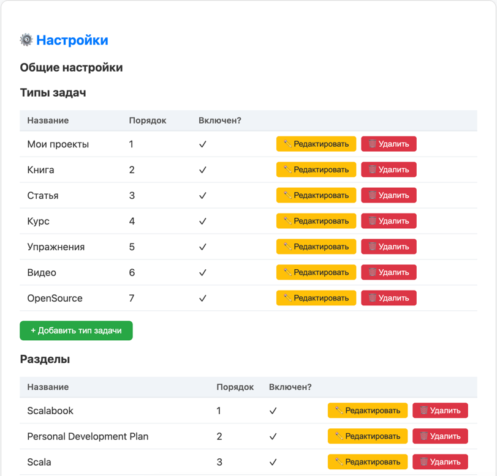
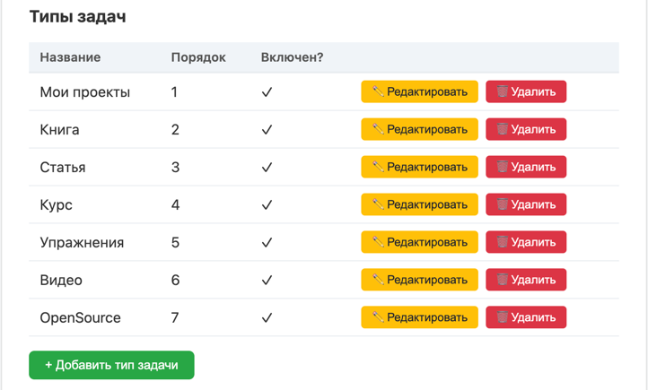
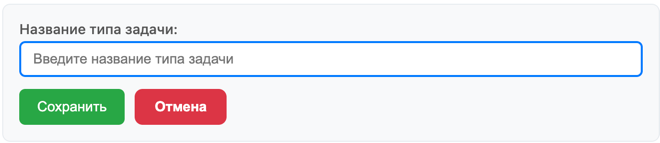
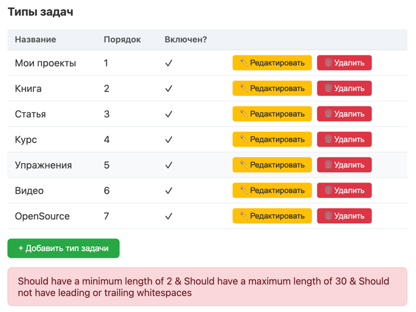
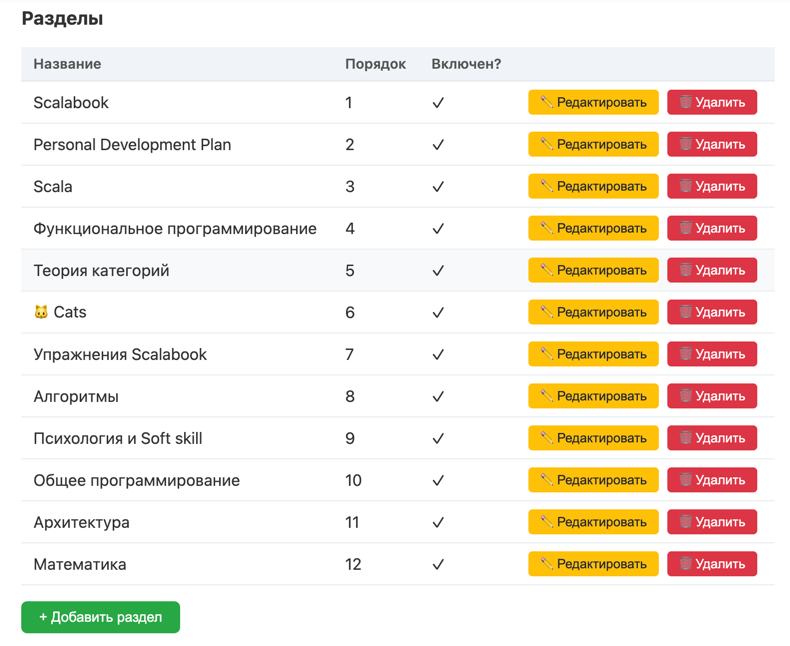



# Страница настроек

Страница настроек — это центр управления справочниками приложения. 
Здесь пользователь настраивает **типы задач**, **разделы** и **цели** — три сущности, 
которые затем используются при создании и фильтрации задач. 

Страница настроек устроена по единому шаблону для каждой из трёх сущностей:

1. **Таблица** со списком существующих записей.
2. **Форма добавления** новой записи (скрыта по умолчанию).
3. **Сообщение об ошибке** (если предыдущая операция не удалась).

Каждая строка таблицы поддерживает три действия:

- **Редактирование** — открывает форму редактирования прямо в строке.
- **Удаление** — удаляет запись с подтверждением.
- **Индикация** — показывает порядок и признак «включён».



## Маршрут

```dotty
val settings = Route(
  Request.get(Path.root / "settings").extractHeader[Authorization],
  Response.ok(Entity.html).orNotFound
)
```

**Разбор маршрута:**

- **`Request.get(Path.root / "settings")`** — GET-запрос на `/settings`.
  Это защищённый эндпоинт, доступный только авторизованным пользователям.
- **`.extractHeader[Authorization]`** — извлекает заголовок `Authorization`, содержащий
  JWT-токен в формате `Bearer <token>`. Именно через этот заголовок мы узнаём,
  кто именно запрашивает настройки.
- **`Response.ok(Entity.html).orNotFound`** — успешный ответ (200 OK) с HTML-телом.
  `.orNotFound` — запасной вариант (404), хотя на практике он редко срабатывает,
  потому что ошибки обрабатываются внутри хэндлера.

**Почему здесь используется заголовок `Authorization`, а не куки?**

Страница настроек вызывается через htmx-запрос из `welcome.scala.html`. 
htmx передаёт токен через заголовок `Authorization`, а не через куки — так удобнее, 
потому что клиентский JavaScript может явно указать токен в `hx-headers`. 
Это соответствует общей архитектуре приложения: все защищённые эндпоинты принимают токен в заголовке.

## Хэндлер `SettingsHandler`

```dotty
final case class SettingsHandler(
    middleware: JwtAuthMiddleware[IO, UserInfo],
    settingsService: SettingsService[IO]
)(using Logger[IO]) extends AuthorizationHandler(middleware):

  val handler: Handler =
    Routes.settings.handleIO: (authorization: Authorization) =>
      handleUserIO(authorization): (user, jwtToken) =>
        getViewSettings(
          settingsService = settingsService,
          id = user.id,
          jwtToken = jwtToken
        )
```

**Пошаговый разбор:**

1. **Зависимости:**
    - `middleware: JwtAuthMiddleware[IO, UserInfo]` — middleware для проверки токена.
      Умеет превращать строку токена в объект `UserInfo` (id, username).
    - `settingsService: SettingsService[IO]` — сервис для работы со справочниками.
      Умеет загружать типы задач, разделы и цели пользователя.
    - `using Logger[IO]` — логгер.

2. **`extends AuthorizationHandler(middleware)`** — наследуемся от базового класса,
   который инкапсулирует логику проверки токена. Это избавляет от необходимости
   вручную извлекать заголовок `Authorization` и валидировать его.

3. **`handleUserIO(authorization): (user, token) => ...`** — специальный метод, который
   принимает два аргумента: `authorization` (извлечённый `handleIO` из заголовка) и
   каррированную лямбду `(user, token)`. Метод:
    - Проверяет токен через middleware.
    - Если токен валиден, передаёт в лямбду `user` (информация о пользователе)
      и `token` (сам JWT-токен).
    - Если невалиден — автоматически возвращает `AuthorizationException`,
      которую обрабатывает `AuthorizationHandler`.

4. **`getViewSettings(...)`** — формирует HTML-страницу настроек, загружая все справочники
   пользователя.

## Формирование страницы настроек

Логика загрузки справочников вынесена в две перегруженные функции `getViewSettings`.
Первая — упрощённая, без сообщений об ошибках. Вторая — полная, принимает три опциональных
сообщения (по одному на каждый справочник).

### Упрощённая версия

```dotty
def getViewSettings(
    settingsService: SettingsService[IO],
    id: UserId,
    jwtToken: JwtToken
): IO[String] =
  getViewSettings(
    settingsService = settingsService,
    id = id,
    jwtToken = jwtToken,
    errorTaskTypeMessage = none,
    errorSectionMessage = none,
    errorGoalMessage = none
  )
```

Эта версия используется, когда страница открывается «с нуля» (например, при клике на кнопку «Настройки»). 
Никаких ошибок нет, поэтому все три сообщения — `none`.

### Полная версия

```dotty
def getViewSettings(
    settingsService: SettingsService[IO],
    id: UserId,
    jwtToken: JwtToken,
    errorTaskTypeMessage: Option[String],
    errorSectionMessage: Option[String],
    errorGoalMessage: Option[String]
): IO[String] =
  for
    taskTypes <- settingsService.getTaskTypes(id)
    sections  <- settingsService.getSections(id)
    goals     <- settingsService.getGoals(id)
  yield View.settings(
    token = jwtToken.value,
    taskTypes = taskTypes,
    sections = sections,
    goals = goals,
    errorTaskTypeMessage = errorTaskTypeMessage,
    errorSectionMessage = errorSectionMessage,
    errorGoalMessage = errorGoalMessage
  ).toString
```

**Что происходит:**

1. **Загружаем типы задач, разделы и цели пользователя.**
2. **Рендер шаблона `View.settings(...)`** — передаём в Twirl-шаблон:
    - `token` — JWT-токен для htmx-заголовков.
    - `taskTypes`, `sections`, `goals` — загруженные справочники.
    - Три опциональных сообщения об ошибках.

**Почему три отдельных сообщения об ошибках?**

Каждый справочник — это независимая сущность. 
Пользователь может ошибиться при добавлении типа задачи (например, ввести пустое имя), 
но при этом успешно добавить раздел. 
Три отдельных сообщения позволяют показывать ошибку **точно под** соответствующим разделом.

## Шаблон `settings.scala.html`

Шаблон состоит из трёх независимых секций, каждая из которых следует одному паттерну.
Разберём его по частям.

### Импорты и параметры

```html
@import ru.scalabook.pdp.models.Goal
@import ru.scalabook.pdp.models.Section
@import ru.scalabook.pdp.models.TaskType

@(token: String, 
  taskTypes: Vector[TaskType], 
  sections: Vector[Section], 
  goals: Vector[Goal], 
  errorTaskTypeMessage: Option[String], 
  errorSectionMessage: Option[String], 
  errorGoalMessage: Option[String]
)
```

**Параметры шаблона:**

| Параметр               | Тип                | Назначение                                 |
| ---------------------- | ------------------ | ------------------------------------------ |
| `token`                | `String`           | JWT-токен для htmx-заголовков              |
| `taskTypes`            | `Vector[TaskType]` | Список типов задач пользователя            |
| `sections`             | `Vector[Section]`  | Список разделов пользователя               |
| `goals`                | `Vector[Goal]`     | Список целей пользователя                  |
| `errorTaskTypeMessage` | `Option[String]`   | Сообщение об ошибке для секции типов задач |
| `errorSectionMessage`  | `Option[String]`   | Сообщение об ошибке для секции разделов    |
| `errorGoalMessage`     | `Option[String]`   | Сообщение об ошибке для секции целей       |

### Общая структура

```html
<div id="app" class="app-container">
  <div id="welcomeBlock" class="welcome-container">
    <div class="welcome-header">
      <div class="welcome-user">
          <h2>⚙️ Настройки</h2>
        ...
      </div>
    </div>
  </div>
</div>
```

**Ключевые моменты:**

- **`#app`** — контейнер, который htmx заменяет при переходах.
- **`#welcomeBlock`** — блок с заголовком и секциями.

### Секция «Типы задач»

```html
<h3>Типы задач</h3>
<div class="settings-list">
  @if(taskTypes.nonEmpty) {
  <table class="task-types-table">
    <thead>
      <tr>
        <th>Название</th>
        <th>Порядок</th>
        <th>Включен?</th>
        <th></th>
      </tr>
    </thead>
    <tbody hx-target="closest tr" hx-swap="outerHTML">
      @for(taskType <- taskTypes.sortBy(_.ordinal.value)) {
      <tr class="task-type-row" data-task-type-id="@taskType.id.value">
        <td>@taskType.name.value</td>
        <td>@taskType.ordinal.value</td>
        <td>@if(taskType.displayed) { ✓ } else { ✗ }</td>
        <td>
          <button
            class="edit-btn"
            hx-get="/settings/task_types/@taskType.id.value/edit"
            hx-trigger="edit"
            onclick="handleEditClick(this)"
          >
            ✏️ Редактировать
          </button>
          <button
            class="delete-btn"
            hx-delete="/settings/task_types/@taskType.id.value"
            hx-target="#app"
            hx-swap="outerHTML"
            hx-confirm="Вы уверены, что хотите удалить тип задачи «@taskType.name.value»?"
          >
            🗑️ Удалить
          </button>
        </td>
      </tr>
      }
    </tbody>
  </table>
  } else {
  <p class="empty-message">Типы задач не найдены</p>
  }
</div>
```

**Разбор таблицы:**

- **Сортировка** — `taskTypes.sortBy(_.ordinal.value)` сортирует записи по порядку.
  Пользователь видит их в том порядке, который задал сам.
- **`data-task-type-id`** — атрибут с ID записи. Используется для отладки и потенциальной
  фильтрации на клиенте.
- **Колонка «Включен?»** — показывает `✓`, если `displayed = true`, и `✗` в противном случае.
  Это позволяет пользователю видеть, какие записи активны, а какие скрыты (например,
  архивные).
- **Кнопка «Редактировать»** — использует `hx-trigger="edit"` вместо `click`. Это значит,
  что запрос отправляется **только** когда JavaScript-функция `handleEditClick()`
  программно вызовет событие `edit`. Такой подход позволяет реализовать **одновременное
  редактирование только одной строки**: если пользователь попытается редактировать
  вторую строку, `handleEditClick` покажет предупреждение и предложит сначала
  закрыть текущую.
- **Кнопка «Удалить»** — использует `hx-delete` и `hx-confirm`. При клике браузер
  показывает диалог подтверждения с указанием имени записи. Если пользователь
  соглашается — htmx отправляет DELETE-запрос.
- **`hx-target="#app"`** для удаления — после удаления сервер возвращает обновлённую
  страницу настроек целиком, и htmx заменяет `#app`.



**Форма добавления типа задачи:**

```html
<div id="addTaskTypeForm" class="add-form" style="display: none;">
  <form
    id="taskTypeForm"
    hx-post="/settings/task_types"
    hx-target="#app"
    hx-swap="outerHTML"
  >
    <input type="hidden" name="token" value="@token" />
    <div class="form-group">
      <label for="taskTypeName">Название типа задачи:</label>
      <input
        id="taskTypeName"
        name="name"
        type="text"
        required
        placeholder="Введите название типа задачи"
      />
    </div>
    <div class="form-actions">
      <button type="submit" class="add-btn">Сохранить</button>
      <button type="button" class="danger-btn" onclick="hideAddTaskTypeForm()">
        Отмена
      </button>
    </div>
  </form>
</div>

<button class="add-btn" onclick="showAddTaskTypeForm()">
  + Добавить тип задачи
</button>
```



**Ключевые моменты:**

- **Форма скрыта по умолчанию** (`style="display: none;"`). Она показывается
  JavaScript-функцией `showAddTaskTypeForm()` при клике на кнопку «+ Добавить».
- **`hx-post="/settings/task_types"`** — POST-запрос на создание нового типа задачи.
- **`hx-target="#app"`** — после создания сервер возвращает обновлённую страницу,
  htmx заменяет `#app`.
- **`<input type="hidden" name="token" value="@token" />`** — токен передаётся
  в теле формы из-за проблемы [в фреймворке Krop](https://github.com/creativescala/krop/issues/55).
- **Кнопка «Отмена»** — вызывает `hideAddTaskTypeForm()`, которая скрывает форму
  и очищает её поля.

**Сообщение об ошибке:**

```html
<div class="messageBlock">
  @errorTaskTypeMessage.map { msg =>
  <div class="error">@msg</div>
  }
</div>
```

- Если `errorTaskTypeMessage` содержит сообщение — отображается красный блок с текстом.
- Если `None` — блок не отображается.



### Секция «Разделы» и «Цели»

Секция разделов и целей устроена **абсолютно аналогично** секции типов задач. Отличия
только в:

- **Названии таблицы** — `sections-table` вместо `task-types-table`.
- **Классе строки** — `section-row` вместо `task-type-row`.
- **Атрибуте** — `data-section-id` вместо `data-task-type-id`.
- **URL-ах** — `/settings/sections` вместо `/settings/task_types`.
- **Сообщении об ошибке** — `errorSectionMessage`.

Такое единообразие — осознанное решение. Копирование кода для каждого справочника
**лучше**, чем преждевременная абстракция: если в будущем потребуется
специализировать поведение одного из справочников, это легко сделать, не ломая
остальные.



### Секция «Периодические задачи»

```html
<h3>Периодические задачи</h3>
<!-- Содержимое периодических задач -->
```

Это **заглушка** для будущей функциональности. Периодические задачи — это задачи,
которые повторяются по расписанию (например, «читать по 30 минут каждый день»).
Их реализация будет разобрана позднее, но структура страницы уже готова
к добавлению этой секции.

## Поток работы со страницей настроек

Рассмотрим типичный сценарий:

1. **Пользователь кликает «⚙️ Настройки»** на главной странице → htmx отправляет
   GET на `/settings` с заголовком `Authorization: Bearer <token>`.
2. **SettingsHandler** проверяет токен и загружает три справочника пользователя.
3. **Сервер возвращает HTML** с тремя таблицами (типы, разделы, цели). htmx заменяет
   содержимое `#app`.
4. **Пользователь кликает «+ Добавить тип задачи»** → JavaScript показывает скрытую
   форму. Форма становится видимой.
5. **Пользователь вводит название и кликает «Сохранить»** → htmx отправляет POST
   на `/settings/task_types` с телом формы (включая токен).
6. **Сервер валидирует данные**, создаёт запись и возвращает обновлённую страницу
   настроек. htmx заменяет `#app` — пользователь видит новую строку в таблице.
7. **Если была ошибка** (например, пустое имя) — сервер возвращает ту же страницу,
   но с `errorTaskTypeMessage = Some("...")`. Пользователь видит красное сообщение
   под таблицей.

## Итог

Мы реализовали страницу настроек — центр управления тремя справочниками приложения:

1. **Типы задач** — классификация задач по формату (книга, статья, видео).
2. **Разделы** — тематическая группировка задач (Программирование, Психология).
3. **Цели** — стратегические ориентиры, к которым привязаны задачи.

**Ключевые архитектурные решения:**

- **Единообразие секций** — каждая из трёх секций устроена одинаково. Это упрощает
  восприятие и поддержку кода.
- **htmx для интерактивности** — все операции (создание, редактирование, удаление)
  происходят без перезагрузки страницы.
- **Одновременное редактирование только одной строки** — через `hx-trigger="edit"`
  и функцию `handleEditClick`.
- **Подтверждение удаления** — через `hx-confirm`, чтобы избежать случайных удалений.
- **Три независимых сообщения об ошибках** — чтобы ошибки отображались точно
  под соответствующей секцией.
  
---

**Ссылки:**

- [Репозиторий с исходниками][repo]

[repo]: https://gitverse.ru/scalabook/pdp
