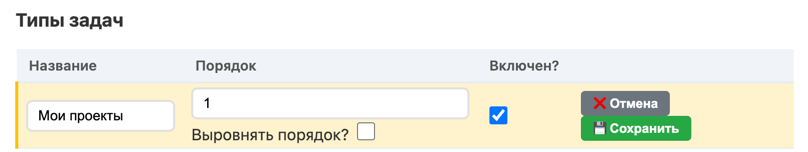
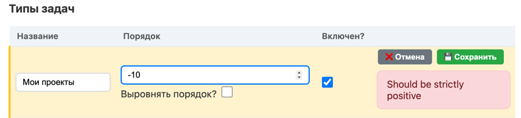



# Настройка типов задач, разделов и целей

После того как мы реализовали страницу настроек, нужно добавить функциональность для управления
справочниками: **создание**, **редактирование**, **удаление** и **отображение** типов задач,
разделов и целей. Каждая из этих сущностей работает по одному паттерну, поэтому мы подробно
разберём типы задач, а для разделов и целей отметим только отличия.

## Общий паттерн CRUD-операций

Для каждой сущности реализуется **пять хэндлеров** и **три шаблона**:

| Операция                              | Хэндлер                  | Шаблон                               |
| ------------------------------------- | ------------------------ | ------------------------------------ |
| Создание                              | `CreateTaskTypeHandler`  | — (возвращает всю страницу настроек) |
| Удаление                              | `DeleteTaskTypeHandler`  | — (возвращает всю страницу настроек) |
| Отображение строки для редактирования | `EditTaskTypeRowHandler` | `editTaskTypeRow.scala.html`         |
| Сохранение изменений                  | `EditTaskTypeHandler`    | — (возвращает обновлённую строку)    |
| Отображение обычной строки            | `GetTaskTypeRowHandler`  | `getTaskTypeRow.scala.html`          |

Такое разделение — следствие использования htmx: каждое действие требует **конкретного
фрагмента HTML** в ответ. Мы не можем «просто обновить строку» — сервер должен вернуть
готовую разметку, которую htmx вставит в DOM.

## Создание типа задачи

### Хэндлер `CreateTaskTypeHandler`

```dotty
final case class CreateTaskTypeHandler(
    middleware: JwtAuthMiddleware[IO, UserInfo],
    settingsService: SettingsService[IO]
)(using Logger[IO]) extends AuthorizationHandler(middleware):
  val handler: Handler =
    Routes.addTaskType.handleIO: (request: CreateItemRequest) =>
      val create: ((UserInfo, JwtToken)) => IO[String] =
        (user, jwtToken) =>
          TaskTypeName.either(request.name) match
            case Right(name) =>
              val newItem = CreateTaskType(name, user.id)
              settingsService
                .createTaskType(newItem)
                .flatMap: _ =>
                  getViewSettings(
                    settingsService = settingsService,
                    id = user.id,
                    jwtToken = jwtToken
                  )
                .recoverWith:
                  case ex: IllegalArgumentException =>
                    getViewSettings(
                      settingsService = settingsService,
                      id = user.id,
                      jwtToken = jwtToken,
                      errorTaskTypeMessage = ex.getMessage.some,
                      errorSectionMessage = none,
                      errorGoalMessage = none
                    )
            case Left(error) =>
              getViewSettings(
                settingsService = settingsService,
                id = user.id,
                jwtToken = jwtToken,
                errorTaskTypeMessage = error.some,
                errorSectionMessage = none,
                errorGoalMessage = none
              )
      // ToDo: https://github.com/creativescala/krop/pull/57
      val authorization: Authorization =
        Authorization(Token(AuthScheme.Bearer, request.token))
      handleUserIO(authorization)(create)
```

**Пошаговый разбор:**

1. **`handleIO: (request: CreateItemRequest) => ...`** — регистрируем обработчик,
   принимающий `CreateItemRequest` (содержит `name` и `token`).
   ```dotty
   final case class CreateItemRequest(token: String, name: String) derives FormCodec
   ```
2. **`val create: ((UserInfo, JwtToken)) => IO[String] = ...`** — определяем лямбду,
   которая принимает пару `(user, jwtToken)`.
3. **`TaskTypeName.either(request.name)`** — валидация названия. Возвращает
   `Either[String, TaskTypeName]`:
    - **`Right(name)`** — имя валидно (2–200 символов, без крайних пробелов).
    - **`Left(error)`** — имя невалидно, содержит сообщение об ошибке.
4. **При успешной валидации:**
    - Создаём `CreateTaskType(name, user.id)`.
    - Вызываем `settingsService.createTaskType(newItem)`.
    - При успехе загружаем обновлённую страницу настроек через `getViewSettings`.
    - При ошибке (например, дубликат имени) — перехватываем `IllegalArgumentException`
      и загружаем страницу с сообщением об ошибке.
5. **При ошибке валидации** — сразу загружаем страницу настроек с сообщением
   об ошибке.
6. **`handleUserIO(authorization)(create)`** — токен приходит в теле запроса, а не в заголовке.
   Поэтому вручную собираем заголовок `Authorization` из `request.token`:
   ```dotty
   val authorization: Authorization =
     Authorization(Token(AuthScheme.Bearer, request.token))
   ```
   После чего `handleUserIO` проверяет его через middleware и передаёт
   `(user, jwtToken)` в лямбду `create`.

   > Примечание: пока это временное решение (см. `// ToDo` — ждём поддержку токена из формы
   > в krop, https://github.com/creativescala/krop/pull/57).

### Маршрут

```dotty
val addTaskType = Route(
  Request.post(Path.root / "settings" / "task_types")
    .withEntity(Entity.formOf[CreateItemRequest]),
  Response.ok(Entity.html).orNotFound
)
```

- POST-запрос на `/settings/task_types`.
- Тело — форма (`application/x-www-form-urlencoded`), десериализуется в `CreateItemRequest`.
- Ответ: 200 OK с HTML (перезагруженная страница настроек) или 404 Not Found при непредусмотренных ошибках.

## Удаление типа задачи

### Хэндлер `DeleteTaskTypeHandler`

```dotty
final case class DeleteTaskTypeHandler(
    middleware: JwtAuthMiddleware[IO, UserInfo],
    settingsService: SettingsService[IO]
)(using Logger[IO]) extends AuthorizationHandler(middleware):
  val handler: Handler =
    Routes.deleteTaskType.handleIO: (id: Int, authorization: Authorization) =>
      handleUserIO(authorization): (user: UserInfo, jwtToken: JwtToken) =>
        TaskTypeId.either(id) match
          case Right(taskTypeId) =>
            for
              _    <- settingsService.deleteTaskType(taskTypeId, user.id)
              view <- getViewSettings(
                settingsService = settingsService,
                id = user.id,
                jwtToken = jwtToken
              )
            yield view
          case Left(error) =>
            getViewSettings(
              settingsService = settingsService,
              id = user.id,
              jwtToken = jwtToken,
              errorTaskTypeMessage = error.some,
              errorSectionMessage = none,
              errorGoalMessage = none
            )
```

**Пошаговый разбор:**

1. **`(id: Int, authorization: Authorization)`** — обработчик принимает ID записи
   (из пути) и заголовок `Authorization`.
2. **`handleUserIO(authorization)(...)`** — стандартная проверка токена через
   `AuthorizationHandler`. В отличие от создания, здесь токен приходит **в заголовке**:
   `authorization` передаётся первым аргументом, а лямбда `(user, jwtToken)` — вторым.
3. **`TaskTypeId.either(id)`** — валидация ID:
    - **`Right(taskTypeId)`** — ID валиден, удаляем запись и загружаем обновлённую страницу.
    - **`Left(error)`** — ID невалиден (например, отрицательный), показываем страницу
      с ошибкой.
4. **Синтаксис `handleUserIO(authorization): (user, jwtToken) => ...`** — это
   каррированный вызов: `authorization`/`token` первым аргументом, лямбда,
   обрабатывающая `(user, jwtToken)`, — вторым. Знак `:` вводит тип/тело лямбды.

### Маршрут

```dotty
val deleteTaskType = Route(
  Request.delete(Path.root / "settings" / "task_types" / Param.int)
    .extractHeader[Authorization],
  Response.ok(Entity.html).orNotFound
)
```

- DELETE-запрос на `/settings/task_types/{id}`.
- ID извлекается из пути (`Param.int`).
- Токен извлекается из заголовка `Authorization`.

## Отображение строки для редактирования

### Хэндлер `EditTaskTypeRowHandler`

```dotty
final case class EditTaskTypeRowHandler(
    middleware: JwtAuthMiddleware[IO, UserInfo],
    settingsService: SettingsService[IO]
)(using Logger[IO]) extends AuthorizationHandler(middleware):
  val handler: Handler =
    Routes.editTaskTypeRow.handleIO: (id: Int, authorization: Authorization) =>
      handleUserIO(authorization): (user: UserInfo, jwtToken: JwtToken) =>
        for
          taskTypeId <- IO.fromEither(
            TaskTypeId.either(id).leftMap(new IllegalArgumentException(_))
          )
          taskTypes <- settingsService.getTaskTypes(user.id)
          taskType  <- IO.fromOption(
            taskTypes.find(_.id.value == id)
          )(new IllegalArgumentException("Задача не найдена"))
        yield View.editTaskTypeRow(
          taskType,
          jwtToken.value,
          none
        ).toString
```

**Пошаговый разбор:**

1. **`TaskTypeId.either(id)`** — валидация ID. Если невалиден — выбрасывается
   `IllegalArgumentException` через `IO.fromEither`.
2. **`settingsService.getTaskTypes(user.id)`** — загружаем все типы задач пользователя.
3. **`taskTypes.find(_.id.value == id)`** — ищем нужный тип. Если не найден —
   выбрасываем `IllegalArgumentException("Задача не найдена")`.
4. **`View.editTaskTypeRow(...)`** — рендерим шаблон `editTaskTypeRow.scala.html`
   с обычным состоянием (без ошибки).

**Зачем загружать все типы, а не один?**

В текущей реализации `SettingsService` не имеет метода `getTaskType(id)`.
Вместо этого мы загружаем все типы и ищем нужный в памяти. Это работает, потому
что типов задач у одного пользователя обычно немного (5–20). Если бы их было
тысячи, стоило бы добавить отдельный метод.

### Маршрут

```dotty
  val editTaskTypeRow = Route(
    Request.get(Path.root / "settings" / "task_types" / Param.int / "edit")
      .extractHeader[Authorization],
    Response.ok(Entity.html).orNotFound
  )
```

- GET-запрос на `/settings/task_types/{id}/edit`.
- Возвращает HTML-строку таблицы в режиме редактирования.



## Шаблон `editTaskTypeRow.scala.html`

```html
@import ru.scalabook.pdp.models.TaskType

@(taskType: TaskType, token: String, errorMessage: Option[String])
<tr class="task-type-row editing"
    hx-trigger="cancel"
    hx-get="/settings/task_types/@taskType.id.value"
>
   <td>
      <input
              class="edit-input"
              name="name"
              value="@taskType.name.value"
              autofocus
      />
   </td>
   <td>
      <input
              class="edit-input"
              name="ordinal"
              type="number"
              value="@taskType.ordinal.value"
              min="0"
      />
      Выровнять порядок?
      <input
              class="edit-checkbox"
              name="ordinalShift"
              type="checkbox"
      />
   </td>
   <td>
      <input
              class="edit-checkbox"
              name="displayed"
              type="checkbox"
              @if(taskType.displayed) { checked }
      />
   </td>
   <td>
      <input type="hidden" name="token" value="@token"/>
      <button
              class="cancel-btn"
              hx-get="/settings/task_types/@taskType.id.value"
      >
         ❌ Отмена
      </button>
      <button
              class="save-btn"
              hx-put="/settings/task_types/@taskType.id.value"
              hx-include="closest tr"
      >
         💾 Сохранить
      </button>
      @errorMessage.map { msg =>
      <div class="error">@msg</div>
      }
   </td>
</tr>
```

**Ключевые особенности:**

1. **`class="task-type-row editing"`** — дополнительный класс `editing` используется
   для реализации «одновременного редактирования только одной строки». Функция
   `handleEditClick` ищет `.editing` и предлагает закрыть предыдущую строку.

2. **`hx-trigger="cancel"`** — строка реагирует на событие `cancel`. Когда пользователь
   открывает другую строку, `handleEditClick` отправляет событие `cancel` на текущую,
   что вызывает GET-запрос на `/settings/task_types/{id}` (получить обычную строку).

3. **`autofocus`** на поле `name` — курсор автоматически встаёт в поле редактирования.

4. **`hx-include="closest tr"`** — при отправке формы PUT-запрос включает **все поля
   из ближайшей строки** (`tr`). Это избавляет от необходимости вручную собирать
   данные из полей. Включаются: `name`, `ordinal`, `ordinalShift`, `displayed`, `token`.

5. **`<input type="hidden" name="token">`** — токен передаётся в теле PUT-запроса.

6. **Кнопка «Отмена»** — GET-запрос на `/settings/task_types/{id}`,
   что возвращает обычную строку.

7. **Кнопка «Сохранить»** — PUT-запрос с данными из строки.

8. **Сообщение об ошибке** — если есть, отображается красным блоком под кнопками.



## Сохранение изменений

### Хэндлер `EditTaskTypeHandler`

Это самый сложный из всех хэндлеров — он поддерживает **переупорядочивание** записей.

```dotty
final case class EditTaskTypeHandler(
    middleware: JwtAuthMiddleware[IO, UserInfo],
    settingsService: SettingsService[IO]
)(using Logger[IO]) extends AuthorizationHandler(middleware):
  val handler: Handler =
    Routes.editTaskType.handleIO: (id: Int, request: EditItemRequest) =>
      val edit: ((UserInfo, JwtToken)) => IO[String] =
        (user, jwtToken) =>
          val rearrange = request.ordinalShift.contains("on")
          (
            TaskTypeId.either(id).toValidatedNec,
            TaskTypeName.either(request.name).toValidatedNec,
            Ordinal.either(request.ordinal).toValidatedNec
          ).mapN { case (taskTypeId, name, ordinal) =>
            val updated =
              TaskType(
                id = taskTypeId,
                name = name,
                userId = user.id,
                displayed = request.displayed.contains("on"),
                ordinal = ordinal
              )

            val run =
              if rearrange then
                for
                  items <- settingsService.getTaskTypes(user.id)
                  _     <- settingsService.updateTaskType(updated)
                  (beforeUpdated, afterUpdated) =
                    items
                      .filterNot(_.id == updated.id)
                      .partition(_.ordinal < updated.ordinal)
                  ids = NonEmptyVector.one(updated.id)
                    .prependVector(
                      beforeUpdated.sortBy(_.ordinal).map(_.id)
                    )
                    .appendVector(afterUpdated.sortBy(_.ordinal).map(_.id))
                  _ <- settingsService.reorderTaskTypes(ids, user.id)
                yield ()
              else
                settingsService.updateTaskType(updated)

            run.map: _ =>
              View.getTaskTypeRow(
                updated,
                jwtToken.value
              ).toString
            .recoverWith:
              case ex: IllegalArgumentException =>
                getError(
                  id = id,
                  userId = user.id,
                  jwtToken = jwtToken,
                  error = ex.getMessage
                )
          }.valueOr(error =>
            getError(
              id = id,
              userId = user.id,
              jwtToken = jwtToken,
              error = error.mkString_(";")
            )
          )
      // ToDo: https://github.com/creativescala/krop/pull/57
      val authorization: Authorization =
        Authorization(Token(AuthScheme.Bearer, request.token))
      handleUserIO(authorization)(edit)

  private def getError(
      id: Int,
      userId: UserId,
      jwtToken: JwtToken,
      error: String
  ): IO[String] =
    for
      taskTypeId <- IO.fromEither(
        TaskTypeId.either(id).leftMap(new IllegalArgumentException(_))
      )
      taskTypes <- settingsService.getTaskTypes(userId)
      taskType  <- IO.fromOption(
        taskTypes.find(_.id.value == id)
      )(new IllegalArgumentException("Задача не найдена"))
    yield View.editTaskTypeRow(
      taskType,
      jwtToken.value,
      error.some
    ).toString
end EditTaskTypeHandler
```

**Пошаговый разбор:**

1. **`(id: Int, request: EditItemRequest)`** — обработчик принимает ID из пути
   и тело формы с новыми данными.
   ```dotty
   final case class EditItemRequest(
      token: String,
      name: String,
      ordinal: Int,
      ordinalShift: Option[String],
      displayed: Option[String]
   ) derives FormCodec
   ```

2. **`val rearrange = request.ordinalShift.contains("on")`** — проверяем,
   установлен ли чекбокс «Выровнять порядок?». Если да — после обновления записи
   выполняется переиндексация порядковых номеров остальных записей.

3. **Валидация через `ValidatedNec`:**
    - `TaskTypeId.either(id)` — валидация ID.
    - `TaskTypeName.either(request.name)` — валидация имени.
    - `Ordinal.either(request.ordinal)` — валидация порядкового номера.

   `.mapN { ... }` собирает результаты: если **все** валидны — выполняется лямбда;
   если есть ошибки — они аккумулируются в `ValidatedNec` и обрабатываются через
   `.valueOr`.

4. **Создание обновлённого `TaskType`:**
    - `displayed = request.displayed.contains("on")` — чекбокс отмечен → `true`.
    - `ordinal = ordinal` — новое значение порядка.

5. **Два сценария выполнения:**
    - **С переупорядочиванием:**
        - Загружаем все типы пользователя.
        - Обновляем текущий тип.
        - Разделяем остальные типы на две группы: те, что идут **до** нового порядкового номера,
          и те, что **после**.
        - Формируем новый порядок: `[before] + [updated] + [after]`.
        - Вызываем `reorderTaskTypes` для сохранения нового порядка.
    - **Без переупорядочивания:** просто `updateTaskType(updated)`.

6. **Успех:** возвращаем обновлённую строку через `View.getTaskTypeRow`.

7. **Ошибка бизнес-логики:** перехватываем `IllegalArgumentException` и вызываем
   `getError`, который рендерит строку в режиме редактирования с сообщением.

8. **`getError`** — вспомогательный метод, который:
    - Загружает оригинальный `TaskType` (по ID).
    - Рендерит `editTaskTypeRow` с сообщением об ошибке.

**Зачем нужен `ordinalShift`?**

Представим, что у пользователя есть записи с порядковыми номерами `1, 2, 3, 4`.
Пользователь хочет изменить номер записи `4` на `2`. 
Если просто обновить её, получится `1, 2, 2, 3` — две записи с одинаковым номером. 
В результате придется обновлять порядок на +1 у двух записей.
Чтобы этого избежать, включается переупорядочивание: система пересчитывает номера так, чтобы они
остались уникальными (`1, 2, 3, 4` с новой позицией обновлённой записи).

### Маршрут

```dotty
val editTaskType = Route(
  Request.put(Path.root / "settings" / "task_types" / Param.int)
    .withEntity(Entity.formOf[EditItemRequest]),
  Response.ok(Entity.html).orNotFound
)
```

- PUT-запрос на `/settings/task_types/{id}`.
- Тело — форма с новыми данными.
- Возвращает обновлённую строку таблицы.

## Отображение обычной строки

### Хэндлер `GetTaskTypeRowHandler`

```dotty
final case class GetTaskTypeRowHandler(
    middleware: JwtAuthMiddleware[IO, UserInfo],
    settingsService: SettingsService[IO]
)(using Logger[IO]) extends AuthorizationHandler(middleware):
  val handler: Handler =
    Routes.getTaskTypeRow.handleIO: (id: Int, authorization: Authorization) =>
      handleUserIO(authorization): (user: UserInfo, jwtToken: JwtToken) =>
        for
          taskTypeId <- IO.fromEither(
            TaskTypeId.either(id).leftMap(new IllegalArgumentException(_))
          )
          taskTypes <- settingsService.getTaskTypes(user.id)
          taskType  <- IO.fromOption(
            taskTypes.find(_.id.value == id)
          )(new IllegalArgumentException("Задача не найдена"))
        yield View.getTaskTypeRow(
          taskType,
          jwtToken.value
        ).toString
```

**Назначение:** возвращает строку таблицы в обычном (нередактируемом) режиме.
Используется когда:

- Пользователь нажал «Отмена» в режиме редактирования.
- Пользователь отменил редактирование через `cancel`-событие.
- После сохранения.

### Маршрут

```dotty
val getTaskTypeRow = Route(
  Request.get(Path.root / "settings" / "task_types" / Param.int)
    .extractHeader[Authorization],
  Response.ok(Entity.html).orNotFound
)
```

## Шаблон `getTaskTypeRow.scala.html`

```html
@import ru.scalabook.pdp.models.TaskType

@(taskType: TaskType, token: String)
<tr class="task-type-row" data-task-type-id="@taskType.id.value">
   <td>
      <button
              class="refresh-btn"
              onclick="htmx.process(this); this.click();"
              hx-get="/settings"
              hx-target="#app"
              hx-swap="outerHTML"

      >
         🔄 Обновить
      </button>
      @taskType.name.value
   </td>
   <td>@taskType.ordinal.value</td>
   <td>@if(taskType.displayed) { ✓ } else { ✗ }</td>
   <td>
      <button
              class="edit-btn"
              hx-get="/settings/task_types/@taskType.id.value/edit"
              hx-trigger="edit"
              onclick="handleEditClick(this)"
      >
         ✏️ Редактировать
      </button>
      <button
              class="delete-btn"
              hx-delete="/settings/task_types/@taskType.id.value"
              hx-target="#app"
              hx-swap="outerHTML"
              hx-confirm="Вы уверены, что хотите удалить тип задачи «@taskType.name.value»?"
      >
         🗑️ Удалить
      </button>
   </td>
</tr>
```

**Особенности:**

- **`data-task-type-id`** — атрибут с ID для отладки.
- **Кнопка «Обновить»** — перезагружает всю страницу настроек. 
  Кнопка необходимо, потому что после редактирования обновляется только редактируемая строка, 
  хотя в остальных строках мог измениться порядок - чтобы это отобразить нужно обновить страницу целиком по кнопке.
- **Кнопка «Редактировать»** — `hx-trigger="edit"` — запрос отправляется **только**
  когда функция `handleEditClick` программно вызовет событие `edit`. Это позволяет
  закрывать ранее открытые строки редактирования.
- **Кнопка «Удалить»** — стандартное подтверждение и удаление.

## Разделы и цели

Хэндлеры и шаблоны для разделов и целей **абсолютно аналогичны**. Отличия только в:

| Аспект              | Типы задач             | Разделы               | Цели               |
| ------------------- | ---------------------- | --------------------- | ------------------ |
| Тип ID              | `TaskTypeId`           | `SectionId`           | `GoalId`           |
| Тип имени           | `TaskTypeName`         | `SectionName`         | `GoalName`         |
| URL-префикс         | `/settings/task_types` | `/settings/sections`  | `/settings/goals`  |
| Шаблон              | `getTaskTypeRow`       | `getSectionRow`       | `getGoalRow`       |
| Сообщение об ошибке | `errorTaskTypeMessage` | `errorSectionMessage` | `errorGoalMessage` |

Такое копирование — осознанное решение. Оно позволяет в будущем **специализировать**
поведение одной из сущностей (например, добавить в цели поле «дедлайн»),
не затрагивая остальные.

## Поток работы с CRUD-операциями

Рассмотрим типичный сценарий редактирования:

1. **Пользователь кликает «✏️ Редактировать»** → JavaScript-функция `handleEditClick`:
    - Проверяет, есть ли уже редактируемая строка (`.editing`).
    - Если есть — предлагает закрыть её.
    - Отправляет событие `edit` на текущей кнопке.
2. **htmx отправляет GET** на `/settings/task_types/{id}/edit`.
3. **Сервер возвращает HTML** с полями ввода. htmx заменяет `<tr>` на редактируемую строку.
4. **Пользователь изменяет поля и кликает «💾 Сохранить»** → htmx отправляет PUT
   на `/settings/task_types/{id}` с данными из строки (`hx-include="closest tr"`).
5. **Сервер валидирует данные и обновляет запись** → возвращает обычную строку
   (или строку с ошибкой, если валидация не прошла).
6. **htmx заменяет `<tr>`** на новую версию.

## Итог

Мы реализовали полный CRUD для трёх справочников:

1. **Создание** (`CreateTaskTypeHandler`) — добавляет новую запись и перезагружает
   страницу настроек.
2. **Удаление** (`DeleteTaskTypeHandler`) — удаляет запись и перезагружает страницу.
3. **Редактирование** (`EditTaskTypeRowHandler` + `EditTaskTypeHandler`) —
   открывает форму редактирования прямо в строке таблицы и сохраняет изменения.
4. **Отмена** (`GetTaskTypeRowHandler`) — возвращает строку в обычный вид.

**Ключевые архитектурные решения:**

- **`ValidatedNec` для валидации** — аккумулирует все ошибки, а не останавливается
  на первой.
- **Опция «Выровнять порядок»** — позволяет переупорядочивать записи, сохраняя
  уникальность порядковых номеров.
- **Единообразие для трёх справочников** — упрощает поддержку и понимание кода.

После реализации этой функциональности пользователь может полностью управлять
своими справочниками через UI: создавать типы задач, разделы и цели, редактировать
их названия, порядок и признак отображения, а также удалять ненужные записи.
Всё это — без единой перезагрузки страницы.

---

**Ссылки:**

- [Репозиторий с исходниками][repo]

[repo]: https://gitverse.ru/scalabook/pdp
