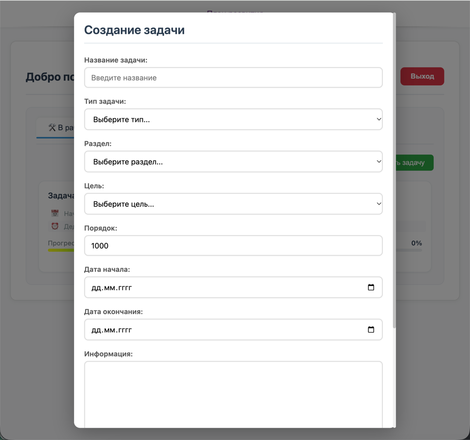
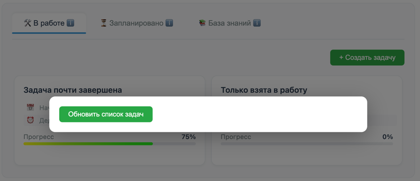
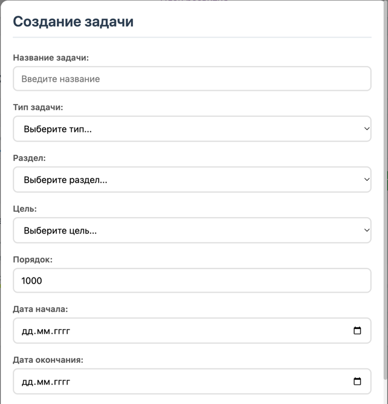
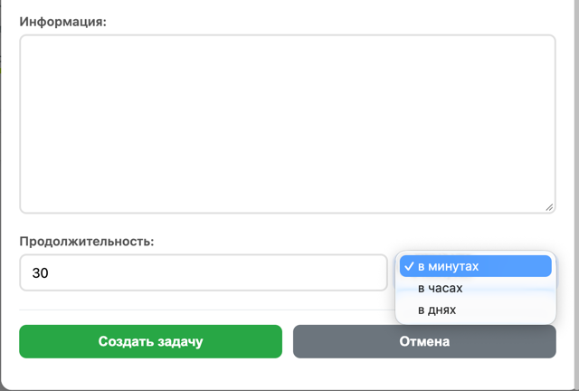



# Создание задачи

Создание задачи — центральная операция всего приложения. Пользователь может создать задачу
с любой из трёх вкладок главной страницы («В работе», «Запланировано», «База знаний»),
при этом набор обязательных полей зависит от выбранной вкладки. Например, для задач
«В работе» обязательны даты начала и окончания, а для «Базы знаний» они опциональны.

В отличие от страницы настроек, где CRUD-операции происходят прямо в таблице, создание
задачи реализовано через **модальное окно**: пользователь кликает «+ Создать задачу»,
открывается всплывающее окно с формой, после заполнения которого задача создаётся,
а пользователь возвращается на ту же вкладку, откуда пришёл.



## Отображение модального окна

### Маршрут

```dotty
val getTaskCreate = Route(
  Request.get(Path.root / "task" / "create" / Param.string)
    .extractHeader[Authorization],
  Response.ok(Entity.html).orNotFound
)
```

**Разбор маршрута:**

- **`Request.get(Path.root / "task" / "create" / Param.string)`** — GET-запрос на
  `/task/create/{tab}`, где `{tab}` — имя вкладки (`"in-progress"`, `"planned"`,
  `"knowledge-base"`). Параметр `tab` определяет, какие поля будут обязательными.
- **`.extractHeader[Authorization]`** — токен передаётся в заголовке `Authorization`.
- **`Response.ok(Entity.html).orNotFound`** — успешный ответ (200 OK) с HTML-телом
  модального окна.

### Хэндлер `CreateTaskModalHandler`

```dotty
final case class CreateTaskModalHandler(
    middleware: JwtAuthMiddleware[IO, UserInfo],
    settingsService: SettingsService[IO],
    taskLifecycleService: TaskLifecycleService[IO]
)(using Logger[IO]) extends AuthorizationHandler(middleware):
  val handler: Handler =
    Routes.getTaskCreate.handleIO:
      (tab: String, authorization: Authorization) =>
        withUserFromHeader(authorization): (user, token) =>
          val ordinalIO: IO[Ordinal] =
            TaskStatus.find(tab) match
              case Some(status)
                  if status == TaskStatus.InProgress ||
                    status == TaskStatus.Planned =>
                taskLifecycleService.taskService
                  .getAll(
                    userId = user.id,
                    maybeStatus = status.some,
                    maybeTaskType = none,
                    maybeSectionId = none
                  )
                  .map(_.map(_.ordinal.next).maxOption.getOrElse(Ordinal.Min))
              case _ => Ordinal.Max.pure[IO]

          ordinalIO.flatMap: ordinal =>
            val request = CreateTaskRequest.empty(
              token = token.value,
              tab = tab,
              ordinal = ordinal.value
            )

            getViewEmptyCreateTaskModal(
              settingsService = settingsService,
              userId = user.id,
              request = request
            )
```

**Пошаговый разбор:**

1. **`withUserFromHeader(authorization)(...)`** — стандартная проверка токена через
   `AuthorizationHandler`. `authorization` из заголовка передаётся первым аргументом;
   лямбда `(user, token)` — вторым. После успешной проверки получаем `user` и `token`.

2. **Вычисление порядкового номера (`ordinalIO`)** — динамически определяется
   для вкладок «В работе» и «Запланировано»: берётся максимальный `ordinal`
   среди существующих задач этого статуса и инкрементируется через `ordinal.next`
   (или `Ordinal.Min`, если задач ещё нет). Для «Базы знаний» используется
   `Ordinal.Max` — новые задачи попадают в конец.

3. **`CreateTaskRequest.empty(token, tab, ordinal.value)`** — формирует пустой
   запрос с уже вычисленным порядковым номером.

4. **`getViewEmptyCreateTaskModal(...)`** — формирует HTML модального окна, передавая:
  - `request` — значение полей модального окна по умолчанию.

### Формирование модального окна

```dotty
def getViewEmptyCreateTaskModal(
    settingsService: SettingsService[IO],
    userId: UserId,
    request: CreateTaskRequest
): IO[String] =
  getViewCreateTaskModal(
    settingsService = settingsService,
    isOpen = true,
    userId = userId,
    request = request,
    errorMessage = none
  )

private def getViewCreateTaskModal(
    settingsService: SettingsService[IO],
    isOpen: Boolean,
    userId: UserId,
    request: CreateTaskRequest,
    errorMessage: Option[String]
): IO[String] =
  for
    taskTypes <- settingsService.getTaskTypes(userId)
    sections  <- settingsService.getSections(userId)
    goals     <- settingsService.getGoals(userId)
  yield View.createTask(
    isOpen = isOpen,
    req = request,
    taskTypes = taskTypes,
    sections = sections,
    goals = goals,
    errorMessage = errorMessage
  ).toString
```

**Что происходит:**

1. **Загрузка справочников** — три запроса к `settingsService`:
  - `taskTypes` — типы задач пользователя.
  - `sections` — разделы пользователя.
  - `goals` — цели пользователя.

2. **Формирование `CreateTaskRequest`:**
  - `request` - значение предзаполненных полей

## Модель `CreateTaskRequest`

`CreateTaskRequest` — это DTO (Data Transfer Object), в который десериализуется тело
формы. Он отличается от доменного `CreateTask` тем, что содержит **только те поля,
которые приходят с формы**, и использует простые типы (`Int`, `Long`, `String`),
а не уточнённые (`TaskId`, `Ordinal`, `FiniteDuration`).

### Определение

```dotty
final case class CreateTaskRequest(
    token: String,
    tab: String,
    name: String,
    taskTypeId: Int,
    sectionId: Int,
    goalId: Int,
    ordinal: Int,
    ordinalShift: Option[String],
    startDate: Option[LocalDate],
    endDate: Option[LocalDate],
    information: String,
    durationValue: Long,
    durationUnit: TimeUnit
) derives FormCodec
```

**Поля:**

| Поле             | Назначение                                                                       |
| ---------------- | -------------------------------------------------------------------------------- |
| `token`          | JWT-токен из скрытого поля формы                                                 |
| `tab`            | Вкладка, с которой создаётся задача (`in-progress`, `planned`, `knowledge-base`) |
| `name`           | Название задачи                                                                  |
| `taskTypeId`     | ID типа задачи                                                                   |
| `sectionId`      | ID раздела                                                                       |
| `goalId`         | ID цели                                                                          |
| `ordinal`        | Порядковый номер                                                                 |
| `ordinalShift`   | Флаг сдвига порядковых номеров (`"on"`, если чекбокс отмечен)                    |
| `startDate`      | Дата начала (опционально)                                                        |
| `endDate`        | Дата окончания (опционально)                                                     |
| `information`    | Описание                                                                         |
| `durationValue`  | Числовое значение продолжительности                                              |
| `durationUnit`   | Единица измерения (`MINUTES`, `HOURS`, `DAYS`)                                   |

**Почему `durationValue` и `durationUnit` — отдельные поля?**

Потому что форма содержит **два** `<input>`/`<select>` для продолжительности.
Пользователь вводит число и выбирает единицу измерения. 
Только на уровне `CreateTask.parse` эти два поля объединяются в `FiniteDuration`.

### Метод `empty`

```dotty
def empty(token: String, tab: String, ordinal: Int): CreateTaskRequest =
  CreateTaskRequest(
    token = token,
    tab = tab,
    name = "",
    taskTypeId = 0,
    sectionId = 0,
    goalId = 0,
    ordinal = ordinal,
    ordinalShift = none,
    startDate = none,
    endDate = none,
    information = "",
    durationValue = 30,
    durationUnit = TimeUnit.MINUTES
  )
```

Возвращает «пустой» запрос со значениями по умолчанию. 
Используется при первом открытии формы, когда `errorRequest` отсутствует. 
Порядковый номер (`ordinal`) не фиксирован, а вычисляется в `CreateTaskModalHandler`:
для вкладок «В работе» и «Запланировано» — это следующий номер после последнего,
а для «Базы знаний» — `Ordinal.Max`, чтобы новая задача попала в конец списка.

## Шаблон `createTask.scala.html`

Шаблон состоит из двух веток: закрытое модальное окно и открытое. 
Первая используется после успешного создания задачи для «мягкого» закрытия окна.

### Ветка «Модальное окно закрыто»

```html
@if(!isOpen) {
<div id="task-modal" class="uk-modal uk-open" style="display:block;">
  <div class="uk-modal-dialog uk-modal-body">
    <button
      class="add-btn"
      hx-get="/home/@req.tab"
      hx-target="#app"
      hx-swap="outerHTML"
      onclick="closeCreateTaskModal()"
    >
      Обновить список задач
    </button>
  </div>
</div>
}
```



**Зачем нужна эта ветка?**

После успешного создания задачи сервер возвращает этот фрагмент HTML вместо формы.
Он вставляется в `#modal-container` и показывает пользователю кнопку «Обновить список
задач». Клик по ней перезагружает главную страницу с той же вкладки, где была
создана задача — и пользователь видит свою новую задачу в списке.

**Почему не сделать редирект сразу?**

Потому что после успешного создания задачи htmx заменяет **только** `#modal-container`,
а не `#app`. Это оставляет главную страницу на месте, но скрывает форму. Кнопка
«Обновить список задач» даёт пользователю контроль над моментом обновления —
он может сначала прочитать сообщение, затем кликнуть.

### Ветка «Модальное окно открыто»

```html
@if(isOpen) {
<div id="task-modal" class="uk-modal uk-open" style="display:block;">
  <div class="uk-modal-dialog uk-modal-body">
    <h2 class="uk-modal-title">Создание задачи</h2>

    <form hx-post="/tasks" hx-target="#modal-container" hx-swap="innerHTML">
      <input type="hidden" name="token" value="@req.token" />
      <input type="hidden" name="tab" value="@req.tab" />
      ...
    </form>
  </div>
</div>
}
```

**Ключевые моменты формы:**

1. **`hx-post="/tasks"`** — POST-запрос на создание задачи.
2. **`hx-target="#modal-container"`** — ответ сервера вставляется в контейнер модальных
   окон, а не в `#app`. Это важно: после успешного создания задача не должна
   «перекидывать» пользователя на другую страницу — он остаётся на текущей вкладке.
3. **`hx-swap="innerHTML"`** — заменяем содержимое `#modal-container`, а не его самого.
4. **Скрытые поля `token` и `tab`** — передаются в теле запроса. `tab` нужен, чтобы
   сервер знал, на какую вкладку вернуть пользователя после создания задачи.

### Поля формы



**Название задачи:**

```html
<div class="form-group">
  <label for="taskName">Название задачи:</label>
  <input
    id="taskName"
    name="name"
    type="text"
    required
    placeholder="Введите название"
    value="@req.name"
  />
</div>
```

Простое текстовое поле. Значение берётся из `req.name`, что позволяет сохранить
введённые данные при ошибке валидации.

**Тип задачи, раздел, цель:**

```html
<div class="form-group">
  <label for="taskTypeId">Тип задачи:</label>
  <select id="taskTypeId" name="taskTypeId" required>
    <option value="">Выберите тип...</option>
    @for(taskType <- taskTypes.filter(_.displayed).sortBy(_.ordinal.value)) {
    <option
      value="@taskType.id.value"
      @if(req.taskTypeId=""
      ="taskType.id.value){selected}"
    >
      @taskType.name.value
    </option>
    }
  </select>
</div>
```

Три аналогичных выпадающих списка. Особенности:

- **`.filter(_.displayed)`** — показываем только включённые элементы. Скрытые
  (архивные) не должны быть доступны для выбора.
- **`.sortBy(_.ordinal.value)`** — сортируем по порядку, заданному пользователем
  в настройках.
- **`@if(req.taskTypeId == taskType.id.value){selected}`** — выделяем текущий
  выбранный вариант при повторном рендере после ошибки.

**Порядок:**

```html
<div class="form-group">
  <label for="ordinal">Порядок:</label>
  <input
    id="ordinal"
    name="ordinal"
    type="number"
    min="1"
    value="@req.ordinal"
    required
  />
</div>
```

Порядковый номер задачи. По умолчанию `1000`, чтобы новые задачи попадали в конец
списка, если пользователь не задаст другое значение.

**Даты (с условной обязательностью):**

```html
<div class="form-group">
    <label for="startDate">Дата начала:</label>
    <input id="startDate" name="startDate" type="date"
           value="@req.startDate.map(_.toString).getOrElse("")"
           @if(req.tab == "in-progress") { required }/>
</div>
```

Здесь ключевая деталь: атрибут `required` **условный**. Для вкладки `"in-progress"`
даты обязательны (задача уже в работе, значит, начало зафиксировано). Для
`"planned"` и `"knowledge-base"` — опциональны.

**Информация:**

```html
<div class="form-group">
  <label for="information">Информация:</label>
  <textarea id="information" name="information" rows="10">
@req.information</textarea>
</div>
```

Многострочное текстовое поле для описания задачи, ссылок, заметок.



**Продолжительность (двухсоставное поле):**

```html
<div class="form-group">
  <label for="durationValue">Продолжительность:</label>
  <div class="duration-group">
    <input
      id="durationValue"
      name="durationValue"
      type="number"
      min="1"
      value="@req.durationValue"
      required
      class="duration-input"
      placeholder="Значение"
    />
    <select
      id="durationUnit"
      name="durationUnit"
      class="duration-select"
      required
    >
      <option
        value="minutes"
        @if(req.durationUnit=""
        ="TimeUnit.MINUTES){selected}"
      >
        в минутах
      </option>
      <option
        value="hours"
        @if(req.durationUnit=""
        ="TimeUnit.HOURS){selected}"
      >
        в часах
      </option>
      <option value="days" @if(req.durationUnit="" ="TimeUnit.DAYS){selected}">
        в днях
      </option>
    </select>
  </div>
</div>
```

**Почему две части, а не одно поле?**

Пользователю удобнее вводить продолжительность в разных единицах измерения: 
для быстрых задач это минуты, для крупных проектов — дни. 
Если бы мы жёстко задали минуты, пользователю пришлось бы вручную считать: 3 дня = 4320 минут. 
Двухсоставное поле решает эту проблему: пользователь вводит значение и выбирает единицу измерения.

При отправке формы сервер получает `durationValue` и `durationUnit` отдельно и конвертирует в `FiniteDuration`.

**Кнопки:**

```html
<div class="form-actions">
  <button type="submit" class="save-btn">Создать задачу</button>
  <button type="button" class="cancel-btn" onclick="closeCreateTaskModal()">
    Отмена
  </button>
</div>
```

- **«Создать задачу»** — `type="submit"`, отправляет форму через htmx.
- **«Отмена»** — `type="button"`, вызывает JavaScript-функцию `closeCreateTaskModal()`,
  которая закрывает модальное окно без создания задачи.

**Сообщение об ошибке:**

```html
<div class="messageBlock">
  @errorMessage.map { msg =>
  <div class="error">@msg</div>
  }
</div>
```

Если есть сообщение об ошибке — отображается красным блоком. Обычно это ошибки
валидации («Название не может быть пустым») или бизнес-логики («Дата начала
позже даты окончания»).

## Хэндлер создания задачи

После того как пользователь заполнил форму и нажал «Создать задачу», htmx отправляет
POST-запрос на `/tasks`. Здесь происходит вся логика создания.

### Хэндлер `CreateTaskHandler`

```dotty
final case class CreateTaskHandler(
    middleware: JwtAuthMiddleware[IO, UserInfo],
    settingsService: SettingsService[IO],
    taskLifecycleService: TaskLifecycleService[IO]
)(using Logger[IO]) extends AuthorizationHandler(middleware):
  val handler: Handler =
    Routes.taskCreate.handleIO: (request: CreateTaskRequest) =>
      val create: ((UserInfo, JwtToken)) => IO[String] =
        (user, jwtToken) =>
          CreateTask.parse(request, user.id) match
            case Validated.Valid(task) =>
              val runReorderTasks: IO[Boolean] =
                if request.ordinalShift.contains("on") then
                  taskLifecycleService.reorderTasks(
                    userId = user.id,
                    ordinal = task.ordinal,
                    status = task.status
                  )
                else IO(true)

              val run: IO[String] =
                for
                  _    <- runReorderTasks
                  _    <- taskLifecycleService.create(task)
                  view <-
                    getViewAfterCreateTask(
                      settingsService = settingsService,
                      userId = user.id,
                      token = jwtToken,
                      tab = request.tab
                    )
                yield view

              run
                .recoverWith:
                  case ex: IllegalArgumentException =>
                    getViewCreateTaskModalWithError(
                      settingsService = settingsService,
                      userId = user.id,
                      errorRequest = request,
                      errorMessage = ex.getMessage
                    )
            case Validated.Invalid(errors) =>
              getViewCreateTaskModalWithError(
                settingsService = settingsService,
                userId = user.id,
                errorRequest = request,
                errorMessage = errors.toChain.toVector.mkString("; ")
              )
      // ToDo: https://github.com/creativescala/krop/pull/57
      val authorization: Authorization =
        Authorization(Token(AuthScheme.Bearer, request.token))
      withUserFromHeader(authorization)(create)
```

**Пошаговый разбор:**

1. **`handleIO: (request: CreateTaskRequest) => ...`** — обработчик принимает
   `CreateTaskRequest`, который был десериализован из формы через `FormCodec`.

2. **`CreateTask.parse(request, user.id)`** — валидация и преобразование запроса
   в доменный объект `CreateTask`. Возвращает `ValidatedNec[String, CreateTask]`:
   - **`Valid`** — все поля корректны, задача готова к созданию.
   - **`Invalid`** — есть ошибки валидации (пустое имя, отрицательный ordinal и т.д.).

3. **Ветка `Valid`:**
   - **`runReorderTasks`** — если в форме был отмечен чекбокс сдвига
     (`request.ordinalShift.contains("on")`), вызывается
     `taskLifecycleService.reorderTasks`, который сдвигает порядковые номера
     существующих задач, освобождая место под новую. Иначе — `IO(true)` (без сдвига).
   - `taskLifecycleService.create(task)` — метод, который выполняет
     **дополнительную валидацию** (проверка существования типа, раздела, цели,
     проверка дат для статуса) и сохраняет задачу в БД.
   - **Успех** → возвращаем `getViewAfterCreateTask`. Это
     «закрытое» модальное окно с кнопкой «Обновить список задач».
   - **Ошибка** (`IllegalArgumentException`) → возвращаем то же модальное окно
     с сохранёнными данными и сообщением об ошибке (`getViewCreateTaskModalWithError`).

4. **Ветка `Invalid`:** возвращаем модальное окно с ошибками валидации, объединёнными
   через `"; "`.

5. **`withUserFromHeader(authorization)(create)`** — токен приходит в теле запроса, а не в заголовке.
   Поскольку `withUserFromHeader` ждёт `Authorization`, мы вручную собираем заголовок из токена формы:
   ```dotty
   val authorization: Authorization =
     Authorization(Token(AuthScheme.Bearer, request.token))
   ```
   После этого `withUserFromHeader` проверяет его через middleware и передаёт `(user, jwtToken)`
   в лямбду `create`.

   > Примечание: пока это временное решение (см. `// ToDo` — ждём поддержку токена из формы
   > в krop, https://github.com/creativescala/krop/pull/57).

`getViewAfterCreateTask` и `getViewCreateTaskModalWithError` используют тот же `getViewCreateTaskModal`,
что и при открытии модального окна:

```dotty
def getViewAfterCreateTask(
    settingsService: SettingsService[IO],
    userId: UserId,
    token: JwtToken,
    tab: String
): IO[String] =
  getViewCreateTaskModal(
    settingsService = settingsService,
    isOpen = false,
    userId = userId,
    request =
      CreateTaskRequest.empty(
        token = token.value,
        tab = tab,
        ordinal = Ordinal.Max.value
      ),
    errorMessage = none
  )

def getViewCreateTaskModalWithError(
    settingsService: SettingsService[IO],
    userId: UserId,
    errorRequest: CreateTaskRequest,
    errorMessage: String
): IO[String] =
  getViewCreateTaskModal(
    settingsService = settingsService,
    isOpen = true,
    userId = userId,
    request = errorRequest,
    errorMessage = errorMessage.some
  )
```

**Почему валидация двухуровневая?**

`CreateTask.parse` проверяет **структурные** инварианты:

- Некорректный UUID задачи.
- Пустое имя.
- Отрицательный ordinal.

```dotty
object CreateTask:
  def parse(
      request: CreateTaskRequest,
      userId: UserId
  ): ValidatedNec[String, CreateTask] =
    (
      TaskName.either(request.name).toValidatedNec,
      TaskTypeId.either(request.taskTypeId).toValidatedNec,
      Status.find(request.tab).toValidNec(s"Status not found: ${request.tab}"),
      SectionId.either(request.sectionId).toValidatedNec,
      GoalId.either(request.goalId).toValidatedNec,
      Ordinal.either(request.ordinal).toValidatedNec
    ).mapN {
      case (name, taskTypeId, status, sectionId, goalId, ordinal) =>
        CreateTask(
          name = name,
          userId = userId,
          taskTypeId = taskTypeId,
          status = status,
          sectionId = sectionId,
          goalId = goalId,
          ordinal = ordinal,
          startDate = request.startDate,
          endDate = request.endDate,
          information = request.information,
          plan = Plan.Empty,
          duration =
            FiniteDuration(request.durationValue, request.durationUnit),
          timeSpent = FiniteDuration(0, TimeUnit.MINUTES)
        )
    }
```

`taskLifecycleService.create` проверяет **бизнес-инварианты**:

- Существует ли тип задачи с таким ID и принадлежит ли он пользователю.
- Существует ли раздел.
- Существует ли цель.
- Корректны ли даты для выбранного статуса (например, дата окончания не раньше
  даты начала).

Такое разделение позволяет переиспользовать `CreateTask.parse` в других контекстах
(например, в API), а бизнес-валидацию оставить в сервисе.

## Возврат на домашнюю страницу

После создания задачи пользователь может кликнуть «Обновить список задач»
в закрытом модальном окне. Это вызовет GET-запрос на `/home/{tab}`.

### Маршрут

```dotty
val home =
  Route(
    Request.get(Path.root / "home" / Param.string).extractHeader[Cookie],
    Response.ok(Entity.html)
  )
```

### Хэндлер `HomeHandler`

```dotty
final case class HomeHandler(
    middleware: JwtAuthMiddleware[IO, UserInfo],
    taskLifecycleService: TaskLifecycleService[IO],
    periodicTaskLifecycleService: PeriodicTaskLifecycleService[IO],
    notesService: NotesService[IO],
    historyService: HistoryService[IO]
)(using Logger[IO]) extends AuthorizationHandler(middleware):
  val handler: Handler =
    Routes.home.handleIO: (tab: String, cookie: Cookie) =>
      withUserFromCookie(cookie)(
        f = (user, jwtToken) =>
          getViewWelcome(
            taskLifecycleService = taskLifecycleService,
            periodicTaskLifecycleService = periodicTaskLifecycleService,
            notesService = notesService,
            historyService = historyService,
            user = user,
            jwtToken = jwtToken,
            tab = tab
          ),
        fallbackPage = View.login(None).toString
      )
```

**Пошаговый разбор:**

1. **`extends AuthorizationHandler(middleware)`** — даёт доступ к `withUserFromCookie(cookie)`.
2. **`withUserFromCookie(cookie)(f, fallbackPage)`** — извлекает токен из куки `token`,
   проверяет его и передаёт `(user, jwtToken)` в `f`. Если токена нет/невалиден —
   возвращает `fallbackPage` (форму логина).
3. **`f`** — строит приветственную страницу нужной вкладки через `getViewWelcome`.
4. Все ошибки (`AuthorizationException` и прочие) обрабатываются внутри `AuthorizationHandler`
   и сводятся к возврату `fallbackPage` — приложение не падает.

**Почему `HomeHandler` отличается от `InitialHandler`?**

| Аспект          | `InitialHandler`    | `HomeHandler` |
| --------------- | ------------------- | ------------- |
| Путь            | `/`                 | `/home/{tab}` |
| Параметры       | нет                 | `tab: String` |
| Вкладка         | Всегда `DefaultTab` | Любая из URL  |
| Источник токена | Cookie              | Cookie        |
| Возвращает      | Всю страницу        | Только `#app` |

`InitialHandler` используется, когда пользователь впервые заходит на сайт:
он не знает, какую вкладку хочет открыть, поэтому показывается `DefaultTab`.
`HomeHandler` используется при навигации внутри приложения: пользователь уже знает,
куда хочет попасть, и передаёт `tab` в URL.

**Почему возвращается только `#app`, а не вся страница?**

Потому что `hx-target="#app"` и `hx-swap="outerHTML"`. Это позволяет обновлять
**только центральную часть** страницы, не перезагружая шапку, скрипты и стили.
Такой подход экономит трафик и ускоряет взаимодействие.

## Полный поток создания задачи

Рассмотрим сценарий:

1. **Пользователь на вкладке «Запланировано»** кликает «+ Создать задачу».
2. **htmx отправляет GET** на `/task/create/planned` с токеном в заголовке.
3. **`CreateTaskModalHandler`** проверяет токен, загружает справочники,
   возвращает HTML модального окна.
4. **htmx вставляет HTML** в `#modal-container`. Пользователь видит форму.
5. **Пользователь заполняет форму** и нажимает «Создать задачу».
6. **htmx отправляет POST** на `/tasks` с данными формы.
7. **`CreateTaskHandler`** валидирует запрос, при отмеченном чекбоксе сдвига вызывает
   `taskLifecycleService.reorderTasks`, затем `taskLifecycleService.create`,
   создаёт задачу в БД.
8. **При успехе** возвращается «закрытое» модальное окно с кнопкой
   «Обновить список задач».
9. **Пользователь кликает** на эту кнопку → GET на `/home/planned`.
10. **`HomeHandler`** возвращает обновлённую страницу welcome с новой задачей в таблице.

**Если на шаге 7 ошибка** (например, дата окончания раньше даты начала):

- Возвращается модальное окно с **сохранёнными данными** и сообщением об ошибке.
- Пользователь исправляет данные и отправляет форму снова.

## Итог

Мы реализовали полный цикл создания задачи:

1. **`CreateTaskModalHandler`** — открывает модальное окно с формой.
2. **`createTask.scala.html`** — рендерит форму с условно обязательными полями
   (даты обязательны только для «В работе»).
3. **`CreateTaskHandler`** — валидирует данные, создаёт задачу, обрабатывает
   ошибки.
4. **`HomeHandler`** — возвращает пользователя на его вкладку с обновлённым списком.

**Ключевые архитектурные решения:**

- **Сохранение введённых данных** — `errorRequest` позволяет не терять данные
  при ошибке.
- **Условная обязательность полей** — атрибут `required` выставляется в зависимости
  от вкладки.
- **Мягкое закрытие модального окна** — после успеха пользователь видит кнопку
  «Обновить список задач», что даёт контроль над моментом перехода.

Эта архитектура делает создание задачи быстрым и удобным: пользователь не теряет
контекст, может исправить ошибки, а его данные не пропадают при неудачной попытке.

---

**Ссылки:**

- [Репозиторий с исходниками][repo]

[repo]: https://gitverse.ru/scalabook/pdp
