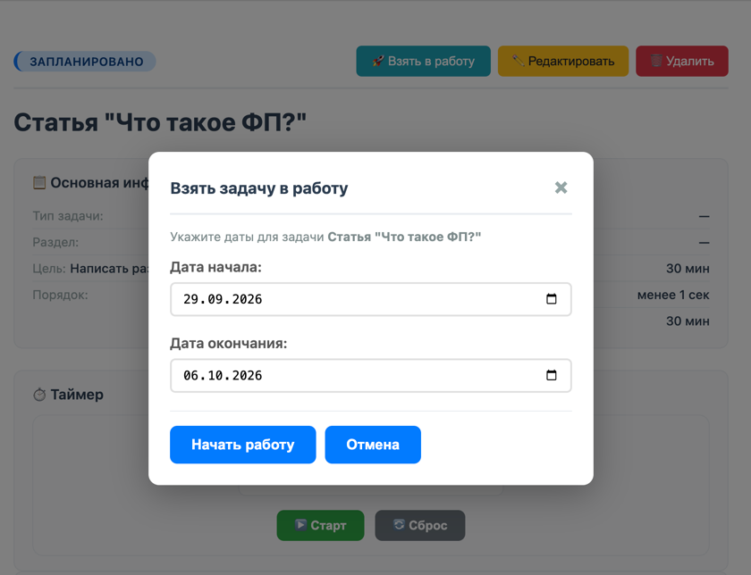
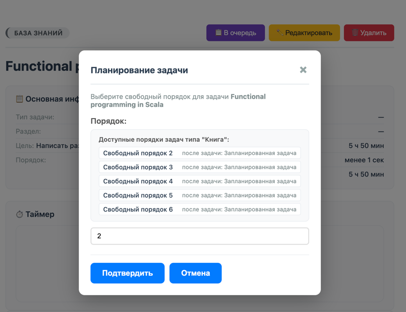
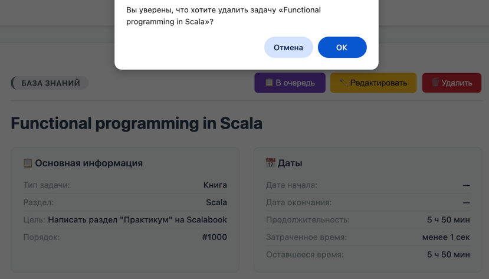

# Действия над задачей

После того как задача создана и находится на странице `/task/{id}`, пользователь может выполнять
над ней различные действия в зависимости от текущего статуса. Все действия реализованы
как отдельные хэндлеры, которые принимают PUT- или DELETE-запрос и возвращают обновлённое
представление задачи или главной страницы.

Список действий:

| Действие                | Статус задачи   | HTTP-метод | Возвращает                    |
| ----------------------- | --------------- | ---------- | ----------------------------- |
| **Завершить**           | `InProgress`    | PUT        | Главную страницу (`HomeView`) |
| **Отложить**            | `InProgress`    | PUT        | Обновлённую страницу задачи   |
| **Взять в работу**      | `Planned`       | PUT        | Обновлённую страницу задачи   |
| **Поставить в очередь** | `KnowledgeBase` | PUT        | Обновлённую страницу задачи   |
| **Удалить**             | Любой           | DELETE     | Главную страницу (`HomeView`) |

**Почему завершение и удаление возвращают главную страницу, а не задачу?**

Потому что после завершения или удаления задача **покидает активный список** — пользователю
логичнее увидеть список оставшихся задач, а не страницу задачи, которой уже нет
в текущей вкладке. Остальные действия не меняют «принадлежность» задачи к вкладке,
поэтому возвращается та же страница задачи с обновлённым статусом.

## Завершение задачи

Завершение — это финальное действие для задачи в статусе `InProgress`. Оно требует
от пользователя рефлексии: оценки (1–5), отзыва, фактической даты окончания и фактической
продолжительности. Эти данные записываются в историю задачи и используются в статистике.


### Маршрут

Маршрут объявлен приватно внутри `TaskHandlers` на основе общего пути `taskPath`
(`Path.root / "task" / uuidParam`):

```dotty
private val completeFormRoute = Route(
  Request.put(taskPath / "complete")
    .withEntity(Entity.formOf[CompileTaskRequest]),
  Response.ok(Entity.html).orNotFound
)
```

**Разбор:**

- **`Request.put(taskPath / "complete")`** — PUT-запрос на
  `/task/{uuid}/complete`. `uuidParam` декодирует путь сразу в `UUID`.
- **`.withEntity(Entity.formOf[CompileTaskRequest])`** — тело запроса в формате
  `application/x-www-form-urlencoded`, десериализуется в `CompileTaskRequest`.
- **`Response.ok(Entity.html).orNotFound`** — успешный ответ с HTML или 404.

### Хэндлер `completeHandler` (класс `TaskHandlers`)

```dotty
val completeHandler: Handler =
  completeFormRoute.handleIO: (uuid: UUID, request: CompileTaskRequest) =>
    val run: ((UserInfo, SignedJwt)) => IO[Option[String]] =
      (user, jwtToken) =>
        val taskId = TaskId(uuid)
        (
          Rating.values
            .find(_.r == request.rating)
            .toValidNec(
              s"Рейтинг (1-5) не определился: ${request.rating}"
            ),
          Review.either(request.review.trim).toValidatedNec,
          request.endDate.toValidNec("Не заполнена дата окончания")
        ).mapN { case (rating, review, endDate) =>
          taskLifecycleService.complete(
            id = taskId,
            userId = user.id,
            rating = rating,
            review = review,
            endDate = endDate,
            duration = FiniteDuration(
              request.durationValue,
              request.durationUnit
            )
          ).map(_ => HomeView.some)
        }.valueOr(errors =>
          getViewTask(
            taskLifecycleService = taskLifecycleService,
            userId = user.id,
            taskId = taskId,
            jwtToken = jwtToken,
            errorMessage = errors.mkString_(";").some
          )
        )
    // ToDo: https://github.com/creativescala/krop/pull/57
    val authorization: Authorization =
      Authorization(Token(AuthScheme.Bearer, request.token))
    withUserFromHeaderOpt(authorization)(run)
```

**Пошаговый разбор:**

1. **`TaskId(uuid)`** — унарная свёртка готового `UUID` в `TaskId`. Ручной парсинг из строки
   больше не нужен: `uuidParam` в маршруте уже декодировал путь в `UUID`.

2. **Тройная валидация через `ValidatedNec`:**
    - **`Rating.values.find(_.r == request.rating)`** — ищет `Rating` по числовому
      значению. Если не найдено — ошибка `"Рейтинг (1-5) не определился: {rating}"`.
    - **`Review.either(request.review.trim)`** — валидация отзыва. `trim` убирает
      крайние пробелы, `either` проверяет не пустоту. Если отзыв пустой — ошибка.
    - **`request.endDate.toValidNec("Не заполнена дата окончания")`** — дата
      окончания обязательна. Если `None` — ошибка.

3. **`.mapN { case (rating, review, endDate) => ... }`** — если все три валидны,
   выполняем завершение:
    - `taskLifecycleService.complete(...)` с параметрами `id`, `userId`, `rating`,
      `review`, `endDate`, `duration`.
    - `duration` конвертируется из минут (`request.duration`) в `FiniteDuration`.
    - При успехе возвращается `HomeView.some` — специальный маркер, означающий
      «показать главную страницу». В `HomeView` входит HTML главной страницы.

4. **`.valueOr(errors => ...)`** — если есть ошибки валидации, показываем форму
   задачи с сообщением об ошибке. Пользователь может исправить данные и попробовать снова.

### Что такое `HomeView`?

`HomeView` — это константа из `WelcomeViews`, возвращающая HTML главной страницы:

```dotty
val HomeView: String = Views.home()

object View:
  def home(): String =
    div(cls := "home-container")(
      a(href := "/", cls := "home-button")("🏠 На главную")
    ).render
```

### Модель `CompileTaskRequest`

```dotty
final case class CompileTaskRequest(
    token: String,
    rating: Int,
    review: String,
    endDate: Option[LocalDate],
    durationValue: Long,
    durationUnit: TimeUnit
) derives FormCodec
```

**Поля:**

| Поле                    | Назначение                              |
| ----------------------- | --------------------------------------- |
| `token`                 | JWT-токен из скрытого поля формы        |
| `rating`                | Оценка от 1 до 5                        |
| `review`                | Отзыв о выполненной работе              |
| `endDate`               | Фактическая дата окончания              |
| `durationdurationValue` | Значение фактической продолжительности  |
| `durationUnit`          | Единица измерения продолжительности     |

### Модальное окно «Завершение задачи»

```dotty
object CompileTaskRequest:
  def render(id: TaskId, token: SignedJwt, timeSpent: FiniteDuration): Tag =
    val now = LocalDate.now().format(DateTimeFormatter.ISO_DATE)

    form(
      attr("id")     := "completeForm",
      attr("hx-put") := s"/task/$id/complete",
      Htmx.appTarget,
      Htmx.appSwap,
      attr("hx-on::after-request") :=
        "if(event.detail.xhr.status === 200) closeModal('completeModal')",
      Htmx.hiddenToken(token.show),
      div(
        cls := "form-group",
        label(`for` := "ratingInput")("Оценка (от 1 до 5):"),
        div(
          cls := "rating-container",
          div(
            cls := "rating-stars",
            (1 to 5).map { n =>
              span(
                cls                := "star",
                attr("data-value") := n,
                onclick            := s"setRating($n)"
              )("☆")
            }
          ),
          input(
            attr("id")    := "ratingInput",
            attr("name")  := "rating",
            attr("type")  := "number",
            cls           := "form-input rating-input",
            placeholder   := "Оценка 1-5",
            attr("value") := "5",
            attr("min")   := "1",
            attr("max")   := "5",
            required
          )
        )
      ),
      div(
        cls := "form-group",
        label(`for` := "reviewInput")("Отзыв о выполненной работе:"),
        textarea(
          attr("id")   := "reviewInput",
          attr("name") := "review",
          cls          := "form-textarea",
          attr("rows") := 10,
          placeholder  :=
            "Опишите, что было сделано, с какими сложностями столкнулись...",
          required
        )()
      ),
      div(
        cls := "form-group",
        label(`for` := "completeEndDateInput")("Фактическая дата окончания:"),
        input(
          attr("id")    := "completeEndDateInput",
          attr("name")  := "endDate",
          attr("type")  := "date",
          cls           := "form-input",
          attr("value") := now,
          required
        )
      ),
      durationGroup(timeSpent),
      div(
        cls := "modal-actions",
        button(`type` := "submit", cls := "save-btn")("Завершить задачу"),
        button(
          `type`  := "button",
          cls     := "cancel-btn",
          onclick := "closeModal('completeModal')"
        )("Отмена")
      )
    )
  end render

  private def durationGroup(timeSpent: FiniteDuration): Tag =
    div(
      cls := "form-group",
      label(`for` := "completeDurationValue")("Фактическая продолжительность:"),
      div(
        cls := "duration-group",
        input(
          attr("id")    := "completeDurationValue",
          attr("name")  := "durationValue",
          attr("type")  := "number",
          attr("min")   := "1",
          cls           := "form-input duration-input",
          placeholder   := "Значение",
          attr("value") := timeSpent.length,
          required
        ),
        select(
          attr("id")   := "completeDurationUnit",
          attr("name") := "durationUnit",
          cls          := "form-select duration-select",
          required,
          option(value := "", disabled, selected)("Выберите единицу..."),
          durationOption(
            "minutes",
            TimeUnit.MINUTES,
            timeSpent.unit,
            "в минутах"
          ),
          durationOption("hours", TimeUnit.HOURS, timeSpent.unit, "в часах"),
          durationOption("days", TimeUnit.DAYS, timeSpent.unit, "в днях")
        )
      )
    )

  private def durationOption(
      optValue: String,
      optionUnit: TimeUnit,
      selectedUnit: TimeUnit,
      text: String
  ): Modifier =
    option(
      (value := optValue) ::
        (if optionUnit == selectedUnit then List[Modifier](selected)
         else List.empty[Modifier])
    )(text)
```

**Особенности:**

1. **Оценка в виде звёзд** — JavaScript-функция `setRating(value)` обновляет
   значение поля `rating` и подсвечивает звёзды. Поле `rating` скрыто стилями,
   но остаётся функциональным.

2. **Отзыв** — обязательное поле (проверяется на сервере). Это осознанное решение:
   завершение задачи без рефлексии менее ценно.

3. **Дата окончания** — по умолчанию сегодня. Пользователь может изменить, если
   завершает задачу задним числом.

4. **Продолжительность** — по умолчанию равна планируемой (`task.duration`).
   Пользователь корректирует, если реальное время отличается.

5. **`hx-put="/task/{id}/complete"`** — отправка формы идёт PUT-запросом.

6. **`hx-target="#app"`** — после завершения заменяется весь контейнер `#app`
   (главная страница).

## Откладывание задачи

Откладывание переводит задачу из `InProgress` обратно в `Planned`. Даты начала
и окончания **очищаются**, потому что при повторном взятии в работу они будут другими.
Это позволяет пользователю временно приостановить работу над задачей, не теряя её.


### Маршрут

Маршрут объявлен приватно внутри `TaskHandlers` на основе общего пути `taskPath`
(`Path.root / "task" / uuidParam`):

```dotty
private val deferFormRoute = Route(
  Request.put(taskPath / "defer")
    .extractHeader[Authorization],
  Response.ok(Entity.html).orNotFound
)
```

**Отличие от `complete`:** здесь **нет** тела запроса, потому что все данные уже
известны (ID задачи из пути, пользователь — из токена). Используется только
заголовок `Authorization`. `uuidParam` декодирует путь сразу в `UUID`.

### Хэндлер `deferHandler` (класс `TaskHandlers`)

```dotty
val deferHandler: Handler =
  deferFormRoute.handleIO: (uuid: UUID, authorization: Authorization) =>
    withUserFromHeaderOpt(authorization): (user, jwtToken) =>
      val taskId = TaskId(uuid)
      for
        _ <- taskLifecycleService.defer(
          id = taskId,
          userId = user.id
        )
        maybeView <- getViewTask(
          taskLifecycleService = taskLifecycleService,
          userId = user.id,
          taskId = taskId,
          jwtToken = jwtToken,
          errorMessage = none
        )
      yield maybeView
```

**Пошаговый разбор:**

1. **`withUserFromHeaderOpt(authorization)`** — мягкая проверка токена из заголовка
   (невалидный токен → `None`, а не исключение). `authorization` — первый аргумент,
   лямбда `(user, jwtToken)` — второй.

2. **`TaskId(uuid)`** — унарная сверка готового `UUID` в `TaskId`. Парсинг из строки
   не нужен — `uuidParam` уже декодировал путь.

3. **`taskLifecycleService.defer(id, userId)`** — выполняет откладывание:
   - Проверяет, что задача в статусе `InProgress`.
   - Меняет статус на `Planned`.
   - Очищает `startDate` и `endDate`.

4. **`getViewTask(...)`** — загружает обновлённую страницу задачи. Пользователь
   видит ту же задачу, но теперь с кнопкой «🚀 Взять в работу».

**Почему нет формы и тела запроса?**

Потому что все необходимые данные уже известны. Пользователь кликает «⏳ Отложить
задачу» — этого достаточно. Подтверждение обеспечивается через `hx-confirm`
в HTML-кнопке.

Рендер ``Views.task`` (scalatags):

```dotty
button(
  cls            := "postpone-task-btn",
  attr("hx-put") := s"/task/${task.id.value}/defer",
  Htmx.appTarget,
  Htmx.appSwap,
  attr("hx-confirm") :=
    s"""Вы уверены, что хотите отложить задачу «${task.name.value}»?"""
)("⏳ Отложить задачу")
```

## Взятие в работу

Переводит задачу из `Planned` в `InProgress`. Требует указания дат начала
и окончания.



### Маршрут

Маршрут объявлен приватно внутри `TaskHandlers` на основе общего пути `taskPath`
(`Path.root / "task" / uuidParam`):

```dotty
private val startFormRoute = Route(
  Request.put(taskPath / "start")
    .withEntity(Entity.formOf[StartTaskRequest]),
  Response.ok(Entity.html).orNotFound
)
```

### Хэндлер `startHandler` (класс `TaskHandlers`)

```dotty
val startHandler: Handler =
  startFormRoute.handleIO: (uuid: UUID, request: StartTaskRequest) =>
    val run: ((UserInfo, SignedJwt)) => IO[Option[String]] =
      (user, jwtToken) =>
        val taskId = TaskId(uuid)
        (
          request.startDate.toValidNec("Не заполнена дата начала"),
          request.endDate.toValidNec("Не заполнена дата окончания")
        ).mapN { case (startDate, endDate) =>
          for
            _ <- taskLifecycleService.start(
              id = taskId,
              userId = user.id,
              startDate = startDate,
              endDate = endDate
            )
            maybeView <- getViewTask(
              taskLifecycleService = taskLifecycleService,
              userId = user.id,
              taskId = taskId,
              jwtToken = jwtToken,
              errorMessage = none
            )
          yield maybeView
        }.valueOr(errors =>
          getViewTask(
            taskLifecycleService = taskLifecycleService,
            userId = user.id,
            taskId = taskId,
            jwtToken = jwtToken,
            errorMessage = errors.mkString_(";").some
          )
        )
    // ToDo: https://github.com/creativescala/krop/pull/57
    val authorization: Authorization =
      Authorization(Token(AuthScheme.Bearer, request.token))
    withUserFromHeaderOpt(authorization)(run)
```

**Пошаговый разбор:**

1. **Валидация дат** через `ValidatedNec`:
   - `startDate` — обязательна.
   - `endDate` — обязательна.
   
   `uuid` приходит уже как `UUID` (`uuidParam` в маршруте), поэтому `TaskId(uuid)`
   собирается сразу, без `Right`/`Left`-веток.

2. **`.mapN { case (startDate, endDate) => ... }`** — при успехе вызываем
   `taskLifecycleService.start(...)`, который:
    - Проверяет, что задача в статусе `Planned`.
    - Меняет статус на `InProgress`.
    - Устанавливает `startDate` и `endDate`.

3. **`.valueOr(...)`** — при ошибке валидации показываем форму задачи
   с сообщением.

### Модель `StartTaskRequest`

```dotty
final case class StartTaskRequest(
    token: String,
    startDate: Option[LocalDate],
    endDate: Option[LocalDate]
) derives FormCodec
```

Минимальный DTO: только токен и две даты. `derives FormCodec` автоматически
генерирует кодек для десериализации из формы.

### Модальное окно «Взять в работу»

```dotty
object StartTaskRequest:
  def render(id: TaskId, token: SignedJwt): Tag =
    val now        = LocalDate.now().format(DateTimeFormatter.ISO_DATE)
    val weeksLater =
      LocalDate.now().plusWeeks(1).format(DateTimeFormatter.ISO_DATE)

    form(
      attr("id")     := "startForm",
      attr("hx-put") := s"/task/${id.value}/start",
      Htmx.appTarget,
      Htmx.appSwap,
      Htmx.hiddenToken(token.show),
      div(
        cls := "form-group",
        label(`for` := "startDateInput")("Дата начала:"),
        input(
          attr("id")    := "startDateInput",
          attr("name")  := "startDate",
          attr("type")  := "date",
          cls           := "form-input",
          attr("value") := now
        )
      ),
      div(
        cls := "form-group",
        label(`for` := "endDateInput")("Дата окончания:"),
        input(
          attr("id")    := "endDateInput",
          attr("name")  := "endDate",
          attr("type")  := "date",
          cls           := "form-input",
          attr("value") := weeksLater
        )
      ),
      div(
        cls := "modal-actions",
        button(
          `type`  := "submit",
          cls     := "save-btn",
          onclick := "closeModal('startModal')"
        )("Начать работу"),
        button(
          `type`  := "button",
          cls     := "cancel-btn",
          onclick := "closeModal('startModal')"
        )("Отмена")
      )
    )
  end render
```

**Значения по умолчанию** выбраны оптимально:

- **Дата начала** — сегодня. Логично: пользователь берёт задачу в работу прямо сейчас.
- **Дата окончания** — через неделю. Типичный срок для задачи среднего размера.

Пользователь может сразу нажать «Начать работу», не меняя даты, либо может обновить только дату окончания — это снижает трение.

## Постановка в очередь

Переводит задачу из `KnowledgeBase` в `Planned`. Требует указания порядкового номера.



### Маршрут

Маршрут объявлен приватно внутри `TaskHandlers` на основе общего пути `taskPath`
(`Path.root / "task" / uuidParam`):

```dotty
private val queueFormRoute = Route(
  Request.put(taskPath / "queue")
    .withEntity(Entity.formOf[QueueTaskRequest]),
  Response.ok(Entity.html).orNotFound
)
```

### Хэндлер `queueHandler` (класс `TaskHandlers`)

```dotty
val queueHandler: Handler =
  queueFormRoute.handleIO: (uuid: UUID, request: QueueTaskRequest) =>
    val run: ((UserInfo, SignedJwt)) => IO[Option[String]] =
      (user, jwtToken) =>
        val taskId = TaskId(uuid)
        Ordinal.either(request.ordinal) match
          case Right(ordinal) =>
            val runReorderTasks: IO[Boolean] =
              if request.ordinalShift.contains("on") then
                taskLifecycleService.reorderTasks(
                  userId = user.id,
                  ordinal = ordinal,
                  status = Status.Planned
                )
              else IO(true)

            for
              _ <- runReorderTasks
              _ <- taskLifecycleService.enqueue(
                id = taskId,
                userId = user.id,
                ordinal = ordinal
              )
              maybeView <- getViewTask(
                taskLifecycleService = taskLifecycleService,
                userId = user.id,
                taskId = taskId,
                jwtToken = jwtToken,
                errorMessage = none
              )
            yield maybeView
          case Left(error) =>
            getViewTask(
              taskLifecycleService = taskLifecycleService,
              userId = user.id,
              taskId = taskId,
              jwtToken = jwtToken,
              errorMessage = error.some
            )
        end match
    // ToDo: https://github.com/creativescala/krop/pull/57
    val authorization: Authorization =
      Authorization(Token(AuthScheme.Bearer, request.token))
    withUserFromHeaderOpt(authorization)(run)
```

**Пошаговый разбор:**

1. **`Ordinal.either(request.ordinal)`** — валидация порядкового номера
   (должен быть положительным). `taskId = TaskId(uuid)` — унарная сверка уже
   декодированного маршрутом `UUID`.

2. **`runReorderTasks`** — если в форме отмечен флажок `ordinalShift` (значение `"on"`),
   сначала вызывается `reorderTasks`, который «раздвигает» уже занятые порядковые номера,
   чтобы освободить место для новой задачи.

3. **`taskLifecycleService.enqueue(id, userId, ordinal)`** — переводит задачу:
    - Проверяет, что задача в статусе `KnowledgeBase`.
    - Меняет статус на `Planned`.
    - Устанавливает указанный порядковый номер.
   Если была включена перестановка — она выполняется **до** постановки в очередь.

4. **При ошибке валидации `ordinal`** — показываем форму задачи с ошибкой.

### Модель `QueueTaskRequest`

```dotty
final case class QueueTaskRequest(
    token: String,
    ordinal: Int,
    ordinalShift: Option[String]
) derives FormCodec
```

- **`token`** — JWT-токен из скрытого поля формы.
- **`ordinal`** — порядковый номер.
- **`ordinalShift`** — опциональный флаг (например, чекбокс «сдвинуть порядок»).
  Если равен `"on"`, перед постановкой в очередь выполняется перестановка порядковых номеров.
  `Option[String]` означает, что флажок может быть не отмечен — тогда сдвиг не выполняется.

### Модальное окно «В очередь»

```dotty
object QueueTaskRequest:
  def render(
      id: TaskId,
      token: SignedJwt,
      taskType: String,
      availableOrdinals: Vector[OrdinalCard]
  ): Tag =
    val ordinal = availableOrdinals.headOption.map(_.ordinal).getOrElse(1)

    val ordinalListChildren: Seq[Tag] =
      if availableOrdinals.nonEmpty then availableOrdinals.map(_.render)
      else Vector(div(cls := "ordinal-info-empty")("Нет доступных порядков"))

    form(
      attr("id")     := "ordinalForm",
      attr("hx-put") := s"/task/${id.value}/queue",
      Htmx.appTarget,
      Htmx.appSwap,
      Htmx.hiddenToken(token.show),
      div(
        cls := "form-group",
        label(`for` := "ordinalSelect")("Порядок:"),
        div(
          cls := "ordinal-info-block compact",
          div(cls := "ordinal-info-title")(
            s"""Доступные порядки задач типа "$taskType":"""
          ),
          div(cls := "ordinal-info-list")(ordinalListChildren*)
        ),
        input(
          attr("id")    := "ordinalSelect",
          attr("name")  := "ordinal",
          attr("type")  := "number",
          cls           := "form-input",
          placeholder   := "Введите порядок",
          attr("value") := ordinal
        ),
        div(
          cls := "form-group",
          label(`for` := "ordinalShift")("Выровнять порядок?"),
          input(
            attr("id")   := "ordinalShift",
            attr("name") := "ordinalShift",
            attr("type") := "checkbox"
          )
        )
      ),
      div(
        cls := "modal-actions",
        button(
          `type`  := "submit",
          cls     := "save-btn",
          onclick := "closeModal('ordinalModal')"
        )("Подтвердить"),
        button(
          `type`  := "button",
          cls     := "cancel-btn",
          onclick := "closeModal('ordinalModal')"
        )("Отмена")
      )
    )
  end render
```

**Ключевые моменты:**

1. **Список доступных порядков** — `availableOrdinals` приходит из `getViewTask`
   (мы разбирали его в документации страницы задачи). Каждый элемент —
   `OrdinalCard(ordinal, after)`, где `after` — название задачи, после которой
   идёт этот свободный номер.

2. **Предзаполненное значение** — первое доступное значение подставляется в поле
   по умолчанию. Пользователю обычно достаточно нажать «Подтвердить».

3. **`hx-put="/task/{id}/queue"`** — PUT-запрос.

4. **`hx-target="#app"`** — после успеха возвращается страница задачи
   с новым статусом (`Planned`).

## Удаление задачи

Удаление — финальное и необратимое действие. Доступно для задач в любом статусе.
Требует подтверждения (`hx-confirm`) на клиенте.



### Маршрут

Маршрут объявлен приватно внутри `TaskHandlers` на основе общего пути `taskPath`
(`Path.root / "task" / uuidParam`):

```dotty
private val deleteRoute = Route(
  Request.delete(taskPath).extractHeader[Authorization],
  Response.ok(Entity.html).orNotFound
)
```

**Разбор:**

- **`Request.delete(taskPath)`** — DELETE-запрос на `/task/{uuid}`.
  `uuidParam` декодирует путь сразу в `UUID`.
- **`.extractHeader[Authorization]`** — токен из заголовка.
- **`Response.ok(Entity.html).orNotFound`** — успешный ответ с HTML.

### Хэндлер `deleteHandler` (класс `TaskHandlers`)

```dotty
val deleteHandler: Handler =
  deleteRoute.handleIO: (uuid: UUID, authorization: Authorization) =>
    withUserFromHeaderOpt(authorization): (user, token) =>
      val taskId = TaskId(uuid)
      taskLifecycleService
        .delete(
          id = taskId,
          userId = user.id
        ).map(_ => HomeView.some)
```

**Пошаговый разбор:**

1. **`withUserFromHeaderOpt(authorization)`** — мягкая проверка токена из заголовка:
   `authorization` — первый аргумент, лямбда `(user, token)` — второй.

2. **`TaskId(uuid)`** — унарная свёртка уже декодированного маршрутом `UUID`.

3. **`taskLifecycleService.delete(id, userId)`** — удаляет задачу:
    - Проверяет, что задача принадлежит пользователю.
    - Удаляет запись из БД.

4. **`.map(_ => HomeView.some)`** — после удаления возвращаем главную страницу
   (`HomeView` из `WelcomeViews`). Пользователь видит список оставшихся задач,
   а удалённая задача исчезает.

### HTML-кнопка удаления

На странице задачи:

```dotty
def deleteButton(path: String, name: String, subject: String): Tag =
  button(
    cls               := "delete-task-btn",
    attr("hx-delete") := path,
    Htmx.appTarget,
    Htmx.appSwap,
    attr("hx-confirm") :=
      s"Вы уверены, что хотите удалить $subject «$name»?"
  )("🗑️ Удалить")
```

**Особенности:**

- **`hx-delete`** — отправляет DELETE-запрос.
- **`hx-confirm`** — браузер показывает диалог подтверждения с указанием имени
  задачи. Это защита от случайных удалений.
- **`hx-target="#app"`** — после успешного удаления заменяется вся страница.

## Общий паттерн действий

Все пять действий следуют одному паттерну:

1. **Маршрут** — PUT или DELETE на `/task/{uuid}/{action}`. Маршруты приватные,
   объявлены внутри `TaskHandlers` на общем пути `taskPath`.
2. **Хэндлер** — `val`-хэндлер (`completeHandler`, `deferHandler`, `startHandler`,
   `queueHandler`, `deleteHandler`) внутри `TaskHandlers`; проверяет токен,
   получает UUID уже декодированным маршрутом (`uuidParam`), вызывает соответствующий
   метод `taskLifecycleService`.
3. **Модель запроса** — DTO с `derives FormCodec` (если есть тело).
4. **HTML-кнопка/форма** — использует htmx для отправки запроса без перезагрузки.
5. **Ответ** — либо страница задачи с обновлённым статусом, либо главная страница
   (для завершения и удаления).

Эти действия покрывают полный жизненный цикл задачи: от создания через
планирование, работу, завершение до удаления. Каждое действие доступно только
в подходящем статусе и защищено проверкой токена и принадлежности задачи
пользователю.

---

**Ссылки:**

- [Репозиторий с исходниками][repo]

[repo]: https://gitverse.ru/scalabook/pdp
