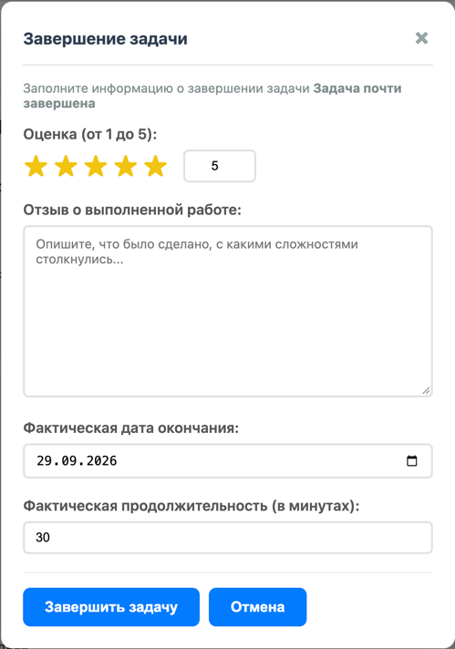
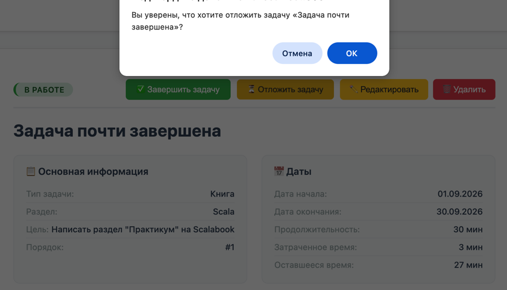



# Действия над задачей

После того как задача создана и находится на странице `/task/{id}`, пользователь может выполнять
над ней различные действия в зависимости от текущего статуса. Все действия реализованы
как отдельные хэндлеры, которые принимают PUT- или DELETE-запрос и возвращают обновлённое
представление задачи или главной страницы.

Список действий:

| Действие                | Статус задачи   | HTTP-метод | Возвращает                    |
| ----------------------- | --------------- | ---------- | ----------------------------- |
| **Завершить**           | `InProgress`    | PUT        | Главную страницу (`HomeView`) |
| **Отложить**            | `InProgress`    | PUT        | Обновлённую страницу задачи   |
| **Взять в работу**      | `Planned`       | PUT        | Обновлённую страницу задачи   |
| **Поставить в очередь** | `KnowledgeBase` | PUT        | Обновлённую страницу задачи   |
| **Удалить**             | Любой           | DELETE     | Главную страницу (`HomeView`) |

**Почему завершение и удаление возвращают главную страницу, а не задачу?**

Потому что после завершения или удаления задача **покидает активный список** — пользователю
логичнее увидеть список оставшихся задач, а не страницу задачи, которой уже нет
в текущей вкладке. Остальные действия не меняют «принадлежность» задачи к вкладке,
поэтому возвращается та же страница задачи с обновлённым статусом.

## Завершение задачи

Завершение — это финальное действие для задачи в статусе `InProgress`. Оно требует
от пользователя рефлексии: оценки (1–5), отзыва, фактической даты окончания и фактической
продолжительности. Эти данные записываются в историю задачи и используются в статистике.



### Маршрут

```dotty
val completeFormTask = Route(
  Request.put(Path.root / "task" / Param.string / "complete")
    .withEntity(Entity.formOf[CompileTaskRequest]),
  Response.ok(Entity.html).orNotFound
)
```

**Разбор:**

- **`Request.put(Path.root / "task" / Param.string / "complete")`** — PUT-запрос на
  `/task/{uuid}/complete`.
- **`.withEntity(Entity.formOf[CompileTaskRequest])`** — тело запроса в формате
  `application/x-www-form-urlencoded`, десериализуется в `CompileTaskRequest`.
- **`Response.ok(Entity.html).orNotFound`** — успешный ответ с HTML или 404.

### Хэндлер `CompleteTaskHandler`

```dotty
final case class CompleteTaskHandler(
    middleware: JwtAuthMiddleware[IO, UserInfo],
    taskLifecycleService: TaskLifecycleService[IO]
)(using Logger[IO]) extends AuthorizationHandler(middleware):
  val handler: Handler =
    Routes.completeFormTask.handleIO:
      (uuid: String, request: CompileTaskRequest) =>
        val run: ((UserInfo, JwtToken)) => IO[Option[String]] =
          (user, jwtToken) =>
            TaskId.parse(uuid) match
              case Validated.Valid(taskId) =>
                (
                  Rating.values
                    .find(_.r == request.rating)
                    .toValidNec(
                      s"Рейтинг (1-5) не определился: ${request.rating}"
                    ),
                  Review.either(request.review.trim).toValidatedNec,
                  request.endDate.toValidNec("Не заполнена дата окончания")
                ).mapN { case (rating, review, endDate) =>
                  taskLifecycleService.complete(
                    id = taskId,
                    userId = user.id,
                    rating = rating,
                    review = review,
                    endDate = endDate,
                    duration =
                      FiniteDuration(request.duration, TimeUnit.MINUTES)
                  ).map(_ => HomeView.some)
                }.valueOr(errors =>
                  getViewTask(
                    taskLifecycleService = taskLifecycleService,
                    userId = user.id,
                    taskId = taskId,
                    jwtToken = jwtToken,
                    errorMessage = errors.mkString_(";").some
                  ).map(_.map(_.toString))
                )
              case Validated.Invalid(error) =>
                Logger[IO].error(error).as(none)
        handleUserIOByTokenOpt(run)(request.token)
end CompleteTaskHandler
```

**Пошаговый разбор:**

1. **`TaskId.parse(uuid)`** — валидация UUID из пути.

2. **Тройная валидация через `ValidatedNec`:**
    - **`Rating.values.find(_.r == request.rating)`** — ищет `Rating` по числовому
      значению. Если не найдено — ошибка `"Рейтинг (1-5) не определился: {rating}"`.
    - **`Review.either(request.review.trim)`** — валидация отзыва. `trim` убирает
      крайние пробелы, `either` проверяет не пустоту. Если отзыв пустой — ошибка.
    - **`request.endDate.toValidNec("Не заполнена дата окончания")`** — дата
      окончания обязательна. Если `None` — ошибка.

3. **`.mapN { case (rating, review, endDate) => ... }`** — если все три валидны,
   выполняем завершение:
    - `taskLifecycleService.complete(...)` с параметрами `id`, `userId`, `rating`,
      `review`, `endDate`, `duration`.
    - `duration` конвертируется из минут (`request.duration`) в `FiniteDuration`.
    - При успехе возвращается `HomeView.some` — специальный маркер, означающий
      «показать главную страницу». В `HomeView` входит HTML главной страницы.

4. **`.valueOr(errors => ...)`** — если есть ошибки валидации, показываем форму
   задачи с сообщением об ошибке. Пользователь может исправить данные и попробовать снова.

5. **`handleUserIOByTokenOpt(run)(request.token)`** — проверка токена.

### Что такое `HomeView`?

`HomeView` — это константа, возвращающая HTML главной страницы:

```dotty
val HomeView: String = View.home().toString
```

`home.scala.html`:

```html
<div class="home-container">
    <a href="/" class="home-button">🏠 На главную</a>
</div>
```

### Модель `CompileTaskRequest`

```dotty
final case class CompileTaskRequest(
    token: String,
    rating: Int,
    review: String,
    endDate: Option[LocalDate],
    duration: Int
) derives FormCodec
```

**Поля:**

| Поле       | Назначение                              |
| ---------- | --------------------------------------- |
| `token`    | JWT-токен из скрытого поля формы        |
| `rating`   | Оценка от 1 до 5                        |
| `review`   | Отзыв о выполненной работе              |
| `endDate`  | Фактическая дата окончания              |
| `duration` | Фактическая продолжительность в минутах |

### Модальное окно «Завершение задачи»

```html
<div id="completeModal" class="modal-overlay" style="display: none;">
  <div class="modal-content">
    <div class="modal-header">
      <h3>Завершение задачи</h3>
      <button class="modal-close-btn" onclick="closeModal('completeModal')">
        ×
      </button>
    </div>
    <div class="modal-body">
      <p class="modal-hint">
        Заполните информацию о завершении задачи
        <strong>@task.name.value</strong>
      </p>
      <form
        id="completeForm"
        hx-put="/task/@task.id/complete"
        hx-target="#app"
        hx-swap="outerHTML"
      >
        <input type="hidden" name="token" value="@token" />

        <div class="form-group">
          <label for="ratingInput">Оценка (от 1 до 5):</label>
          <div class="rating-container">
            <div class="rating-stars">
              <span class="star" data-value="1" onclick="setRating(1)">☆</span>
              ...
            </div>
            <input
              id="ratingInput"
              name="rating"
              type="number"
              class="form-input rating-input"
              value="5"
            />
          </div>
        </div>

        <div class="form-group">
          <label for="reviewInput">Отзыв о выполненной работе:</label>
          <textarea
            id="reviewInput"
            name="review"
            class="form-textarea"
            rows="10"
            placeholder="Опишите, что было сделано..."
          ></textarea>
        </div>

        <div class="form-group">
          <label for="completeEndDateInput">Фактическая дата окончания:</label>
          <input
            id="completeEndDateInput"
            name="endDate"
            type="date"
            class="form-input"
            value="@{LocalDate.now().format(DateTimeFormatter.ISO_DATE)}"
          />
        </div>

        <div class="form-group">
          <label for="completeDurationInput"
            >Фактическая продолжительность (в минутах):</label
          >
          <input
            id="completeDurationInput"
            name="duration"
            type="number"
            class="form-input"
            value="@task.duration.toMinutes"
          />
        </div>

        <div class="modal-actions">
          <button type="submit" class="save-btn">Завершить задачу</button>
          <button
            type="button"
            class="cancel-btn"
            onclick="closeModal('completeModal')"
          >
            Отмена
          </button>
        </div>
      </form>
    </div>
  </div>
</div>
```

**Особенности:**

1. **Оценка в виде звёзд** — JavaScript-функция `setRating(value)` обновляет
   значение поля `rating` и подсвечивает звёзды. Поле `rating` скрыто стилями,
   но остаётся функциональным.

2. **Отзыв** — обязательное поле (проверяется на сервере). Это осознанное решение:
   завершение задачи без рефлексии менее ценно.

3. **Дата окончания** — по умолчанию сегодня. Пользователь может изменить, если
   завершает задачу задним числом.

4. **Продолжительность** — по умолчанию равна планируемой (`task.duration`).
   Пользователь корректирует, если реальное время отличается.

5. **`hx-put="/task/{id}/complete"`** — отправка формы идёт PUT-запросом.

6. **`hx-target="#app"`** — после завершения заменяется весь контейнер `#app`
   (главная страница).

## Откладывание задачи

Откладывание переводит задачу из `InProgress` обратно в `Planned`. Даты начала
и окончания **очищаются**, потому что при повторном взятии в работу они будут другими.
Это позволяет пользователю временно приостановить работу над задачей, не теряя её.



### Маршрут

```dotty
val deferFormTask = Route(
  Request.put(Path.root / "task" / Param.string / "defer")
    .extractHeader[Authorization],
  Response.ok(Entity.html).orNotFound
)
```

**Отличие от `complete`:** здесь **нет** тела запроса, потому что все данные уже
известны (ID задачи из пути, пользователь — из токена). Используется только
заголовок `Authorization`.

### Хэндлер `DeferTaskHandler`

```dotty
final case class DeferTaskHandler(
    middleware: JwtAuthMiddleware[IO, UserInfo],
    taskLifecycleService: TaskLifecycleService[IO]
)(using Logger[IO]) extends AuthorizationHandler(middleware):
  val handler: Handler =
    Routes.deferFormTask.handleIO:
      (uuid: String, authorization: Authorization) =>
        handleUserIOOpt: (user, jwtToken) =>
          TaskId.parse(uuid) match
            case Validated.Valid(taskId) =>
              for
                _ <- taskLifecycleService.defer(
                  id = taskId,
                  userId = user.id
                )
                maybeView <- getViewTask(
                  taskLifecycleService = taskLifecycleService,
                  userId = user.id,
                  taskId = taskId,
                  jwtToken = jwtToken,
                  errorMessage = none
                )
              yield maybeView.map(_.toString)
            case Validated.Invalid(error) =>
              Logger[IO].error(error).as(none)
        .apply(authorization)
end DeferTaskHandler
```

**Пошаговый разбор:**

1. **`handleUserIOOpt`** — мягкая проверка токена (невалидный токен → `None`,
   а не исключение).

2. **`taskLifecycleService.defer(id, userId)`** — выполняет откладывание:
  - Проверяет, что задача в статусе `InProgress`.
  - Меняет статус на `Planned`.
  - Очищает `startDate` и `endDate`.

3. **`getViewTask(...)`** — загружает обновлённую страницу задачи. Пользователь
   видит ту же задачу, но теперь с кнопкой «🚀 Взять в работу».

**Почему нет формы и тела запроса?**

Потому что все необходимые данные уже известны. Пользователь кликает «⏳ Отложить
задачу» — этого достаточно. Подтверждение обеспечивается через `hx-confirm`
в HTML-кнопке.

Шаблонизатор `task.scala.html`

```html
<button
    class="postpone-task-btn"
    hx-put="/task/@task.id/defer"
    hx-target="#app"
    hx-swap="outerHTML"
    hx-confirm="Вы уверены, что хотите отложить задачу «@task.name.value»?"
>
    ⏳ Отложить задачу
</button>
```

## Взятие в работу

Переводит задачу из `Planned` в `InProgress`. Требует указания дат начала
и окончания.


### Маршрут

```dotty
val startFormTask = Route(
  Request.put(Path.root / "task" / Param.string / "start")
    .withEntity(Entity.formOf[StartTaskRequest]),
  Response.ok(Entity.html).orNotFound
)
```

### Хэндлер `StartTaskHandler`

```dotty
final case class StartTaskHandler(
    middleware: JwtAuthMiddleware[IO, UserInfo],
    taskLifecycleService: TaskLifecycleService[IO]
)(using Logger[IO]) extends AuthorizationHandler(middleware):
  val handler: Handler =
    Routes.startFormTask.handleIO: (uuid: String, request: StartTaskRequest) =>
      val run: ((UserInfo, JwtToken)) => IO[Option[String]] =
        (user, jwtToken) =>
          TaskId.parse(uuid) match
            case Validated.Valid(taskId) =>
              (
                request.startDate.toValidNec("Не заполнена дата начала"),
                request.endDate.toValidNec("Не заполнена дата окончания")
              ).mapN { case (startDate, endDate) =>
                for
                  _ <- taskLifecycleService.start(
                    id = taskId,
                    userId = user.id,
                    startDate = startDate,
                    endDate = endDate
                  )
                  maybeView <- getViewTask(...)
                yield maybeView.map(_.toString)
              }.valueOr(errors =>
                getViewTask(..., errorMessage = errors.mkString_(";").some)
                  .map(_.map(_.toString))
              )
            case Validated.Invalid(error) =>
              Logger[IO].error(error).as(none)
      handleUserIOByTokenOpt(run)(request.token)
end StartTaskHandler
```

**Пошаговый разбор:**

1. **Валидация дат** через `ValidatedNec`:
    - `startDate` — обязательна.
    - `endDate` — обязательна.

2. **`.mapN { case (startDate, endDate) => ... }`** — при успехе вызываем
   `taskLifecycleService.start(...)`, который:
    - Проверяет, что задача в статусе `Planned`.
    - Меняет статус на `InProgress`.
    - Устанавливает `startDate` и `endDate`.

3. **`.valueOr(...)`** — при ошибке валидации показываем форму задачи
   с сообщением.

### Модель `StartTaskRequest`

```dotty
final case class StartTaskRequest(
    token: String,
    startDate: Option[LocalDate],
    endDate: Option[LocalDate]
) derives FormCodec
```

Минимальный DTO: только токен и две даты. `derives FormCodec` автоматически
генерирует кодек для десериализации из формы.

### Модальное окно «Взять в работу»

```html
<div id="startModal" class="modal-overlay" style="display: none;">
  <div class="modal-content">
    <div class="modal-header">
      <h3>Взять задачу в работу</h3>
      <button class="modal-close-btn" onclick="closeModal('startModal')">
        ×
      </button>
    </div>
    <div class="modal-body">
      <p class="modal-hint">
        Укажите даты для задачи <strong>@task.name.value</strong>
      </p>
      <form
        id="startForm"
        hx-put="/task/@task.id/start"
        hx-target="#app"
        hx-swap="outerHTML"
      >
        <input type="hidden" name="token" value="@token" />

        <div class="form-group">
          <label for="startDateInput">Дата начала:</label>
          <input
            id="startDateInput"
            name="startDate"
            type="date"
            class="form-input"
            value="@{LocalDate.now().format(DateTimeFormatter.ISO_DATE)}"
          />
        </div>
        <div class="form-group">
          <label for="endDateInput">Дата окончания:</label>
          <input
            id="endDateInput"
            name="endDate"
            type="date"
            class="form-input"
            value="@{LocalDate.now().plusWeeks(1).format(DateTimeFormatter.ISO_DATE)}"
          />
        </div>

        <div class="modal-actions">
          <button type="submit" class="save-btn">Начать работу</button>
          <button
            type="button"
            class="cancel-btn"
            onclick="closeModal('startModal')"
          >
            Отмена
          </button>
        </div>
      </form>
    </div>
  </div>
</div>
```

**Значения по умолчанию** выбраны оптимально:

- **Дата начала** — сегодня. Логично: пользователь берёт задачу в работу прямо сейчас.
- **Дата окончания** — через неделю. Типичный срок для задачи среднего размера.

Пользователь может сразу нажать «Начать работу», не меняя даты, либо может обновить только дату окончания — это снижает трение.

## Постановка в очередь

Переводит задачу из `KnowledgeBase` в `Planned`. Требует указания порядкового номера.


### Маршрут

```dotty
val queueFormTask = Route(
  Request.put(Path.root / "task" / Param.string / "queue")
    .withEntity(Entity.formOf[QueueTaskRequest]),
  Response.ok(Entity.html).orNotFound
)
```

### Хэндлер `QueueTaskHandler`

```dotty
final case class QueueTaskHandler(
    middleware: JwtAuthMiddleware[IO, UserInfo],
    taskLifecycleService: TaskLifecycleService[IO]
)(using Logger[IO]) extends AuthorizationHandler(middleware):
  val handler: Handler =
    Routes.queueFormTask.handleIO: (uuid: String, request: QueueTaskRequest) =>
      val run: ((UserInfo, JwtToken)) => IO[Option[String]] =
        (user, jwtToken) =>
          TaskId.parse(uuid) match
            case Validated.Valid(taskId) =>
              Ordinal.either(request.ordinal) match
                case Right(ordinal) =>
                  for
                    _ <- taskLifecycleService.enqueue(
                      id = taskId,
                      userId = user.id,
                      ordinal = ordinal
                    )
                    maybeView <- getViewTask(...)
                  yield maybeView.map(_.toString)
                case Left(error) =>
                  getViewTask(..., errorMessage = error.some)
                    .map(_.map(_.toString))
            case Validated.Invalid(error) =>
              Logger[IO].error(error).as(none)
      handleUserIOByTokenOpt(run)(request.token)
end QueueTaskHandler
```

**Пошаговый разбор:**

1. **`Ordinal.either(request.ordinal)`** — валидация порядкового номера
   (должен быть положительным).

2. **`taskLifecycleService.enqueue(id, userId, ordinal)`** — переводит задачу:
    - Проверяет, что задача в статусе `KnowledgeBase`.
    - Меняет статус на `Planned`.
    - Устанавливает указанный порядковый номер.

3. **При ошибке валидации `ordinal`** — показываем форму задачи с ошибкой.

### Модель `QueueTaskRequest`

```dotty
final case class QueueTaskRequest(token: String, ordinal: Int) derives FormCodec
```

### Модальное окно «В очередь»

```html
<div id="ordinalModal" class="modal-overlay" style="display: none;">
  <div class="modal-content">
    <div class="modal-header">
      <h3>Планирование задачи</h3>
      <button class="modal-close-btn" onclick="closeModal('ordinalModal')">
        ×
      </button>
    </div>
    <div class="modal-body">
      <p class="modal-hint">
        Выберите свободный порядок для задачи <strong>@task.name.value</strong>
      </p>
      <form
        id="ordinalForm"
        hx-put="/task/@task.id/queue"
        hx-target="#app"
        hx-swap="outerHTML"
      >
        <input type="hidden" name="token" value="@token" />

        <div class="form-group">
          <label for="ordinalSelect">Порядок:</label>

          <div class="ordinal-info-block compact">
            <div class="ordinal-info-title">
              Доступные порядки задач типа "@task.taskType":
            </div>
            <div class="ordinal-info-list">
              @for(ordinalCard <- availableOrdinals) {
              <div class="ordinal-info-item">
                <span class="ordinal-number">
                  Свободный порядок @ordinalCard.ordinal
                </span>
                <span class="ordinal-after">
                  после задачи: @ordinalCard.after
                </span>
              </div>
              }
            </div>
          </div>

          <input
            id="ordinalSelect"
            name="ordinal"
            type="number"
            class="form-input"
            placeholder="Введите порядок"
            value="@availableOrdinals.headOption.map(_.ordinal).getOrElse(1)"
          />
        </div>

        <div class="modal-actions">
          <button type="submit" class="save-btn">Подтвердить</button>
          <button
            type="button"
            class="cancel-btn"
            onclick="closeModal('ordinalModal')"
          >
            Отмена
          </button>
        </div>
      </form>
    </div>
  </div>
</div>
```

**Ключевые моменты:**

1. **Список доступных порядков** — `availableOrdinals` приходит из `getViewTask`
   (мы разбирали его в документации страницы задачи). Каждый элемент —
   `OrdinalCard(ordinal, after)`, где `after` — название задачи, после которой
   идёт этот свободный номер.

2. **Предзаполненное значение** — первое доступное значение подставляется в поле
   по умолчанию. Пользователю обычно достаточно нажать «Подтвердить».

3. **`hx-put="/task/{id}/queue"`** — PUT-запрос.

4. **`hx-target="#app"`** — после успеха возвращается страница задачи
   с новым статусом (`Planned`).

## Удаление задачи

Удаление — финальное и необратимое действие. Доступно для задач в любом статусе.
Требует подтверждения (`hx-confirm`) на клиенте.


### Маршрут

```dotty
val deleteTask = Route(
  Request.delete(Path.root / "task" / Param.string)
    .extractHeader[Authorization],
  Response.ok(Entity.html).orNotFound
)
```

**Разбор:**

- **`Request.delete(Path.root / "task" / Param.string)`** — DELETE-запрос на
  `/task/{uuid}`.
- **`.extractHeader[Authorization]`** — токен из заголовка.
- **`Response.ok(Entity.html).orNotFound`** — успешный ответ с HTML.

### Хэндлер `DeleteTaskHandler`

```dotty
final case class DeleteTaskHandler(
    middleware: JwtAuthMiddleware[IO, UserInfo],
    taskLifecycleService: TaskLifecycleService[IO]
)(using Logger[IO]) extends AuthorizationHandler(middleware):
  val handler: Handler =
    Routes.deleteTask.handleIO: (uuid: String, authorization: Authorization) =>
      handleUserIOOpt: (user, token) =>
        TaskId.parse(uuid) match
          case Validated.Valid(taskId) =>
            taskLifecycleService
              .delete(
                id = taskId,
                userId = user.id
              ).map(_ => HomeView.some)
          case Validated.Invalid(error) =>
            Logger[IO].error(error).as(none)
      .apply(authorization)
end DeleteTaskHandler
```

**Пошаговый разбор:**

1. **`handleUserIOOpt`** — мягкая проверка токена.

2. **`taskLifecycleService.delete(id, userId)`** — удаляет задачу:
    - Проверяет, что задача принадлежит пользователю.
    - Удаляет запись из БД.

3. **`.map(_ => HomeView.some)`** — после удаления возвращаем главную страницу.
   Пользователь видит список оставшихся задач, а удалённая задача исчезает.

### HTML-кнопка удаления

На странице задачи:

```html
<button
  class="delete-task-btn"
  hx-delete="/task/@task.id"
  hx-target="#app"
  hx-swap="outerHTML"
  hx-confirm="Вы уверены, что хотите удалить задачу «@task.name.value»?"
>
  🗑️ Удалить
</button>
```

**Особенности:**

- **`hx-delete`** — отправляет DELETE-запрос.
- **`hx-confirm`** — браузер показывает диалог подтверждения с указанием имени
  задачи. Это защита от случайных удалений.
- **`hx-target="#app"`** — после успешного удаления заменяется вся страница.

## Общий паттерн действий

Все пять действий следуют одному паттерну:

1. **Маршрут** — PUT или DELETE на `/task/{uuid}/{action}`.
2. **Хэндлер** — наследуется от `AuthorizationHandler`, проверяет токен,
   парсит UUID, вызывает соответствующий метод `taskLifecycleService`.
3. **Модель запроса** — DTO с `derives FormCodec` (если есть тело).
4. **HTML-кнопка/форма** — использует htmx для отправки запроса без перезагрузки.
5. **Ответ** — либо страница задачи с обновлённым статусом, либо главная страница
   (для завершения и удаления).

Эти действия покрывают полный жизненный цикл задачи: от создания через
планирование, работу, завершение до удаления. Каждое действие доступно только
в подходящем статусе и защищено проверкой токена и принадлежности задачи
пользователю.

---

**Ссылки:**

- [Персональный план развития][plugin]
- [Репозиторий с исходниками][repo]

[repo]: https://gitverse.ru/scalabook/pdp
[plugin]: https://artemkorsakov.github.io/personal-development-plan/ru/
