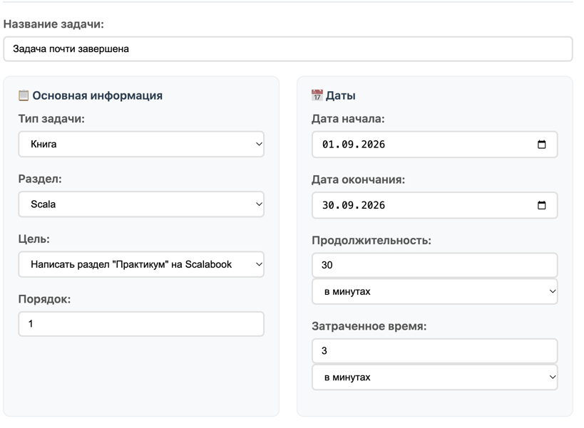
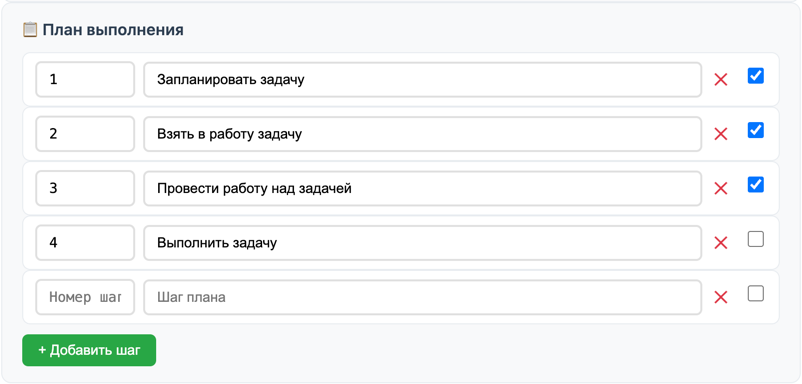
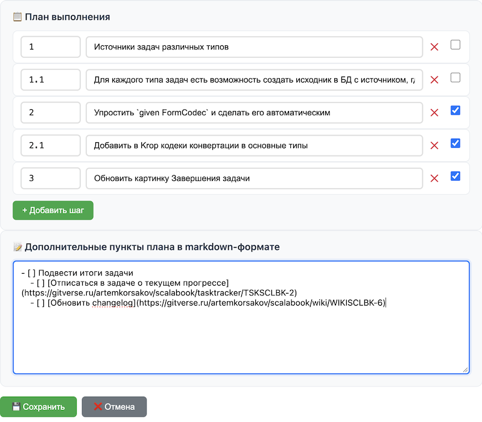
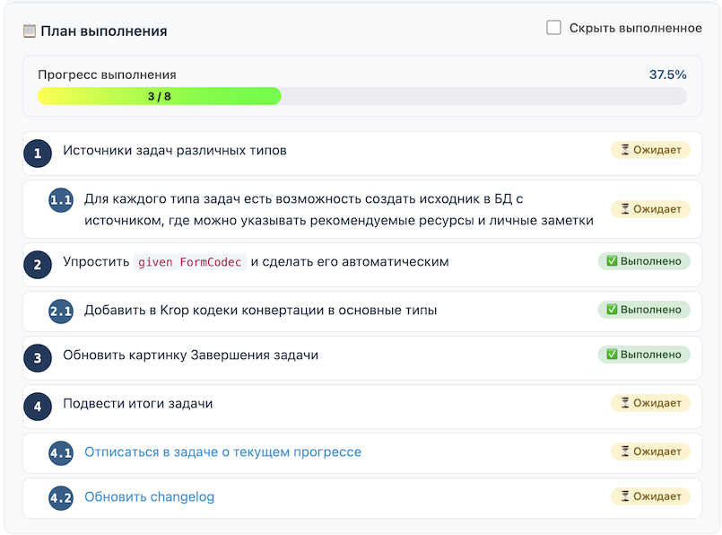



# Редактирование задачи

Страница редактирования задачи — это форма, которая позволяет пользователю изменить
все аспекты задачи: название, тип, раздел, цель, порядок, даты, продолжительность,
затраченное время, описание и план выполнения. Она открывается по кнопке «✏️ Редактировать»
на странице задачи и заменяет её содержимое в контейнере `#app`.

Редактирование реализовано через **два хэндлера**:

1. **`EditFormTaskHandler`** — отображает форму редактирования с предзаполненными полями.
2. **`EditTaskHandler`** — принимает отправленные данные и сохраняет изменения.

## Отображение формы редактирования

### Маршрут

```dotty
val editFormTask = Route(
  Request.get(Path.root / "task" / Param.string / "edit")
    .extractHeader[Authorization],
  Response.ok(Entity.html).orNotFound
)
```

**Разбор маршрута:**

- **`Request.get(Path.root / "task" / Param.string / "edit")`** — GET-запрос на
  `/task/{uuid}/edit`, где `{uuid}` — идентификатор задачи.
- **`.extractHeader[Authorization]`** — токен передаётся в заголовке
- **`Response.ok(Entity.html).orNotFound`** — успешный ответ с HTML формы
  редактирования или 404, если задача не найдена.

### Хэндлер `EditFormTaskHandler`

```dotty
final case class EditFormTaskHandler(
    middleware: JwtAuthMiddleware[IO, UserInfo],
    settingsService: SettingsService[IO],
    taskLifecycleService: TaskLifecycleService[IO]
)(using Logger[IO]) extends AuthorizationHandler(middleware):
  val handler: Handler =
    Routes.editFormTask.handleIO:
      (uuid: String, authorization: Authorization) =>
        handleUserIOOpt: (user, jwtToken) =>
          TaskId.parse(uuid) match
            case Validated.Valid(taskId) =>
              getViewEditTaskModal(
                settingsService = settingsService,
                taskLifecycleService = taskLifecycleService,
                userId = user.id,
                taskId = taskId,
                jwtToken = jwtToken,
                errorMessage = none
              )
            case Validated.Invalid(error) =>
              Logger[IO].error(error).as(none)
        .apply(authorization)
end EditFormTaskHandler
```

**Пошаговый разбор:**

1. **`TaskId.parse(uuid)`** — валидируем UUID задачи:
    - **`Valid(taskId)`** — ID валиден, загружаем форму редактирования.
    - **`Invalid(error)`** — UUID некорректен (например, не UUID-формат), логируем и возвращаем `None`.

### Формирование формы

```dotty
def getViewEditTaskModal(
    settingsService: SettingsService[IO],
    taskLifecycleService: TaskLifecycleService[IO],
    userId: UserId,
    taskId: TaskId,
    jwtToken: JwtToken,
    errorMessage: Option[String]
): IO[Option[String]] =
  for
    taskTypes     <- settingsService.getTaskTypes(userId)
    sections      <- settingsService.getSections(userId)
    goals         <- settingsService.getGoals(userId)
    maybeTaskCard <- taskLifecycleService.get(taskId, userId)
  yield maybeTaskCard.map: card =>
    View.editTask(
      task = card,
      token = jwtToken.value,
      taskTypes = taskTypes,
      sections = sections,
      goals = goals,
      errorMessage = errorMessage
    ).toString
```

**Что происходит:**

1. **Четыре запроса:**
    - `taskTypes` — типы задач пользователя.
    - `sections` — разделы пользователя.
    - `goals` — цели пользователя.
    - `maybeTaskCard` — текущая задача (`Option[TaskCard]`).

2. **Если задача найдена** (`Some(card)`) — рендерим форму редактирования, передавая:
    - `task` — текущие данные задачи.
    - `token` — JWT-токен.
    - `taskTypes`, `sections`, `goals` — для выпадающих списков.
    - `errorMessage` — опциональное сообщение об ошибке.

3. **Если задача не найдена** — возвращаем `None`, что приведёт к 404.

**Почему параметр `errorMessage` опционален?**

Форма может быть показана в двух случаях:

- **Первый раз** — когда пользователь кликнул «Редактировать». Тогда `errorMessage = None`.
- **После ошибки сохранения** — когда `EditTaskHandler` не смог сохранить
  изменения и вернул форму с сохранёнными данными и сообщением об ошибке.

## Шаблон `editTask.scala.html`

Шаблон — это большая форма, которая по структуре напоминает страницу задачи,
но с полями ввода вместо текста. Рассмотрим её по частям.

### Верхняя панель

```html
<div class="task-detail-header">
  <div class="task-detail-nav">
    <span class="task-detail-status-badge @task.status.toString.toLowerCase">
      @task.status.show
    </span>
  </div>
  <div class="task-detail-actions">
    <button class="save-task-btn" form="editTaskForm" type="submit">
      💾 Сохранить
    </button>
    <button
      class="cancel-task-btn"
      hx-get="/task/@task.id"
      hx-target="#app"
      hx-swap="outerHTML"
    >
      ❌ Отмена
    </button>
  </div>
</div>
```

**Особенности:**

1. **Кнопка «Сохранить»** использует атрибут `form="editTaskForm"` — это HTML-механизм,
   который связывает кнопку с формой, даже если кнопка находится **вне** неё.
   Так кнопка в шапке может отправлять форму в теле страницы. Это удобно:
   пользователю не нужно прокручивать страницу вниз, чтобы сохранить изменения.

2. **Кнопка «Отмена»** — GET-запрос на `/task/{id}`, что возвращает страницу
   задачи в режиме просмотра. Изменения не сохраняются.


### Форма редактирования

```html
<form
  id="editTaskForm"
  hx-put="/task/@task.id"
  hx-target="#app"
  hx-swap="outerHTML"
>
  <div id="form-error">
    @errorMessage.map { msg =>
    <div class="error">@msg</div>
    }
  </div>
  <input type="hidden" name="token" value="@token" />
  <input
    type="hidden"
    name="status"
    value="@task.status.toString.toLowerCase"
  />
  ...
</form>
```

**Ключевые моменты:**

- **`hx-put="/task/{id}"`** — PUT-запрос на сохранение задачи.
- **`hx-target="#app"`** — ответ сервера заменяет весь контейнер `#app`.
- **`hx-swap="outerHTML"`** — заменяем сам блок, а не его содержимое.
- **Скрытое поле `token`** — для аутентификации на сервере.
- **Скрытое поле `status`** — текущий статус задачи, чтобы сервер знал,
  как валидировать даты (для `in-progress` они обязательны).



### Название задачи

```html
<div class="form-group">
  <label for="taskName">Название задачи:</label>
  <input
    id="taskName"
    name="name"
    type="text"
    required
    value="@task.name.value"
    class="form-input"
  />
</div>
```

Простое текстовое поле с предзаполненным значением. `required` гарантирует,
что пользователь не оставит поле пустым.

### Основная информация

```html
<div class="task-detail-grid">
  <div class="task-detail-section">
    <h3>📋 Основная информация</h3>
    <div class="form-group">
      <label for="taskTypeId">Тип задачи:</label>
      <select id="taskTypeId" name="taskTypeId" class="form-select" required>
        @for(taskType <- taskTypes.filter(_.displayed).sortBy(_.ordinal.value))
        {
        <option
          value="@taskType.id.value"
          @if(task.taskType=""
          ="taskType.name.value){selected}"
        >
          @taskType.name.value
        </option>
        }
      </select>
    </div>
    ...
  </div>
</div>
```

**Три выпадающих списка** (тип, раздел, цель). Особенности:

- **`.filter(_.displayed)`** — показываем только включённые элементы.
- **`.sortBy(_.ordinal.value)`** — сортируем по порядку.
- **`@if(task.taskType == taskType.name.value){selected}`** — выделяем текущий
  выбранный вариант. Обратите внимание: `task.taskType` — это **строка** (название),
  а `taskType.name.value` — тоже строка, поэтому сравнение работает напрямую.

**Почему сравнение по имени, а не по ID?**

Потому что `TaskCard` (модель отображения) содержит уже «обогащённые» данные —
названия вместо ID. Это следствие того, что `TaskCard` создаётся на сервере
из доменного `Task` и справочников, и хранит готовые строки для UI.

### Даты

```html
<div class="task-detail-section">
  <h3>📅 Даты</h3>
  <div class="form-group">
    <label for="startDate">Дата начала:</label>
    <input
      id="startDate"
      name="startDate"
      type="date"
      value="@task.startDate"
      class="form-input"
    />
  </div>
  <div class="form-group">
    <label for="endDate">Дата окончания:</label>
    <input
      id="endDate"
      name="endDate"
      type="date"
      value="@task.endDate"
      class="form-input"
    />
  </div>
</div>
```

**Важная деталь:** `task.startDate` — это `Option[LocalDate]`. При передаче в `value`
Twirl автоматически выводит `Some(date)` как `date` (без обёртки), а `None` — как
пустую строку. Это работает благодаря тому, что `LocalDate.toString` возвращает
строку в формате ISO (`2026-07-25`), который принимает `<input type="date">`.

### Продолжительность (двухсоставное поле)

```html
<div class="form-group">
  <label for="durationValue">Продолжительность:</label>
  <div class="duration-group">
    <input
      id="durationValue"
      name="durationValue"
      type="number"
      min="1"
      value="@task.duration.length"
      required
      class="form-input duration-input"
    />
    <select
      id="durationUnit"
      name="durationUnit"
      class="form-select duration-select"
      required
    >
      <option
        value="minutes"
        @if(task.duration.unit=""
        ="TimeUnit.MINUTES){selected}"
      >
        в минутах
      </option>
      <option
        value="hours"
        @if(task.duration.unit=""
        ="TimeUnit.HOURS){selected}"
      >
        в часах
      </option>
      <option
        value="days"
        @if(task.duration.unit=""
        ="TimeUnit.DAYS){selected}"
      >
        в днях
      </option>
    </select>
  </div>
</div>
```

**Ключевое отличие от страницы создания задачи:** здесь используется **не**
`FiniteDuration`, а тип `TaskDuration`, который хранит **число и единицу отдельно**.
Поля `task.duration.length` и `task.duration.unit` — это части этой структуры.

Почему так? Потому что при редактировании мы хотим показать пользователю
**то же значение, что он вводил** — например, «3 дня», а не «4320 минут».

### Затраченное время

Аналогично продолжительности, но с `min="0"` — затраченное время может быть нулевым.

### Информация

```html
<div class="task-detail-section full-width">
  <h3>📝 Информация</h3>
  <textarea id="information" name="information" rows="10" class="form-textarea">
@task.information</textarea>
</div>
```

Многострочное поле для описания задачи. Значение вставляется как **содержимое**
`<textarea>`, а не как атрибут (у `<textarea>` нет атрибута `value`).

### Редактор плана



```html
<div class="plan-editor">
  <div id="planContainer">
    @if(task.plan.nonEmpty) { @for((plan, index) <- task.plan.zipWithIndex) {
    <div class="plan-step-editor" data-index="@index">
      <div class="plan-step-input-group">
        <input
          type="text"
          name="plan[@index].number"
          value="@plan.number"
          class="form-input plan-step-number-input"
          placeholder="Номер шага"
          pattern="^\d+(?:\.\d+)*$"
        />
        <input
          type="text"
          name="plan[@index].step"
          value="@plan.step"
          class="form-input plan-step-input"
          placeholder="Шаг плана"
        />
        <button
          type="button"
          class="remove-step-btn"
          onclick="removeStep(this)"
        >
          ✕
        </button>
      </div>
      <div class="plan-step-status-toggle">
        <label>
          <input
            type="checkbox"
            @if(plan.completed){checked}
            onchange="toggleStepStatus(this)"
          />
        </label>
        <input
          type="hidden"
          name="plan[@index].completed"
          value="@if(plan.completed){true}else{false}"
        />
      </div>
    </div>
    } } else {
    <p class="empty-message" id="emptyPlanMessage">План не составлен</p>
    }
  </div>
  <button type="button" class="add-step-btn" onclick="addStep()">
    + Добавить шаг
  </button>
</div>
```

**Как работает редактор плана:**

1. **Каждый шаг** — отдельный блок `.plan-step-editor` с тремя полями:
    - `plan[index].number` — номер шага (например, `1.2.3`). Валидация через
      `pattern="^\d+(?:\.\d+)*$"`.
    - `plan[index].step` — текст шага.
    - `plan[index].completed` — скрытое поле, синхронизированное с чекбоксом.

2. **Чекбокс** — управляется JavaScript-функцией `toggleStepStatus`, которая
   обновляет скрытое поле `completed`.

3. **Кнопка «✕»** — удаляет шаг. JavaScript-функция `removeStep` удаляет родительский
   `.plan-step-editor`.

4. **Кнопка «+ Добавить шаг»** — добавляет новый пустой шаг. JavaScript-функция
   `addStep` генерирует HTML и добавляет его в `#planContainer`.

5. **`data-index`** — индекс шага. При добавлении/удалении шагов JavaScript
   переиндексирует `name` всех полей, чтобы сохранить правильные индексы.

**Почему `completed` — скрытое поле, а не сам чекбокс?**

Потому что HTML-формы **не отправляют** значение чекбокса, если он не отмечен.
Если бы мы полагались на чекбокс, в запросе не было бы поля `plan[i].completed`
для невыполненных шагов, и сервер не смог бы отличить «не отмечен» от «отсутствует».
Скрытое поле решает эту проблему: всегда отправляется `true` или `false`.

### Импорт дополнительных пунктов плана

Помимо основного редактора плана, где каждый шаг задаётся отдельным полем,
форма редактирования задачи содержит **дополнительное поле** для
быстрого ввода целого плана в **markdown-формате**. Это позволяет пользователю
скопировать готовый чек-лист из заметок, документации или из другого приложения
и вставить его одним куском, не разбивая вручную на отдельные шаги.

### Зачем это нужно

Основной редактор плана удобен для точечного редактирования: изменить текст шага,
поменять порядок, отметить выполнение. Но когда план состоит из 15–20 пунктов,
вводить их по одному через форму — утомительно. Markdown-поле решает эту проблему:

- **Массовый ввод.** Пользователь копирует план из Obsidian, Notion или
  обычного `.md`-файла и вставляет его в одно поле.
- **Знакомый синтаксис.** Markdown-чек-листы (`- [ ] Пункт`) интуитивно понятны
  большинству разработчиков.
- **Иерархия через отступы.** Вложенность задаётся отступами, как в обычном
  markdown-списке.

### Формат ввода

Пользователь вводит план в виде markdown-чек-листа:

```text
- [ ] Пункт 1
    - [ ] Подпункт 1.1
    - [ ] Подпункт 1.2
        - [ ] Подпункт 1.2.1
- [ ] Пункт 2
```

**Правила синтаксиса:**

- **Каждый пункт начинается с `- [ ]`.** Пробелы внутри квадратных скобок обязательны.
- **Уровень вложенности определяется отступом.** Один уровень = 4 пробела.
  Это стандарт markdown, которому следуют большинство редакторов.
- **Текст пункта идёт после `- [ ]`.** Может содержать любые символы:
  кириллицу, латиницу, знаки препинания, ссылки, инлайн-код.
- **Пустые строки игнорируются.** Между пунктами можно оставлять пустые строки —
  они не создадут «фантомных» шагов.

### HTML-разметка



```html
<!-- Дополнительные пункты плана в markdown-формате -->
<div class="task-detail-section full-width">
  <h3>📝 Дополнительные пункты плана в markdown-формате</h3>
  <p>
    Задачи должны задаваться в виде: - [ ] Пункт 1
  </p>
  <textarea
    id="additional_plan"
    name="additional_plan"
    rows="10"
    class="form-textarea"
  ></textarea>
</div>
```

**Разбор разметки:**

- **`<h3>` с иконкой 📝** — заголовок секции, визуально отделяет markdown-поле
  от основного редактора плана.
- **`<p>` с примером** — подсказка пользователю о том, в каком формате вводить
  план. Внутри — небольшой пример с иерархией.
- **`<textarea>` с `name="additional_plan"`** — поле ввода. Имя `additional_plan`
  используется сервером для извлечения значения из формы.
- **`rows="10"`** — высота поля, достаточная для среднего плана (10–15 пунктов).

### Обработка на сервере

После отправки формы сервер извлекает поле `additional_plan` и парсит его
в список шагов через метод `decodeAdditionalPlanSteps`:

```dotty
private[dto] def decodeAdditionalPlanSteps(
    urlForm: UrlForm,
    maxStepNumber: StepNumber
): List[PlanStepRequest] = {
  @tailrec
  def loop(
      sources: List[String],
      stepNumber: StepNumber,
      acc: Vector[PlanStepRequest]
  ): List[PlanStepRequest] =
    sources match
      case Nil          => acc.toList
      case head :: tail =>
        // Анализируем на импорт только такие строки:
        // "    - [ ] Статистика ..."
        val parts = head.split("- \\[ \\]", 2)

        val step = parts.drop(1).mkString("").trim

        if step.nonEmpty then
          // Отступ - это стандартные 4 пробела в markdown-формате
          val level = parts.headOption.getOrElse("").count(_.isSpaceChar) / 4
          val nextStepNumber = stepNumber.next(level)

          val newAcc =
            acc :+ PlanStepRequest(
              number = nextStepNumber.value,
              step = step,
              completed = false
            )

          loop(
            sources = tail,
            stepNumber = nextStepNumber,
            acc = newAcc
          )
        else
          loop(
            sources = tail,
            stepNumber = stepNumber,
            acc = acc
          )
        end if

  loop(
    sources = urlForm
      .getFirstOrElse("additional_plan", "")
      .split("\\n").toList,
    stepNumber = maxStepNumber,
    acc = Vector.empty[PlanStepRequest]
  )
}
```

### Разбор алгоритма

**1. Входные данные:**

- **`urlForm`** — форма с полем `additional_plan`.
- **`maxStepNumber`** — номер последнего существующего шага плана. Именно
  **после него** будут добавляться новые пункты.

**2. Извлечение и разбиение текста:**

```dotty
urlForm.getFirstOrElse("additional_plan", "").split("\\n").toList
```

- **`.getFirstOrElse("additional_plan", "")`** — извлекаем содержимое поля
  или пустую строку, если поле не заполнено.
- **`.split("\\n")`** — разбиваем на строки.

**3. Рекурсивный обход строк (`loop`):**

Функция `loop` обрабатывает строки по одной, аккумулируя результат:

- **`sources`** — оставшиеся строки для обработки.
- **`stepNumber`** — текущий номер шага (обновляется после каждого добавления).
- **`acc`** — накопленный список шагов.

**4. Разбор строки:**

```dotty
val parts = head.split("- \\[ \\]", 2)
```

- **`split("- \\[ \\]", 2)`** — разбивает строку по шаблону `- [ ]`,
  ограничивая результат двумя частями:
    - `parts(0)` — префикс (отступы перед `- [ ]`).
    - `parts(1)` — текст шага после `- [ ]`.

**Почему `2` в `split`?** Это ограничение на количество частей. Если в тексте
шага случайно встретится `- [ ]` (например, в описании другого чек-листа),
он не разобьёт строку дополнительно — весь остаток попадёт во вторую часть.

**5. Извлечение текста шага:**

```dotty
val step = parts.drop(1).mkString("").trim
```

- **`.drop(1)`** — берём всё, кроме префикса.
- **`.mkString("")`** — склеиваем оставшиеся части (на практике — одну).
- **`.trim`** — убираем лишние пробелы вокруг текста.

**6. Пропуск пустых строк:**

```dotty
if step.nonEmpty then ...
else
  loop(sources = tail, stepNumber = stepNumber, acc = acc)
```

Если после `- [ ]` нет текста (или строка вообще не содержит `- [ ]`),
шаг не создаётся. Мы просто переходим к следующей строке, **не инкрементируя
`stepNumber`** — это важно, чтобы пустые строки не сбивали нумерацию.

**7. Вычисление уровня вложенности:**

```dotty
val level = parts.headOption.getOrElse("").count(_.isSpaceChar) / 4
```

- **`.count(_.isSpaceChar)`** — считаем количество пробельных символов в префиксе.
- **`/ 4`** — делим на 4, потому что один уровень = 4 пробела. Результат —
  уровень вложенности (0, 1, 2...).

**8. Расчёт номера следующего шага:**

```dotty
val nextStepNumber = stepNumber.next(level)
```

Используем метод `next(level)`, который [мы разбирали в предыдущем разделе](../task_types/tasks.md).
Он учитывает текущий номер и желаемый уровень, возвращая корректный номер
нового шага.

**9. Добавление шага в аккумулятор:**

```dotty
acc :+ PlanStepRequest(
  number = nextStepNumber.value,
  step = step,
  completed = false
)
```

Все новые шаги создаются с `completed = false`. Это логично: пользователь
только что добавил пункты в план, выполнять их ещё не начал.

**10. Рекурсия:**

```dotty
loop(sources = tail, stepNumber = nextStepNumber, acc = newAcc)
```

Переходим к следующей строке, обновляя `stepNumber` для корректной нумерации.

### Пример работы

Рассмотрим пошаговый разбор для входного текста:

```text
- [ ] Статистика по статусам
    - [ ] Прогресс-бар
    - [ ] Наименование
- [ ] Статистика по типам
```

При условии, что `maxStepNumber = StepNumber("1")`:

| Строка                         | `step`                   | `level` | `nextStepNumber` | `acc` после        |
| ------------------------------ | ------------------------ | ------- | ---------------- | ------------------ |
| `- [ ] Статистика по статусам` | `Статистика по статусам` | `0`     | `2`              | `[2]`              |
| `    - [ ] Прогресс-бар`       | `Прогресс-бар`           | `1`     | `2.1`            | `[2, 2.1]`         |
| `    - [ ] Наименование`       | `Наименование`           | `1`     | `2.2`            | `[2, 2.1, 2.2]`    |
| `- [ ] Статистика по типам`    | `Статистика по типам`    | `0`     | `3`              | `[2, 2.1, 2.2, 3]` |

### Что пользователь видит в результате



После отправки формы новые пункты появляются в общем списке плана задачи
с корректными номерами и иерархией. Их можно дальше редактировать через
основной редактор — например, менять порядок или отмечать выполненными.

### Важные детали

**1. Пункты добавляются в конец плана.**

Переданное `maxStepNumber` — это номер последнего существующего шага. Все
новые пункты нумеруются **после** него. Если в плане уже есть шаги `1`, `1.1`,
`1.2`, и пользователь добавляет markdown-план с двумя верхнеуровневыми
пунктами, они получат номера `2` и `3`. Это сохраняет порядок: старые шаги
остаются на месте, новые добавляются в конец.

**2. Пустые строки не создают шагов.**

Если пользователь оставит пустые строки между пунктами для читаемости,
алгоритм их пропустит. `stepNumber` при этом не инкрементируется, поэтому
нумерация остаётся корректной.

**3. Только `- [ ]`, а не `- [x]`.**

Алгоритм распознаёт только **невыполненные** пункты. Если пользователь вставит
чек-лист с уже отмеченными пунктами (`- [x]`), они не будут распознаны как
шаги — строка не содержит `- [ ]`, поэтому пропускается.

Это осознанное решение: markdown-поле предназначено для **добавления новых**
пунктов. Если нужно отметить существующие выполненными, это делается в основном
редакторе.

**4. Вложенность через отступы.**

Уровень вложенности вычисляется как `количество пробелов / 4`. Если пользователь
использует табы вместо пробелов — алгоритм может дать неожиданный результат,
потому что `\t` — это один символ, а не 4 пробела. Но большинство современных
редакторов автоматически конвертируют табы в пробелы, поэтому проблема
на практике редка.

**5. Символ `- [ ]` — точный шаблон.**

Регулярное выражение `- \\[ \\]` требует **ровно один пробел** между `-` и `[`,
а также **ровно один пробел** между `[` и `]`. Формат `-[ ]`, `-  [ ]` или
`- []` не будет распознан. Это стандарт GitHub Flavored Markdown, которому
следуют Obsidian, Notion и другие редакторы.

**6. Ошибки парсинга не откатывают вставку.**

Если в одной из строк ошибка (например, неверный формат), она просто
пропускается. Остальные пункты будут добавлены. Пользователь может
отредактировать их вручную.

### Преимущества подхода

Импорт плана через markdown-поле — это **снижение трения** для пользователя.
Вместо того чтобы вручную вбивать 20 пунктов через форму, он за одну операцию
копирует план из своего любимого редактора. А сервер берёт на себя всю
рутинную работу по вычислению номеров и построению иерархии.

Это типичный пример **user-friendly автоматизации**: пользователь делает
простое действие (копирует-вставляет текст), а сложная логика (парсинг,
нумерация, иерархия) остаётся на сервере.

## Сохранение изменений

### Маршрут

```dotty
val editTask = Route(
  Request.put(Path.root / "task" / Param.string)
    .withEntity(Entity.formOf[EditTaskRequest]),
  Response.ok(Entity.html).orNotFound
)
```

**Разбор:**

- **`Request.put(Path.root / "task" / Param.string)`** — PUT-запрос на `/task/{uuid}`.
- **`.withEntity(Entity.formOf[EditTaskRequest])`** — тело запроса в формате
  `application/x-www-form-urlencoded`, десериализуется в `EditTaskRequest`.
- **`Response.ok(Entity.html).orNotFound`** — успешный ответ с HTML или 404.

### Хэндлер `EditTaskHandler`

```dotty
final case class EditTaskHandler(
    middleware: JwtAuthMiddleware[IO, UserInfo],
    settingsService: SettingsService[IO],
    taskLifecycleService: TaskLifecycleService[IO]
)(using Logger[IO]) extends AuthorizationHandler(middleware):
  val handler: Handler =
    Routes.editTask.handleIO: (taskId: String, request: EditTaskRequest) =>
      val run: ((UserInfo, JwtToken)) => IO[Option[String]] =
        (user, jwtToken) =>
          Task.parse(request, user.id, taskId) match
            case Validated.Valid(task) =>
              taskLifecycleService
                .update(task)
                .flatMap: _ =>
                  getViewTask(
                    taskLifecycleService = taskLifecycleService,
                    userId = user.id,
                    taskId = task.id,
                    jwtToken = jwtToken,
                    errorMessage = none
                  ).map(_.map(_.toString))
                .recoverWith:
                  case ex: IllegalArgumentException =>
                    getViewEditTaskModal(
                      settingsService = settingsService,
                      taskLifecycleService = taskLifecycleService,
                      userId = user.id,
                      taskId = task.id,
                      jwtToken = jwtToken,
                      errorMessage = ex.getMessage.some
                    )
            case Validated.Invalid(errors) =>
              Logger[IO].error(errors.toChain.toVector.mkString("; ")).as(none)
      handleUserIOByTokenOpt(run)(request.token)
end EditTaskHandler
```

**Пошаговый разбор:**

1. **`(taskId: String, request: EditTaskRequest)`** — обработчик принимает UUID
   из пути и данные формы.

2. **`Task.parse(request, user.id, taskId)`** — парсит запрос в доменный `Task`:
    - Валидирует все поля.
    - Проверяет, что UUID корректен.
    - Преобразует `durationValue`/`durationUnit` в `FiniteDuration`.
    - Преобразует `plan` из `List[PlanStepRequest]` в `Plan`.
    ```dotty
    def parse(
          request: EditTaskRequest,
          userId: UserId,
          taskId: String
      ): ValidatedNec[String, Task] =
        (
          TaskId.parse(taskId).toValidatedNec,
          TaskName.either(request.name).toValidatedNec,
          TaskTypeId.either(request.taskTypeId).toValidatedNec,
          Status.find(
            request.status
          ).toValidNec(s"Status not found: ${request.status}"),
          SectionId.either(request.sectionId).toValidatedNec,
          GoalId.either(request.goalId).toValidatedNec,
          Ordinal.either(request.ordinal).toValidatedNec,
          request.plan.traverse(PlanStep.parse)
        ).mapN {
          case (id, name, taskTypeId, status, sectionId, goalId, ordinal, steps) =>
            Task(
              id = id,
              name = name,
              userId = userId,
              taskTypeId = taskTypeId,
              status = status,
              sectionId = sectionId,
              goalId = goalId,
              ordinal = ordinal,
              startDate = request.startDate,
              endDate = request.endDate,
              information = request.information,
              plan = Plan(steps.sortBy(_.number)),
              duration =
                FiniteDuration(request.durationValue, request.durationUnit),
              timeSpent =
                FiniteDuration(request.timeSpentValue, request.timeSpentUnit)
            )
        }
    ```

3. **Ветка `Valid(task)`:**
    - Вызываем `taskLifecycleService.update(task)` — обновляем задачу в БД
      с дополнительной валидацией.
    - **Успех** → возвращаем обновлённую страницу задачи через `getViewTask`.
    - **Ошибка** → возвращаем форму редактирования с ошибкой и сохранёнными данными.

4. **Ветка `Invalid(errors)`:**
    - Логируем ошибки и возвращаем `None`. Это приведёт к 404 (или другому
      «мягкому» поведению). На практике ошибки валидации обрабатываются
      в `taskLifecycleService.update`, поэтому эта ветка срабатывает редко.

5. **`handleUserIOByTokenOpt(run)(request.token)`** — проверяет токен из тела
   запроса. Если невалиден — `None`.

**Почему после успешного обновления возвращается `getViewTask`, а не `getViewEditTaskModal`?**

Потому что после сохранения пользователь должен увидеть **результат** своих
изменений — страницу задачи в режиме просмотра. 
Это логичнее, чем оставлять его в форме редактирования.

## Модель `EditTaskRequest`

`EditTaskRequest` — DTO для формы редактирования. Отличается от `NewTaskRequest`
наличием `timeSpent*` полей и структурой `plan`.

### Определение

```dotty
final case class EditTaskRequest(
    token: String,
    status: String,
    name: String,
    taskTypeId: Int,
    sectionId: Int,
    goalId: Int,
    ordinal: Int,
    startDate: Option[LocalDate],
    endDate: Option[LocalDate],
    information: String,
    plan: List[PlanStepRequest],
    durationValue: Long,
    durationUnit: TimeUnit,
    timeSpentValue: Long,
    timeSpentUnit: TimeUnit
)

final case class PlanStepRequest(
    number: String,
    step: String,
    completed: Boolean
)
```

**Отличия от `NewTaskRequest`:**

| Поле         | `NewTaskRequest` | `EditTaskRequest`        |
| ------------ | ---------------- | ------------------------ |
| `status`     | —                | Есть (для валидации дат) |
| `plan`       | —                | `List[PlanStepRequest]`  |
| `timeSpent*` | —                | Есть                     |

### `FormCodec[EditTaskRequest]`

Самая интересная часть — **декодирование плана** из формы. Проблема в том, что
HTML-формы не поддерживают вложенные структуры: все поля плоские, с именами вида
`plan[0].number`, `plan[0].step`, `plan[0].completed`, `plan[1].number` и т.д.

**Алгоритм декодирования плана:**

```dotty
// Извлекаем все ключи, которые начинаются с "plan["
val planKeys = urlForm.values.keys
  .filter(_.startsWith("plan["))
  .toList

// Группируем ключи по индексу
val planMap: Map[Int, Map[String, String]] =
  planKeys.foldLeft(Map.empty[Int, Map[String, String]]) {
    case (acc, key) =>
      val pattern = "plan\\[(\\d+)\\]\\.(.*)".r
      key match
        case pattern(indexStr, field) =>
          indexStr.toIntOption match
            case Some(index) =>
              val value      = urlForm.getFirst(key).getOrElse("")
              val updatedMap = acc.getOrElse(index, Map.empty) + (field -> value)
              acc + (index -> updatedMap)
            case None => acc
        case _ => acc
  }

// Сортируем по индексу и собираем PlanStepRequest
val planSteps: List[PlanStepRequest] = planMap.toList
  .sortBy(_._1)
  .flatMap { case (_, fields) =>
    val number = fields.getOrElse("number", "")
    val step   = fields.getOrElse("step", "")
    if number.nonEmpty && step.nonEmpty then
      val completed = fields.get("completed").contains("true")
      PlanStepRequest(number, step, completed).some
    else none
  }
  .filter(_.step.nonEmpty)
```

**Разбор:**

1. **Регулярное выражение** `plan\\[(\\d+)\\]\\.(.*)` разбирает ключ на две части:
    - `(\d+)` — индекс (например, `0`, `1`, `2`).
    - `(.*)` — имя поля (например, `number`, `step`, `completed`).

2. **Группировка** — строим `Map[Int, Map[String, String]]`, где внешний ключ —
   индекс шага, внутренний — поля.

3. **Сортировка** — `sortBy(_._1)` гарантирует, что шаги идут в правильном порядке,
   даже если HTML-поля пришли вперемешку.

4. **Фильтрация** — пропускаем шаги, у которых пустой `number` или `step`.
   Это защита от пустых строк, которые могут появиться, если пользователь
   добавил шаг и не заполнил его.

5. **`fields.get("completed").contains("true")`** — чекбокс приходит как строка
   `"true"` или `"false"` (из скрытого поля). Преобразуем в `Boolean`.

**Кодирование** — аналогично, но в обратную сторону: проходим по `plan.zipWithIndex`
и создаём плоские ключи `plan[0].number`, `plan[0].step`, `plan[0].completed`.

## Полный поток редактирования

1. **Пользователь на странице задачи** кликает «✏️ Редактировать».
2. **htmx отправляет GET** на `/task/{uuid}/edit`.
3. **`EditFormTaskHandler`** проверяет токен, загружает задачу и справочники,
   возвращает HTML формы.
4. **htmx заменяет `#app`** — пользователь видит форму с предзаполненными полями.
5. **Пользователь изменяет поля** и нажимает «💾 Сохранить».
6. **htmx отправляет PUT** на `/task/{uuid}` с данными формы.
7. **`EditTaskHandler`** парсит запрос, обновляет задачу в БД.
8. **При успехе** возвращается обновлённая страница задачи — пользователь
   видит результат своих изменений.
9. **При ошибке** возвращается та же форма с сообщением об ошибке и сохранёнными
   данными.

## Итог

Мы реализовали полный цикл редактирования задачи:

1. **`EditFormTaskHandler`** — открывает форму с предзаполненными полями.
2. **`editTask.scala.html`** — рендерит форму с редактором плана и двухсоставными
   полями продолжительности.
3. **`EditTaskHandler`** — принимает данные, валидирует, сохраняет.
4. **`EditTaskRequest`** — DTO с нетривиальной логикой декодирования плана.

**Ключевые архитектурные решения:**

- **Кнопка «Сохранить» вне формы** — через атрибут `form="editTaskForm"`.
  Это позволяет разместить кнопку в шапке, не дублируя её.
- **Двухсоставные поля продолжительности** — сохраняют исходные единицы измерения
  (`length` и `unit` отдельно), чтобы пользователь не видел «4320 минут» вместо «3 дня».
- **Скрытое поле для `completed`** — гарантирует, что все шаги плана отправят
  своё состояние, даже если чекбокс не отмечен.
- **Плоское кодирование плана** — `plan[i].field` — решение проблемы вложенности
  HTML-форм.
- **Валидация двухуровневая** — структурная (`Task.parse`) и бизнес-логика
  (`TaskLifecycleService.update`).
- **Сохранение данных при ошибке** — `errorRequest` (в нашем случае — `EditTaskRequest`)
  позволяет не терять введённые данные при неудачной попытке.

Форма редактирования — мощный инструмент: она позволяет изменить **все** аспекты
задачи, включая план выполнения, который на других страницах доступен только
для просмотра. Это делает страницу редактирования ключевым элементом работы
с задачей после её создания.

---

**Ссылки:**

- [Персональный план развития][plugin]
- [Репозиторий с исходниками][repo]

[repo]: https://gitverse.ru/scalabook/pdp
[plugin]: https://artemkorsakov.github.io/personal-development-plan/ru/
