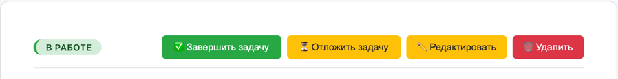
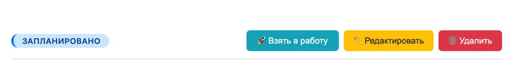
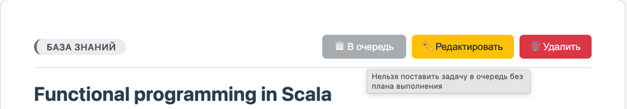
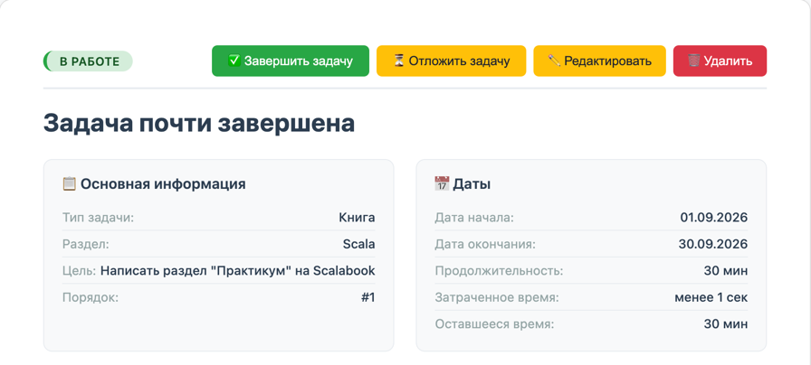
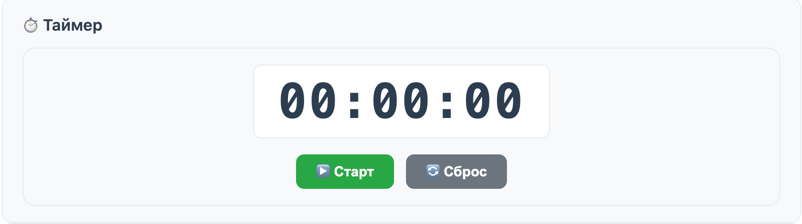
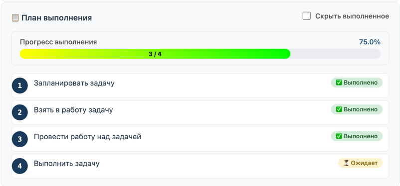
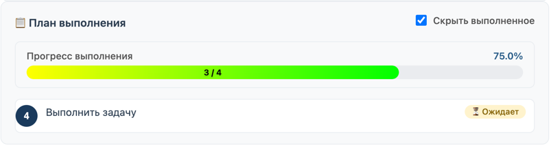
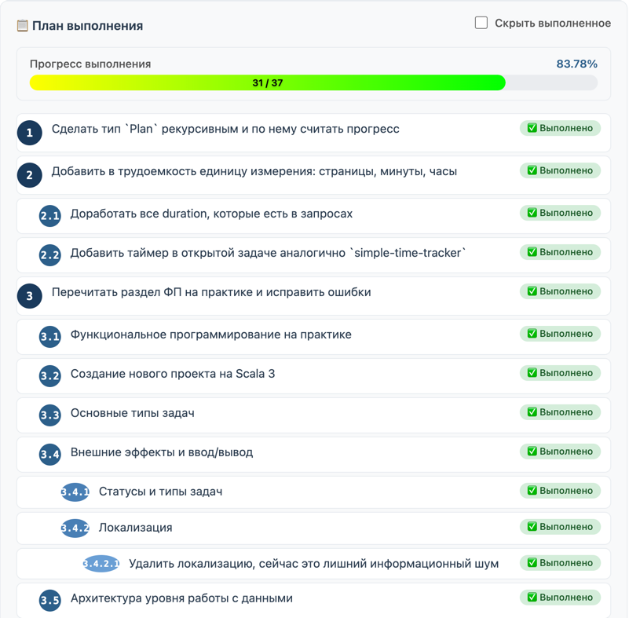



# Страница задачи

Страница задачи — это детальный экран, на котором пользователь работает с конкретной задачей.
Здесь он может изучить полное описание, посмотреть план выполнения, запустить таймер,
изменить статус задачи и многое другое. Страница открывается в **новой вкладке браузера**
при клике на задачу из списка — это позволяет пользователю работать с несколькими задачами
параллельно, не теряя контекст главной страницы.

Маршрут страницы — `/task/{uuid}`, где `{uuid}` — уникальный идентификатор задачи.

## Хэндлер `OpenTaskHandler`

```dotty
final case class OpenTaskHandler(
    middleware: JwtAuthMiddleware[IO, UserInfo],
    taskLifecycleService: TaskLifecycleService[IO]
)(using Logger[IO]) extends AuthorizationHandler(middleware):
  val handler: Handler =
    Routes.openTask.handleIO: (uuid: String, cookie: Cookie) =>
      cookie.getToken match
        case Some(token) =>
          val run: ((UserInfo, JwtToken)) => IO[Option[String]] =
            (user, jwtToken) =>
              TaskId.either(uuid) match
                case Right(taskId) =>
                  getViewTask(
                    taskLifecycleService = taskLifecycleService,
                    userId = user.id,
                    taskId = taskId,
                    jwtToken = jwtToken,
                    errorMessage = none
                  ).map(_.map(html =>
                    View.base("План развития", html).toString
                  ))
                case Left(error) =>
                  Logger[IO].error(error).as(none)
          handleUserIOByTokenOpt(run)(token)
            .map(_.getOrElse(View.base("План развития", NotFoundView).toString))

        case None =>
          Logger[IO].error(
            "В cookies не найден токен пользователя"
          ).as(View.base("План развития", NotFoundView).toString)
end OpenTaskHandler
```

**Пошаговый разбор:**

1. **`handleIO: (uuid: String, cookie: Cookie) => ...`** — обработчик принимает
   UUID задачи из пути и cookie из заголовка.

2. **`cookie.getToken`** — извлекаем токен из cookie (тот же приём, что и в
   `InitialHandler`).

3. **Если токен найден:**
    - Определяем лямбду `run: ((UserInfo, JwtToken)) => IO[Option[String]]`.
    - Она парсит UUID через `TaskId.parse(uuid)`.
    - **`Valid(taskId)`** → загружает задачу через `getViewTask` и оборачивает
      результат в `View.base(...)` — полную HTML-страницу.
    - **`Invalid(error)`** → логирует ошибку и возвращает `None`.

4. **`handleUserIOByTokenOpt(run)(token)`** — специальный метод, который:
    - Проверяет токен через middleware.
    - Если токен валиден — передаёт `(user, jwtToken)` в лямбду `run`.
    - Если токен **невалиден** — возвращает начальную страницу с формой логина.

5. **`.map(_.getOrElse(...))`** — если лямбда вернула `None` (задача не найдена
   или токен невалиден), отдаём страницу 404.

6. **Если токена нет в cookie** — сразу логируем и отдаём 404.

## Формирование страницы задачи

```dotty
def getViewTask(
    taskLifecycleService: TaskLifecycleService[IO],
    userId: UserId,
    taskId: TaskId,
    jwtToken: JwtToken,
    errorMessage: Option[String]
): IO[Option[HtmlFormat.Appendable]] =
  for
    (plannedTasks, _, _) <- taskLifecycleService.getAll(
      userId = userId,
      maybeStatus = Status.Planned.some,
      maybeTaskType = none,
      maybeSectionId = none
    )
    maybeTask <- taskLifecycleService.get(taskId, userId)
  yield maybeTask.map: card =>
    val availableOrdinals = getAvailableOrdinals(plannedTasks)
    View.task(
      task = card,
      token = jwtToken.value,
      availableOrdinals = availableOrdinals,
      errorMessage = errorMessage
    )
```

**Что происходит:**

1. **Загрузка запланированных задач** — нужны для вычисления доступных порядковых
   номеров при постановке задачи в очередь. Загружаем **все** задачи со статусом
   `Planned` для данного пользователя.

2. **Загрузка конкретной задачи** — `taskLifecycleService.get(taskId, userId)`
   возвращает `Option[TaskCard]`. Если задача не найдена или не принадлежит
   пользователю — будет `None`.

3**Рендер шаблона** — `View.task(...)` возвращает `HtmlFormat.Appendable`,
   обёрнутый в `Option` (если задача найдена).

## Вычисление доступных порядковых номеров

```dotty
def getAvailableOrdinals(plannedTasks: Vector[TableTaskCard])
    : Vector[OrdinalCard] =
  val top = 5

  val orderingTasks: Vector[(Ordinal, String)] =
    plannedTasks.sortBy(_.ordinal).map: task =>
      (task.ordinal, task.name.value)

  val start = orderingTasks.headOption.map(_._1.value + 1).getOrElse(1)
  (start to (start + orderingTasks.length + top))
    .filterNot(i => orderingTasks.exists(_._1.value == i))
    .map: i =>
      val name = orderingTasks.takeWhile(
        _._1.value <= i
      ).lastOption.map(_._2).getOrElse("-")
      OrdinalCard(i, name)
    .take(top)
    .toVector
```

**Задача:** предложить пользователю **5 свободных порядковых номеров**, которые
можно использовать для новой задачи или для перестановки.

Эта информация показывается [в модальном окне «В очередь»](ui_task_actions.md) — пользователь видит,
какие порядковые номера свободны и после какой задачи они окажутся.

## Модели данных

### `TaskCard`

```dotty
final case class TaskCard(
    id: TaskId,
    name: TaskName,
    taskType: String,
    status: Status,
    section: String,
    goal: String,
    ordinal: Ordinal,
    startDate: Option[LocalDate],
    endDate: Option[LocalDate],
    information: String,
    plan: List[PlanRowCard],
    completedCount: Int,
    count: Int,
    progress: Double,
    duration: FiniteDuration,
    durationDesc: String,
    timeSpent: FiniteDuration,
    timeSpentDesc: String,
    remainingTimeDesc: String
)
```

**Поля:**

| Поле                          | Назначение                                          |
| ----------------------------- | --------------------------------------------------- |
| `id`, `name`                  | Идентификатор и название задачи                     |
| `taskType`, `section`, `goal` | Читаемые названия типа, раздела и цели (а не их ID) |
| `status`                      | Текущий статус                                      |
| `ordinal`                     | Порядковый номер                                    |
| `startDate`, `endDate`        | Даты начала и окончания                             |
| `information`                 | Описание                                            |
| `plan`                        | Список шагов плана (`PlanRowCard`)                  |
| `completedCount`, `count`     | Сколько шагов выполнено / всего                     |
| `progress`                    | Прогресс в процентах (0–100)                        |
| `duration`, `durationDesc`    | Планируемая продолжительность (число и описание)    |
| `timeSpent`, `timeSpentDesc`  | Затраченное время (число и описание)                |
| `remainingTimeDesc`           | Описание оставшегося времени                        |

**Почему здесь `String` для `taskType`/`section`/`goal`, а не ID?**

Это **модель отображения** (`Card`). Она используется только в шаблоне, поэтому
содержит уже «обогащённые» данные: названия вместо ID. Это позволяет шаблону
не делать лишних вычислений.

### `PlanRowCard`

```dotty
final case class PlanRowCard(number: String, step: String, completed: Boolean)
```

Модель строки плана. `number` — строка вида `"1.2.3"`, `step` — текст шага,
`completed` — флаг выполнения.

### `OrdinalCard`

```dotty
final case class OrdinalCard(ordinal: Int, after: String)
```

Модель доступного порядкового номера. `ordinal` — номер, `after` — название задачи,
после которой этот номер идёт.

## Шаблон `task.scala.html`

Шаблон состоит из трёх основных блоков: **верхняя панель с действиями**,
**информация о задаче**, **план и модальные окна**.

### Верхняя панель

```html
<div class="task-detail-header">
   <div class="task-detail-nav">
      <span class="task-detail-status-badge @task.status.toString.toLowerCase">
          @task.status.show
      </span>
   </div>
   <div class="task-detail-actions">
      <!-- Кнопки действий в зависимости от статуса -->
      @task.status match {
      case Status.InProgress => {
      <button
         class="complete-task-btn"
         onclick="openModal('completeModal')"
      >
         ✅ Завершить задачу
      </button>
      <button
         class="postpone-task-btn"
         hx-put="/task/@task.id/defer"
         hx-target="#app"
         hx-swap="outerHTML"
         hx-confirm="Вы уверены, что хотите отложить задачу «@task.name.value»?"
      >
         ⏳ Отложить задачу
      </button>
      }
      case Status.Planned => {
      @if(task.plan.isEmpty) {
      <button
         class="start-task-btn"
         disabled
         title="Нельзя взять в работу задачу без плана выполнения"
      >
         🚀 Взять в работу
      </button>
      } else {
      <button
         class="start-task-btn"
         onclick="openModal('startModal')"
      >
         🚀 Взять в работу
      </button>
      }
      }
      case Status.KnowledgeBase => {
      @if(task.plan.isEmpty) {
      <button
         class="queue-task-btn"
         disabled
         title="Нельзя поставить задачу в очередь без плана выполнения"
      >
         📋 В очередь
      </button>
      } else {
      <button
         class="queue-task-btn"
         onclick="openModal('ordinalModal')"
      >
         📋 В очередь
      </button>
      }
      }
      case _ => {}
      }
      <button
         class="edit-task-btn"
         hx-get="/task/@task.id/edit"
         hx-target="#app"
         hx-swap="outerHTML"
      >
         ✏️ Редактировать
      </button>
      <button
         class="delete-task-btn"
         hx-delete="/task/@task.id"
         hx-target="#app"
         hx-swap="outerHTML"
         hx-confirm="Вы уверены, что хотите удалить задачу «@task.name.value»?"
      >
         🗑️ Удалить
      </button>
   </div>
</div>
```

**Как работают кнопки действий:**

Набор кнопок зависит от статуса задачи:

| Статус          | Кнопки                                                         |
| --------------- | -------------------------------------------------------------- |
| `InProgress`    | ✅ Завершить задачу, ⏳ Отложить задачу                        |
| `Planned`       | 🚀 Взять в работу (если есть план активна, иначе задизейблена) |
| `KnowledgeBase` | 📋 В очередь (если есть план активна, иначе задизейблена)      |

В работе:



Запланировано:



База знаний:


**Особенность «Отложить задачу»:**

```html
<button
  class="postpone-task-btn"
  hx-put="/task/@task.id/defer"
  hx-target="#app"
  hx-swap="outerHTML"
  hx-confirm="Вы уверены, что хотите отложить задачу «@task.name.value»?"
>
  ⏳ Отложить задачу
</button>
```

- **`hx-put="/task/{id}/defer"`** — PUT-запрос на откладывание задачи.
- **`hx-target="#app"`** — после откладывания **вся страница задачи заменяется**
  обновлённым представлением (теперь задача в статусе `Planned`).
- **`hx-confirm`** — подтверждение.

**Особенность "Взять в работу" и "В очередь":**

```html
@if(task.plan.isEmpty) {
<button
  class="start-task-btn"
  disabled
  title="Нельзя взять в работу задачу без плана выполнения"
>
  🚀 Взять в работу
</button>
} else {
<button class="start-task-btn" onclick="openModal('startModal')">
  🚀 Взять в работу
</button>
}
```

- Если у задачи **нет плана** — кнопка **отключена** с подсказкой.
- Если план есть — [открывается модальное окно](ui_task_actions.md).

Запланировано:


База знаний:



### Основная информация

```html
<!-- Название задачи -->
<h1 class="task-detail-title">@task.name.value</h1>

<!-- Основная информация -->
<div class="task-detail-grid">
   <div class="task-detail-section">
      <h3>📋 Основная информация</h3>
      <div class="task-detail-item">
         <span class="detail-label">Тип задачи:</span>
         <span class="detail-value">@task.taskType</span>
      </div>
      <div class="task-detail-item">
         <span class="detail-label">Раздел:</span>
         <span class="detail-value">@task.section</span>
      </div>
      <div class="task-detail-item">
         <span class="detail-label">Цель:</span>
         <span class="detail-value">@task.goal</span>
      </div>
      <div class="task-detail-item">
         <span class="detail-label">Порядок:</span>
         <span class="detail-value">#@task.ordinal.value</span>
      </div>
   </div>

   <div class="task-detail-section">
      <h3>📅 Даты</h3>
      <div class="task-detail-item">
         <span class="detail-label">Дата начала:</span>
         <span class="detail-value">@task.startDate.map(_.format(DateTimeFormatter.ofPattern("dd.MM.yyyy"))).getOrElse("—")</span>
      </div>
      <div class="task-detail-item">
         <span class="detail-label">Дата окончания:</span>
         <span class="detail-value">@task.endDate.map(_.format(DateTimeFormatter.ofPattern("dd.MM.yyyy"))).getOrElse("—")</span>
      </div>
      <div class="task-detail-item">
         <span class="detail-label">Продолжительность:</span>
         <span class="detail-value">@task.durationDesc</span>
      </div>
      <div class="task-detail-item">
         <span class="detail-label">Затраченное время:</span>
         <span class="detail-value">@task.timeSpentDesc</span>
      </div>
      <div class="task-detail-item">
         <span class="detail-label">Оставшееся время:</span>
         <span class="detail-value">@task.remainingTimeDesc</span>
      </div>
   </div>
</div>
```

Два блока в сетке: слева — основная информация (тип, раздел, цель, порядок),
справа — даты и продолжительность.

**Форматирование дат:**

```html
@task.startDate.map(_.format(DateTimeFormatter.ofPattern("dd.MM.yyyy"))).getOrElse("—")
```

- Если дата есть — форматируется в вид `25.07.2026`.
- Если нет — отображается `—`.



### Таймер

```html
<div class="task-detail-section full-width">
   <h3>⏱️ Таймер</h3>
   <div class="timer-container">
      <div class="timer-display" id="timerDisplay">00:00:00</div>
      <div class="timer-actions">
         <button
            class="timer-btn start-btn"
            id="startTimerBtn"
            onclick="startTimer('@task.id')"
         >
            ▶️ Старт
         </button>
         <button
            class="timer-btn stop-btn"
            id="stopTimerBtn"
            onclick="stopTimer('@task.id', '@token')"
            style="display: none;"
         >
            ⏹️ Стоп
         </button>
         <button
            class="timer-btn reset-btn"
            id="resetTimerBtn"
            onclick="resetTimer()"
         >
            🔄 Сброс
         </button>
      </div>
   </div>
</div>
```

**Как работает таймер:**

1. **Начальное состояние:** кнопки «Старт» и «Сброс» видимы, «Стоп» скрыта.
2. **Клик «Старт»** → JavaScript запускает интервал и переключает кнопки.
3. **Клик «Стоп»** → JavaScript останавливает интервал и отправляет PUT-запрос
   на `/task/{id}/spent` с количеством минут.
4. **Клик «Сброс»** → JavaScript сбрасывает счётчик.

**Почему таймер на JavaScript, а не на htmx?**

Таймер должен обновляться **каждую секунду** — это 60 запросов в минуту.
Если бы мы использовали htmx для каждого тика, сервер был бы перегружен.
Поэтому обновление счётчика происходит на клиенте, а на сервер отправляется
только итоговое значение при остановке.

Начальное состояние: 



Таймер запущен:


### План выполнения



```html
<div class="plan-header">
  <h3>📋 План выполнения</h3>
  <label class="hide-completed-label">
    <input type="checkbox" id="hideCompleted" onchange="toggleCompleted()" />
    Скрыть выполненное
  </label>
</div>
```

**Чекбокс «Скрыть выполненное»** — JavaScript-функция `toggleCompleted()`
скрывает все шаги плана с `data-completed="true"`.



**Прогресс-бар:**

```html
<div class="plan-progress-container">
  <div class="plan-progress-label">
    <span>Прогресс выполнения</span>
    <span class="plan-progress-percent">@task.progress%</span>
  </div>
  <div class="plan-progress-bar">
    <div class="plan-progress-fill" style="width: @task.progress%;">
      <span class="plan-progress-text">@task.completedCount / @task.count</span>
    </div>
  </div>
</div>
```

Показывает процент выполнения и счётчик `выполнено / всего`.

**Список шагов плана:**

```html
@for(plan <- task.plan) { @defining(plan.number.count(_ == '.')) { level =>
<div
  class="task-plan-item"
  data-level="@level"
  data-completed="@plan.completed"
>
  <div class="plan-step-number level-@level">@plan.number</div>
  <div class="plan-step-content">
    <div class="plan-step-text">@plan.step</div>
    @if(plan.completed) {
    <span class="plan-step-status completed">✅ Выполнено</span>
    } else {
    <span class="plan-step-status pending">⏳ Ожидает</span>
    }
  </div>
</div>
} }
```

**Иерархия уровней:** `plan.number.count(_ == '.')` считает количество точек
в номере:

- `1` → уровень 0
- `1.2` → уровень 1
- `1.2.3` → уровень 2 и т.д.

CSS использует `data-level` для отступов и цветовой дифференциации.



### Модальные окна

Модальные окна разобраны на странице ["Действия над задачей"](ui_task_actions.md)

## Обработка «задача не найдена»

```html
<div class="home-container">
  <div class="not-found-content">
    <h1 class="not-found-title">404</h1>
    <p class="not-found-text">Страница не найдена</p>
    <a href="/" class="home-button">🏠 На главную</a>
  </div>
</div>
```

Шаблон `notFound.scala.html` используется в `OpenTaskHandler`, когда:

- Задача с таким UUID не существует.
- Задача принадлежит другому пользователю.
- Токен невалиден или отсутствует.

Это безопасный способ обработки ошибок: пользователь видит понятную страницу 404
с кнопкой «На главную», а не техническую ошибку.


## Итог

Страница задачи — это полнофункциональный экран для работы с конкретной задачей:

1. **Просмотр полной информации:** название, тип, раздел, цель, порядок, даты,
   продолжительность, затраченное и оставшееся время.
2. **Управление статусом:** завершение, откладывание, взятие в работу, постановка
   в очередь — каждая операция доступна только для соответствующего статуса.
3. **Работа с планом:** список шагов с иерархическими уровнями, прогресс-бар,
   фильтр «Скрыть выполненное».
4. **Таймер:** запуск, остановка и сброс, с сохранением затраченного времени
   на сервере.
5. **Редактирование и удаление:** переход на форму редактирования или удаление
   с подтверждением.

**Ключевые архитектурные решения:**

- **Модель `TaskCard`** — «толстая» модель отображения с готовыми строками
  для шаблона (названия вместо ID, описания длительности и т.д.).
- **`availableOrdinals`** — алгоритм предлагает 5 свободных порядковых номеров
  с подсказками, после какой задачи они окажутся.

Страница задачи — центральное место работы пользователя с отдельной задачей.
Она сочетает в себе информативность (все данные о задаче на одном экране)
и интерактивность (быстрое переключение статусов, работа с планом, таймер).

---

**Ссылки:**

- [Репозиторий с исходниками][repo]

[repo]: https://gitverse.ru/scalabook/pdp
