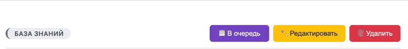
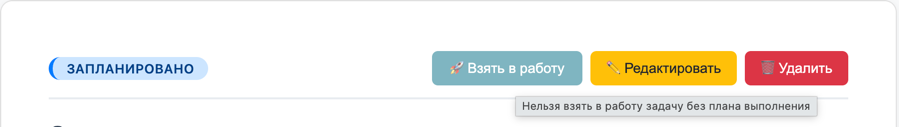
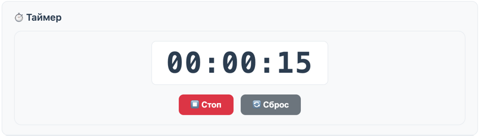
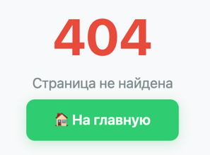

# Страница задачи

Страница задачи — это детальный экран, на котором пользователь работает с конкретной задачей.
Здесь он может изучить полное описание, посмотреть план выполнения, запустить таймер,
изменить статус задачи и многое другое. Страница открывается в **новой вкладке браузера**
при клике на задачу из списка — это позволяет пользователю работать с несколькими задачами
параллельно, не теряя контекст главной страницы.

Маршрут страницы — `/task/{uuid}`, где `{uuid}` — уникальный идентификатор задачи.

## Хэндлер `openHandler` (класс `TaskHandlers`)

Все операции со страницей задачи собраны в один класс `TaskHandlers`. Операция открытия
задачи — это публичный `val openHandler`, декларативно связанный со своим приватным маршрутом
`openRoute`:

```dotty
final case class TaskHandlers(
    middleware: JwtAuthMiddleware[IO, UserInfo],
    settingsService: SettingsService[IO],
    taskLifecycleService: TaskLifecycleService[IO]
)(using Logger[IO]) extends AuthorizationHandler(middleware):
  private val taskPath = Path.root / "task" / uuidParam

  private val openRoute = Route(
    Request.get(taskPath).extractHeader[`Cookie`],
    Response.ok(Entity.html)
  )

  val openHandler: Handler =
    openRoute.handleIO: (uuid: UUID, cookie: Cookie) =>
      withUserFromCookieOpt(cookie)(
        f = (user, jwtToken) =>
          getViewTask(
            taskLifecycleService = taskLifecycleService,
            userId = user.id,
            taskId = TaskId(uuid),
            jwtToken = jwtToken,
            errorMessage = none
          ).map(_.map(html => Views.base(Title, raw(html)))),
        fallbackPage = NotFoundView
      )

  val editFormHandler: Handler = ...
  val editHandler: Handler = ...
  val createHandler: Handler = ...
  val completeHandler: Handler = ...
  // ... остальные операции
end TaskHandlers
```

**Пошаговый разбор:**

1. **`handleIO: (uuid: UUID, cookie: Cookie) => ...`** — обработчик принимает
   UUID задачи из пути и cookie из заголовка. Обратите внимание: `uuid` уже имеет
   тип `UUID`, а не `String` — маршрут `/task/{uuid}` использует `uuidParam`
   (`Param[UUID]`), поэтому ручной парсинг UUID в хэндлере больше не нужен.

2. **`withUserFromCookieOpt(cookie)(f, fallbackPage)`** — извлекает токен из куки `token`,
   проверяет его через middleware и передаёт `(user, jwtToken)` в лямбду `f`.
   Если токена нет или он невалиден — возвращает `fallbackPage` (страницу 404).
   Извлечение токена из куки инкапсулировано в `AuthorizationHandler`
   (метод делает это внутри себя), поэтому ручной `cookie.getToken` не нужен.

3. **Лямбда `f`** — сразу загружает задачу через `getViewTask` с `TaskId(uuid)`
   без веток `Right`/`Left`, потому что `uuid` уже валиден по типу. Обёртывает
   результат в `Views.base(...)` — полную HTML-страницу. Так как `getViewTask`
   возвращает строку, её оборачивают в `raw(...)`, потому что `Views.base` принимает
   scalatags-фрагмент `Modifier`.

4. **Возврат `Option`**: `f` возвращает `IO[Option[String]]`. Если задача не найдена —
   `None`, и `withUserFromCookieOpt` подставляет `fallbackPage` (404).

5. **`fallbackPage = NotFoundView`** — константа из `WelcomeViews`, общий шаблон 404
   для всего приложения.

## Формирование страницы задачи

Функция `getViewTask` вынесена в объект `TaskViews`, который группирует все вспомогательные
функции построения представлений задач:

```dotty
private[tasks] object TaskViews:
  def getViewTask(
      taskLifecycleService: TaskLifecycleService[IO],
      userId: UserId,
      taskId: TaskId,
      jwtToken: SignedJwt,
      errorMessage: Option[String]
  ): IO[Option[String]] =
    for
      (tasks, taskTypes, sections, goals) <- taskLifecycleService.getAll(
        userId = userId,
        maybeStatus = Status.Planned.some,
        maybeTaskType = none,
        maybeSectionId = none
      )
      maybeTask <- taskLifecycleService.get(taskId, userId)
    yield maybeTask.map: card =>
      val typesMap     = taskTypes.map(t => (t.id, t.name)).toMap
      val sectionsMap  = sections.map(t => (t.id, t.name)).toMap
      val goalsMap     = goals.map(t => (t.id, t.name)).toMap
      val plannedTasks =
        tasks.map(task =>
          TablePlannedTaskCard.fromTaskResult(task, typesMap, sectionsMap, goalsMap)
        )
      val availableOrdinals = getAvailableOrdinals(plannedTasks)
      Views.task(
        task = card,
        token = jwtToken.show,
        availableOrdinals = availableOrdinals,
        errorMessage = errorMessage
      ).render
```

**Что происходит:**

1. **Загрузка данных** — `taskLifecycleService.getAll` возвращает кортеж
   `(tasks, taskTypes, sections, goals)`. Задачи со статусом `Planned` нужны для
   вычисления доступных порядковых номеров при постановке задачи в очередь, а справочники —
   для обогащения строк таблицы читаемыми названиями.

2. **Обогащение строк** — задачи превращаются в `TablePlannedTaskCard` через
   `TablePlannedTaskCard.fromTaskResult`, подставляя названия типов, разделов и целей вместо их ID.

3. **Загрузка конкретной задачи** — `taskLifecycleService.get(taskId, userId)`
   возвращает `Option[TaskCard]`. Если задача не найдена или не принадлежит
   пользователю — будет `None`.

4. **Рендер шаблона** — `Views.task(...)` возвращает `Frag`; `.render` превращает его
   в HTML-строку, обёрнутую в `Option` (если задача найдена).

## Вычисление доступных порядковых номеров

```dotty
def getAvailableOrdinals(plannedTasks: Vector[TablePlannedTaskCard])
    : Vector[OrdinalCard] =
  val top = 5

  val orderingTasks: Vector[(Ordinal, String)] =
    plannedTasks.sortBy(_.ordinal).map: task =>
      (task.ordinal, task.name.value)

  val start = orderingTasks.headOption.map(_._1.value + 1).getOrElse(1)
  (start to (start + orderingTasks.length + top))
    .filterNot(i => orderingTasks.exists(_._1.value == i))
    .map: i =>
      val name = orderingTasks.takeWhile(
        _._1.value <= i
      ).lastOption.map(_._2).getOrElse("-")
      OrdinalCard(i, name)
    .take(top)
    .toVector
```

**Задача:** предложить пользователю **5 свободных порядковых номеров**, которые
можно использовать для новой задачи или для перестановки.

Эта информация показывается [в модальном окне «В очередь»](ui_task_actions.md) — пользователь видит,
какие порядковые номера свободны и после какой задачи они окажутся.

## Модели данных

### `TaskCard`

```dotty
final case class TaskCard(
    id: TaskId,
    name: TaskName,
    taskType: String,
    status: Status,
    section: String,
    goal: String,
    ordinal: Ordinal,
    startDate: Option[LocalDate],
    endDate: Option[LocalDate],
    information: String,
    plan: List[PlanRowCard],
    completedCount: Int,
    count: Int,
    progress: Double,
    duration: FiniteDuration,
    durationDesc: String,
    timeSpent: FiniteDuration,
    timeSpentDesc: String,
    remainingTimeDesc: String
)
```

**Поля:**

| Поле                          | Назначение                                          |
| ----------------------------- | --------------------------------------------------- |
| `id`, `name`                  | Идентификатор и название задачи                     |
| `taskType`, `section`, `goal` | Читаемые названия типа, раздела и цели (а не их ID) |
| `status`                      | Текущий статус                                      |
| `ordinal`                     | Порядковый номер                                    |
| `startDate`, `endDate`        | Даты начала и окончания                             |
| `information`                 | Описание                                            |
| `plan`                        | Список шагов плана (`PlanRowCard`)                  |
| `completedCount`, `count`     | Сколько шагов выполнено / всего                     |
| `progress`                    | Прогресс в процентах (0–100)                        |
| `duration`, `durationDesc`    | Планируемая продолжительность (число и описание)    |
| `timeSpent`, `timeSpentDesc`  | Затраченное время (число и описание)                |
| `remainingTimeDesc`           | Описание оставшегося времени                        |

**Почему здесь `String` для `taskType`/`section`/`goal`, а не ID?**

Это **модель отображения** (`Card`). Она используется только в шаблоне, поэтому
содержит уже «обогащённые» данные: названия вместо ID. Это позволяет шаблону
не делать лишних вычислений.

### `PlanRowCard`

```dotty
final case class PlanRowCard(number: String, step: String, completed: Boolean)
```

Модель строки плана. `number` — строка вида `"1.2.3"`, `step` — текст шага,
`completed` — флаг выполнения.

### `OrdinalCard`

```dotty
final case class OrdinalCard(ordinal: Int, after: String)
```

Модель доступного порядкового номера. `ordinal` — номер, `after` — название задачи,
после которой этот номер идёт.

## Рендер карточки задачи `Views.task`

Шаблон состоит из трёх основных блоков: **верхняя панель с действиями**,
**информация о задаче**, **план и модальные окна**.

### Верхняя панель

```dotty
val statusButtons: Modifier = task.status match
  case Status.InProgress =>
    frag(
      button(
        cls             := "complete-task-btn",
        attr("onclick") := "openModal('completeModal')"
      )("✅ Завершить задачу"),
      button(
        cls            := "postpone-task-btn",
        attr("hx-put") := s"/task/${task.id.value}/defer",
        Htmx.appTarget,
        Htmx.appSwap,
        attr("hx-confirm") :=
          s"""Вы уверены, что хотите отложить задачу «${task.name.value}»?"""
      )("⏳ Отложить задачу")
    )
  case Status.Planned =>
    if task.plan.isEmpty then
      button(
        cls           := "start-task-btn",
        disabled      := true,
        attr("title") := "Нельзя взять в работу задачу без плана выполнения"
      )("🚀 Взять в работу")
    else
      button(
        cls             := "start-task-btn",
        attr("onclick") := "openModal('startModal')"
      )("🚀 Взять в работу")
  case Status.KnowledgeBase =>
    if task.plan.isEmpty then
      button(
        cls      := "queue-task-btn",
        disabled := true,
        attr(
          "title"
        ) := "Нельзя поставить задачу в очередь без плана выполнения"
      )("📋 В очередь")
    else
      button(
        cls             := "queue-task-btn",
        attr("onclick") := "openModal('ordinalModal')"
      )("📋 В очередь")
  case _ =>
    frag()
```

**Как работают кнопки действий:**

Набор кнопок зависит от статуса задачи:

| Статус          | Кнопки                                                         |
| --------------- | -------------------------------------------------------------- |
| `InProgress`    | ✅ Завершить задачу, ⏳ Отложить задачу                        |
| `Planned`       | 🚀 Взять в работу (если есть план активна, иначе задизейблена) |
| `KnowledgeBase` | 📋 В очередь (если есть план активна, иначе задизейблена)      |

В работе:


Запланировано:


База знаний:



**Особенность «Отложить задачу»:**

```dotty
button(
  cls            := "postpone-task-btn",
  attr("hx-put") := s"/task/${task.id.value}/defer",
  Htmx.appTarget,
  Htmx.appSwap,
  attr("hx-confirm") :=
    s"""Вы уверены, что хотите отложить задачу «${task.name.value}»?"""
)("⏳ Отложить задачу")
```

- **`hx-put="/task/{id}/defer"`** — PUT-запрос на откладывание задачи.
- **`hx-target="#app"`** — после откладывания **вся страница задачи заменяется**
  обновлённым представлением (теперь задача в статусе `Planned`).
- **`hx-confirm`** — подтверждение.

**Особенность "Взять в работу" и "В очередь":**

```dotty
if task.plan.isEmpty then
  button(
    cls           := "start-task-btn",
    disabled      := true,
    attr("title") := "Нельзя взять в работу задачу без плана выполнения"
  )("🚀 Взять в работу")
else
  button(
    cls             := "start-task-btn",
    attr("onclick") := "openModal('startModal')"
  )("🚀 Взять в работу")
```

- Если у задачи **нет плана** — кнопка **отключена** с подсказкой.
- Если план есть — [открывается модальное окно](ui_task_actions.md).

Запланировано:



База знаний:


### Основная информация

```dotty
div(
  `id` := "taskDetailBlock",
  cls  := "task-detail-container",
  div(cls := "task-detail-header")(
    div(cls := "task-detail-nav")(
      span(
        cls :=
          s"task-detail-status-badge ${task.status.toString.toLowerCase}"
      )(task.status.show)
    ),
    div(cls := "task-detail-actions")(
      statusButtons,
      editButton(s"/task/${task.id.value}/edit"),
      deleteButton(
        s"/task/${task.id.value}",
        task.name.value,
        "задачу"
      )
    )
  ),
  errorBlock(errorMessage),
  task.render,
  ...
)

final case class TaskCard(...):
  ...
  def render: Frag =
    val mainInfo =
      detailSection(
        "📋 Основная информация",
        Seq(
          "Тип задачи" -> taskType,
          "Раздел"     -> section,
          "Цель"       -> goal,
          "Порядок"    -> s"#${ordinal.value}"
        )
      )

    val dates =
      detailSection(
        "📅 Даты",
        Seq(
          "Дата начала"       -> startDate.render,
          "Дата окончания"    -> endDate.render,
          "Продолжительность" -> durationDesc,
          "Затраченное время" -> timeSpentDesc,
          "Оставшееся время"  -> remainingTimeDesc
        )
      )

    frag(
      titleCard(name.value),
      div(
        cls := "task-detail-grid",
        mainInfo,
        dates
      )
    )
  end render
```

Два блока в сетке: слева — основная информация (тип, раздел, цель, порядок),
справа — даты и продолжительность.

**Форматирование дат:**

```dotty
private inline def formatter: DateTimeFormatter =
  DateTimeFormatter.ofPattern("dd.MM.yyyy")

given Render[LocalDate] with
  def render(value: LocalDate): String =
    value.format(formatter)

given Render[Option[LocalDate]] with
  def render(value: Option[LocalDate]): String =
    value.map(_.render).getOrElse("—")
```

- Если дата есть — форматируется в вид `25.07.2026`.
- Если нет — отображается `—`.


### Таймер

```dotty
div(cls := "task-detail-section full-width")(
  h3("⏱️ Таймер"),
  div(
    cls                  := "timer-container",
    attr("data-task-id") := task.id.value.toString
  )(
    div(cls := "timer-display", `id` := "timerDisplay")("00:00:00"),
    div(cls := "timer-actions")(
      button(
        cls             := "timer-btn start-btn",
        `id`            := "startTimerBtn",
        attr("onclick") := s"startTimer('${task.id.value}')"
      )("▶️ Старт"),
      button(
        cls             := "timer-btn stop-btn",
        `id`            := "stopTimerBtn",
        attr("onclick") :=
          s"stopTimer('${task.id.value}', '${token.show}')",
        style := "display: none;"
      )("⏹️ Записать"),
      button(
        cls             := "timer-btn reset-btn",
        `id`            := "resetTimerBtn",
        attr("onclick") := "resetTimer()"
      )("🔄 Сброс")
    )
  )
)
```

**Как работает таймер:**

1. **Начальное состояние:** кнопки «Старт» и «Сброс» видимы, «Стоп» скрыта.
2. **Клик «Старт»** → JavaScript запускает интервал и переключает кнопки.
3. **Клик «Стоп»** → JavaScript останавливает интервал и отправляет PUT-запрос
   на `/task/{id}/spent` с количеством минут.
4. **Клик «Сброс»** → JavaScript сбрасывает счётчик.

**Почему таймер на JavaScript, а не на htmx?**

Таймер должен обновляться **каждую секунду** — это 60 запросов в минуту.
Если бы мы использовали htmx для каждого тика, сервер был бы перегружен.
Поэтому обновление счётчика происходит на клиенте, а на сервер отправляется
только итоговое значение при остановке.

Начальное состояние: 


Таймер запущен:



### План выполнения


```dotty
def renderPlan(
    plan: List[PlanRowCard],
    progress: ProgressCard,
    link: String
): Tag =
  div(
    cls := "task-detail-section full-width",
    div(
      cls := "plan-header",
      h3("📋 План выполнения"),
      label(
        cls := "hide-completed-label",
        input(
          `type`   := "checkbox",
          id       := "hideCompleted",
          onchange := "toggleCompleted()",
          checked
        ),
        " Скрыть выполненное"
      )
    ),
    if plan.nonEmpty then
      frag(
        progress.render,
        div(
          cls := "task-plan-list",
          id  := "planList",
          plan.map(_.render(link))
        )
      )
    else p(cls := "empty-message")("План не составлен")
  )
```

**Чекбокс «Скрыть выполненное»** — JavaScript-функция `toggleCompleted()`
скрывает все шаги плана с `data-completed="true"`.


**Прогресс-бар:**

```dotty
final case class ProgressCard(
    progress: Double,
    completedCount: Int,
    count: Int
):
  def render: Tag =
    div(
      cls := "plan-progress-container",
      div(
        cls := "plan-progress-label",
        span("Прогресс выполнения"),
        span(cls := "plan-progress-percent")(s"$progress%")
      ),
      div(
        cls := "plan-progress-bar",
        div(
          cls   := "plan-progress-fill",
          style := s"width: $progress%;",
          span(cls := "plan-progress-text")(completedCount / count)
        )
      )
    )
```

Показывает процент выполнения и счётчик `выполнено / всего`.

**Список шагов плана:**

```dotty
div(
  cls := "task-plan-list",
  id  := "planList",
  plan.map(_.render(link))
)

final case class PlanRowCard(number: String, step: String, completed: Boolean):
  def render(link: String): Tag =
    val level = number.count(_ == '.')
    div(
      cls := "task-plan-item" + (if completed then " completed-hidden" else ""),
      attr("data-level")     := level,
      attr("data-completed") := completed,
      div(
        cls := s"plan-step-number level-$level",
        number
      ),
      div(
        cls := "plan-step-content",
        div(
          cls                   := "plan-step-text markdown-content",
          attr("data-markdown") := step
        ),
        if completed then
          span(cls := "plan-step-status completed")("✅ Выполнено")
        else
          button(
            cls            := "plan-step-complete-btn",
            attr("hx-put") := s"$link/$number",
            Htmx.appTarget,
            Htmx.appSwap,
            title := "Отметить шаг как выполненный"
          )("✅ Выполнить")
      )
    )
```

**Иерархия уровней:** `plan.number.count(_ == '.')` считает количество точек
в номере:

- `1` → уровень 0
- `1.2` → уровень 1
- `1.2.3` → уровень 2 и т.д.

CSS использует `data-level` для отступов и цветовой дифференциации.


### Модальные окна

Модальные окна разобраны на странице ["Действия над задачей"](ui_task_actions.md)

## Обработка «задача не найдена»

```dotty
def notFound(): Modifier =
  div(cls := "home-container")(
    div(cls := "not-found-content")(
      h1(cls := "not-found-title")("404"),
      p(cls := "not-found-text")("Страница не найдена"),
      a(href := "/", cls := "home-button")("🏠 На главную")
    )
  )
```

Рендер ``Vies.notFound`` используется в `TaskHandlers.openHandler`, когда:

- Задача с таким UUID не существует.
- Задача принадлежит другому пользователю.
- Токен невалиден или отсутствует.

Это безопасный способ обработки ошибок: пользователь видит понятную страницу 404
с кнопкой «На главную», а не техническую ошибку.



## Итог

Страница задачи — это полнофункциональный экран для работы с конкретной задачей:

1. **Просмотр полной информации:** название, тип, раздел, цель, порядок, даты,
   продолжительность, затраченное и оставшееся время.
2. **Управление статусом:** завершение, откладывание, взятие в работу, постановка
   в очередь — каждая операция доступна только для соответствующего статуса.
3. **Работа с планом:** список шагов с иерархическими уровнями, прогресс-бар,
   фильтр «Скрыть выполненное».
4. **Таймер:** запуск, остановка и сброс, с сохранением затраченного времени
   на сервере.
5. **Редактирование и удаление:** переход на форму редактирования или удаление
   с подтверждением.

**Ключевые архитектурные решения:**

- **Модель `TaskCard`** — «толстая» модель отображения с готовыми строками
  для шаблона (названия вместо ID, описания длительности и т.д.).
- **`availableOrdinals`** — алгоритм предлагает 5 свободных порядковых номеров
  с подсказками, после какой задачи они окажутся.

Страница задачи — центральное место работы пользователя с отдельной задачей.
Она сочетает в себе информативность (все данные о задаче на одном экране)
и интерактивность (быстрое переключение статусов, работа с планом, таймер).

---

**Ссылки:**

- [Репозиторий с исходниками][repo]

[repo]: https://gitverse.ru/scalabook/pdp
