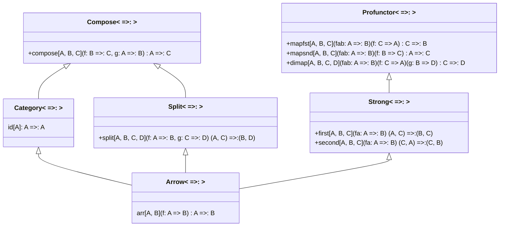

# Группа Arrow

## Введение

В функциональном программировании **Arrow** — это абстракция, которая обобщает понятие функций 
и позволяет работать с вычислениями как с объектами первого класса. 
Концепция `Arrow` была введена Джоном Хьюзом как способ структурирования программ, 
где вычисления могут быть комбинированы и преобразованы в более сложные конструкции. 
В Scala эта концепция реализуется через типовые классы, 
которые предоставляют гибкость и мощь для построения композиционных и модульных программ.

**Группа Arrow** включает в себя несколько связанных типовых классов, таких как `Arrow`, `ArrowChoice`, `ArrowApply` и другие. 
Эти типовые классы позволяют:

- **Абстрагировать вычисления**: `Arrow` позволяет представлять вычисления как объекты, которые можно комбинировать и преобразовывать.
- **Создавать сложные pipelines**: С помощью `Arrow` можно строить цепочки вычислений, где выход одной операции становится входом для другой.
- **Обрабатывать ветвления и выбор**: Типовые классы, такие как `ArrowChoice`, добавляют возможность работать с условными вычислениями и ветвлениями.
- **Применять вычисления динамически**: `ArrowApply` позволяет создавать вычисления, которые могут динамически применяться к своим входным данным.

В Scala типовые классы `Arrow` реализуются в библиотеках, таких как **Cats** или **Scalaz**, 
и предоставляют мощные инструменты для функционального программирования. 
Они особенно полезны в задачах, где требуется высокая степень композиции и модульности, 
таких как обработка потоков данных, построение DSL (Domain-Specific Languages) или реализация сложных бизнес-логик.

В этом разделе мы рассмотрим основные типовые классы группы `Arrow`, их методы и примеры использования, 
чтобы понять, как они могут быть применены для создания гибких и выразительных программ на Scala.

## Использование

Группа `Arrow` находит применение в различных областях функционального программирования. 
Эти абстракции позволяют работать с вычислениями как с объектами первого класса, обеспечивая гибкость и модульность. 
Вот основные области, где используется группа `Arrow`:

- **Композиция вычислений**
    - `Arrow` позволяет комбинировать вычисления в цепочки (pipelines), где выход одной операции становится входом для другой.
    - Пример: обработка данных, где каждая операция (например, фильтрация, преобразование, агрегация) 
      представлена как `Arrow` и объединяется в общий pipeline.
- **Domain-Specific Languages (DSL)**
    - `Arrow` используется для создания встроенных DSL, которые описывают сложные процессы в декларативном стиле.
    - Пример: DSL для описания бизнес-процессов, где каждая операция (например, проверка условий, выполнение действий) 
      представлена как `Arrow`.
- **Обработка потоков данных**
    - `Arrow` позволяет строить сложные цепочки обработки потоков данных, где каждая операция 
      (например, `map`, `filter`, `reduce`) может быть представлена как `Arrow`.
    - Пример: обработка событий в реальном времени или потоковая обработка данных в системах, 
      таких как Apache Kafka или Apache Flink.
- **Условные вычисления и ветвления**
    - Типовые классы, такие как `ArrowChoice`, позволяют работать с условными вычислениями и ветвлениями, 
      что полезно для реализации сложной логики.
    - Пример: обработка запросов, где в зависимости от входных данных выбирается одна из нескольких возможных операций.
- **Динамическое применение вычислений**
    - `ArrowApply` позволяет создавать вычисления, которые могут динамически применяться к своим входным данным.
    - Пример: системы, где вычисления генерируются на лету в зависимости от контекста или входных параметров.
- **Функционально-реактивное программирование (FRP)**
    - `Arrow` используется в FRP для описания реактивных потоков данных и их преобразований.
    - Пример: библиотеки для работы с реактивными потоками, такие как Monix или FS2, 
      где `Arrow` помогает комбинировать и преобразовывать потоки.
- **Тестирование и симуляции**
    - `Arrow` позволяет разделить описание вычислений и их интерпретацию, что полезно для тестирования и симуляции.
    - Пример: в тестах можно использовать одну интерпретацию для реального выполнения операций, 
      а другую — для симуляции или мокирования.
- **Параллельные и асинхронные вычисления**
    - `Arrow` может быть использован для описания параллельных и асинхронных вычислений, 
      которые затем интерпретируются в зависимости от контекста.
    - Пример: построение асинхронных цепочек операций, где каждая операция выполняется в отдельном потоке или асинхронно.
- **Графы вычислений**
    - `Arrow` позволяет строить графы вычислений, где узлы представляют операции, а рёбра — зависимости между ними.
    - Пример: системы планирования задач, где каждая задача представлена как `Arrow`, 
      а зависимости между задачами описываются с помощью композиции `Arrow`.
- **Работа с эффектами**
    - `Arrow` может быть использован для работы с эффектами (например, `IO`, `State`, `Reader`) в функциональном стиле.
    - Пример: построение цепочек операций с эффектами, где каждая операция представлена как `Arrow`, 
      а эффекты управляются с помощью монад.

## Схема

---

**Ссылки:**

- [Исходный код](https://gitverse.ru/artemkorsakov/scalabook/content/master/examples/src/main/scala/ru/scalabook/typeclass/arrow)
- [Тесты](https://gitverse.ru/artemkorsakov/scalabook/content/master/examples/src/test/scala/ru/scalabook/typeclass/arrow)
- [Learning Scalaz](http://eed3si9n.com/learning-scalaz/Arrow.html)
