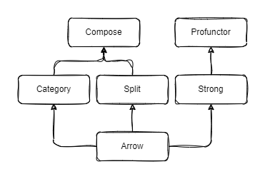

# Группа Arrow

## Схема

## Использование

Arrow — это термин, используемый в теории категорий как абстрактное понятие вещи, которая ведет себя как функция.

---

**Ссылки:**

- [Исходный код](https://gitverse.ru/artemkorsakov/scalabook/content/master/examples/src/main/scala/ru/scalabook/typeclass/arrow)
- [Тесты](https://gitverse.ru/artemkorsakov/scalabook/content/master/examples/src/test/scala/ru/scalabook/typeclass/arrow)
- [Learning Scalaz](http://eed3si9n.com/learning-scalaz/Arrow.html)
