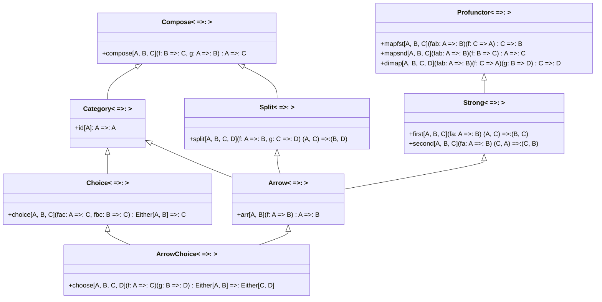



# Группа Arrow

В функциональном программировании **Arrow** — это абстракция, обобщающая понятие функций 
и позволяющая работать с вычислениями как с объектами первого класса. 
Концепция была введена Джоном Хьюзом для структурирования программ, 
где вычисления могут комбинироваться и преобразовываться в более сложные конструкции. 
В Scala эта концепция реализуется через классы типов, 
которые предоставляют гибкость для построения композиционных программ, 
моделируя компонуемые отношения между двумя типами — например, функцию `A => B`, 
`Kleisli` (обертывание `A => F[B]`) или `Cokleisli` (обертывание `F[A] => B`). 
Стрелку `F[A, B]` можно рассматривать как представление вычисления от `A` до `B` с некоторым контекстом, 
аналогично тому, как функтор/аппликатив/монада `F[A]` представляет значение `A` с контекстом.

**Группа Arrow** включает в себя несколько связанных классов типов. 
Эти классы типов позволяют:

- **Абстрагировать вычисления**: `Arrow` позволяет представлять вычисления как объекты, которые можно комбинировать и преобразовывать.
- **Создавать сложные pipelines**: С помощью `Arrow` можно строить цепочки вычислений, где выход одной операции становится входом для другой.

## Использование

Группа `Arrow` находит применение в различных областях функционального программирования. 
Эти абстракции позволяют работать с вычислениями как с объектами первого класса, обеспечивая гибкость и модульность. 
Вот основные области, где используется группа `Arrow`:

- **Композиция вычислений**
    - `Arrow` позволяет комбинировать вычисления в цепочки (pipelines), где выход одной операции становится входом для другой.
    - Пример: обработка данных, где каждая операция (например, фильтрация, преобразование, агрегация) 
      представлена как `Arrow` и объединяется в общий pipeline.
- **Domain-Specific Languages (DSL)**
    - `Arrow` используется для создания встроенных DSL, которые описывают сложные процессы в декларативном стиле.
    - Пример: DSL для описания бизнес-процессов, где каждая операция (например, проверка условий, выполнение действий) 
      представлена как `Arrow`.
- **Обработка потоков данных**
    - `Arrow` позволяет строить сложные цепочки обработки потоков данных, где каждая операция 
      (например, `map`, `filter`, `reduce`) может быть представлена как `Arrow`.
    - Пример: обработка событий в реальном времени или потоковая обработка данных в системах, 
      таких как Apache Kafka или Apache Flink.
- **Графы вычислений**
    - `Arrow` позволяет строить графы вычислений, где узлы представляют операции, а рёбра — зависимости между ними.
    - Пример: системы планирования задач, где каждая задача представлена как `Arrow`, 
      а зависимости между задачами описываются с помощью композиции `Arrow`.

## Схема

---

**Ссылки:**

- [Ссылка на репозиторий с упражнениями][sample]
- [Cats](https://typelevel.org/cats/typeclasses/arrow.html)
- [Learning Scalaz](http://eed3si9n.com/learning-scalaz/Arrow.html)

[sample]: https://gitverse.ru/scalabook/typeclasses
