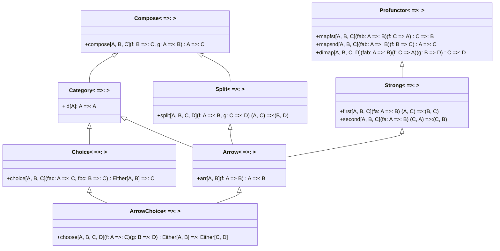



# Arrow Choice

`ArrowChoice` — это расширение [`Choice`](choice.md), добавляющее метод `choose` с инфиксным синтаксисом `+++`:

```dotty
trait ArrowChoice[=>:[_, _]] extends Arrow[=>:] with Choice[=>:]:
  def choose[A, B, C, D](f: A =>: C)(g: B =>: D): Either[A, B] =>: Either[C, D]

  infix def +++[A, B, C, D](f: A =>: C)(g: B =>: D)
      : Either[A, B] =>: Either[C, D] =
    choose(f)(g)

  override def choice[A, B, C](
      f: A =>: C,
      g: B =>: C
  ): Either[A, B] =>: C =
    mapsnd(choose(f)(g))(_.fold(identity, identity))
```

В то время как `Choice` работает с выбором между двумя альтернативами (`Either`) внутри одной стрелки, 
`ArrowChoice` позволяет параллельно преобразовывать обе ветви `Either`, применяя разные стрелки к левой и правой частям. 
Результатом также является `Either`, но уже с преобразованными значениями.

### Применение: Логирование в middleware

Вернемся к примеру с [middleware аутентификации](choice.md). 
Предположим, мы хотим добавить логирование в middleware `auth`, 
которое будет логировать как отклоненные запросы, так и успешно прошедшие:

```dotty
def logReject[F[_]]: Kleisli[[A] =>> OptionT[F, A], Response[F], Response[F]] = ???
// логирует отклоненные запросы

def logThrough[F[_]]: Kleisli[[A] =>> OptionT[F, A], Request[F], Request[F]] = ???
// логирует успешно прошедшие запросы
```

С помощью `ArrowChoice` мы можем легко скомпоновать логирование с нашим существующим middleware:

```dotty
def authedRoute[F[_]: Monad] =
  auth[F] andThen
  (logReject[F] +++ logThrough[F]) andThen
  (reject[F] ||| routes[F])
```

Разберем эту композицию по шагам:

1. **`auth[F]`** — middleware аутентификации, преобразует `Request[F]` в `Either[Response[F], Request[F]]`

2. **`logReject[F] +++ logThrough[F]`** — использует `ArrowChoice` (`+++`) для параллельного преобразования обеих ветвей:
    - Если результат `auth` — это `Left` (отклонено), применяется `logReject` к `Response[F]`
    - Если результат `auth` — это `Right` (успешно), применяется `logThrough` к `Request[F]`
    - Результат: `Either[Response[F], Request[F]]` (тип не меняется, но каждая ветвь обогащается логированием)

3. **`reject[F] ||| routes[F]`** — использует `Choice` (`|||`) для финальной обработки:
    - Если результат предыдущего шага — `Left`, применяется `reject` (возвращаем ответ)
    - Если результат — `Right`, применяется `routes` (обрабатываем запрос)

## Упражнения

### Упражнение 4.8.1: Реализация ArrowChoice для Function1 (обычные функции)

> [Репозиторий с упражнениями и инструкцией по выполнению][sample]

Реализуйте экземпляр `ArrowChoice` для `Function1`.

```dotty
given ArrowChoice[Function1] with
  override def arr[A, B](f: A => B): A => B =
    ???

  override def id[A]: A => A =
    ???

  override def compose[A, B, C](f: B => C, g: A => B): A => C =
    ???

  override def first[A, B, C](fa: A => B): ((A, C)) => (B, C) =
    ???

  override def choose[A, B, C, D](
      f: A => C
  )(
      g: B => D
  ): Either[A, B] => Either[C, D] =
    ???
end given
```

@:note(🔍 Показать решение)

Этот экземпляр `ArrowChoice` для обычных функций `Function1` реализует все операции напрямую без дополнительных эффектов: 
`arr` просто возвращает переданную функцию, `id` возвращает `identity`, 
`compose` использует стандартную композицию `andThen`, 
`first` применяет функцию к первому элементу пары, сохраняя второй без изменений, 
а `choose` обрабатывает `Either`, применяя `f` к `Left` и `g` к `Right` 
и возвращая результат в соответствующей стороне `Either`.

```dotty
given ArrowChoice[Function1] with
  override def arr[A, B](f: A => B): A => B =
    f

  override def id[A]: A => A =
    identity

  override def compose[A, B, C](f: B => C, g: A => B): A => C =
    g andThen f

  override def first[A, B, C](fa: A => B): ((A, C)) => (B, C) =
    (a, c) => (fa(a), c)

  override def choose[A, B, C, D](
      f: A => C
  )(
      g: B => D
  ): Either[A, B] => Either[C, D] =
    case Left(a)  => Left(f(a))
    case Right(b) => Right(g(b))
end given
```

@:@

### Упражнение 4.8.2: Реализация экземпляра ArrowChoice для Kleisli

В этом упражнении вам предстоит реализовать экземпляр класса типов `ArrowChoice` для типа `Kleisli[F, A, B]`,
используя монадические возможности `Monad[F]`.

```dotty
given kleisliArrowChoice[F[_]: Monad]
    : ArrowChoice[[A, B] =>> Kleisli[F, A, B]] with
  override def arr[A, B](f: A => B): Kleisli[F, A, B] =
    ???

  override def id[A]: Kleisli[F, A, A] =
    ???

  override def compose[A, B, C](
      f: Kleisli[F, B, C],
      g: Kleisli[F, A, B]
  ): Kleisli[F, A, C] =
    ???

  override def first[A, B, C](fa: Kleisli[F, A, B])
      : Kleisli[F, (A, C), (B, C)] =
    ???

  override def choose[A, B, C, D](
      f: Kleisli[F, A, C]
  )(
      g: Kleisli[F, B, D]
  ): Kleisli[F, Either[A, B], Either[C, D]] =
    ???
```

@:note(🔍 Показать решение)

Этот экземпляр `ArrowChoice` для `Kleisli` реализует все необходимые операции, 
используя монаду `Monad` для работы с контекстом: 
`arr` поднимает функцию в стрелку, помещая результат в контекст через `unit`, 
`id` возвращает тождественную стрелку, также использующую `unit`, 
`compose` последовательно соединяет вычисления через `flatMap`, передавая результат первого вычисления во второе, 
`first` применяет стрелку к первому элементу пары, сохраняя второй элемент с помощью `map`, 
а `choose` обрабатывает `Either`, применяя `f` к `Left` и `g` к `Right` с помощью сопоставления с шаблоном, 
преобразуя результаты в соответствующие стороны `Either` через `map` внутри контекста.

```dotty
given kleisliArrowChoice[F[_]: Monad]
    : ArrowChoice[[A, B] =>> Kleisli[F, A, B]] with
  override def arr[A, B](f: A => B): Kleisli[F, A, B] =
    Kleisli[F, A, B](a => Monad[F].unit(f(a)))

  override def id[A]: Kleisli[F, A, A] =
    Kleisli[F, A, A](Monad[F].unit)

  override def compose[A, B, C](
      f: Kleisli[F, B, C],
      g: Kleisli[F, A, B]
  ): Kleisli[F, A, C] =
    Kleisli[F, A, C](a => g.run(a).flatMap(b => f.run(b)))

  override def first[A, B, C](fa: Kleisli[F, A, B])
      : Kleisli[F, (A, C), (B, C)] =
    Kleisli[F, (A, C), (B, C)]((a, c) =>
      fa.run(a).map(b => (b, c))
    )

  override def choose[A, B, C, D](
      f: Kleisli[F, A, C]
  )(
      g: Kleisli[F, B, D]
  ): Kleisli[F, Either[A, B], Either[C, D]] =
    Kleisli[F, Either[A, B], Either[C, D]] {
      case Left(a)  => f.run(a).map(c => Left(c))
      case Right(b) => g.run(b).map(d => Right(d))
    }
end kleisliArrowChoice
```

@:@

### Упражнение 4.8.3: Реализация экземпляра ArrowChoice для Cokleisli

В этом упражнении вам предстоит реализовать экземпляр класса типов `ArrowChoice` для типа `Cokleisli[F, A, B]`,
используя комонадические возможности `CoMonad[F]`.

```dotty
given cokleisliArrowChoice[F[_]: {CoMonad, Applicative}]
    : ArrowChoice[[A, B] =>> Cokleisli[F, A, B]] with
  override def arr[A, B](f: A => B): Cokleisli[F, A, B] =
    ???

  override def id[A]: Cokleisli[F, A, A] =
    ???

  override def compose[A, B, C](
      f: Cokleisli[F, B, C],
      g: Cokleisli[F, A, B]
  ): Cokleisli[F, A, C] =
    ???

  override def first[A, B, C](fa: Cokleisli[F, A, B])
      : Cokleisli[F, (A, C), (B, C)] =
    ???

  override def choose[A, B, C, D](
      f: Cokleisli[F, A, C]
  )(
      g: Cokleisli[F, B, D]
  ): Cokleisli[F, Either[A, B], Either[C, D]] =
    ???
```

@:note(🔍 Показать решение)

Этот экземпляр `ArrowChoice` для `Cokleisli` реализует все необходимые операции, используя комонаду 
`CoMonad` для работы с контекстом: `arr` поднимает функцию, извлекая значение через `coUnit`, 
`id` возвращает тождественную стрелку, `compose` последовательно соединяет вычисления через `cobind`, 
`first` применяет стрелку к первому элементу пары, извлекая второй элемент через `coPure`, 
а `choose` параллельно преобразует обе ветви `Either`, 
применяя `map` к контексту и используя `Applicative` для помещения значений в контекст перед применением стрелок, 
после чего результат извлекается через `coUnit`.

```dotty
given cokleisliArrowChoice[F[_]: {CoMonad, Applicative}]
    : ArrowChoice[[A, B] =>> Cokleisli[F, A, B]] with
  override def arr[A, B](f: A => B): Cokleisli[F, A, B] =
    Cokleisli[F, A, B](fa => f(CoMonad[F].coUnit(fa)))

  override def id[A]: Cokleisli[F, A, A] =
    Cokleisli[F, A, A](CoMonad[F].coUnit)

  override def compose[A, B, C](
      f: Cokleisli[F, B, C],
      g: Cokleisli[F, A, B]
  ): Cokleisli[F, A, C] =
    Cokleisli[F, A, C](fa => f.run(fa.cobind(g.run)))

  override def first[A, B, C](fa: Cokleisli[F, A, B])
      : Cokleisli[F, (A, C), (B, C)] =
    Cokleisli[F, (A, C), (B, C)](fac =>
      val b      = fa.run(CoMonad[F].map(fac)(_._1))
      val (_, c) = CoMonad[F].coPure(fac)
      (b, c)
    )

  override def choose[A, B, C, D](
      f: Cokleisli[F, A, C]
  )(
      g: Cokleisli[F, B, D]
  ): Cokleisli[F, Either[A, B], Either[C, D]] =
    Cokleisli[F, Either[A, B], Either[C, D]] { feither =>
      val fcd: F[Either[C, D]] = CoMonad[F].map(feither) {
        case Left(a)  => Left(f.run(Applicative[F].unit(a)))
        case Right(b) => Right(g.run(Applicative[F].unit(b)))
      }

      CoMonad[F].coUnit(fcd)
    }
end cokleisliArrowChoice
```

@:@

## Схема



## Реализация в библиотеках

### Реализация в Cats

```dotty
import cats.syntax.all.*

val toLong: Int => Long                           = _.toLong
val toDouble: Float => Double                     = _.toDouble
val f: Either[Int, Float] => Either[Long, Double] = toLong +++ toDouble

f(Left(3))
// Left(3)
f(Right(3))
// Right(3.0)
```

`Choice` и `ArrowChoice` в Cats — это мощные абстракции для работы с условной логикой на уровне типов. Они позволяют:

- **Композировать функции**, работающие с различными типами, в единую обработку
- **Избегать явных конструкций** сопоставления с шаблоном (`match` / `case`)
- **Строить гибкие middleware**, обрабатывающие различные сценарии выполнения
- **Легко добавлять сквозную функциональность** (логирование, мониторинг) без изменения существующего кода
- **Сохранять чистоту и композируемость** кода даже при сложной бизнес-логике

Эти классы типов являются важной частью библиотеки Cats и широко используются в таких библиотеках,
как Http4s, Doobie и других, где требуется композиция вычислений с контекстом и условной логикой.

---

**Ссылки:**

- [Ссылка на репозиторий с упражнениями][sample]
- [Cats](https://typelevel.org/cats/typeclasses/arrowchoice.html)

[sample]: https://gitverse.ru/scalabook/typeclasses
