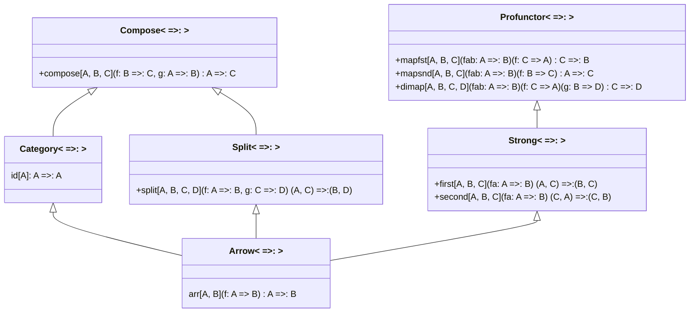



# Arrow

`Arrow` — это класс типов в функциональном программировании, 
который обобщает понятие **функции** и предоставляет абстракцию для работы с вычислениями как с первоклассными сущностями. 
`Arrow` расширяет возможности [`Category`](category.md), [`Split`](split.md) и [`Strong`](strong.md), 
добавляя поддержку параллельной композиции, ветвления и других операций. 
Это позволяет строить сложные цепочки вычислений, где каждая операция может быть комбинирована с другими.

Основные операции, предоставляемые `Arrow`:

- **Композиция**: Комбинирование двух вычислений в одно.
- **Параллельная композиция**: Выполнение двух вычислений независимо над разными частями входных данных.
- **Ветвление**: Выбор между двумя вычислениями в зависимости от входных данных.
- **Динамическое применение**: Применение вычислений, которые возвращают другие вычисления.

**Где применяется `Arrow`?**

- **Функциональные pipeline**:
    - `Arrow` используется для построения цепочек вычислений, где каждая операция передаёт свой результат следующей.
    - Пример: обработка данных, где данные проходят через несколько этапов преобразования.
- **Domain-Specific Languages (DSL)**:
    - `Arrow` позволяет создавать встроенные DSL, которые описывают сложные процессы в декларативном стиле.
    - Пример: DSL для описания бизнес-процессов, где каждая операция представлена как Arrow.
- **Реактивные системы**:
    - В реактивных системах `Arrow` может использоваться для обработки событий и потоков данных.
    - Пример: обработка событий в реальном времени, где каждое событие проходит через цепочку операций.
- **Параллельные и асинхронные вычисления**:
    - `Arrow` позволяет описывать параллельные и асинхронные вычисления, которые затем интерпретируются в зависимости от контекста.
    - Пример: построение асинхронных цепочек операций, где каждая операция выполняется в отдельном потоке или асинхронно.
- **Тестирование**:
    - `Arrow` позволяет разделить описание вычислений и их интерпретацию, что полезно для тестирования и симуляции.
    - Пример: в тестах можно использовать одну интерпретацию для реального выполнения операций, а другую — для симуляции или мокирования.

**Краткие примеры**

- **Функциональные pipeline**:
    - Есть три функции: `parseData`, `validateData`, `transformData`.
    - С помощью `Arrow` можно создать цепочку, которая сначала парсит данные, затем валидирует их и, наконец, преобразует.
- **DSL для бизнес-логики**:
    - Есть операции: `checkInventory`, `calculatePrice`, `applyDiscount`.
    - С помощью `Arrow` можно создать pipeline, который сначала проверяет наличие товара, затем рассчитывает цену и, наконец, применяет скидку.
- **Реактивные системы**:
    - Есть поток событий, где каждое событие проходит через цепочку операций: `filterEvents`, `transformEvents`, `handleEvents`.
    - С помощью `Arrow` можно создать обработчик, который фильтрует события, преобразует их и затем обрабатывает.
- **Параллельные вычисления**:
    - Есть две независимые задачи: `fetchUser` и `fetchProduct`.
    - С помощью `Arrow` можно создать параллельную цепочку, которая выполняет обе задачи одновременно и объединяет результаты.
- **Тестирование**:
    - Есть операции: `sendRequest`, `checkStatusCode`, `validateResponse`.
    - С помощью `Arrow` можно создать тест, который отправляет запрос, проверяет статус код и валидирует ответ.

## Формальное определение

Пусть \\(C\\) — это категория, где:

- \\(\text{Obj}(C)\\) — это набор объектов (например, типов в Scala).
- \\(\text{Mor}(C)\\) — это набор морфизмов (например, функций между типами).

Класс типов `Arrow` формально определяется следующим образом:

- **Объекты**: Типы \\(A, B, C, D, \dots\\), которые являются объектами категории.
- **Морфизмы**: Функции (или стрелки) \\(f: A \to B\\), \\(g: B \to C\\), где:
    - \\(A, B, C\\) — это типы.
    - \\(f\\) и \\(g\\) — это функции, которые можно комбинировать.
- **Операция `arr`**: Для любой функции \\(f: A \to B\\) существует морфизм \\(\text{arr}(f): A \to B\\), который "поднимает" функцию в Arrow.
- **Операция `>>>` (композиция)**: Для любых двух морфизмов \\(f: A \to B\\) и \\(g: B \to C\\) 
  существует морфизм \\(f \, >>> \, g: A \to C\\), который является композицией \\(f\\) и \\(g\\).
- **Операция `first`**: Для любого морфизма \\(f: A \to B\\) существует морфизм \\(\text{first}(f): (A, C) \to (B, C)\\), 
  который применяет \\(f\\) к первому элементу пары, оставляя второй элемент без изменений.
- **Операция `second`**: Для любого морфизма \\(f: A \to B\\) существует морфизм \\(\text{second}(f): (C, A) \to (C, B)\\), 
  который применяет \\(f\\) ко второму элементу пары, оставляя первый элемент без изменений.
- **Операция `***` (параллельная композиция)**: Для любых двух морфизмов \\(f: A \to B\\) и \\(g: C \to D\\) 
  существует морфизм \\(f \, \*\*\* \, g: (A, C) \to (B, D)\\), который применяет \\(f\\) и \\(g\\) параллельно.
- **Операция `&&&` (ветвление)**: Для любых двух морфизмов \\(f: A \to B\\) и \\(g: A \to C\\) 
  существует морфизм \\(f \, \&\&\& \, g: A \to (B, C)\\), который применяет \\(f\\) и \\(g\\) к одному и тому же входу.

### Законы `Arrow`

Класс типов `Arrow` должен удовлетворять следующим законам:

- **Ассоциативность композиции**:
  \\((f \, >>> \, g) \, >>> \, h = f \, >>> \, (g \, >>> \, h)\\).
  Это означает, что порядок применения композиции не имеет значения.
- **Тождественный морфизм**:
  \\(\text{arr}(\text{id}) \, >>> \, f = f \quad \text{и} \quad f \, >>> \, \text{arr}(\text{id}) = f\\),
  где \\(\text{id}\\) — тождественный морфизм.
- **Естественность `first`**:
  \\(\text{first}(f) \, >>> \, \text{arr}(\text{id} \times g) = \text{arr}(\text{id} \times g) \, >>> \, \text{first}(f)\\).
  Это означает, что операция `first` должна быть естественной по отношению к композиции.
- **Совместимость `first` и `***`**:
  \\(\text{first}(f \, >>> \, g) = \text{first}(f) \, >>> \, \text{first}(g)\\).
  Это означает, что `first` сохраняет композицию.

## Определение в виде кода на Scala

```dotty
trait Arrow[=>:[_, _]] extends Split[=>:], Strong[=>:], Category[=>:]:
  self =>

  /** 'Поднятие' обычной функции до Arrow. */
  def arr[A, B](f: A => B): A =>: B

  /** Псевдоним для `compose`. */
  final def <<<[A, B, C](fbc: B =>: C, fab: A =>: B): A =>: C =
    compose(fbc, fab)

  /** Обратный `<<<`. */
  final def >>>[A, B, C](fab: A =>: B, fbc: B =>: C): A =>: C =
    compose(fbc, fab)

  /** Меняет пару местами */
  def swap[X, Y]: (X, Y) =>: (Y, X) = arr[(X, Y), (Y, X)] { case (x, y) => (y, x) }

  /** Пропустить `C` нетронутым. */
  override def second[A, B, C](f: A =>: B): (C, A) =>: (C, B) =
    >>>(<<<(first[A, B, C](f), swap), swap)

  /** Запустить `fab` и `fcd` рядом друг с другом. Иногда обозначается как `***`. */
  override def split[A, B, C, D](fab: A =>: B, fcd: C =>: D): (A, C) =>: (B, D) =
    >>>(first[A, B, C](fab), second[C, D, B](fcd))

  /** Запустить `fab` и `fac` на одном и том же `A`. Иногда обозначается как `&&&`. */
  def combine[A, B, C](fab: A =>: B, fac: A =>: C): A =>: (B, C) =
    >>>(arr((a: A) => (a, a)), split(fab, fac))

  /** Contramap on `A`. */
  override def mapfst[A, B, C](fab: A =>: B)(f: C => A): C =>: B =
    >>>[C, A, B](arr(f), fab)

  /** Functor map on `B`. */
  override def mapsnd[A, B, C](fab: A =>: B)(f: B => C): A =>: C =
    <<<[A, B, C](arr(f), fab)

  /** Запустить два `fab` рядом друг с другом */
  def product[A, B](fab: A =>: B): (A, A) =>: (B, B) =
    split(fab, fab)
```

### Функция от одной переменной

```dotty
given Arrow[Function1] with
  override def arr[A, B](f: A => B): A => B = f
  override def id[A]: A => A = a => a
  override def compose[A, B, C](f: B => C, g: A => B): A => C = g andThen f
  override def first[A, B, C](fa: A => B): ((A, C)) => (B, C) = (a, c) => (fa(a), c)
```

### Связь с другими классами типов

Каждая "стрелка" образует [`Contravariant`](../monad/contravariant-functor.md)
в одном параметре типа и [`Applicative`](../monad/applicative.md)
в другом, как и в случае с обычными функциями.

```dotty
trait Arrow[=>:[_, _]] extends Split[=>:], Strong[=>:], Category[=>:]:
  ...

  override def covariantInstance[C]: Applicative[[X] =>> =>:[C, X]] =
    new Applicative[[X] =>> =>:[C, X]]:
      override def unit[A](a: => A): C =>: A = arr(_ => a)

      override def apply[A, B](fab: C =>: (A => B))(fa: C =>: A): C =>: B =
        <<<(arr((y: (A => B, A)) => y._1(y._2)), combine(fab, fa))
```

## Схема



## Реализация в библиотеках

### Реализация в ScalaZ

```dotty
import scalaz.*
import Scalaz.*

val plus1 = (_: Int) + 1
val times2 = (_: Int) * 2
val rev = (_: String).reverse

plus1.first apply (7 -> "abc")     // (8,abc)
plus1.second apply ("def" -> 14)   // (def,15)
plus1 *** rev apply (7 -> "abc")   // (8,cba)
plus1 &&& times2 apply 7           // (8,14)
plus1.product apply (9 -> 99)      // (10,100)

val f1 = (_:Int) + 1
val f2 = (_:Int) * 100

(f1 >>> f2)(2)                     // 300
(f1 <<< f2)(2)                     // 201
```


---

**Ссылки:**

- [Herding Cats](http://eed3si9n.com/herding-cats/Arrow.html)
- [Learning Scalaz](http://eed3si9n.com/learning-scalaz/Arrow.html)
- [Scalaz API](https://javadoc.io/doc/org.scalaz/scalaz-core_3/7.3.6/scalaz/Arrow.html)
