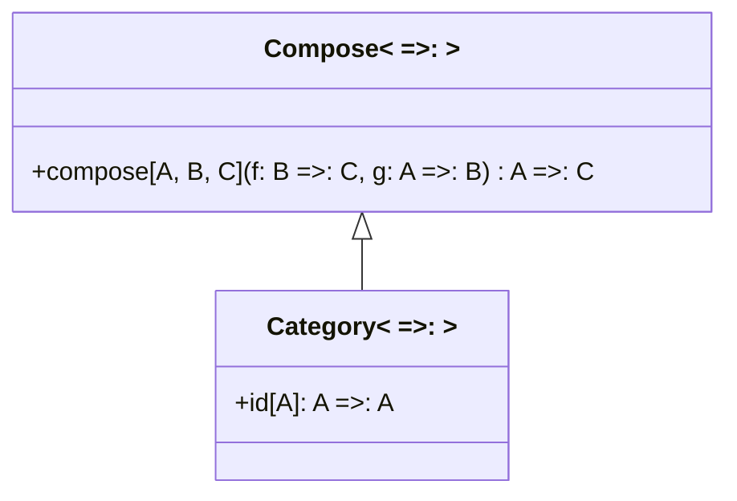

# Category

`Category` — это класс типов в Scala, который представляет собой **категорию** в математическом смысле. 
В теории категорий категория состоит из объектов и морфизмов (стрелок) между ними, 
которые можно комбинировать с помощью [операции композиции](compose.md). 
В Scala `Category` предоставляет абстракцию для работы с композицией функций или морфизмов.

Основные компоненты `Category`:

- **Объекты**: Типы (например, `A`, `B`, `C`).
- **Морфизмы**: Функции между типами (например, `A => B`).
- **Композиция**: Операция, которая комбинирует два морфизма \\(f: A \to B\\) и \\(g: B \to C\\) 
  в новый морфизм \\(g \circ f: A \to C\\).
- **Тождественный морфизм**: Для каждого объекта \\(A\\) существует морфизм \\(\text{id}_A: A \to A\\), 
  который действует как нейтральный элемент для композиции.

**Краткие примеры**

- **Обработка данных**:
    - Есть три функции: `parseData`, `validateData`, `transformData`.
    - С помощью `Category` можно создать одну функцию, которая сначала парсит данные, затем валидирует их и, наконец, преобразует.
- **Работа с эффектами**:
    - Есть две функции: `fetchUser` (возвращает `Option[User]`) и `getUserDetails` (принимает `User` и возвращает `Option[UserDetails]`).
    - С помощью `Category` можно создать функцию, которая сначала получает пользователя, а затем его детали.
- **DSL для бизнес-логики**:
    - Есть операции: `checkInventory`, `calculatePrice`, `applyDiscount`.
    - С помощью `Category` можно создать pipeline, который сначала проверяет наличие товара, затем рассчитывает цену и, наконец, применяет скидку.
- **Тестирование**:
    - Есть функции: `sendRequest`, `checkStatusCode`, `validateResponse`.
    - С помощью `Category` можно создать тест, который отправляет запрос, проверяет статус код и валидирует ответ.

## Формальное определение

Пусть \\(C\\) — это категория, где:

- \\(\text{Obj}(C)\\) — это набор объектов (например, типов в Scala).
- \\(\text{Mor}(C)\\) — это набор морфизмов (например, функций между типами).

Класс типов `Category` формально определяется следующим образом:

- **Объекты**: Типы \\(A, B, C, \dots\\), которые являются объектами категории.
- **Морфизмы**: Функции (или стрелки) \\(f: A \to B\\), \\(g: B \to C\\), где:
    - \\(A, B, C\\) — это типы.
    - \\(f\\) и \\(g\\) — это функции, которые можно комбинировать.
- **Операция композиции**: Для любых двух морфизмов \\(f: A \to B\\) и \\(g: B \to C\\) существует 
  морфизм \\(g \circ f: A \to C\\), который является композицией \\(f\\) и \\(g\\).
- **Тождественный морфизм**: Для каждого объекта \\(A\\) существует тождественный морфизм \\(\text{id}\_A: A \to A\\), 
  такой что: \\(f \circ \text{id}\_A = f \quad \text{и} \quad \text{id}\_B \circ f = f\\), где \\(f: A \to B\\).

> `Category` - это [`Compose`](compose.md) с операцией `identity`.

### Законы категории

Класс типов `Category` должен удовлетворять следующим законам категории:

- **Ассоциативность композиции**:
  \\(h \circ (g \circ f) = (h \circ g) \circ f\\).
  Это означает, что порядок применения композиции не имеет значения.
- **Существование тождественного морфизма**:
  Для каждого объекта \\(A\\) существует тождественный морфизм \\(\text{id}\_A: A \to A\\), такой что:
  \\(f \circ \text{id}\_A = f \quad \text{и} \quad \text{id}\_B \circ f = f\\), где \\(f: A \to B\\).

#### Что такое композиция?

Имея стрелку **f** от **a** к **b** и стрелку **g** от **b** к **c**,
их _композиция_ представляет собой стрелку, идущую непосредственно от **a** к **c**.
Другими словами, если имеются две стрелки, цель одной из которых совпадает с источником другой,
то всегда можно скомпоновать их, чтобы получить третью стрелку.
Обозначается как: \\(h = g \circ f\\)

#### Что такое ассоциативность?

Допустим, \\(j = i \circ f\\).
Предположим, что удалось разложить i на \\(h \circ g\\).
Тогда \\(j = (h \circ g) \circ f\\).
Желательно, чтобы это разложение было таким же, как и \\(j = h \circ (g \circ f)\\).
При этом должна существовать возможность заявить,
что j была декомпозирована на три более простые функции \\(j = h \circ g \circ f\\)
и не нужно отслеживать, какая декомпозиция была первой.
Это свойство называется _ассоциативностью_ композиции.

#### Что такое тождественность?

Каждый объект имеет специальную стрелку, называемую _тождественной_ (или _тождественностью_),
которая оставляет объект неизменным.
Это означает, что когда вы компонуете тождественную стрелку с любой другой стрелкой, входящей или исходящей,
то получаете ту же стрелку. Тождественная стрелка ничего не делает с другой стрелкой.

Тождественная стрелка на объекте \\(a\\) обозначается как \\(id\_{a}\\).
Так что, если имеется стрелка \\(f : a \to b\\),
то можно скомпоновать ее с тождественностями с обеих сторон: \\(id\_{b} \circ f = f = f \circ id\_{a}\\)

## Определение в виде кода на Scala

В Scala класс типов `Category` может быть определён следующим образом:

```dotty
trait Compose[=>:[_, _]]:
  // Композиция морфизмов
  def compose[A, B, C](f: B =>: C, g: A =>: B): A =>: C
  
trait Category[=>:[_, _]] extends Compose[=>:]:
  // Тождественный морфизм
  def id[A]: A =>: A
```

Здесь:

- `=>:[_, _]` — это тип, представляющий морфизм (например, функция `A => B`).
- Метод `id` возвращает тождественный морфизм для типа `A`.
- Метод `compose` принимает два морфизма \\(f: B \to C\\) и \\(g: A \to B\\) и возвращает их композицию \\(f \circ g: A \to C\\).

### Связь с другими классами типов

`Category` можно трансформировать в [Monoid](../monoid/monoid.md)
и [PlusEmpty](../monad/plus-empty.md).

```dotty
trait Category[=>:[_, _]] extends Compose[=>:]:
  def id[A]: A =>: A

  def empty: PlusEmpty[[A] =>> A =>: A] = new PlusEmpty[[A] =>> A =>: A] with ComposePlus:
    def empty[A]: A =>: A = id

  def monoid[A]: Monoid[A =>: A] = new Monoid[A =>: A] with ComposeSemigroup[A]:
    def empty: A =>: A = id
```

## Упражнения

### Упражнение 4.2.1: Реализация Category для Function1 (обычные функции)

> [Репозиторий с упражнениями и инструкцией по выполнению][sample]

Реализуйте экземпляр `Category` для `Function1`:

```dotty
given Category[Function1] with
  override def compose[A, B, C](f: B => C, g: A => B): A => C = ???
  override def id[A]: A => A = ???
```

**Примеры:**

```dotty
import Category.given

// Базовые функции
val add1: Int => Int = _ + 1
val mul2: Int => Int = _ * 2
val toString: Int => String = _.toString
val length: String => Int = _.length

// Композиция
val composed1 = compose(mul2, add1)  // сначала add1, потом mul2
composed1(5)  // (5 + 1) * 2 = 12

val composed2 = compose(length, toString)  // сначала toString, потом length
composed2(42)  // длина строки "42" = 2

// Тождественная функция
id(42)      // 42
id("hello") // "hello"
```

@:note(🔍 Показать решение)

Реализация `compose` использует встроенную композицию `g andThen f`, которая сначала применяет `g`, затем `f`. 
Это соответствует математическому определению композиции: (f ∘ g)(x) = f(g(x)). 
Реализация `id` возвращает функцию `a => a` — тождественное отображение. 

```dotty
given Category[Function1] with
  override def compose[A, B, C](f: B => C, g: A => B): A => C = g andThen f

  override def id[A]: A => A = a => a
```

@:@

### Упражнение 4.2.2: Реализация экземпляра Category для Kleisli на основе Monad

В этом упражнении вам предстоит реализовать экземпляр класса типов `Category` для типа `Kleisli[F, A, B]`, 
используя монадические возможности `Monad[F]`.

```dotty
given kleisliCategory[F[_]: Monad]: Category[[A, B] =>> Kleisli[F, A, B]]
with
  def compose[A, B, C](
      f: Kleisli[F, B, C],
      g: Kleisli[F, A, B]
  ): Kleisli[F, A, C] =
    ???

  def id[A]: Kleisli[F, A, A] =
    ???
```

@:note(🔍 Показать решение)

Решение использует `Monad[F]` для получения доступа к `unit` (также известному как `pure`), 
который помещает значение в контекст `F`. 
Для тождественной стрелки мы возвращаем `Kleisli`, который принимает значение `A` и возвращает `F[A]` с помощью `Monad[F].unit`. 
Операция `compose` использует `flatMap` из монады для последовательного выполнения вычислений, как и в экземпляре `Compose` для `Kleisli`.

```dotty
given kleisliCategory[F[_]: Monad]: Category[[A, B] =>> Kleisli[F, A, B]]
with
  def compose[A, B, C](
      f: Kleisli[F, B, C],
      g: Kleisli[F, A, B]
  ): Kleisli[F, A, C] =
    Kleisli[F, A, C](a => g.run(a).flatMap(b => f.run(b)))

  def id[A]: Kleisli[F, A, A] =
    Kleisli[F, A, A](Monad[F].unit)
```

@:@

### Упражнение 4.2.3: Реализация экземпляра Category для Cokleisli на основе CoMonad

В этом упражнении вам предстоит реализовать экземпляр класса типов `Category` для типа `Cokleisli[F, A, B]`, 
используя комонадические возможности `CoMonad[F]`.

```dotty
given cokleisliCategory[F[_]: CoMonad]: Category[[A, B] =>> Cokleisli[F, A, B]]
with
  def compose[A, B, C](
      f: Cokleisli[F, B, C],
      g: Cokleisli[F, A, B]
  ): Cokleisli[F, A, C] =
    ???

  def id[A]: Cokleisli[F, A, A] =
    ???
```

@:note(🔍 Показать решение)

Решение использует `CoMonad[F]` для получения доступа к `coUnit` (также известному как `extract`), 
который извлекает значение из контекста `F[A]`. 
Для тождественной стрелки мы возвращаем `Cokleisli`, который принимает `F[A]` и возвращает `A` с помощью `CoMonad[F].coUnit`. 
Операция `compose` использует `cobind` для расширения контекста, как и в экземпляре `Compose` для `Cokleisli`.

```dotty
given cokleisliCategory[F[_]: CoMonad]: Category[[A, B] =>> Cokleisli[F, A, B]]
with
  def compose[A, B, C](
      f: Cokleisli[F, B, C],
      g: Cokleisli[F, A, B]
  ): Cokleisli[F, A, C] =
    Cokleisli[F, A, C](fa => f.run(fa.cobind(g.run)))

  def id[A]: Cokleisli[F, A, A] =
    Cokleisli[F, A, A](CoMonad[F].coUnit)
```

@:@

## Схема



## Реализация в библиотеках

### Реализация в ScalaZ

```dotty
import scalaz.*
import Scalaz.*

// ... Все операции родителей
```

---

**Ссылки:**

- [Ссылка на репозиторий с упражнениями][sample]
- [Cats](https://typelevel.org/cats/typeclasses/arrow.html)
- [Herding Cats](http://eed3si9n.com/herding-cats/Arrow.html)
- [Learning Scalaz](http://eed3si9n.com/learning-scalaz/Arrow.html)
- [On Monoids](https://apocalisp.wordpress.com/2010/06/14/on-monoids/)
- [Scalaz API](https://javadoc.io/doc/org.scalaz/scalaz-core_3/7.3.6/scalaz/Category.html)

[sample]: https://gitverse.ru/scalabook/typeclasses
