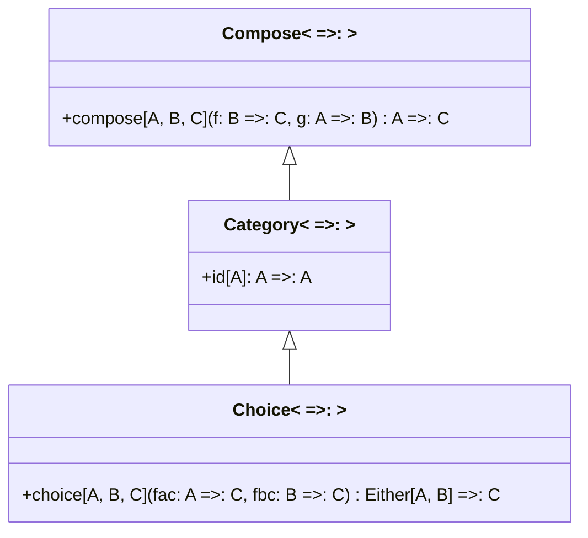



# Choice

В функциональном программировании мы привыкли работать с функциями вида `A => B`. 
Однако часто возникают ситуации, когда нам нужно скомпоновать несколько функций, 
работающих с разными типами входных данных, в единую композицию.

Представьте, что у нас есть две функции: `A => C` и `B => C`. 
Как их объединить в одну функцию, которая могла бы принимать либо значение типа `A`, либо значение типа `B` 
и в обоих случаях возвращать `C`? По сути, мы ищем функцию с типом:

`(A => C) => (B => C) => (Either[A, B] => C)`

Именно эту возможность предоставляет класс типов `Choice`. 
Если мы обобщим обычную функцию `=>` до более абстрактной стрелки `=>:[_, _]`, то получим определение `Choice`.

```dotty
trait Choice[=>:[_, _]] extends Category[=>:]:
  def choice[A, B, C](fac: A =>: C, fbc: B =>: C): Either[A, B] =>: C

  infix def |||[A, B, C](fac: A =>: C, fbc: B =>: C): Either[A, B] =>: C =
    choice(fac, fbc)
```

Этот метод принимает две стрелки: одну от `A` к `C` и другую от `B` к `C`, 
и возвращает стрелку, которая принимает `Either[A, B]` (то есть либо `A`, либо `B`) и возвращает `C`. 
Инфиксный синтаксис для `choice` — это оператор `|||`. 
С его помощью код становится более читаемым и выразительным.

## Практическое применение: Middleware в HTTP-сервере

Одним из наиболее полезных применений `Choice` является построение middleware (промежуточного программного обеспечения) 
в HTTP-серверах. Это особенно актуально для таких библиотек, как [Http4s](https://http4s.org/).

### HttpRoutes как Kleisli

В Http4s тип `HttpRoutes[F]` определен как `Kleisli` (стрелка, представляющая вычисление с эффектом в контексте `F`):

```dotty
type HttpRoutes[F[_]] = Kleisli[[A] =>> OptionT[F, A], Request[F], Response[F]]
```

Здесь:

- `Request[F]` — входящий HTTP-запрос
- `Response[F]` — исходящий HTTP-ответ
- `[A] =>> OptionT[F, A]` — [монадный трансформер](../monad/monad-transformer.md), добавляющий опциональность к эффекту `F`
- `Kleisli` — обертка над функцией `Request[F] => OptionT[F, Response[F]]`

### Создание middleware аутентификации

Предположим, мы хотим добавить аутентификацию к нашим маршрутам. 
Мы можем определить middleware как стрелку, которая принимает запрос и 
возвращает либо отклоненный ответ (с кодом ошибки), либо пропускает запрос дальше.

```dotty
type Middleware[F[_]] = Kleisli[[A] =>> OptionT[F, A], Request[F], Either[Response[F], Request[F]]]
```

Здесь:

- `Left[Response[F]]` — означает, что запрос отклонен, и мы немедленно возвращаем ответ (например, 401 Unauthorized)
- `Right[Request[F]]` — означает, что аутентификация прошла успешно, и запрос может быть передан дальше по цепочке обработки

Теперь определим, что делать в случае отклонения запроса:

```dotty
def reject[F[_]: Monad]: Kleisli[[A] =>> OptionT[F, A], Response[F], Response[F]] =
  Kleisli.ask[[A] =>> OptionT[F, A], Response[F]]
```

Функция `reject` просто возвращает полученный ответ без изменений. Она нужна как "заглушка" для обработки случая `Left`.

### Композиция middleware с маршрутами

Теперь мы можем скомпоновать наше middleware с основными маршрутами:

```dotty
def authedRoute[F[_]: Monad] = auth[F] andThen (reject[F] ||| routes[F])
```

Разберем эту композицию:

1. `auth[F]` — middleware аутентификации, преобразует `Request[F]` в `Either[Response[F], Request[F]]`
2. `reject[F] ||| routes[F]` — использует `Choice` для обработки двух случаев:
    - Если `auth` вернул `Left` (отклонено), применяется `reject[F]` (возвращаем ответ об ошибке)
    - Если `auth` вернул `Right` (успешно), применяется `routes[F]` (основная логика)
3. `andThen` — последовательная композиция: сначала применяем `auth`, затем результат передаем в `reject ||| routes`

В результате мы получаем новый маршрут, который автоматически выполняет аутентификацию, 
правильно обрабатывает как отклоненные, так и успешные запросы — и все это без явных условных конструкций в коде!

## Пример: Обработка HTTP-ответов

Другой практический пример — обработка ответов HTTP-клиента. 
Рассмотрим ситуацию, когда мы выполняем HTTP-запрос и получаем результат, 
который может быть либо ошибкой, либо успешным ответом.

```dotty
val resp: IO[Either[Throwable, String]] =
  httpClient.expect[String](uri"https://google.com/").attempt
```

Метод `attempt` (из [`MonadError`](../monad/monad-error.md)) преобразует `IO[A]` в `IO[Either[Throwable, A]]`, где:

- `Left` содержит ошибку
- `Right` содержит успешный результат

### Традиционный подход без Choice

Без использования `Choice` нам пришлось бы писать что-то вроде:

```dotty
resp.flatMap:
  case Left(error) => recover(error)    // обрабатываем ошибку
  case Right(data) => processResp(data) // обрабатываем успешные данные
```

Этот подход работает, но содержит явную логику сопоставления с шаблоном, что делает код менее композируемым.

### Композируемое решение с Choice

С `Choice` мы можем переписать это более декларативно:

```dotty
def recover[A](error: Throwable): IO[A] = ???   // обработка ошибки
def processResp[A](resp: String): IO[A] = ???   // обработка успешного ответа

resp >>= (recover ||| processResp)
```

Здесь оператор `|||` (из `Choice`) комбинирует две функции:

- `recover` — применяется к случаю `Left` (ошибка)
- `processResp` — применяется к случаю `Right` (успех)

Результат — единая функция, которая принимает `Either[Throwable, String]` и возвращает `IO[A]`. 
Это более композируемый подход: мы отделяем логику обработки от логики выбора ветки выполнения.


## Упражнения

### Упражнение 4.7.1: Реализация Choice для Function1 (обычные функции)

> [Репозиторий с упражнениями и инструкцией по выполнению][sample]

Реализуйте экземпляр `Choice` для `Function1`.

```dotty
given Choice[Function1] with
  override def choice[A, B, C](fac: A => C, fbc: B => C): Either[A, B] => C =
    ???

  override def id[A]: A => A =
    ???

  override def compose[A, B, C](f: B => C, g: A => B): A => C =
    ???
```

@:note(🔍 Показать решение)

Этот экземпляр `Choice` для обычных функций `Function1` реализует выбор между двумя функциями напрямую 
без дополнительных эффектов: `choice` принимает две функции `A => C` и `B => C` 
и с помощью сопоставления с шаблоном применяет первую к `Left` или вторую к `Right`, возвращая результат типа `C`, 
`id` возвращает тождественную функцию `identity`, а `compose` реализует стандартную композицию функций через `andThen`.

```dotty
given Choice[Function1] with
  override def choice[A, B, C](fac: A => C, fbc: B => C): Either[A, B] => C =
    case Left(a)  => fac(a)
    case Right(b) => fbc(b)

  override def id[A]: A => A =
    identity

  override def compose[A, B, C](f: B => C, g: A => B): A => C =
    g andThen f
```

@:@

### Упражнение 4.7.2: Реализация экземпляра Choice для Kleisli

В этом упражнении вам предстоит реализовать экземпляр класса типов `Choice` для типа `Kleisli[F, A, B]`,
используя монадические возможности `Monad[F]`.

```dotty
given kleisliChoice[F[_]: Monad]: Choice[[A, B] =>> Kleisli[F, A, B]] with
  override def choice[A, B, C](
      fac: Kleisli[F, A, C],
      fbc: Kleisli[F, B, C]
  ): Kleisli[F, Either[A, B], C] =
    ???

  override def id[A]: Kleisli[F, A, A] =
    ???

  override def compose[A, B, C](
      f: Kleisli[F, B, C],
      g: Kleisli[F, A, B]
  ): Kleisli[F, A, C] =
    ???
```

@:note(🔍 Показать решение)

Этот экземпляр `Choice` для `Kleisli` реализует выбор между двумя стрелками через монаду `Monad`: 
`choice` принимает `Either[A, B]` и с помощью сопоставления с шаблоном применяет `fac` к `Left` или `fbc` к `Right`, 
возвращая результат в контексте `F[C]`, при этом `id` создает тождественную стрелку, 
помещая значение в контекст через `unit`, а `compose` последовательно соединяет вычисления через `flatMap`, 
передавая результат первого вычисления во второе.

```dotty
given kleisliChoice[F[_]: Monad]: Choice[[A, B] =>> Kleisli[F, A, B]] with
  override def choice[A, B, C](
      fac: Kleisli[F, A, C],
      fbc: Kleisli[F, B, C]
  ): Kleisli[F, Either[A, B], C] =
    Kleisli[F, Either[A, B], C] {
      case Left(a)  => fac.run(a)
      case Right(b) => fbc.run(b)
    }

  override def id[A]: Kleisli[F, A, A] =
    Kleisli[F, A, A](Monad[F].unit)

  override def compose[A, B, C](
      f: Kleisli[F, B, C],
      g: Kleisli[F, A, B]
  ): Kleisli[F, A, C] =
    Kleisli[F, A, C](a => g.run(a).flatMap(b => f.run(b)))
```

@:@

### Упражнение 4.7.3: Реализация экземпляра Choice для Cokleisli

В этом упражнении вам предстоит реализовать экземпляр класса типов `Choice` для типа `Cokleisli[F, A, B]`,
используя комонадические возможности `CoMonad[F]`.

```dotty
given cokleisliChoice[F[_]: {CoMonad, Applicative}]
    : Choice[[A, B] =>> Cokleisli[F, A, B]]
with
  override def choice[A, B, C](
      fac: Cokleisli[F, A, C],
      fbc: Cokleisli[F, B, C]
  ): Cokleisli[F, Either[A, B], C] =
    ???

  override def id[A]: Cokleisli[F, A, A] =
    ???

  override def compose[A, B, C](
      f: Cokleisli[F, B, C],
      g: Cokleisli[F, A, B]
  ): Cokleisli[F, A, C] =
    ???
```

@:note(🔍 Показать решение)

Этот экземпляр `Choice` для `Cokleisli` реализует выбор между двумя стрелками через комонаду `CoMonad` 
и аппликатив `Applicative`: `choice` принимает контекст `F[Either[A, B]]`, 
применяет `map` для прохода по каждому элементу, где для `Left` запускает `fac` с `unit(a)`, 
а для `Right` — `fbc` с `unit(b)`, формируя `F[C]`, после чего извлекает результат через `coUnit`, 
возвращая обычное значение `C`, при этом `id` возвращает тождественную стрелку через `coUnit`, 
а `compose` последовательно соединяет вычисления через `cobind`.

```dotty
given cokleisliChoice[F[_]: {CoMonad, Applicative}]
    : Choice[[A, B] =>> Cokleisli[F, A, B]]
with
  override def choice[A, B, C](
      fac: Cokleisli[F, A, C],
      fbc: Cokleisli[F, B, C]
  ): Cokleisli[F, Either[A, B], C] =
    Cokleisli[F, Either[A, B], C] { feither =>
      val fc: F[C] = CoMonad[F].map(feither) {
        case Left(a)  => fac.run(Applicative[F].unit(a))
        case Right(b) => fbc.run(Applicative[F].unit(b))
      }

      CoMonad[F].coUnit(fc)
    }

  override def id[A]: Cokleisli[F, A, A] =
    Cokleisli[F, A, A](CoMonad[F].coUnit)

  override def compose[A, B, C](
      f: Cokleisli[F, B, C],
      g: Cokleisli[F, A, B]
  ): Cokleisli[F, A, C] =
    Cokleisli[F, A, C](fa => f.run(fa.cobind(g.run)))
end cokleisliChoice
```

@:@

## Схема



## Реализация в библиотеках

### Реализация в Cats

```dotty
import cats.syntax.all.*

val b: Boolean => String                = _.toString + " is a boolean"
val i: Int => String                    = _.toString + " is an integer"
val f: (Either[Boolean, Int]) => String = b ||| i

f(Right(3))
// "3 is an integer"
f(Left(false))
// "false is a boolean"
```

---

**Ссылки:**

- [Ссылка на репозиторий с упражнениями][sample]
- [Cats](https://typelevel.org/cats/typeclasses/arrowchoice.html)

[sample]: https://gitverse.ru/scalabook/typeclasses
