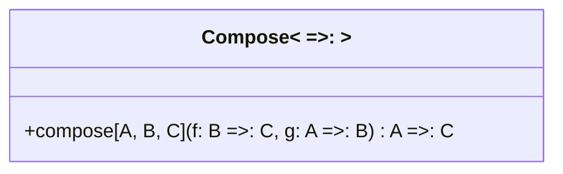



# Compose

`Compose` — это класс типов, который предоставляет возможность композиции функций или морфизмов. 
Он является частью более общей абстракции, известной как [**Category**](category.md), 
и позволяет комбинировать две функции в одну, где выход первой функции становится входом второй.

Основной метод класса типов `Compose` — это `compose`, который выполняет композицию двух функций. 
В математической нотации это можно записать как: \\((f \circ g)(x) = f(g(x))\\).

**Где применяется `Compose`?**

- **Функциональное программирование**:
    - `Compose` используется для создания цепочек функций, где каждая функция передаёт свой результат следующей.
    - Пример: обработка данных, где данные проходят через несколько этапов преобразования.
- **Построение DSL (Domain-Specific Languages)**:
    - В DSL `Compose` позволяет комбинировать операции в более сложные конструкции.
    - Пример: DSL для описания бизнес-процессов, где каждая операция композируется в общий pipeline.
- **Работа с эффектами**:
    - `Compose` может быть использован для композиции функций, работающих с эффектами (например, `Option`, `Either`, `IO`).
    - Пример: цепочка операций, где каждая операция возвращает `Option`, и результат одной операции передаётся в следующую.
- **Обработка потоков данных**:
    - В потоковой обработке данных `Compose` позволяет комбинировать операции, такие как `map`, `filter`, `reduce`.
    - Пример: обработка событий в реальном времени, где каждая операция композируется в общий поток.
- **Тестирование**:
    - `Compose` может быть использован для создания цепочек тестовых операций.
    - Пример: тестирование API, где каждый запрос композируется с проверкой результата.

## Формальное определение

Пусть \\(C\\) — это категория, где:

- \\(\text{Obj}(C)\\) — это набор объектов (например, типов в Scala).
- \\(\text{Mor}(C)\\) — это набор морфизмов (например, функций между типами).

Класс типов `Compose` формально определяется следующим образом:

- **Объекты**: Типы \\(A, B, C, \dots\\), которые являются объектами категории.
- **Морфизмы**: Функции (или стрелки) \\(f: A \to B\\), \\(g: B \to C\\), где:
    - \\(A, B, C\\) — это типы.
    - \\(f\\) и \\(g\\) — это функции, которые можно комбинировать.
- **Операция композиции**: Для любых двух морфизмов \\(f: A \to B\\) и \\(g: B \to C\\) 
  существует морфизм \\(g \circ f: A \to C\\), который является композицией \\(f\\) и \\(g\\).

Класс типов `Compose` предоставляет метод `compose`, который реализует эту операцию композиции:

\\(\text{compose}(g, f) = g \circ f\\)

где:

- \\(f: A \to B\\) — первая функция,
- \\(g: B \to C\\) — вторая функция,
- \\(g \circ f: A \to C\\) — результирующая функция.

### Законы `Compose`

Класс типов `Compose` должен удовлетворять следующему закону:

**Ассоциативность композиции**: \\(h \circ (g \circ f) = (h \circ g) \circ f\\)

Это означает, что порядок применения композиции не имеет значения.

#### Что такое композиция?

Имея стрелку **f** от **a** к **b** и стрелку **g** от **b** к **c**,
их _композиция_ представляет собой стрелку, идущую непосредственно от **a** к **c**.
Другими словами, если имеются две стрелки, цель одной из которых совпадает с источником другой,
то всегда можно скомпоновать их, чтобы получить третью стрелку.
Обозначается как: \\(h = g \circ f\\)

#### Что такое ассоциативность?

Допустим, \\(j = i \circ f\\).
Предположим, что удалось разложить i на \\(h \circ g\\).
Тогда \\(j = (h \circ g) \circ f\\).
Желательно, чтобы это разложение было таким же, как и \\(j = h \circ (g \circ f)\\).
При этом должна существовать возможность заявить,
что j была декомпозирована на три более простые функции \\(j = h \circ g \circ f\\)
и не нужно отслеживать, какая декомпозиция была первой.
Это свойство называется _ассоциативностью_ композиции.

## Определение в виде кода на Scala

В Scala класс типов `Compose` может быть определён следующим образом:

```dotty
trait Compose[=>:[_, _]]:
  /** Ассоциативный `=>:` бинарный оператор. */
  def compose[A, B, C](f: B =>: C, g: A =>: B): A =>: C
```

Здесь:

- `=>:[_, _]` — это тип, представляющий морфизм (например, функция `A => B`).
- Метод `compose` принимает два морфизма \\(f: B \to C\\) и \\(g: A \to B\\) и возвращает их композицию \\(f \circ g: A \to C\\).

### Связь с другими классами типов

Функция `compose` позволяет реализовать [Semigroup](../monoid/semigroup.md) 
и [Plus](../monad/plus.md) в терминах объединения функций.

```dotty
trait Compose[=>:[_, _]]:
  self =>

  /** Ассоциативный `=>:` бинарный оператор. */
  def compose[A, B, C](f: B =>: C, g: A =>: B): A =>: C

  protected[arrow] trait ComposePlus extends Plus[[A] =>> A =>: A]:
    def plus[A](f1: A =>: A, f2: => A =>: A): A =>: A = self.compose(f1, f2)

  protected[arrow] trait ComposeSemigroup[A] extends Semigroup[A =>: A]:
    def combine(f1: A =>: A, f2: A =>: A): A =>: A = self.compose(f1, f2)

  def plus: Plus[[A] =>> A =>: A] = new ComposePlus {}

  def semigroup[A]: Semigroup[A =>: A] = new ComposeSemigroup[A] {}
```

## Упражнения

### Упражнение 4.1.1: Реализация Compose для Function1 (обычные функции)

> [Репозиторий с упражнениями и инструкцией по выполнению][sample]

Реализуйте экземпляр `Compose` для `Function1`, используя встроенную композицию функций.

```dotty
given Compose[Function1] with
  override def compose[A, B, C](f: B => C, g: A => B): A => C = ???
```

**Примеры:**

```dotty
import Compose.given

// Базовые функции
val add1: Int => Int = x => x + 1
val mul2: Int => Int = x => x * 2
val toString: Int => String = _.toString
val length: String => Int = _.length

// Композиция add1 и mul2
val composed1 = compose(mul2, add1)  // сначала add1, потом mul2
composed1(5)  // (5 + 1) * 2 = 12

// Композиция toString и length
val composed2 = compose(length, toString)  // сначала toString, потом length
composed2(42)  // длина строки "42" = 2
```

@:note(🔍 Показать решение)

Реализация тривиальна: в Scala уже есть встроенный метод `andThen` для функций, 
который делает именно то, что нужно — сначала применяет `g`, затем `f`. 
Обратите внимание на порядок: `compose(f, g)` должна возвращать `g andThen f`, 
то есть функцию, которая сначала выполняет `g`, а потом `f`. 
Это стандартное определение композиции в математике: (f ∘ g)(x) = f(g(x)). 
Альтернативно можно использовать `f compose g` (хотя в Scala `compose` определён с обратным порядком аргументов).

```dotty
given Compose[Function1] with
  override def compose[A, B, C](f: B => C, g: A => B): A => C = g andThen f
```

@:@

## Схема



## Реализация в библиотеках

### Реализация в Cats

```dotty
import cats.*, cats.data.*, cats.syntax.all.*

lazy val f = (_:Int) + 1
lazy val g = (_:Int) * 100

(f >>> g)(2)
// res0: Int = 300

(f <<< g)(2)
// res1: Int = 201
```

### Реализация в ScalaZ

```dotty
import scalaz.*
import Scalaz.*

val f1 = (_:Int) + 1
val f2 = (_:Int) * 100

(f1 >>> f2)(2)   // 300
(f1 <<< f2)(2)   // 201
```

---

**Ссылки:**

- [Ссылка на репозиторий с упражнениями][sample]
- [Cats](https://typelevel.org/cats/typeclasses/arrow.html)
- [Herding Cats](http://eed3si9n.com/herding-cats/Arrow.html)
- [Learning Scalaz](http://eed3si9n.com/learning-scalaz/Arrow.html)
- [Scalaz API](https://javadoc.io/doc/org.scalaz/scalaz-core_3/7.3.6/scalaz/Compose.html)

[sample]: https://gitverse.ru/scalabook/typeclasses
