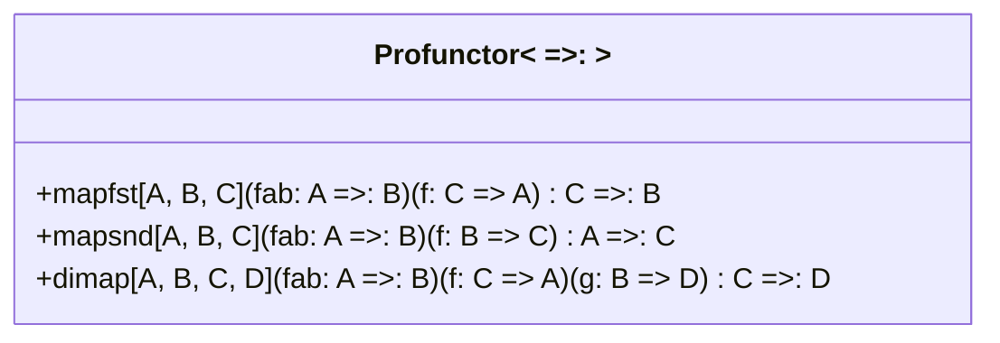



# Profunctor

`Profunctor` — это типовой класс в функциональном программировании, 
который обобщает понятие [**бифунктора**](../bifunctor/bifunctor.md) (функтора двух аргументов) для случая, 
когда первый аргумент **контравариантен**, а второй **ковариантен**. 
Это означает, что `Profunctor` может преобразовывать входные данные (первый аргумент) 
и выходные данные (второй аргумент) независимо друг от друга.

Основные операции, предоставляемые `Profunctor`:

- **`dimap`**: Преобразует входные и выходные данные с помощью двух функций.
- **`lmap`** (или **`mapfst`**): Преобразует только входные данные.
- **`rmap`** (или **`mapsnd`**): Преобразует только выходные данные.

**Где применяется `Profunctor`?**

- **Оптики (Lens, Prism, Iso)**:
    - `Profunctor` используется в библиотеках для работы с оптиками (например, Monocle), где нужно преобразовывать входные и выходные данные.
    - Пример: Lens, которая позволяет читать и изменять поля в структурах данных.
- **Функциональные pipeline**:
    - `Profunctor` позволяет строить pipeline, где входные и выходные данные могут быть преобразованы независимо.
    - Пример: обработка данных, где входные данные фильтруются, а выходные — преобразуются.
- **Реактивные системы**:
    - В реактивных системах `Profunctor` может использоваться для преобразования входных событий и выходных реакций.
    - Пример: обработка событий, где входные события фильтруются, а выходные реакции преобразуются.
- **Работа с функциями**:
    - `Profunctor` может быть использован для преобразования функций, где входные и выходные типы изменяются.
    - Пример: преобразование функции `A => B` в функцию `C => D` с помощью двух функций `C => A` и `B => D`.
- **Тестирование**:
    - `Profunctor` может быть использован для преобразования тестовых данных и результатов.
    - Пример: тестирование API, где входные запросы преобразуются, а выходные ответы проверяются.

**Краткие примеры**

- **Оптики (Lens)**:
    - Есть Lens, которая работает с полем `age` в структуре `Person`.
    - С помощью `Profunctor` можно преобразовать Lens так, чтобы она работала с полем `birthYear`, вычисляя возраст на лету.

## Формальное определение

Пусть \\(P\\) — это профунктор, где:

- \\(P: C^\text{op} \times D \to \text{Set}\\) — это функтор из произведения категорий \\(C^\text{op}\\) 
  (противоположной категории \\(C\\)) и \\(D\\) в категорию множеств.
- \\(C^\text{op}\\) — это категория, где морфизмы направлены в обратную сторону (контравариантность).
- \\(D\\) — это категория, где морфизмы направлены в обычную сторону (ковариантность).

Типовой класс `Profunctor` формально определяется следующим образом:

- **Объекты**: Типы \\(A, B, C, D, \dots\\), которые являются объектами категорий \\(C\\) и \\(D\\).
- **Морфизмы**: Функции (или стрелки) \\(f: A \to B\\) и \\(g: C \to D\\), где:
    - \\(f\\) — контравариантный морфизм (преобразует входные данные).
    - \\(g\\) — ковариантный морфизм (преобразует выходные данные).
- **Операция `dimap`**: Для любых двух морфизмов \\(f: A \to B\\) и \\(g: C \to D\\) существует морфизм:
  \\(\text{dimap}(f, g): P\[B, C\] \to P\[A, D\]\\),
  который преобразует профунктор \\(P\[B, C\]\\) в профунктор \\(P\[A, D\]\\).

### Законы `Profunctor`

Типовой класс `Profunctor` должен удовлетворять следующим законам:

- **Тождественность**:
  \\(\text{dimap}(\text{id}\_A, \text{id}\_B) = \text{id}_{P\[A, B\]}\\).
  Это означает, что применение `dimap` к тождественным морфизмам возвращает исходный профунктор.
- **Композиция**:
  \\(\text{dimap}(f \circ g, h \circ k) = \text{dimap}(g, h) \circ \text{dimap}(f, k)\\).
  Это означает, что `dimap` сохраняет композицию морфизмов.

## Определение в виде кода на Scala

```dotty
trait Profunctor[=>:[_, _]]:
  /** Contramap on `A`. */
  def mapfst[A, B, C](fab: A =>: B)(f: C => A): C =>: B

  /** Functor map on `B`. */
  def mapsnd[A, B, C](fab: A =>: B)(f: B => C): A =>: C

  /** Functor map on `A` and `B`. */
  def dimap[A, B, C, D](fab: A =>: B)(f: C => A)(g: B => D): C =>: D =
    mapsnd(mapfst(fab)(f))(g)
```

Здесь:

- `=>:[_, _]` — это тип, представляющий профунктор (например, функция `A => B`).
- Метод `dimap` принимает профунктор \\(P\[A, B\]\\) и две функции:
  - \\(f: C \to A\\) — контравариантное преобразование входных данных.
  - \\(g: B \to D\\) — ковариантное преобразование выходных данных.
- Результат — новый профунктор \\(P\[C, D\]\\).

### Функция от одной переменной

```dotty
given Profunctor[Function1] with
  override def mapfst[A, B, C](fab: A => B)(f: C => A): C => B = f andThen fab

  override def mapsnd[A, B, C](fab: A => B)(f: B => C): A => C = fab andThen f
```

### Связь с другими типовыми классами

`Profunctor` позволяет реализовать [InvariantFunctor](../monad/invariant-functor.md),
[Functor](../monad/functor.md)
и [ContravariantFunctor](../monad/contravariant-functor.md).


```dotty
trait Profunctor[=>:[_, _]]:
  ...

  protected[arrow] trait SndCovariant[C] extends Functor[[X] =>> =>:[C, X]]:
    extension [A](fa: C =>: A) override def map[B](f: A => B): C =>: B = mapsnd(fa)(f)

  def invariantFunctor: InvariantFunctor[[X] =>> X =>: X] =
    new InvariantFunctor[[X] =>> X =>: X]:
      extension [A](fa: A =>: A)
        override def xmap[B](f: A => B, g: B => A): B =>: B = mapsnd(mapfst(fa)(g))(f)

  def covariantInstance[C]: Functor[[X] =>> =>:[C, X]] =
    new SndCovariant[C] {}

  def contravariantInstance[C]: ContravariantFunctor[[X] =>> =>:[X, C]] =
    new ContravariantFunctor[[X] =>> =>:[X, C]]:
      override def cmap[A, B](fa: B =>: C)(f: A => B): A =>: C = mapfst(fa)(f)
```

## Схема



## Реализация в библиотеках

### Реализация в ScalaZ

```dotty
import scalaz.*
import Scalaz.*

// ... Все операции родителей
```

---

**Ссылки:**

- [Learning Scalaz](http://eed3si9n.com/learning-scalaz/Arrow.html)
- [Scalaz API](https://javadoc.io/doc/org.scalaz/scalaz-core_3/7.3.6/scalaz/Profunctor.html)
- The Dao of Functional Programming - Bartosz Milewski:
    - [Дао функционального программирования, глава 6.2](https://henrychern.wordpress.com/2022/09/23/milewski-%d0%b4%d0%b0%d0%be-%d1%84%d1%83%d0%bd%d0%ba%d1%86%d0%b8%d0%be%d0%bd%d0%b0%d0%bb%d1%8c%d0%bd%d0%be%d0%b3%d0%be-%d0%bf%d1%80%d0%be%d0%b3%d1%80%d0%b0%d0%bc%d0%bc%d0%b8%d1%80%d0%be%d0%b2%d0%b0/)
    - [The Dao of Functional Programming, 6.2](https://github.com/BartoszMilewski/Publications/blob/master/TheDaoOfFP/DaoFP.pdf)
