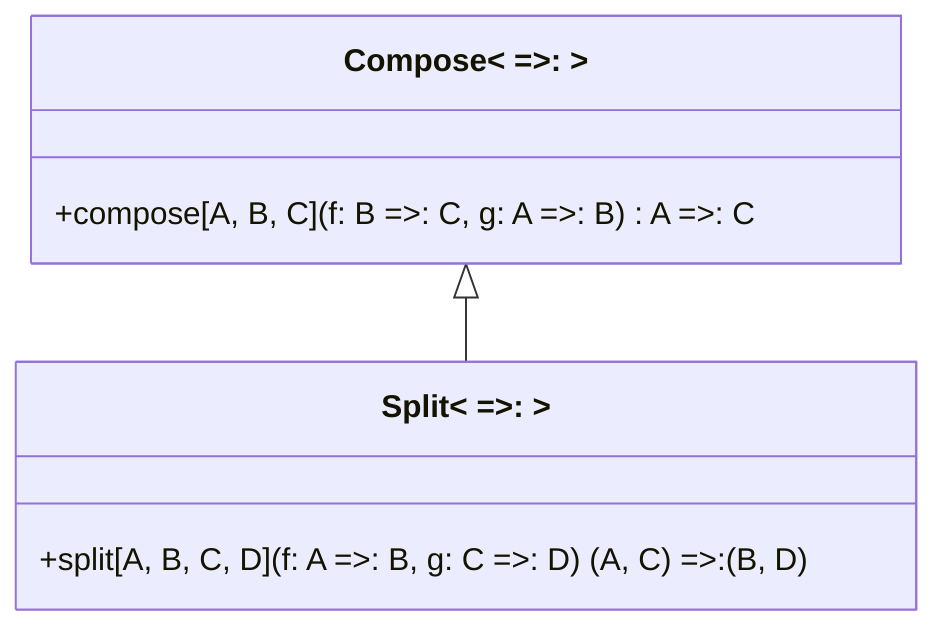

# Split

`Split` — это типовой класс в Scala, который предоставляет возможность 
**параллельной [композиции](compose.md)** двух морфизмов (функций или вычислений). 
Он позволяет комбинировать два морфизма так, чтобы они работали независимо над разными частями входных данных. 
Это особенно полезно в случаях, когда нужно обрабатывать пары значений или выполнять параллельные вычисления.

Основная операция, предоставляемая `Split`, — это `***` (или `split`), которая принимает два морфизма:

- \\(f: A \to B\\)
- \\(g: C \to D\\)

и возвращает новый морфизм:

- \\(f \, \*\*\* \, g: (A, C) \to (B, D)\\)

Это означает, что входные данные \\((A, C)\\) разделяются на две части, 
каждая из которых обрабатывается независимо, а результаты объединяются в пару \\((B, D)\\).

**Где применяется `Split`?**

- **Параллельная обработка данных**:
    - `Split` используется для одновременной обработки двух независимых потоков данных.
    - Пример: обработка пар значений, где каждая часть пары обрабатывается отдельной функцией.
- **Работа с кортежами**:
    - `Split` полезен для работы с кортежами, где нужно применить разные функции к каждому элементу кортежа.
    - Пример: преобразование кортежа `(Int, String)` в кортеж `(Boolean, Double)` с помощью двух функций.
- **Функциональные pipeline**:
    - В функциональных pipeline `Split` позволяет комбинировать независимые операции в одну.
    - Пример: обработка данных, где одна часть данных фильтруется, а другая — преобразуется.
- **Реактивные системы**:
    - В реактивных системах `Split` может использоваться для параллельной обработки событий.
    - Пример: обработка двух потоков событий, где каждый поток обрабатывается независимо.
- **Тестирование**:
    - `Split` может быть использован для одновременного применения тестовых операций к разным частям данных.
    - Пример: тестирование API, где запрос и ответ обрабатываются независимо.

## Примеры

- **Обработка пар значений**:
    - Есть две функции: `f: Int => Boolean` и `g: String => Double`.
    - С помощью `Split` можно создать функцию, которая принимает пару `(Int, String)` и возвращает пару `(Boolean, Double)`.
- **Параллельная обработка данных**:
    - Есть два потока данных: один содержит числа, другой — строки.
    - С помощью `Split` можно создать pipeline, где числа фильтруются, а строки преобразуются.
- **Работа с кортежами**:
    - Есть кортеж `(Int, String)` и две функции: `f: Int => Boolean` и `g: String => Double`.
    - С помощью `Split` можно преобразовать кортеж в `(Boolean, Double)`.
- **Реактивные системы**:
    - Есть два потока событий: один содержит клики мыши, другой — нажатия клавиш.
    - С помощью `Split` можно создать обработчик, который независимо обрабатывает каждый поток.
- **Тестирование**:
    - Есть запрос и ответ API, которые нужно проверить.
    - С помощью `Split` можно создать тест, где запрос проверяется одной функцией, а ответ — другой.

## Формальное определение

Пусть \\(C\\) — это категория, где:

- \\(\text{Obj}(C)\\) — это набор объектов (например, типов в Scala).
- \\(\text{Mor}(C)\\) — это набор морфизмов (например, функций между типами).

Типовой класс `Split` формально определяется следующим образом:

- **Объекты**: Типы \\(A, B, C, D, \dots\\), которые являются объектами категории.
- **Морфизмы**: Функции (или стрелки) \\(f: A \to B\\) и \\(g: C \to D\\), где:
    - \\(A, B, C, D\\) — это типы.
    - \\(f\\) и \\(g\\) — это функции, которые можно комбинировать параллельно.
- **Операция `split`**: Для любых двух морфизмов \\(f: A \to B\\) и \\(g: C \to D\\) существует морфизм:
  \\(f \, \*\*\* \, g: (A, C) \to (B, D)\\), который применяет \\(f\\) к первому элементу пары, а \\(g\\) — ко второму.

### Законы `Split`

Типовой класс `Split` должен удовлетворять следующим законам:

- **Ассоциативность**:
  \\((f \, \*\*\* \, g) \, \*\*\* \, h = f \, \*\*\* \, (g \, \*\*\* \, h)\\).
  Это означает, что порядок применения параллельной композиции не имеет значения.
- **Тождественный морфизм**:
  \\(\text{id}\_A \, \*\*\* \, \text{id}\_B = \text{id}\_{(A, B)}\\),
  где \\(\text{id}\_A\\) и \\(\text{id}\_B\\) — тождественные морфизмы для объектов \\(A\\) и \\(B\\).
-  **Совместимость с композицией**:
  \\((f\_1 \, \*\*\* \, g\_1) \circ (f\_2 \, \*\*\* \, g\_2) = (f\_1 \circ f\_2) \, \*\*\* \, (g\_1 \circ g\_2)\\).
  Это означает, что параллельная композиция совместима с обычной композицией морфизмов.

## Определение в виде кода на Scala

```dotty
trait Split[=>:[_, _]] extends Compose[=>:]:
  def split[A, B, C, D](f: A =>: B, g: C =>: D): (A, C) =>: (B, D)
```

Здесь:

- `=>:[_, _]` — это тип, представляющий морфизм (например, функция `A => B`).
- Метод `split` принимает два морфизма \\(f: A \to B\\) и \\(g: C \to D\\) и возвращает новый морфизм \\((A, C) \to (B, D)\\).

### Функция от одной переменной

```dotty
object Split:
  given Split[Function1] with
    override def compose[A, B, C](f: B => C, g: A => B): A => C = g andThen f

    override def split[A, B, C, D](f: A => B, g: C => D): ((A, C)) => (B, D) =
      (a, c) => (f(a), g(c))
```

## Схема



## Реализация в библиотеках

### Реализация в Cats

```dotty
import cats.*, cats.data.*, cats.syntax.all.*

lazy val f = (_:Int) + 1
lazy val g = (_:Int) * 100

(f split g)((1, 1))
// res0: (Int, Int) = (2, 100)
```

### Реализация в ScalaZ

```dotty
import scalaz.*
import Scalaz.*

// ... Все операции родителей
```

---

**Ссылки:**

- [Herding Cats](http://eed3si9n.com/herding-cats/Arrow.html)
- [Learning Scalaz](http://eed3si9n.com/learning-scalaz/Arrow.html)
- [Scalaz API](https://javadoc.io/doc/org.scalaz/scalaz-core_3/7.3.6/scalaz/Split.html)
