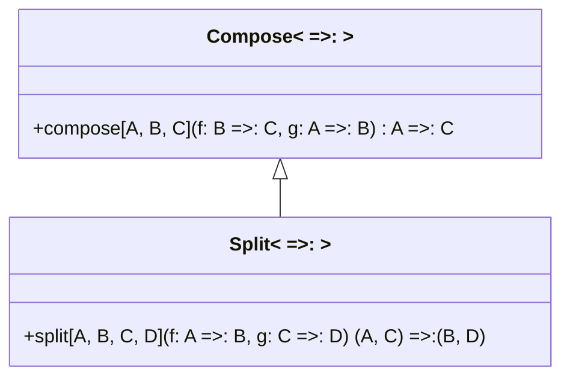

# Split

## Формальное определение

`Split` - полугруппоид ([`Compose`](compose.md)), допускающий произведения.

`Split` должен удовлетворять законам `Compose`.


## Определение в виде кода на Scala

```dotty
trait Split[=>:[_, _]] extends Compose[=>:]:
  def split[A, B, C, D](f: A =>: B, g: C =>: D): (A, C) =>: (B, D)
```

## Примеры

### Функция от одной переменной

```dotty
object Split:
  given Split[Function1] with
    override def compose[A, B, C](f: B => C, g: A => B): A => C = g andThen f

    override def split[A, B, C, D](f: A => B, g: C => D): ((A, C)) => (B, D) =
      (a, c) => (f(a), g(c))
```

## Схема



## Реализация в библиотеках

### Реализация в Cats

```dotty
import cats.*, cats.data.*, cats.syntax.all.*

lazy val f = (_:Int) + 1
lazy val g = (_:Int) * 100

(f split g)((1, 1))
// res0: (Int, Int) = (2, 100)
```

### Реализация в ScalaZ

```dotty
import scalaz.*
import Scalaz.*

// ... Все операции родителей
```

---

**Ссылки:**

- [Herding Cats](http://eed3si9n.com/herding-cats/Arrow.html)
- [Learning Scalaz](http://eed3si9n.com/learning-scalaz/Arrow.html)
- [Scalaz API](https://javadoc.io/doc/org.scalaz/scalaz-core_3/7.3.6/scalaz/Split.html)
