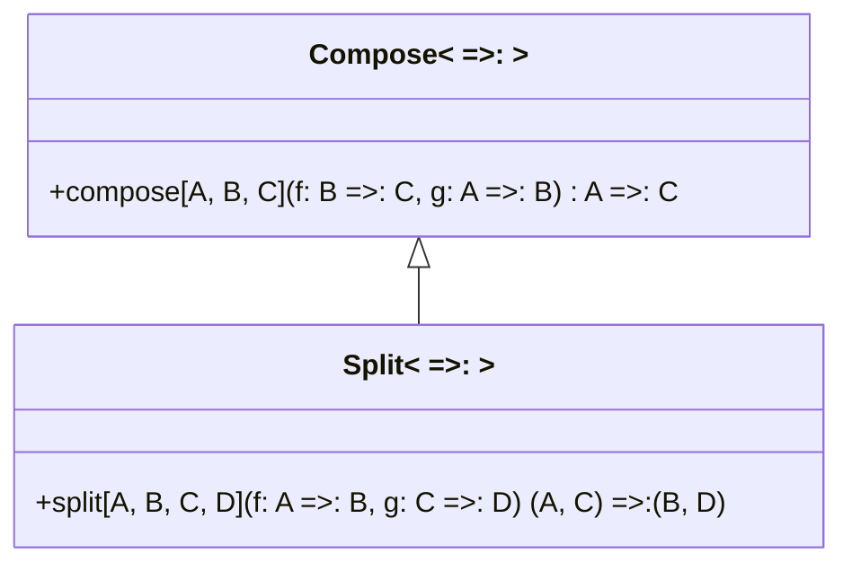



# Split

`Split` — это класс типов в Scala, который предоставляет возможность 
**параллельной [композиции](compose.md)** двух морфизмов (функций или вычислений). 
Он позволяет комбинировать два морфизма так, чтобы они работали независимо над разными частями входных данных. 
Это особенно полезно в случаях, когда нужно обрабатывать пары значений или выполнять параллельные вычисления.

Основная операция, предоставляемая `Split`, — это `***` (или `split`), которая принимает два морфизма:

- \\(f: A \to B\\)
- \\(g: C \to D\\)

и возвращает новый морфизм:

- \\(f \, \*\*\* \, g: (A, C) \to (B, D)\\)

Это означает, что входные данные \\((A, C)\\) разделяются на две части, 
каждая из которых обрабатывается независимо, а результаты объединяются в пару \\((B, D)\\).

**Краткие примеры**

- **Обработка пар значений**:
    - Есть две функции: `f: Int => Boolean` и `g: String => Double`.
    - С помощью `Split` можно создать функцию, которая принимает пару `(Int, String)` и возвращает пару `(Boolean, Double)`.
- **Параллельная обработка данных**:
    - Есть два потока данных: один содержит числа, другой — строки.
    - С помощью `Split` можно создать pipeline, где числа фильтруются, а строки преобразуются.
- **Работа с кортежами**:
    - Есть кортеж `(Int, String)` и две функции: `f: Int => Boolean` и `g: String => Double`.
    - С помощью `Split` можно преобразовать кортеж в `(Boolean, Double)`.
- **Реактивные системы**:
    - Есть два потока событий: один содержит клики мыши, другой — нажатия клавиш.
    - С помощью `Split` можно создать обработчик, который независимо обрабатывает каждый поток.
- **Тестирование**:
    - Есть запрос и ответ API, которые нужно проверить.
    - С помощью `Split` можно создать тест, где запрос проверяется одной функцией, а ответ — другой.

## Формальное определение

Пусть \\(C\\) — это категория, где:

- \\(\text{Obj}(C)\\) — это набор объектов (например, типов в Scala).
- \\(\text{Mor}(C)\\) — это набор морфизмов (например, функций между типами).

Класс типов `Split` формально определяется следующим образом:

- **Объекты**: Типы \\(A, B, C, D, \dots\\), которые являются объектами категории.
- **Морфизмы**: Функции (или стрелки) \\(f: A \to B\\) и \\(g: C \to D\\), где:
    - \\(A, B, C, D\\) — это типы.
    - \\(f\\) и \\(g\\) — это функции, которые можно комбинировать параллельно.
- **Операция `split`**: Для любых двух морфизмов \\(f: A \to B\\) и \\(g: C \to D\\) существует морфизм:
  \\(f \, \*\*\* \, g: (A, C) \to (B, D)\\), который применяет \\(f\\) к первому элементу пары, а \\(g\\) — ко второму.

### Законы `Split`

Класс типов `Split` должен удовлетворять следующим законам:

- **Ассоциативность**:
  \\((f \, \*\*\* \, g) \, \*\*\* \, h = f \, \*\*\* \, (g \, \*\*\* \, h)\\).
  Это означает, что порядок применения параллельной композиции не имеет значения.
- **Тождественный морфизм**:
  \\(\text{id}\_A \, \*\*\* \, \text{id}\_B = \text{id}\_{(A, B)}\\),
  где \\(\text{id}\_A\\) и \\(\text{id}\_B\\) — тождественные морфизмы для объектов \\(A\\) и \\(B\\).
-  **Совместимость с композицией**:
  \\((f\_1 \, \*\*\* \, g\_1) \circ (f\_2 \, \*\*\* \, g\_2) = (f\_1 \circ f\_2) \, \*\*\* \, (g\_1 \circ g\_2)\\).
  Это означает, что параллельная композиция совместима с обычной композицией морфизмов.

## Определение в виде кода на Scala

```dotty
trait Split[=>:[_, _]] extends Compose[=>:]:
  def split[A, B, C, D](f: A =>: B, g: C =>: D): (A, C) =>: (B, D)
```

Здесь:

- `=>:[_, _]` — это тип, представляющий морфизм (например, функция `A => B`).
- Метод `split` принимает два морфизма \\(f: A \to B\\) и \\(g: C \to D\\) и возвращает новый морфизм \\((A, C) \to (B, D)\\).

## Упражнения

### Упражнение 4.3.1: Реализация Split для Function1 (обычные функции)

> [Репозиторий с упражнениями и инструкцией по выполнению][sample]

Реализуйте экземпляр `Split` для `Function1`

```dotty
given Split[Function1] with
  override def compose[A, B, C](f: B => C, g: A => B): A => C = ???
  override def split[A, B, C, D](f: A => B, g: C => D): ((A, C)) => (B, D) = ???
```

**Примеры:**

```dotty
import Split.given

// Базовые функции
val inc: Int => Int = _ + 1
val toString: Int => String = _.toString

// split — параллельное применение
val parallel = split(inc, toString)
parallel(5, 42)  // (6, "42")
```

@:note(🔍 Показать решение)

Реализация `compose` использует встроенную композицию `g andThen f` — сначала применяется `g`, затем `f`. 
Реализация `split` принимает пару `(a, c)` и возвращает пару `(f(a), g(c))`. 
Это простое, но мощное определение позволяет комбинировать функции параллельно, 
сохраняя независимость преобразований для разных компонентов кортежа.

```dotty
given Split[Function1] with
  override def compose[A, B, C](f: B => C, g: A => B): A => C = g andThen f

  override def split[A, B, C, D](f: A => B, g: C => D): ((A, C)) => (B, D) =
    (a, c) => (f(a), g(c))
```

@:@

### Упражнение 4.3.2: Реализация экземпляра Split для Kleisli на основе Bind

В этом упражнении вам предстоит реализовать экземпляр класса типов `Split` для типа `Kleisli[F, A, B]`, 
используя возможности связывания вычислений через `Bind[F]`.

```dotty
given kleisliSplit[F[_]: Bind]: Split[[A, B] =>> Kleisli[F, A, B]] with
  override def compose[A, B, C](
      f: Kleisli[F, B, C],
      g: Kleisli[F, A, B]
  ): Kleisli[F, A, C] =
    ???

  override def split[A, B, C, D](
      f: Kleisli[F, A, B],
      g: Kleisli[F, C, D]
  ): Kleisli[F, (A, C), (B, D)] =
    ???
```

@:note(🔍 Показать решение)

Решение использует `Bind[F]` для получения доступа к `apply2`, 
который позволяет параллельно выполнить два вычисления в контексте `F` и объединить их результаты в кортеж. 
Для двух стрелок `f` и `g` операция `split` создает новую стрелку, которая принимает пару `(a, c)`, 
применяет `f.run(a)` и `g.run(c)` параллельно, а затем с помощью `apply2` объединяет результаты `(b, d)`. 
Операция `compose` реализуется стандартным образом через `flatMap`, как и в экземпляре `Compose` для `Kleisli`.

```dotty
given kleisliSplit[F[_]: Bind]: Split[[A, B] =>> Kleisli[F, A, B]] with
  override def compose[A, B, C](
      f: Kleisli[F, B, C],
      g: Kleisli[F, A, B]
  ): Kleisli[F, A, C] =
    Kleisli[F, A, C](a => g.run(a).flatMap(b => f.run(b)))

  override def split[A, B, C, D](
      f: Kleisli[F, A, B],
      g: Kleisli[F, C, D]
  ): Kleisli[F, (A, C), (B, D)] =
    Kleisli[F, (A, C), (B, D)]((a, c) =>
      Bind[F].apply2(f.run(a), g.run(c))((b, d) => (b, d))
    )
```

@:@

### Упражнение 4.3.3: Реализация экземпляра Split для Cokleisli на основе CoBind

В этом упражнении вам предстоит реализовать экземпляр класса типов `Split` для типа `Cokleisli[F, A, B]`, 
используя возможности расширения контекста через `CoBind[F]`.

```dotty
given cokleisliSplit[F[_]: CoBind]: Split[[A, B] =>> Cokleisli[F, A, B]] with
  override def compose[A, B, C](
      f: Cokleisli[F, B, C],
      g: Cokleisli[F, A, B]
  ): Cokleisli[F, A, C] =
    ???

  override def split[A, B, C, D](
      f: Cokleisli[F, A, B],
      g: Cokleisli[F, C, D]
  ): Cokleisli[F, (A, C), (B, D)] =
    ???
```

@:note(🔍 Показать решение)

Решение использует `CoBind[F]` для получения доступа к `map`, который позволяет преобразовывать значения внутри контекста `F`. 
Для двух стрелок `f` и `g` операция `split` создает новую стрелку, которая принимает контекст `fac: F[(A, C)]`. 
С помощью `CoBind[F].map` извлекаются левая часть `fa: F[A]` (проекция на первый элемент) 
и правая часть `fc: F[C]` (проекция на второй элемент). 
Затем `f.run(fa)` и `g.run(fc)` применяются к полученным контекстам, а результаты объединяются в пару `(B, D)`. 
Операция `compose` реализуется стандартным образом через `cobind`, как и в экземпляре `Compose` для `Cokleisli`.

```dotty
given cokleisliSplit[F[_]: CoBind]: Split[[A, B] =>> Cokleisli[F, A, B]] with
  override def compose[A, B, C](
      f: Cokleisli[F, B, C],
      g: Cokleisli[F, A, B]
  ): Cokleisli[F, A, C] =
    Cokleisli[F, A, C](fa => f.run(fa.cobind(g.run)))

  override def split[A, B, C, D](
      f: Cokleisli[F, A, B],
      g: Cokleisli[F, C, D]
  ): Cokleisli[F, (A, C), (B, D)] =
    Cokleisli[F, (A, C), (B, D)] { fac =>
      val fa = CoBind[F].map(fac)((a, _) => a)
      val fc = CoBind[F].map(fac)((_, c) => c)
      (f.run(fa), g.run(fc))
    }
```

@:@

## Схема



## Реализация в библиотеках

### Реализация в Cats

```dotty
import cats.*, cats.data.*, cats.syntax.all.*

lazy val f = (_:Int) + 1
lazy val g = (_:Int) * 100

(f split g)((1, 1))
// res0: (Int, Int) = (2, 100)
```

### Реализация в ScalaZ

```dotty
import scalaz.*
import Scalaz.*

// ... Все операции родителей
```

---

**Ссылки:**

- [Ссылка на репозиторий с упражнениями][sample]
- [Cats](https://typelevel.org/cats/typeclasses/arrow.html)
- [Herding Cats](http://eed3si9n.com/herding-cats/Arrow.html)
- [Learning Scalaz](http://eed3si9n.com/learning-scalaz/Arrow.html)
- [Scalaz API](https://javadoc.io/doc/org.scalaz/scalaz-core_3/7.3.6/scalaz/Split.html)

[sample]: https://gitverse.ru/scalabook/typeclasses
