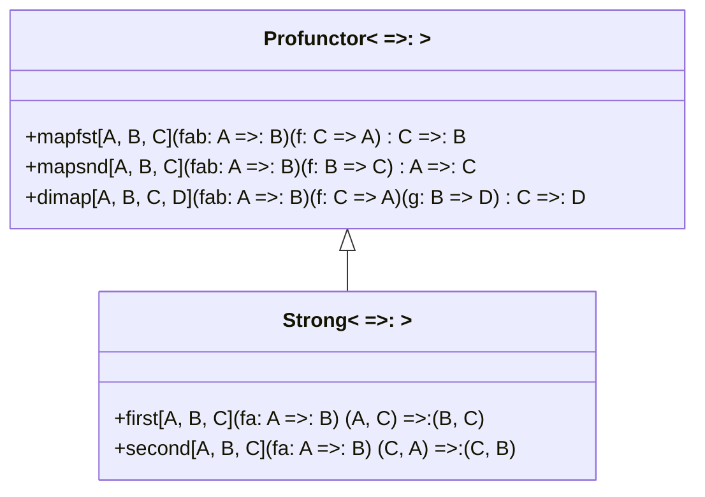

# Strong

`Strong` — это класс типов в функциональном программировании, 
который расширяет возможности [**профунктора**](profunctor.md) (`Profunctor`), 
добавляя поддержку работы с **парными типами** (кортежами). 
Он позволяет "усилить" профунктор, предоставляя возможность извлекать 
и комбинировать элементы из парных структур данных.

Основная операция, предоставляемая `Strong`, — это `first` (или `***`), 
которая позволяет профунктору работать с первым элементом пары, оставляя второй элемент без изменений. 
Аналогично, операция `second` (или `&&&`) работает со вторым элементом пары.

**Краткие примеры**

- **Оптики (Lens)**:
    - Есть Lens, которая работает с полем `age` в структуре `Person`.
    - С помощью `Strong` можно создать Lens, которая работает с кортежем `(Person, String)`, изменяя только поле `age`.
- **Функциональные pipeline**:
    - Есть функция `Int => Boolean`, которая обрабатывает данные.
    - С помощью `Strong` можно создать функцию, которая работает с кортежем `(Int, String)`, преобразуя только первый элемент.
- и т.д.

## Формальное определение

Пусть \\(P\\) — это [профунктор](profunctor.md), где:

- \\(P: C^\text{op} \times D \to \text{Set}\\) — это функтор из произведения категорий \\(C^\text{op}\\) 
  (противоположной категории \\(C\\)) и \\(D\\) в категорию множеств.
- \\(C^\text{op}\\) — это категория, где морфизмы направлены в обратную сторону (контравариантность).
- \\(D\\) — это категория, где морфизмы направлены в обычную сторону (ковариантность).

Класс типов `Strong` формально определяется следующим образом:

- **Объекты**: Типы \\(A, B, C, D, \dots\\), которые являются объектами категорий \\(C\\) и \\(D\\).
- **Морфизмы**: Функции (или стрелки) \\(f: A \to B\\) и \\(g: C \to D\\), где:
    - \\(f\\) — контравариантный морфизм (преобразует входные данные).
    - \\(g\\) — ковариантный морфизм (преобразует выходные данные).
- **Операция `first`**: Для любого морфизма \\(p: P\[A, B\]\\) существует морфизм:
  \\(\text{first}(p): P\[(A, C), (B, C)\]\\), 
  который применяет \\(p\\) к первому элементу пары, оставляя второй элемент без изменений.
- **Операция `second`**: Для любого морфизма \\(p: P\[A, B\]\\) существует морфизм:
  \\(\text{second}(p): P\[(C, A), (C, B)\]\\),
  который применяет \\(p\\) ко второму элементу пары, оставляя первый элемент без изменений.

### Законы `Strong`

Класс типов `Strong` должен удовлетворять следующим законам:

- **Естественность**:
  \\(\text{first}(p) \circ (f \times \text{id}) = (g \times \text{id}) \circ \text{first}(p)\\).
  Это означает, что операция `first` должна быть естественной по отношению к композиции.
- **Ассоциативность**:
  \\(\text{first}(\text{first}(p)) = \text{assoc} \circ \text{first}(p) \circ \text{assoc}^{-1}\\),
  где \\(\text{assoc}\\) — это ассоциативное преобразование кортежей.
- **Тождественный морфизм**:
  \\(\text{first}(\text{id}\_P) = \text{id}\_{P\[(A, C), (A, C)\]}\\).
  Это означает, что применение `first` к тождественному морфизму возвращает тождественный морфизм.

## Определение в виде кода на Scala

```dotty
trait Strong[=>:[_, _]] extends Profunctor[=>:]:
  def first[A, B, C](fa: A =>: B): (A, C) =>: (B, C)

  def second[A, B, C](fa: A =>: B): (C, A) =>: (C, B) =
    dimap[(A, C), (B, C), (C, A), (C, B)](first(fa))(_.swap)(_.swap)
```

Здесь:

- `=>:[_, _]` — это тип, представляющий профунктор (например, функция `A => B`).
- Метод `first` принимает профунктор \\(P\[A, B\]\\) и возвращает новый профунктор \\(P\[(A, C), (B, C)\]\\).
- Метод `second` принимает профунктор \\(P\[A, B\]\\) и возвращает новый профунктор \\(P\[(C, A), (C, B)\]\\).

## Упражнения

### Упражнение 4.5.1: Реализация Strong для Function1 (обычные функции)

> [Репозиторий с упражнениями и инструкцией по выполнению][sample]

Реализуйте экземпляр `Strong` для `Function1`, определив:

- `mapfst` — контравариантное отображение входа (из `Profunctor`)
- `mapsnd` — ковариантное отображение выхода (из `Profunctor`)
- `first` — применение функции к первому элементу пары
- `second` — применение функции ко второму элементу пары

```dotty
given Strong[Function1] with
  override def mapfst[A, B, C](fab: A => B)(f: C => A): C => B = ???
  override def mapsnd[A, B, C](fab: A => B)(f: B => C): A => C = ???
  override def first[A, B, C](fa: A => B): ((A, C)) => (B, C) = ???
  override def second[A, B, C](fa: A => B): ((C, A)) => (C, B) = ???
```

**Примеры:**

```dotty
import Strong.given

// Базовые функции
val inc: Int => Int = _ + 1
val mul2: Int => Int = _ * 2
val toString: Int => String = _.toString
val length: String => Int = _.length

// first — применение к первому элементу пары
val firstInc = first(inc)
firstInc(5, "hello")   // (6, "hello")
firstInc(10, "world")  // (11, "world")

val firstToString = first(toString)
firstToString(42, true)  // ("42", true)

// second — применение ко второму элементу пары
val secondInc = second(inc)
secondInc("hello", 5)   // ("hello", 6)
secondInc("world", 10)  // ("world", 11)

val secondLength = second(length)
secondLength(42, "hello")  // (42, 5)

// Композиция first с Profunctor операциями
val transformed = mapsnd(first(inc))(toString)
transformed(5, "x")  // (toString(inc(5)), "x") = ("6", "x")

// Вложенные first
val nestedFirst = first(first(inc))
nestedFirst((5, "hello"), true)  // ((6, "hello"), true)

// Вложенные second
val nestedSecond = second(second(inc))
nestedSecond(true, ("hello", 5))  // (true, ("hello", 6))

// Комбинация first и second
val firstThenSecond = second(first(inc))
firstThenSecond("hello", (5, true))  // ("hello", (6, true))
```

@:note(🔍 Показать решение)

Реализация `mapfst` использует композицию `f andThen fab` — сначала преобразуем вход, затем применяем функцию. 
`mapsnd` использует `fab andThen f` — сначала применяем функцию, затем преобразуем выход. 
`first` принимает пару `(a, c)` и возвращает `(fa(a), c)` — исходная функция применяется к первому элементу, второй остаётся неизменным. 
`second` принимает пару `(c, a)` и возвращает `(c, fa(a))` — исходная функция применяется ко второму элементу, первый остаётся неизменным. 

```dotty
given Strong[Function1] with
  override def mapfst[A, B, C](fab: A => B)(f: C => A): C => B = f andThen fab

  override def mapsnd[A, B, C](fab: A => B)(f: B => C): A => C = fab andThen f

  override def first[A, B, C](fa: A => B): ((A, C)) => (B, C) = (a, c) =>
    (fa(a), c)

  override def second[A, B, C](fa: A => B): ((C, A)) => (C, B) = (c, a) =>
    (c, fa(a))
```

@:@

### Упражнение 4.5.2: Реализация экземпляра Strong для Kleisli на основе Functor

В этом упражнении вам предстоит реализовать экземпляр класса типов `Strong` для типа `Kleisli[F, A, B]`, 
используя возможность отображения через `Functor[F]`.

```dotty
given kleisliStrong[F[_]: Functor]: Strong[[A, B] =>> Kleisli[F, A, B]] with
  override def mapfst[A, B, C](fab: Kleisli[F, A, B])(f: C => A)
      : Kleisli[F, C, B] =
    ???

  override def mapsnd[A, B, C](fab: Kleisli[F, A, B])(f: B => C)
      : Kleisli[F, A, C] =
    ???

  override def first[A, B, C](fa: Kleisli[F, A, B])
      : Kleisli[F, (A, C), (B, C)] =
    ???

  override def second[A, B, C](fa: Kleisli[F, A, B])
      : Kleisli[F, (C, A), (C, B)] =
    ???
```

@:note(🔍 Показать решение)

Решение использует `Functor[F]` для получения доступа к `map`, который позволяет преобразовывать значения внутри контекста `F`. 
Для `first` создается новая стрелка, которая принимает пару `(a, c)`, применяет исходную стрелку `fa` к `a`, 
получая `F[B]`, а затем с помощью `map` добавляет неизменный `c` к результату, получая `F[(B, C)]`. 
`second` работает аналогично, но применяет стрелку ко второму элементу пары, сохраняя первый неизменным. 
Операции `mapfst` и `mapsnd` наследуются от `Profunctor` и реализуются стандартным образом для `Kleisli`.

```dotty
given kleisliStrong[F[_]: Functor]: Strong[[A, B] =>> Kleisli[F, A, B]] with
  override def mapfst[A, B, C](fab: Kleisli[F, A, B])(f: C => A)
      : Kleisli[F, C, B] =
    Kleisli[F, C, B](c => fab.run(f(c)))

  override def mapsnd[A, B, C](fab: Kleisli[F, A, B])(f: B => C)
      : Kleisli[F, A, C] =
    Kleisli[F, A, C](a => fab.run(a).map(f))

  override def first[A, B, C](fa: Kleisli[F, A, B])
      : Kleisli[F, (A, C), (B, C)] =
    Kleisli[F, (A, C), (B, C)]((a, c) =>
      fa.run(a).map(b => (b, c))
    )

  override def second[A, B, C](fa: Kleisli[F, A, B])
      : Kleisli[F, (C, A), (C, B)] =
    Kleisli[F, (C, A), (C, B)]((c, a) =>
      fa.run(a).map(b => (c, b))
    )
```

@:@

### Упражнение 4.5.3: Реализация экземпляра Strong для Cokleisli на основе CoMonad

В этом упражнении вам предстоит реализовать экземпляр класса типов `Strong` для типа `Cokleisli[F, A, B]`, 
используя комонадические возможности `CoMonad[F]`.

```dotty
given cokleisliStrong[F[_]: CoMonad]: Strong[[A, B] =>> Cokleisli[F, A, B]]
with
  override def mapfst[A, B, C](fab: Cokleisli[F, A, B])(f: C => A)
      : Cokleisli[F, C, B] =
    ???

  override def mapsnd[A, B, C](fab: Cokleisli[F, A, B])(f: B => C)
      : Cokleisli[F, A, C] =
    ???

  override def first[A, B, C](fa: Cokleisli[F, A, B])
      : Cokleisli[F, (A, C), (B, C)] =
    ???

  override def second[A, B, C](fa: Cokleisli[F, A, B])
      : Cokleisli[F, (C, A), (C, B)] =
    ???
end cokleisliStrong
```

@:note(🔍 Показать решение)

Решение использует `CoMonad[F]` для получения доступа к `coPure` (также известному как `extract`), 
который извлекает значение из контекста `F`. 
Для `first` создается новая стрелка, которая принимает контекст `fac: F[(A, C)]`. 
С помощью `map(_._1)` извлекается `F[A]`, к которому применяется исходная стрелка `fa`, давая `B`. 
Одновременно с помощью `coPure` из `fac` извлекается значение `C`. Результатом является пара `(B, C)`. 
`second` работает аналогично, но извлекает второй элемент пары с помощью `map(_._2)`. 
Операции `mapfst` и `mapsnd` наследуются от `Profunctor` и реализуются стандартным образом для `Cokleisli`.

```dotty
given cokleisliStrong[F[_]: CoMonad]: Strong[[A, B] =>> Cokleisli[F, A, B]]
with
  override def mapfst[A, B, C](fab: Cokleisli[F, A, B])(f: C => A)
      : Cokleisli[F, C, B] =
    Cokleisli[F, C, B](fc => fab.run(fc.map(f)))

  override def mapsnd[A, B, C](fab: Cokleisli[F, A, B])(f: B => C)
      : Cokleisli[F, A, C] =
    Cokleisli[F, A, C](fa => f(fab.run(fa)))

  override def first[A, B, C](fa: Cokleisli[F, A, B])
      : Cokleisli[F, (A, C), (B, C)] =
    Cokleisli[F, (A, C), (B, C)](fac =>
      val b      = fa.run(fac.map(_._1))
      val (_, c) = CoMonad[F].coPure(fac)
      (b, c)
    )

  override def second[A, B, C](fa: Cokleisli[F, A, B])
      : Cokleisli[F, (C, A), (C, B)] =
    Cokleisli[F, (C, A), (C, B)](fca =>
      val b      = fa.run(fca.map(_._2))
      val (c, _) = CoMonad[F].coPure(fca)
      (c, b)
    )
end cokleisliStrong
```

@:@

## Схема



## Реализация в библиотеках

### Реализация в Cats

```dotty
import cats.*, cats.data.*, cats.syntax.all.*

lazy val f = (_:Int) + 1
lazy val f_first = f.first[Int]
f_first((1, 1))
// res0: (Int, Int) = (2, 1)

lazy val f_second = f.second[Int]
f_second((1, 1))
// res1: (Int, Int) = (1, 2)
```

### Реализация в ScalaZ

```dotty
import scalaz.*
import Scalaz.*

val plus1 = (_: Int) + 1

plus1.first apply (7 -> "abc")    // (8,abc)
plus1.second apply ("def" -> 14)  // (def,15)
```

---

**Ссылки:**

- [Ссылка на репозиторий с упражнениями][sample]
- [Cats](https://typelevel.org/cats/typeclasses/arrow.html)
- [Herding Cats](http://eed3si9n.com/herding-cats/Arrow.html)
- [Learning Scalaz](http://eed3si9n.com/learning-scalaz/Arrow.html)
- [Scalaz API](https://javadoc.io/doc/org.scalaz/scalaz-core_3/7.3.6/scalaz/Strong.html)

[sample]: https://gitverse.ru/scalabook/typeclasses
