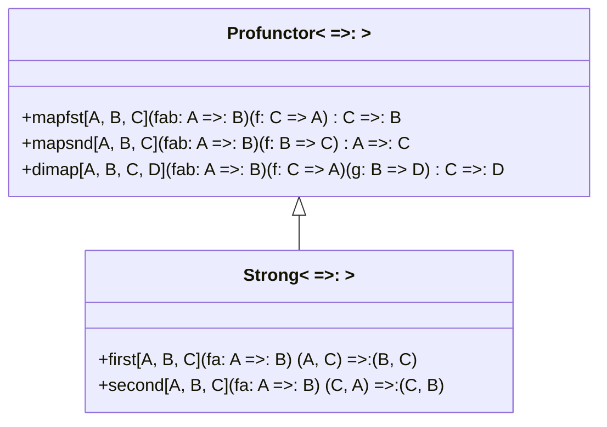

# Strong

`Strong` — это типовой класс в функциональном программировании, 
который расширяет возможности [**профунктора**](profunctor.md) (`Profunctor`), 
добавляя поддержку работы с **парными типами** (кортежами). 
Он позволяет "усилить" профунктор, предоставляя возможность извлекать 
и комбинировать элементы из парных структур данных.

Основная операция, предоставляемая `Strong`, — это `first` (или `***`), 
которая позволяет профунктору работать с первым элементом пары, оставляя второй элемент без изменений. 
Аналогично, операция `second` (или `&&&`) работает со вторым элементом пары.

**Где применяется `Strong`?**

- **Оптики (Lens, Prism, Iso)**:
    - `Strong` используется в библиотеках для работы с оптиками (например, Monocle), где нужно работать с полями структур данных.
    - Пример: Lens, которая позволяет читать и изменять поля в структурах данных.
- **Функциональные pipeline**:
    - `Strong` позволяет строить pipeline, где данные могут быть частично обработаны, а остальные части остаются неизменными.
    - Пример: обработка данных, где одно поле кортежа преобразуется, а другое остаётся без изменений.
- **Реактивные системы**:
    - В реактивных системах `Strong` может использоваться для обработки событий, где часть данных изменяется, а другая часть остаётся неизменной.
    - Пример: обработка событий, где одно поле события фильтруется, а другое остаётся без изменений.
- **Работа с кортежами**:
    - `Strong` полезен для работы с кортежами, где нужно преобразовать только один элемент пары.
    - Пример: преобразование кортежа `(Int, String)` в кортеж `(Boolean, String)` с помощью функции `Int => Boolean`.
- **Тестирование**:
    - `Strong` может быть использован для частичного преобразования тестовых данных.
    - Пример: тестирование API, где часть запроса изменяется, а остальная часть остаётся без изменений.

**Краткие примеры**

- **Оптики (Lens)**:
    - Есть Lens, которая работает с полем `age` в структуре `Person`.
    - С помощью `Strong` можно создать Lens, которая работает с кортежем `(Person, String)`, изменяя только поле `age`.
- **Функциональные pipeline**:
    - Есть функция `Int => Boolean`, которая обрабатывает данные.
    - С помощью `Strong` можно создать функцию, которая работает с кортежем `(Int, String)`, преобразуя только первый элемент.
- и т.д.

## Формальное определение

`Strong` - сила в объединении. `Strong` расширяет [`Profunctor`](profunctor.md) и добавляет операции `first` и `second`,
добавляющие заданное значение слева или справа от функции 
`A =>: B => (A, C) =>: (B, C)` или `A =>: B => (C, A) =>: (C, B)`.

`Strong` должен удовлетворять следующим законам:

- при отображении функции `swap` слева и справа на `second` получим `first`: `dimap(second)(_.swap)(_.swap) == first`
- верно и обратное: `dimap(first)(_.swap)(_.swap) == second`
- `lmap fst == rmap fst . first'`
- и `lmap snd == rmap snd . second'`
- `lmap (second f) . first == rmap (second f) . first`
- и `lmap (first f) . second == rmap (first f) . second`
- `first' . first' == dimap assoc unassoc . first'`, где `assoc ((a,b),c) = (a,(b,c))` и `unassoc (a,(b,c)) = ((a,b),c)`
- и `second' . second' == dimap unassoc assoc . second'`


## Определение в виде кода на Scala

```dotty
trait Strong[=>:[_, _]] extends Profunctor[=>:]:
  def first[A, B, C](fa: A =>: B): (A, C) =>: (B, C)

  def second[A, B, C](fa: A =>: B): (C, A) =>: (C, B) =
    dimap[(A, C), (B, C), (C, A), (C, B)](first(fa))(_.swap)(_.swap)
```

### Функция от одной переменной

```dotty
given Strong[Function1] with
  override def mapfst[A, B, C](fab: A => B)(f: C => A): C => B = f andThen fab

  override def mapsnd[A, B, C](fab: A => B)(f: B => C): A => C = fab andThen f

  override def first[A, B, C](fa: A => B): ((A, C)) => (B, C) = (a, c) => (fa(a), c)

  override def second[A, B, C](fa: A => B): ((C, A)) => (C, B) = (c, a) => (c, fa(a))
```

## Схема



## Реализация в библиотеках

### Реализация в Cats

```dotty
import cats.*, cats.data.*, cats.syntax.all.*

lazy val f = (_:Int) + 1
lazy val f_first = f.first[Int]
f_first((1, 1))
// res0: (Int, Int) = (2, 1)

lazy val f_second = f.second[Int]
f_second((1, 1))
// res1: (Int, Int) = (1, 2)
```

### Реализация в ScalaZ

```dotty
import scalaz.*
import Scalaz.*

val plus1 = (_: Int) + 1

plus1.first apply (7 -> "abc")    // (8,abc)
plus1.second apply ("def" -> 14)  // (def,15)
```

---

**Ссылки:**

- [Herding Cats](http://eed3si9n.com/herding-cats/Arrow.html)
- [Learning Scalaz](http://eed3si9n.com/learning-scalaz/Arrow.html)
- [Scalaz API](https://javadoc.io/doc/org.scalaz/scalaz-core_3/7.3.6/scalaz/Strong.html)
