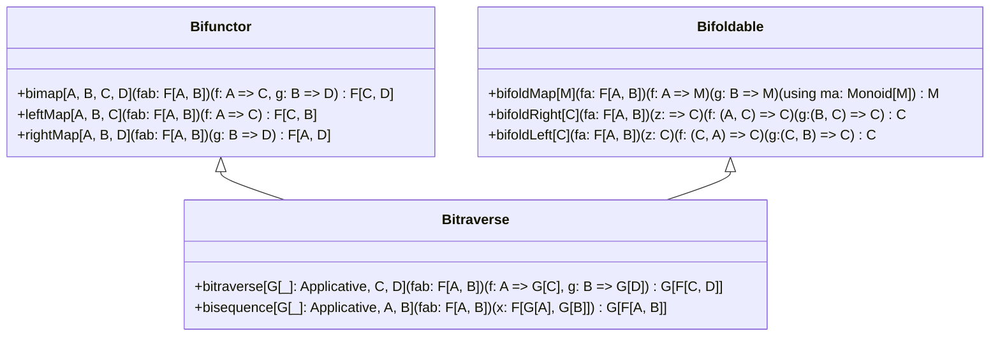



# Группа Bifunctor

## Введение

В функциональном программировании классы типов играют ключевую роль в обеспечении абстракций 
для работы с различными типами данных. Одним из таких классов типов является `Bifunctor`, 
который обобщает возможность применения функций к двум типам, содержащимся в одном контексте. 
В Scala, как и в других функциональных языках, `Bifunctor` предоставляет мощный инструмент для работы с типами, 
которые имеют два параметра, например, `Either`, `Tuple2` или пользовательские бифункторы.

Класс типов `Bifunctor` позволяет применять функции к каждому из двух типов, сохраняя структуру контейнера. 
Это особенно полезно в случаях, когда необходимо трансформировать оба типа независимо друг от друга, 
не разрушая при этом общую структуру данных. 
В этом разделе мы рассмотрим, как определяется и используется `Bifunctor`, 
а также изучим примеры его применения для различных типов данных.

## Использование

Бифункторы (Bifunctor) находят применение в различных областях функционального программирования, 
особенно там, где требуется работа с типами, имеющими два параметра. 
Они предоставляют удобный способ трансформации обоих типов, сохраняя при этом структуру контейнера. 
Вот несколько примеров, где бифункторы могут быть полезны:

- **Работа с типами, имеющими два параметра**.
  Бифункторы естественным образом применяются к типам, которые содержат два значения или два типа. Например:
    - **`Either[A, B]`**: Тип `Either` представляет собой контейнер, который может содержать либо значение типа `A`, либо типа `B`. С помощью бифунктора можно трансформировать как левое значение (`A`), так и правое (`B`), не меняя структуру `Either`.
    - **`Tuple2[A, B]`** (или пары): Бифунктор позволяет применять функции к обоим элементам кортежа независимо.
    - **Пользовательские типы**: Если вы создаете свои типы с двумя параметрами (например, `Result[Error, Value]`), бифунктор поможет легко работать с ними.
- **Обработка ошибок и альтернативных путей**.
  В типах, подобных `Either`, где один параметр может представлять ошибку, а другой — успешное значение, бифункторы позволяют:
    - Трансформировать ошибки (например, преобразовать тип ошибки из `String` в `CustomError`).
    - Трансформировать успешные значения (например, преобразовать результат вычисления).
  Это особенно полезно в цепочках вычислений, где нужно обрабатывать как ошибки, так и успешные результаты.
- **Композиция и преобразование данных**.
  Бифункторы могут использоваться для композиции данных в контексте двух типов. Например:
    - В случае `Tuple2` можно преобразовать оба значения кортежа, сохраняя их связь.
    - В случае `Either` можно изменить как левую, так и правую часть, не нарушая структуру.
- **Функциональные библиотеки и фреймворки**.
  Бифункторы активно используются в функциональных библиотеках, таких как **Cats** или **Scalaz**, для предоставления универсальных абстракций. Например:
    - В библиотеке Cats бифунктор реализован для типов `Either` и `Tuple2`, что позволяет использовать их в функциональных цепочках.
    - Они также могут быть частью более сложных абстракций, таких как `Bifoldable` или `Bitraverse`.
- **Парсинг и валидация**.
  В задачах парсинга или валидации данных бифункторы могут быть полезны для работы с результатами, которые могут быть либо ошибкой, либо успешным значением. Например:
    - При парсинге JSON можно использовать бифунктор для преобразования ошибок парсинга и самих данных.
- **Функциональные эффекты**.
  В некоторых случаях бифункторы могут использоваться для работы с эффектами, которые содержат два типа. Например, в библиотеках для функционального программирования можно встретить типы, подобные `IO[Error, Result]`, где бифунктор позволяет трансформировать как ошибку, так и результат.

## Схема

**Ссылки:**

- [Ссылка на репозиторий с упражнениями][sample]

[sample]: https://gitverse.ru/scalabook/typeclasses
