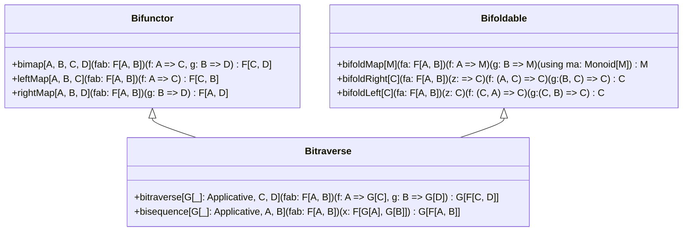

# Группа Bifunctor

## Схема

**Ссылки:**

- [Исходный код](https://gitverse.ru/artemkorsakov/scalabook/content/master/examples/src/main/scala/ru/scalabook/typeclass/bifunctor)
- [Тесты](https://gitverse.ru/artemkorsakov/scalabook/content/master/examples/src/test/scala/ru/scalabook/typeclass/bifunctor)
