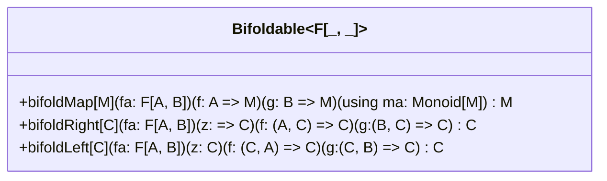



# Bifoldable

**Bifoldable** — это класс типов, который обобщает операцию [свертки](../monad/foldable.md) (fold) 
для типов, имеющих два параметра. Он позволяет "сворачивать" (аккумулировать) значения обоих типов, 
содержащихся в контейнере, в одно результирующее значение. 
В то время как [`Foldable`](../monad/foldable.md) работает с типами, имеющими один параметр (например, `List[A]`), 
`Bifoldable` расширяет эту идею на типы с двумя параметрами (например, `Either[A, B]` или `Tuple2[A, B]`).

Основные операции `Bifoldable`:

- `bifoldLeft`: Сворачивает контейнер, начиная с левого типа.
- `bifoldRight`: Сворачивает контейнер, начиная с правого типа.
- `bifoldMap`: Преобразует оба типа в моноид и затем объединяет их.

**Где применяется Bifoldable?**

- **Типы с двумя параметрами**:
    - `Either[A, B]`: Сворачивание левого типа (ошибки) и правого типа (успешного значения).
    - `Tuple2[A, B]`: Сворачивание обоих элементов кортежа.
    - Пользовательские типы, например, `Result[Error, Value]`.
- **Обработка ошибок**:
    - Агрегация ошибок и успешных значений в `Either`.
- **Агрегация данных**:
    - Суммирование или объединение значений в кортежах или других структурах с двумя параметрами.
- **Функциональные библиотеки**:
    - Используется в библиотеках Cats и Scalaz для работы с типами, имеющими два параметра.
- **Парсинг и валидация**:
    - Агрегация ошибок и результатов в процессах парсинга или валидации.

**Краткие примеры**

- **`Either[A, B]`**:
    - Суммирование всех ошибок (левый тип) и успешных значений (правый тип) в списке `Either`.
    - Преобразование всех ошибок в строки и объединение их в один результат.
- **`Tuple2[A, B]`**:
    - Суммирование обоих элементов кортежа, например, `(Int, Int)` в одно число.
    - Конкатенация строк из обоих элементов кортежа.
- **Пользовательский тип**:
    - Для типа `Result[Error, Value]` можно агрегировать все ошибки и значения в отдельные результаты.
- **Парсинг JSON**:
    - Агрегация всех ошибок парсинга и успешно распарсенных значений.

## Формальное определение

Класс типов `Bifoldable` представляет собой структуру, которая:

- Работает с типами, имеющими два параметра, например `F[_, _]`.
- Предоставляет операции для свертки (fold) обоих параметров:
    - `bifoldLeft`: Сворачивает контейнер, начиная с левого типа.
    - `bifoldRight`: Сворачивает контейнер, начиная с правого типа.
    - `bifoldMap`: Преобразует оба типа в моноид и затем объединяет их.

#### Законы Bifoldable

`Bifoldable` должен удовлетворять следующим законам (аналогично законам `Foldable`):

- **Закон ассоциативности**:
  Для `bifoldLeft` и `bifoldRight` порядок свертки должен соответствовать ассоциативности операций.
- **Закон нейтрального элемента**:
  Для `bifoldMap` результат свертки с нейтральным элементом моноида должен быть нейтральным элементом.

## Код

```dotty
trait Bifoldable[F[_, _]]:
  extension [A, B](fa: F[A, B])
    /** Аккумулирование всех `A` и `B`. */
    def bifoldMap[M](f: A => M)(g: B => M)(using ma: Monoid[M]): M

    /** Аккумулирование до `C`, начиная "справа". */
    def bifoldRight[C](z: => C)(f: (A, C) => C)(g: (B, C) => C): C =
      fa.bifoldMap[C => C](f.curried)(g.curried)(using endoMonoid[C])(z)

    /** Аккумулирование до `C`, начиная "слева". */
    def bifoldLeft[C](z: C)(f: (C, A) => C)(g: (C, B) => C): C =
      fa.bifoldMap[C => C](a => c => f(c, a))(b => c => g(c, b))(using dual(endoMonoid[C]))(z)
```

### Связь с другими классами типов

**Bifoldable** тесно связан с **Foldable**, который работает с типами, имеющими один параметр. 
В сущности, `Bifoldable` можно рассматривать как расширение `Foldable` для типов с двумя параметрами.

#### **`leftFoldable`**

```dotty
def leftFoldable[R]: Foldable[[X] =>> F[X, R]] =
  new Foldable[[X] =>> F[X, R]]:
    extension [A](fa: F[A, R])
      override def foldMap[B](f: A => B)(using mb: Monoid[B]): B =
        fa.bifoldMap[B](f)(_ => mb.empty)
```

- **Цель**: Создать `Foldable` для первого параметра типа `F[A, R]`, где второй параметр (`R`) фиксирован.
- **Как это работает**:
    - `leftFoldable` возвращает `Foldable` для типа `[X] =>> F[X, R]`, где `R` фиксирован.
    - Метод `foldMap` применяет функцию `f: A => B` только к первому параметру (`A`), 
      игнорируя второй параметр (`R`), используя метод `bifoldMap` из `Bifoldable`.
    - Второй параметр игнорируется, и для него используется нейтральный элемент моноида (`mb.empty`).
- **Пример**: Если `F` — это `Either[A, R]`, то `leftFoldable` позволяет свернуть только левую часть (`A`), игнорируя правую (`R`).

#### **`rightFoldable`**

```dotty
def rightFoldable[L]: Foldable[[X] =>> F[L, X]] =
  new Foldable[[X] =>> F[L, X]]:
    extension [A](fa: F[L, A])
      override def foldMap[B](f: A => B)(using mb: Monoid[B]): B =
        fa.bifoldMap[B](_ => mb.empty)(f)
```

- **Цель**: Создать `Foldable` для второго параметра типа `F[L, A]`, где первый параметр (`L`) фиксирован.
- **Как это работает**:
    - `rightFoldable` возвращает `Foldable` для типа `[X] =>> F[L, X]`, где `L` фиксирован.
    - Метод `foldMap` применяет функцию `f: A => B` только ко второму параметру (`A`), 
      игнорируя первый параметр (`L`), используя метод `bifoldMap` из `Bifoldable`.
    - Первый параметр игнорируется, и для него используется нейтральный элемент моноида (`mb.empty`).
- **Пример**: Если `F` — это `Either[L, A]`, то `rightFoldable` позволяет свернуть только правую часть (`A`), игнорируя левую (`L`).

#### **`uFoldable`**

```dotty
def uFoldable: Foldable[[X] =>> F[X, X]] =
  new Foldable[[X] =>> F[X, X]]:
    extension [A](fa: F[A, A])
      override def foldMap[B](f: A => B)(using mb: Monoid[B]): B =
        fa.bifoldMap[B](f)(f)
```

- **Цель**: Создать унифицированный `Foldable` для типа `F[X, X]`, где оба параметра имеют одинаковый тип.
- **Как это работает**:
    - `uFoldable` возвращает `Foldable` для типа `[X] =>> F[X, X]`.
    - Метод `foldMap` применяет функцию `f: A => B` к обоим параметрам одновременно, используя метод `bifoldMap` из `Bifoldable`.
- **Пример**: Если `F` — это `Tuple2[A, A]`, то `uFoldable` позволяет свернуть оба элемента кортежа одновременно.

## Упражнения

### Упражнение 3.2.1: Реализация Bifoldable для Either.

> [Репозиторий с упражнениями и инструкцией по выполнению][sample]

Реализуйте экземпляр `Bifoldable` для `Either`.

```dotty
given eitherBifoldable: Bifoldable[Either] with
  extension [A, B](fab: Either[A, B])
    def bifoldMap[M](f: A => M)(g: B => M)(using ma: Monoid[M]): M = ???
```

**Примеры:**

```dotty
import Bifoldable.given
import Monoid.given

val right: Either[String, Int] = Right(42)
val left: Either[String, Int] = Left("error")

// Свёртка с преобразованием в Int (моноид сложения)
right.bifoldMap(_.length)(identity)  // 42
left.bifoldMap(_.length)(identity)   // 5 — длина строки "error"
```

@:note(🔍 Показать решение)

Реализация `bifoldMap` для `Either` проста: используем сопоставление с шаблоном для определения варианта. 
Если `fab` — это `Right(value)`, применяем функцию `g` к `value` и возвращаем результат. 
Если `fab` — это `Left(value)`, применяем функцию `f` к `value` и возвращаем результат. 
Параметр `ma: Monoid[M]` необходим для соответствия сигнатуре `Bifoldable`, 
хотя для `Either` он не используется (так как у нас только одно значение). 
Это нормально, потому что законы Bifoldable требуют наличия моноида для типов-контейнеров, 
которые могут содержать несколько значений.

```dotty
given eitherBifoldable: Bifoldable[Either] with
  extension [A, B](fab: Either[A, B])
    def bifoldMap[M](f: A => M)(g: B => M)(using ma: Monoid[M]): M =
      fab match
        case Right(value) => g(value)
        case Left(value)  => f(value)
```

@:@

## Схема



## Реализация в библиотеках

### Реализация в Cats

Предположим, что существует несколько путей ввода и системных запросов, 
которые в итоге приводят либо к результату `Either[Exception, *]`, 
либо к результату `Validated[Exception, *]`.
Требуется отслеживать количество ошибок и сохранять содержимое действительных запросов.

Сначала добавим неявные переменные:

```dotty
import cats.*
import cats.data.*
import cats.syntax.all.*
```

Затем определим класс сводки, способный хранить эту информацию:

```dotty
case class Report(entries: Chain[String], errors: Int):
  def withEntries(entry: String): Report =
    this.copy(entries = entries :+ entry)

  def withError: Report =
    this.copy(errors = errors + 1)
```

`Bifoldable` полезен для получения сводного значения из типов данных `F[_,_]`:

```dotty
def update[F[_, _]: Bifoldable](current: Report)(result: F[Exception, String])
    : Report =
  result.bifoldLeft(current)(
    (acc, _) => acc.withError,
    (acc, user) => acc.withEntries(user)
  )
```

Вот системный ввод:

```dotty
val validated =
  List(
    Validated.valid[Exception, String]("valid request 1"),
    Validated.valid[Exception, String]("valid request 2"),
    Validated.invalid[
      Exception,
      String
    ](new RuntimeException("Not a valid request"))
  )

val attempted =
  List(
    Either.right[Exception, String]("valid request 1"),
    Either.right[Exception, String]("valid request 2"),
    Either.left[Exception, String](new RuntimeException("Not a valid request"))
  )
```

и свернуть каждое значение в аккумулятор:

```dotty
val empty = Report(Chain.empty, 0)

validated
  .foldl(empty)((acc, validation) => update(acc)(validation))
// Report(Chain(valid request 1, valid request 2),1)

attempted
  .foldl(empty)((acc, attempt) => update(acc)(attempt))
// Report(Chain(valid request 1, valid request 2),1)
```

---

**Ссылки:**

- [Ссылка на репозиторий с упражнениями][sample]
- [Cats](https://typelevel.org/cats/typeclasses/bifoldable.html)
- [Scalaz API](https://javadoc.io/doc/org.scalaz/scalaz-core_3/7.3.6/scalaz/Bifoldable.html)

[sample]: https://gitverse.ru/scalabook/typeclasses
