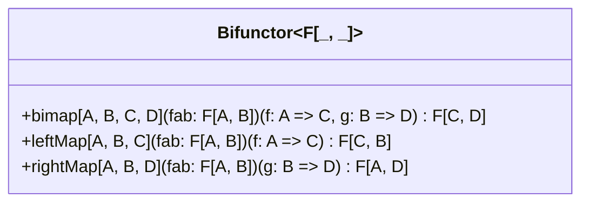



# Bifunctor

**Bifunctor** — это типовой класс, который обобщает [возможность применения функций](../monad/functor.md)
к двум типам, содержащимся в одном контексте. 
Он позволяет трансформировать оба типа независимо, сохраняя при этом структуру контейнера. 
В Scala бифунктор определяется для типов с двумя параметрами, таких как `Either[A, B]`, `Tuple2[A, B]` или пользовательские типы.

Основная операция бифунктора — `bimap`, которая принимает две функции: 
одну для преобразования первого типа, другую — для второго. 
Например, для `Either[A, B]` можно преобразовать как левую часть (`A`), так и правую (`B`).

**Где применяется Bifunctor?**

- **Типы с двумя параметрами**:
    - `Either[A, B]`: Обработка ошибок (левый тип) и успешных значений (правый тип).
    - `Tuple2[A, B]`: Преобразование обоих элементов кортежа.
    - Пользовательские типы, например, `Result[Error, Value]`.
- **Обработка ошибок**:
    - Преобразование типа ошибки и успешного результата в `Either`.
- **Функциональные библиотеки**:
    - Используется в библиотеках Cats и Scalaz для работы с типами, имеющими два параметра.
- **Парсинг и валидация**:
    - Преобразование ошибок и данных в результатах парсинга.
- **Композиция данных**:
    - Работа с парами значений или сложными структурами, где нужно трансформировать оба типа.

**Краткие примеры**

- **`Either[A, B]`**:
    - Преобразование ошибки типа `String` в `CustomError`.
    - Преобразование успешного результата типа `Int` в `String`.
- **`Tuple2[A, B]`**:
    - Преобразование обоих элементов кортежа: `(Int, String)` в `(String, Boolean)`.
- **Пользовательский тип**:
    - Для типа `Result[Error, Value]` можно преобразовать ошибку и значение, например, из `Result[String, Int]` в `Result[CustomError, String]`.
- **Парсинг JSON**:
    - Преобразование ошибки парсинга и результата в другой формат.

## Формальное определение

Типовой класс `Bifunctor` представляет собой структуру, которая:

- Работает с типами, имеющими два параметра, например `F[_, _]`.
- Предоставляет операцию `bimap`, которая принимает:
    - Функцию для преобразования первого типа: `A => C`.
    - Функцию для преобразования второго типа: `B => D`.
    - Возвращает новый контейнер с преобразованными типами: `F[C, D]`.

### Законы Bifunctor:

Бифунктор должен удовлетворять следующим законам (аналогично законам функтора):

- **Закон идентичности**: `bimap(fab)(identity, identity) == fab`.
  Применение функций `identity` к обоим типам не изменяет контейнер.
- **Закон композиции**:
  `bimap(bimap(fab)(f1, g1))(f2, g2) == bimap(fab)(f2.compose(f1), g2.compose(g1))`.
  Последовательное применение `bimap` эквивалентно одному применению с композицией функций.

## Определение в виде кода на Scala

```dotty
trait Bifunctor[F[_, _]]:
  def bimap[A, B, C, D](fab: F[A, B])(f: A => C, g: B => D): F[C, D]

  def leftMap[A, B, C](fab: F[A, B])(f: A => C): F[C, B] =
    bimap(fab)(f, identity)

  def rightMap[A, B, D](fab: F[A, B])(g: B => D): F[A, D] =
    bimap(fab)(identity, g)

  def umap[A, B](faa: F[A, A])(f: A => B): F[B, B] =
    bimap(faa)(f, f)
```

### Either

```dotty
given Bifunctor[Either] with
  override def bimap[A, B, C, D](fab: Either[A, B])(f: A => C, g: B => D): Either[C, D] =
    fab match
      case Right(value) => Right(g(value))
      case Left(value)  => Left(f(value))
```

### Writer - функциональный журнал

```dotty
case class Writer[W, A](run: () => (W, A))

given Bifunctor[Writer] with
  override def bimap[A, B, C, D](fab: Writer[A, B])(f: A => C, g: B => D): Writer[C, D] =
    Writer { () =>
      val (a, b) = fab.run()
      (f(a), g(b))
    }
```

### Связь с другими типовыми классами

Бифунктор (`Bifunctor`) тесно связан с [функтором](../monad/functor.md) (`Functor`), 
так как он расширяет идею функтора на типы с двумя параметрами. 
В то время как функтор работает с типами, имеющими один параметр (например, `F[A]`), 
бифунктор работает с типами, имеющими два параметра (например, `F[A, B]`).

Предположим, у нас есть тип `Either[A, B]` и бифунктор для него:

- `leftFunctor` позволяет работать с левой частью (`A`), например, преобразовывать `Either[String, Int]` в `Either[Int, Int]`.
- `rightFunctor` позволяет работать с правой частью (`B`), например, преобразовывать `Either[String, Int]` в `Either[String, String]`.
- `uFunctor` позволяет работать с обоими частями одновременно, если они одного типа, 
  например, преобразовывать `Either[Int, Int]` в `Either[String, String]`.

#### **`leftFunctor`**

```dotty
def leftFunctor[R]: Functor[[X] =>> F[X, R]] =
  new Functor[[X] =>> F[X, R]]:
    extension [A](fax: F[A, R]) override def map[B](f: A => B): F[B, R] = leftMap(fax)(f)
```

- **Цель**: Создать функтор для первого параметра типа `F[A, R]`, где второй параметр (`R`) фиксирован.
- **Как это работает**:
    - `leftFunctor` возвращает функтор для типа `[X] =>> F[X, R]`, где `R` фиксирован.
    - Метод `map` применяет функцию `f: A => B` только к первому параметру (`A`), используя метод `leftMap` бифунктора.
- **Пример**: Если `F` — это `Either[A, R]`, то `leftFunctor` позволяет применять функцию к левой части (`A`), оставляя правую часть (`R`) неизменной.

#### **`rightFunctor`**

```dotty
  def rightFunctor[L]: Functor[[X] =>> F[L, X]] =
    new Functor[[X] =>> F[L, X]]:
      extension [A](fax: F[L, A]) override def map[B](f: A => B): F[L, B] = rightMap(fax)(f)
```

- **Цель**: Создать функтор для второго параметра типа `F[L, A]`, где первый параметр (`L`) фиксирован.
- **Как это работает**:
    - `rightFunctor` возвращает функтор для типа `[X] =>> F[L, X]`, где `L` фиксирован.
    - Метод `map` применяет функцию `f: A => B` только ко второму параметру (`A`), используя метод `rightMap` бифунктора.
- **Пример**: Если `F` — это `Either[L, A]`, то `rightFunctor` позволяет применять функцию к правой части (`A`), оставляя левую часть (`L`) неизменной.

#### **`uFunctor`**

```dotty
  def uFunctor: Functor[[X] =>> F[X, X]] =
    new Functor[[X] =>> F[X, X]]:
      extension [A](fax: F[A, A]) override def map[B](f: A => B): F[B, B] = umap(fax)(f)
```

- **Цель**: Создать функтор для типа `F[X, X]`, где оба параметра имеют одинаковый тип.
- **Как это работает**:
    - `uFunctor` возвращает функтор для типа `[X] =>> F[X, X]`.
    - Метод `map` применяет функцию `f: A => B` к обоим параметрам одновременно, используя метод `umap` бифунктора.
- **Пример**: Если `F` — это `Tuple2[A, A]`, то `uFunctor` позволяет преобразовать оба элемента кортежа одновременно.

## Схема



## Реализация в библиотеках

### Реализация в ScalaZ

```dotty
import scalaz.*
import Scalaz.*

Bifunctor[Tuple2].bimap(("asdf", 1))(_.toUpperCase, _ + 1)                               
// ("ASDF",2)
("asdf", 1).bimap(_.length, _ + 1)                                                       
// (4,2)

// Для суммированных типов, какая функция применяется, зависит от того, какое значение присутствует:
Bifunctor[Either].bimap(Left("asdf") : Either[String,Int])(_.toUpperCase, _ + 1)         
// Left("ASDF")
Bifunctor[Either].bimap(Right(1): Either[String,Int])(_.toUpperCase, _ + 1)              
// Right(2)

//
// leftMap / rightMap
//

// Существуют функции для отображения только «правого» или «левого» значения:
Bifunctor[Tuple2].leftMap(("asdf", 1))(_.substring(1))                                   
// ("sdf" -> 1)
Bifunctor[Tuple2].rightMap(("asdf", 1))(_ + 3)                                           
// ("asdf" -> 4)

// Они идут с таким синтаксисом
1.success[String].rightMap(_ + 10)                                                       
// Success(11)
("a", 1).rightMap(_ + 10)                                                                
// ("a" -> 11)

// и еще более причудливым
1.success[String] :-> (_ + 1)                                                            
// Success(2)

// С левой стороны вывод типа может быть плохим, так что мы вынуждены явно указывать типы в функции, которую мы оставилиMap.
val strlen: String => Int = _.length
(strlen <-: ("asdf", 1))                                                                 
// (4 -> 1)
(((_:String).length) <-: ("asdf", 1))                                                    
// (4 -> 1)

strlen <-: ("asdf", 1) :-> (_ + 1)                                                       
// (4 -> 2)

//
// Functor extraction
//

// Мы можем получить либо левый, либо правый базовые функторы.
val leftF = Bifunctor[\/].leftFunctor[String]
leftF.map("asdf".right[Int])(_ + 1)                                                      
// "asdf".right[Int]
leftF.map(1.left)(_ + 1)                                                                 
// 2.left[String]

val rightF = Bifunctor[\/].rightFunctor[String]
rightF.map("asdf".left[Int])(_ + 1)                                                      
// "asdf".left[Int]
rightF.map(1.right)(_ + 1)                                                               
// 2.right[String]

//
// Ufunctor
//

// Если у нас есть F[A,A] (вместо F[A,B] с разными A и B) мы можем извлечь "унифицированный функтор", который является функтором,
Bifunctor[Tuple2].uFunctor.map((2,3))(_ * 3)                                             
// (6 -> 9)

// или пропустить шаг извлечения единого функтора методом umap.
Bifunctor[Tuple2].umap((2,3))(_ * 3)                                                     
// (6 -> 9)
```

---

**Ссылки:**

- Category Theory for Programmers - Bartosz Milewski:
    - [Теория категорий для программистов](https://henrychern.wordpress.com/2022/09/15/%d1%82%d0%b5%d0%be%d1%80%d0%b8%d1%8f-%d0%ba%d0%b0%d1%82%d0%b5%d0%b3%d0%be%d1%80%d0%b8%d0%b9-%d0%b4%d0%bb%d1%8f-%d0%bf%d1%80%d0%be%d0%b3%d1%80%d0%b0%d0%bc%d0%bc%d0%b8%d1%81%d1%82%d0%be%d0%b2/)
    - [Category Theory for Programmers, Functoriality](https://bartoszmilewski.com/2015/02/03/functoriality/)
- [Herding Cats](http://eed3si9n.com/herding-cats/datatype-generic-programming.html)
- [Scalaz API](https://javadoc.io/doc/org.scalaz/scalaz-core_3/7.3.6/scalaz/Bifunctor.html)
- The Dao of Functional Programming - Bartosz Milewski:
    - [Дао функционального программирования, глава 6.1](https://henrychern.wordpress.com/2022/09/23/milewski-%d0%b4%d0%b0%d0%be-%d1%84%d1%83%d0%bd%d0%ba%d1%86%d0%b8%d0%be%d0%bd%d0%b0%d0%bb%d1%8c%d0%bd%d0%be%d0%b3%d0%be-%d0%bf%d1%80%d0%be%d0%b3%d1%80%d0%b0%d0%bc%d0%bc%d0%b8%d1%80%d0%be%d0%b2%d0%b0/)
    - [The Dao of Functional Programming, 6.1](https://github.com/BartoszMilewski/Publications/blob/master/TheDaoOfFP/DaoFP.pdf)
 